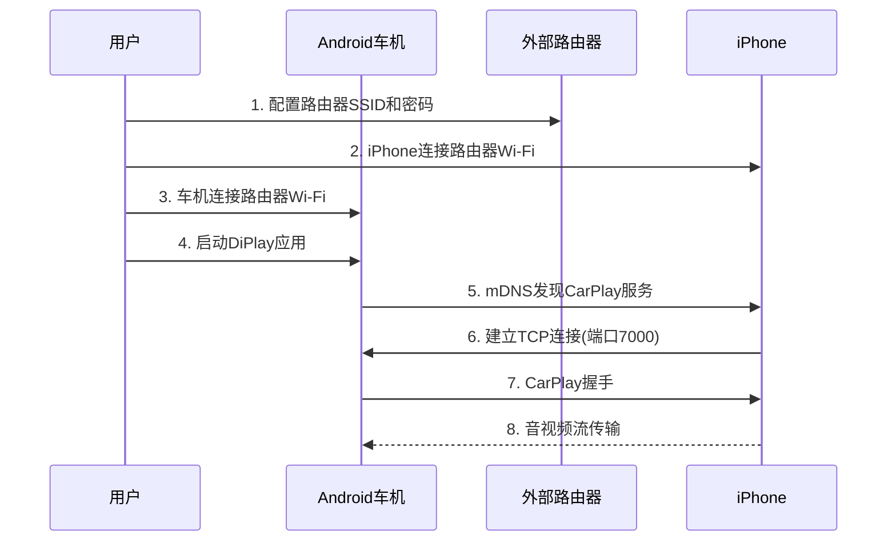

# DiPlay Android 4.2.2 (API 17) 深度代码迁移指南

> **作者**: Shiro  
> **生成日期**: 2026-10-08  
> **基于 DiPlay 版本**: v0.2.14 (commit: latest)  
> **目标 Android 版本**: 4.2.2 (API 17, Jelly Bean MR1)

---

## 目录

1. [迁移总览](#迁移总览)
2. [构建系统迁移](#构建系统迁移)
3. [AndroidManifest.xml 迁移](#androidmanifestxml-迁移)
4. [核心 API 兼容性迁移](#核心-api-兼容性迁移)
5. [USB 子系统迁移](#usb-子系统迁移)
6. [Wi-Fi Direct 子系统迁移](#wi-fi-direct-子系统迁移)
7. [蓝牙子系统迁移](#蓝牙子系统迁移)
8. [网络层迁移](#网络层迁移)
9. [UI 层迁移](#ui-层迁移)
10. [权限系统迁移](#权限系统迁移)
11. [存储访问迁移](#存储访问迁移)
12. [完整迁移检查清单](#完整迁移检查清单)

---

## 迁移总览

### 1.1 API 差距分析

| 维度 | 当前版本 (API 28) | 目标版本 (API 17) | 差距 |
|------|------------------|------------------|------|
| **API 级别** | 28 (Android 9.0) | 17 (Android 4.2.2) | **11 个版本** |
| **发布年份** | 2018 | 2012 | 6 年 |
| **运行时权限** | ✅ 支持 | ❌ 不支持 | 需完全重写 |
| **Wi-Fi Direct 高级 API** | ✅ 支持 | ❌ 不支持 | 需降级处理 |
| **USB 异步 API** | ✅ 支持 | ⚠️ 基础支持 | 需兼容性层 |
| **Jetpack Compose** | ✅ 支持 | ❌ 不支持 | 需完全重写 UI |
| **Kotlin 协程** | ✅ 支持 | ⚠️ 需 desugaring | 需配置 |
| **java.time** | ✅ 支持 | ❌ 不支持 | 需替代方案 |

### 1.2 迁移工作量评估

| 模块 | 文件数 | 预估工作量 | 难度 |
|------|--------|-----------|------|
| 构建系统 | 5 | 2 天 | ⭐⭐ |
| AndroidManifest | 5 | 1 天 | ⭐⭐ |
| USB 子系统 | 8 | 10-15 天 | ⭐⭐⭐⭐⭐ |
| Wi-Fi Direct | 6 | 8-12 天 | ⭐⭐⭐⭐ |
| 蓝牙子系统 | 4 | 5-7 天 | ⭐⭐⭐ |
| 网络层 | 12 | 7-10 天 | ⭐⭐⭐⭐ |
| UI 层 (Compose→XML) | 20+ | 15-20 天 | ⭐⭐⭐⭐⭐ |
| 权限系统 | 10 | 3-5 天 | ⭐⭐⭐ |
| 存储访问 | 6 | 2-3 天 | ⭐⭐ |
| **总计** | **76+** | **53-75 天** | **极高** |

---

## 构建系统迁移

### 2.1 根 build.gradle.kts

**文件**: `/workspace/DiPlay/build.gradle.kts`

**当前配置**:
```kotlin
plugins {
    alias(libs.plugins.android.application) apply false
    alias(libs.plugins.kotlin.android) apply false
    alias(libs.plugins.kotlin.compose) apply false
}
```

**问题**: 
- AGP 9.3.0 要求 minSdk >= 21
- Kotlin 2.2.10 的某些特性需要高版本 API

**迁移方案**:

```kotlin
// 修改后的 build.gradle.kts
plugins {
    // 降级 AGP 到支持 API 17 的版本
    id("com.android.application") version "7.4.2" apply false
    id("com.android.library") version "7.4.2" apply false
    // Kotlin 1.9.x 是最后一个良好支持 API 17 的版本
    id("org.jetbrains.kotlin.android") version "1.9.22" apply false
}

// 全局配置
allprojects {
    tasks.withType<org.jetbrains.kotlin.gradle.tasks.KotlinCompile>().configureEach {
        kotlinOptions {
            // 使用 Java 8 字节码以支持 desugaring
            jvmTarget = "1.8"
            // 禁用需要高版本 API 的优化
            freeCompilerArgs += listOf(
                "-Xjvm-default=all",
                "-XXLanguage:-NewInference"
            )
        }
    }
}
```

### 2.2 gradle/libs.versions.toml

**文件**: `/workspace/DiPlay/gradle/libs.versions.toml`

**当前配置**:
```toml
[versions]
agp = "9.3.0"
kotlin = "2.2.10"
composeBom = "2026.02.01"
```

**迁移方案**:

```toml
[versions]
# 降级到支持 API 17 的版本
agp = "7.4.2"
kotlin = "1.9.22"
# Compose 不支持 API 17，需要移除
# composeBom = "2026.02.01"  # 删除

# 添加兼容版本
androidxCore = "1.9.0"  # 最后支持 API 14 的版本
androidxAppcompat = "1.6.1"
desugarJdk = "2.0.4"  # Core library desugaring

[libraries]
# 移除所有 Compose 相关依赖
# 添加 desugaring 支持
desugar-jdk-libs = { group = "com.android.tools", name = "desugar_jdk_libs", version.ref = "desugarJdk" }
```

### 2.3 mobile/build.gradle.kts

**文件**: `/workspace/DiPlay/mobile/build.gradle.kts`

**当前配置**:
```kotlin
android {
    namespace = "com.shihab.diplay"
    compileSdk = 37
    
    defaultConfig {
        applicationId = "com.shihab.diplay"
        minSdk = 28
        targetSdk = 37
        versionCode = 21
        versionName = "0.2.14"
    }
    
    compileOptions {
        sourceCompatibility = JavaVersion.VERSION_11
        targetCompatibility = JavaVersion.VERSION_11
    }
}
```

**迁移方案**:

```kotlin
android {
    namespace = "com.shihab.diplay"
    compileSdk = 36  // 见 2.6：本机 android-33/34/35 jar 为裁剪版，需 36 + aapt2 覆盖；标准环境 34 即可
    
    defaultConfig {
        applicationId = "com.shihab.diplay"
        minSdk = 17  // 目标: API 17
        targetSdk = 28  // 保持 targetSdk 28 以获得更好的行为
        multiDexEnabled = true  // desugaring + minSdk<21 强制要求，见 2.6
        versionCode = 22
        versionName = "0.2.14-api17"
    }
    
    compileOptions {
        // 使用 Java 8 以支持 desugaring
        sourceCompatibility = JavaVersion.VERSION_1_8
        targetCompatibility = JavaVersion.VERSION_1_8
        // 启用 core library desugaring
        isCoreLibraryDesugaringEnabled = true
    }
    
    buildFeatures {
        // 禁用 Compose
        // compose = true  // 删除
        // 启用 View 系统
        viewBinding = true
    }
}

dependencies {
    // Core library desugaring - 必须
    coreLibraryDesugaring("com.android.tools:desugar_jdk_libs:2.0.4")
    
    // AndroidX 兼容库
    implementation("androidx.core:core-ktx:1.9.0")
    implementation("androidx.appcompat:appcompat:1.6.1")
    implementation("androidx.constraintlayout:constraintlayout:2.1.4")
    implementation("androidx.lifecycle:lifecycle-runtime-ktx:2.6.2")
    
    // 移除所有 Compose 依赖
    // implementation(platform("androidx.compose:compose-bom:2026.02.01"))
    // implementation("androidx.compose.ui:ui")
    // implementation("androidx.compose.material3:material3")
    
    // 协程支持 (需要 desugaring)
    implementation("org.jetbrains.kotlinx:kotlinx-coroutines-android:1.7.3")
}
```

### 2.4 shared/build.gradle

**文件**: `/workspace/DiPlay/shared/build.gradle`

**当前配置**:
```gradle
android {
    compileSdk = 37
    
    defaultConfig {
        minSdk = 28
        targetSdk = 37
    }
    
    externalNativeBuild {
        ndkBuild {
            arguments "APP_PLATFORM=android-28"
        }
    }
}
```

**迁移方案**:

```gradle
android {
    compileSdk = 36  // 见 2.6；标准环境 34 即可
    
    defaultConfig {
        minSdk = 17
        targetSdk = 28
        multiDexEnabled true  // desugaring + minSdk<21 强制要求，见 2.6
    }
    
    compileOptions {
        sourceCompatibility JavaVersion.VERSION_1_8
        targetCompatibility JavaVersion.VERSION_1_8
        coreLibraryDesugaringEnabled true
    }
    
    externalNativeBuild {
        ndkBuild {
            // 降低 NDK 平台版本
            arguments "APP_PLATFORM=android-17"
            // 使用 STL 兼容版本
            arguments "APP_STL=c++_shared"
        }
    }
}

dependencies {
    coreLibraryDesugaring "com.android.tools:desugar_jdk_libs:2.0.4"
}
```

### 2.5 common/build.gradle.kts

**文件**: `/workspace/DiPlay/common/build.gradle.kts`

**迁移方案**:

```kotlin
android {
    compileSdk = 36  // 见 2.6；标准环境 34 即可
    
    defaultConfig {
        minSdk = 17
        targetSdk = 28
        multiDexEnabled = true  // desugaring + minSdk<21 强制要求，见 2.6
    }
    
    compileOptions {
        sourceCompatibility = JavaVersion.VERSION_1_8
        targetCompatibility = JavaVersion.VERSION_1_8
        isCoreLibraryDesugaringEnabled = true
    }
    
    buildFeatures {
        viewBinding = true
        // 禁用 Compose
    }
}

dependencies {
    coreLibraryDesugaring("com.android.tools:desugar_jdk_libs:2.0.4")
    implementation("androidx.core:core-ktx:1.9.0")
    implementation("androidx.appcompat:appcompat:1.6.1")
}
```

### 2.6 构建实测踩坑（原文档遗漏，落地时逐个撞上）

以下问题全部在实际构建中验证并修复，按出现顺序记录：

1. **Gradle wrapper 版本与镜像**：AGP 7.4.2 兼容 Gradle 7.5–7.6.x，但项目 `settings.gradle.kts`
   使用的 `foojay-resolver` 0.5.0 **要求 Gradle 7.6+**（7.5 在配置阶段直接失败）。
   最终 wrapper 定为 `gradle-7.6.4-bin.zip`，并使用腾讯云镜像加速下载：

   ```properties
   # gradle/wrapper/gradle-wrapper.properties
   distributionUrl=https\://mirrors.cloud.tencent.com/gradle/gradle-7.6.4-bin.zip
   ```

2. **desugaring 强制 legacy multidex**：`isCoreLibraryDesugaringEnabled = true` 且 minSdk < 21 时，
   AGP 7.4.2 配置阶段报错 "In order to use core library desugaring, please enable multidex"。
   修复需要四件事，缺一不可：
   - 所有启用 desugaring 的模块（mobile/automotive/common/shared）`defaultConfig` 加 `multiDexEnabled = true`；
   - 依赖 `androidx.multidex:multidex:2.0.1`（common 用 `api()` 暴露给壳应用）；
   - Application 类继承 `MultiDexApplication`（本项目新建 `DiPlayApplication`）；
   - mobile/automotive 的 Manifest `<application android:name=...>` 注册该类。

3. **AGP 7.4.2 没有 `assets.directories`**：该属性是 AGP 9 API，7.4.2 的
   `AndroidSourceDirectorySet` 只有 `srcDirs`。构建脚本里遍历 assets 目录的代码需改用 `source.assets.srcDirs`。

4. **AGP 7.4.2 内置 D8/R8 无法解析 Kotlin 1.9 元数据**：dexBuilder 阶段报
   `com.android.tools.r8.kotlin.H`。官方支持方案是在根构建脚本用 buildscript classpath 前置新版 R8 覆盖：

   ```kotlin
   // build.gradle.kts 顶部
   buildscript {
       dependencies { classpath("com.android.tools:r8:8.2.42") }
   }
   ```

5. **compileSdk 与 aapt2**：文档建议 compileSdk 34，但本机 android-33/34/35 平台 jar 为裁剪版
   （缺 `TetheringManager` 等类），实际使用 **compileSdk 36**；而 AGP 7.4.2 自带的旧版 aapt2
   无法解析 android-36 的资源表，需用本机 build-tools 覆盖：

   ```properties
   # gradle.properties
   android.aapt2FromMavenOverride=/path/to/sdk/build-tools/36.0.0/aapt2
   ```

6. **androidx.car.app / media3 的 minSdk 冲突**：这些库清单声明 minSdk 21/23，与 minSdk 17 合并时
   manifest merger 报错。在应用 Manifest 加 `tools:overrideLibrary` 强行通过，低版本设备靠运行时
   版本分支保护跳过相关功能（car.app 仅 AAOS、media3 播放路径需守卫）。

7. **robolectric 版本号**：`4.9.0` 不存在（中央仓库与镜像均 404），正确版本是 **`4.9`**。

---

## AndroidManifest.xml 迁移

### 3.1 common/src/main/AndroidManifest.xml

**文件**: `/workspace/DiPlay/common/src/main/AndroidManifest.xml`

**当前配置** (问题行):
```xml
<!-- 行 4-18: 权限声明 -->
<uses-permission android:name="android.permission.POST_NOTIFICATIONS"/>
<queries>
    <intent>...</intent>
</queries>

<!-- 行 49-68: Service 声明 -->
<service
    android:name=".DiPlaySessionService"
    android:foregroundServiceType="connectedDevice|mediaPlayback"
    ... />
```

**问题分析**:
1. `POST_NOTIFICATIONS` - API 33+ 运行时权限
2. `<queries>` - API 30+ 包可见性
3. `foregroundServiceType` - API 29+

**迁移方案**:

```xml
<?xml version="1.0" encoding="utf-8"?>
<manifest xmlns:android="http://schemas.android.com/apk/res/android"
    xmlns:tools="http://schemas.android.com/tools">
    
    <!-- 基础权限 - API 17 支持 -->
    <uses-permission android:name="android.permission.INTERNET"/>
    <uses-permission android:name="android.permission.ACCESS_NETWORK_STATE"/>
    <uses-permission android:name="android.permission.ACCESS_WIFI_STATE"/>
    <uses-permission android:name="android.permission.CHANGE_WIFI_STATE"/>
    <uses-permission android:name="android.permission.BLUETOOTH"/>
    <uses-permission android:name="android.permission.BLUETOOTH_ADMIN"/>
    <uses-permission android:name="android.permission.ACCESS_FINE_LOCATION"/>
    <uses-permission android:name="android.permission.ACCESS_COARSE_LOCATION"/>
    <uses-permission android:name="android.permission.VIBRATE"/>
    <uses-permission android:name="android.permission.WAKE_LOCK"/>
    <uses-permission android:name="android.permission.FOREGROUND_SERVICE"/>
    
    <!-- USB Host 权限 - API 12+ -->
    <uses-permission android:name="android.permission.USB_PERMISSION"
        tools:ignore="PermissionImpliesUnsupportedHardware"/>
    
    <uses-feature android:name="android.hardware.usb.host" android:required="false"/>
    
    <!-- 移除 POST_NOTIFICATIONS (API 33+) -->
    <!-- <uses-permission android:name="android.permission.POST_NOTIFICATIONS"/> -->
    
    <!-- 移除 <queries> (API 30+) -->
    <!-- 如果需要查询其他应用，使用 PackageManager 的旧 API -->
    
    <application
        android:allowBackup="true"
        android:icon="@mipmap/ic_launcher"
        android:label="@string/app_name"
        android:theme="@style/Theme.DiPlay"
        android:supportsRtl="true"
        <!-- 移除 dataExtractionRules (API 31+) -->
        <!-- android:dataExtractionRules="@xml/data_extraction_rules" -->
        <!-- 移除 localeConfig (API 33+) -->
        <!-- android:localeConfig="@xml/locales_config" -->
        >
        
        <!-- Service 声明 - 移除 foregroundServiceType -->
        <service
            android:name=".DiPlaySessionService"
            android:enabled="true"
            android:exported="false"
            <!-- 移除 foregroundServiceType (API 29+) -->
            <!-- android:foregroundServiceType="connectedDevice|mediaPlayback" -->
            />
        
        <!-- Activity 声明 -->
        <activity
            android:name=".CarPlayHostActivity"
            android:exported="true"
            android:launchMode="singleTop"
            android:configChanges="orientation|screenSize|keyboardHidden">
            
            <intent-filter>
                <action android:name="android.hardware.usb.action.USB_DEVICE_ATTACHED"/>
            </intent-filter>
            
            <meta-data
                android:name="android.hardware.usb.action.USB_DEVICE_FILTER"
                android:resource="@xml/usb_device_filter"/>
        </activity>
        
    </application>
</manifest>
```

### 3.2 shared/src/main/AndroidManifest.xml

**文件**: `/workspace/DiPlay/shared/src/main/AndroidManifest.xml`

**问题**: 使用 `usesPermissionFlags` (API 31+)

**迁移方案**:

```xml
<?xml version="1.0" encoding="utf-8"?>
<manifest xmlns:android="http://schemas.android.com/apk/res/android">
    
    <!-- 移除 usesPermissionFlags (API 31+) -->
    <!-- <uses-permission android:name="android.permission.ACCESS_FINE_LOCATION" -->
    <!--     android:usesPermissionFlags="neverForLocation"/> -->
    
    <!-- 使用标准权限声明 -->
    <uses-permission android:name="android.permission.ACCESS_FINE_LOCATION"/>
    <uses-permission android:name="android.permission.ACCESS_COARSE_LOCATION"/>
    
    <!-- 移除 <queries> 标签 -->
    <!-- 如果需要检查包是否存在，使用 PackageManager.getPackageInfo() -->
    
</manifest>
```

### 3.3 mobile/src/main/AndroidManifest.xml

**文件**: `/workspace/DiPlay/mobile/src/main/AndroidManifest.xml`

**问题**: 使用 `dataExtractionRules`, `fullBackupContent`, `localeConfig`

**迁移方案**:

```xml
<?xml version="1.0" encoding="utf-8"?>
<manifest xmlns:android="http://schemas.android.com/apk/res/android"
    xmlns:tools="http://schemas.android.com/tools">
    
    <application
        android:allowBackup="true"
        android:icon="@mipmap/ic_launcher"
        android:label="@string/app_name"
        android:theme="@style/Theme.DiPlay"
        <!-- 移除 API 31+ 属性 -->
        <!-- android:dataExtractionRules="@xml/data_extraction_rules" -->
        <!-- android:fullBackupContent="@xml/backup_rules" -->
        <!-- android:localeConfig="@xml/locales_config" -->
        >
        
        <!-- 使用旧版备份规则 -->
        <meta-data
            android:name="com.google.android.backup.api_key"
            android:value="YOUR_BACKUP_KEY"/>
        
    </application>
</manifest>
```

---

## 核心 API 兼容性迁移

### 4.1 版本检查工具类

**创建文件**: `shared/src/main/java/com/shilapi/xcertplay/compat/ApiLevel.kt`

```kotlin
package com.shilapi.xcertplay.compat

import android.os.Build

/**
 * API 级别兼容性检查工具
 * 用于统一管理不同 Android 版本的 API 可用性
 * 
 * @author Shiro
 * @since 2026-10-08
 */
object ApiLevel {
    // API 级别常量
    const val JELLY_BEAN = 17          // Android 4.2
    const val JELLY_BEAN_MR1 = 17      // Android 4.2
    const val JELLY_BEAN_MR2 = 18      // Android 4.3
    const val KITKAT = 19              // Android 4.4
    const val KITKAT_WATCH = 20        // Android 4.4W
    const val LOLLIPOP = 21            // Android 5.0
    const val LOLLIPOP_MR1 = 22        // Android 5.1
    const val MARSHMALLOW = 23         // Android 6.0
    const val NOUGAT = 24              // Android 7.0
    const val NOUGAT_MR1 = 25          // Android 7.1
    const val OREO = 26                // Android 8.0
    const val OREO_MR1 = 27            // Android 8.1
    const val PIE = 28                 // Android 9.0
    const val Q = 29                   // Android 10
    const val R = 30                   // Android 11
    const val S = 31                   // Android 12
    const val S_V2 = 32                // Android 12L
    const val TIRAMISU = 33            // Android 13
    const val UPSIDE_DOWN_CAKE = 34    // Android 14
    
    /**
     * 检查当前 API 级别是否至少为指定版本
     */
    @JvmStatic
    fun isAtLeast(level: Int): Boolean = Build.VERSION.SDK_INT >= level
    
    /**
     * 检查当前 API 级别是否低于指定版本
     */
    @JvmStatic
    fun isBelow(level: Int): Boolean = Build.VERSION.SDK_INT < level
    
    /**
     * 检查当前 API 级别是否在指定范围内
     */
    @JvmStatic
    fun isInRange(minLevel: Int, maxLevel: Int): Boolean = 
        Build.VERSION.SDK_INT in minLevel..maxLevel
    
    /**
     * 获取当前 API 级别
     */
    @JvmStatic
    fun current(): Int = Build.VERSION.SDK_INT
    
    /**
     * 获取 Android 版本名称
     */
    @JvmStatic
    fun versionName(): String = when (current()) {
        JELLY_BEAN, JELLY_BEAN_MR1 -> "4.2 Jelly Bean"
        JELLY_BEAN_MR2 -> "4.3 Jelly Bean"
        KITKAT -> "4.4 KitKat"
        KITKAT_WATCH -> "4.4W KitKat"
        LOLLIPOP -> "5.0 Lollipop"
        LOLLIPOP_MR1 -> "5.1 Lollipop"
        MARSHMALLOW -> "6.0 Marshmallow"
        NOUGAT -> "7.0 Nougat"
        NOUGAT_MR1 -> "7.1 Nougat"
        OREO -> "8.0 Oreo"
        OREO_MR1 -> "8.1 Oreo"
        PIE -> "9.0 Pie"
        Q -> "10"
        R -> "11"
        S -> "12"
        S_V2 -> "12L"
        TIRAMISU -> "13"
        UPSIDE_DOWN_CAKE -> "14"
        else -> "Unknown"
    }
}
```

### 4.2 java.time 替代方案

**创建文件**: `shared/src/main/java/com/shilapi/xcertplay/compat/TimeCompat.kt`

```kotlin
package com.shilapi.xcertplay.compat

import java.text.SimpleDateFormat
import java.util.Date
import java.util.Locale
import java.util.TimeZone
import java.util.concurrent.TimeUnit

/**
 * java.time API 的兼容层
 * 用于替代 API 26+ 的 java.time 包
 * 
 * @author Shiro
 * @since 2026-10-08
 */
object TimeCompat {
    
    /**
     * 获取当前时间戳（毫秒）
     */
    @JvmStatic
    fun currentTimeMillis(): Long = System.currentTimeMillis()
    
    /**
     * 获取当前时间戳（秒）
     */
    @JvmStatic
    fun currentTimeSeconds(): Long = System.currentTimeMillis() / 1000
    
    /**
     * 获取当前纳秒时间
     */
    @JvmStatic
    fun currentTimeNanos(): Long = System.nanoTime()
    
    /**
     * 格式化时间戳
     */
    @JvmStatic
    fun formatTimestamp(
        millis: Long, 
        pattern: String = "yyyy-MM-dd HH:mm:ss",
        locale: Locale = Locale.getDefault()
    ): String {
        val sdf = SimpleDateFormat(pattern, locale)
        return sdf.format(Date(millis))
    }
    
    /**
     * 格式化时间戳（带时区）
     */
    @JvmStatic
    fun formatTimestampWithZone(
        millis: Long,
        pattern: String = "yyyy-MM-dd HH:mm:ss",
        timeZone: TimeZone = TimeZone.getDefault(),
        locale: Locale = Locale.getDefault()
    ): String {
        val sdf = SimpleDateFormat(pattern, locale)
        sdf.timeZone = timeZone
        return sdf.format(Date(millis))
    }
    
    /**
     * 解析时间字符串
     */
    @JvmStatic
    fun parseTimestamp(
        timeString: String,
        pattern: String = "yyyy-MM-dd HH:mm:ss",
        locale: Locale = Locale.getDefault()
    ): Long {
        val sdf = SimpleDateFormat(pattern, locale)
        return sdf.parse(timeString)?.time ?: 0L
    }
    
    /**
     * 时间单位转换
     */
    @JvmStatic
    fun convertTime(value: Long, fromUnit: TimeUnit, toUnit: TimeUnit): Long {
        return toUnit.convert(value, fromUnit)
    }
    
    /**
     * 获取 UTC 时间
     */
    @JvmStatic
    fun utcTime(millis: Long = currentTimeMillis()): String {
        return formatTimestampWithZone(
            millis,
            timeZone = TimeZone.getTimeZone("UTC")
        )
    }
}

/**
 * 持续时间兼容类
 * 替代 java.time.Duration
 */
class DurationCompat private constructor(private val millis: Long) {
    
    companion object {
        @JvmStatic
        fun ofMillis(millis: Long): DurationCompat = DurationCompat(millis)
        
        @JvmStatic
        fun ofSeconds(seconds: Long): DurationCompat = 
            DurationCompat(TimeUnit.SECONDS.toMillis(seconds))
        
        @JvmStatic
        fun ofMinutes(minutes: Long): DurationCompat = 
            DurationCompat(TimeUnit.MINUTES.toMillis(minutes))
        
        @JvmStatic
        fun ofHours(hours: Long): DurationCompat = 
            DurationCompat(TimeUnit.HOURS.toMillis(hours))
        
        @JvmStatic
        fun ofDays(days: Long): DurationCompat = 
            DurationCompat(TimeUnit.DAYS.toMillis(days))
        
        @JvmStatic
        fun between(startMillis: Long, endMillis: Long): DurationCompat = 
            DurationCompat(endMillis - startMillis)
    }
    
    fun toMillis(): Long = millis
    fun toSeconds(): Long = TimeUnit.MILLISECONDS.toSeconds(millis)
    fun toMinutes(): Long = TimeUnit.MILLISECONDS.toMinutes(millis)
    fun toHours(): Long = TimeUnit.MILLISECONDS.toHours(millis)
    fun toDays(): Long = TimeUnit.MILLISECONDS.toDays(millis)
    
    fun isZero(): Boolean = millis == 0L
    fun isNegative(): Boolean = millis < 0L
    
    operator fun plus(other: DurationCompat): DurationCompat = 
        DurationCompat(this.millis + other.millis)
    
    operator fun minus(other: DurationCompat): DurationCompat = 
        DurationCompat(this.millis - other.millis)
    
    override fun toString(): String = when {
        millis < 1000 -> "${millis}ms"
        millis < 60_000 -> "${toSeconds()}s"
        millis < 3_600_000 -> "${toMinutes()}m"
        else -> "${toHours()}h"
    }
}
```

### 4.3 Optional 替代方案

**创建文件**: `shared/src/main/java/com/shilapi/xcertplay/compat/OptionalCompat.kt`

```kotlin
package com.shilapi.xcertplay.compat

/**
 * java.util.Optional 的兼容实现
 * 用于替代 API 24+ 的 Optional 类
 * 
 * @author Shiro
 * @since 2026-10-08
 */
class OptionalCompat<T> private constructor(private val value: T?) {
    
    companion object {
        /**
         * 创建空 Optional
         */
        @JvmStatic
        fun <T> empty(): OptionalCompat<T> = OptionalCompat(null)
        
        /**
         * 创建包含值的 Optional
         */
        @JvmStatic
        fun <T> of(value: T): OptionalCompat<T> {
            requireNotNull(value) { "Value cannot be null" }
            return OptionalCompat(value)
        }
        
        /**
         * 创建可能为空的 Optional
         */
        @JvmStatic
        fun <T> ofNullable(value: T?): OptionalCompat<T> = OptionalCompat(value)
    }
    
    /**
     * 检查是否有值
     */
    fun isPresent(): Boolean = value != null
    
    /**
     * 检查是否为空
     */
    fun isEmpty(): Boolean = value == null
    
    /**
     * 获取值（如果存在）
     */
    fun get(): T = value ?: throw NoSuchElementException("No value present")
    
    /**
     * 获取值或返回默认值
     */
    fun orElse(other: T): T = value ?: other
    
    /**
     * 获取值或返回 supplier 提供的值
     */
    fun orElseGet(supplier: () -> T): T = value ?: supplier()
    
    /**
     * 获取值或抛出异常
     */
    fun <X : Throwable> orElseThrow(exceptionSupplier: () -> X): T = 
        value ?: throw exceptionSupplier()
    
    /**
     * 如果有值，执行操作
     */
    fun ifPresent(consumer: (T) -> Unit) {
        value?.let(consumer)
    }
    
    /**
     * 如果有值，执行操作；否则执行空操作
     */
    fun ifPresentOrElse(consumer: (T) -> Unit, emptyAction: () -> Unit) {
        if (value != null) consumer(value) else emptyAction()
    }
    
    /**
     * 转换值
     */
    fun <U> map(mapper: (T) -> U): OptionalCompat<U> = 
        if (value != null) OptionalCompat.ofNullable(mapper(value))
        else empty()
    
    /**
     * 扁平转换
     */
    fun <U> flatMap(mapper: (T) -> OptionalCompat<U>): OptionalCompat<U> = 
        if (value != null) mapper(value) else empty()
    
    /**
     * 过滤值
     */
    fun filter(predicate: (T) -> Boolean): OptionalCompat<T> = 
        if (value != null && predicate(value)) this else empty()
    
    override fun equals(other: Any?): Boolean {
        if (this === other) return true
        if (other !is OptionalCompat<*>) return false
        return value == other.value
    }
    
    override fun hashCode(): Int = value?.hashCode() ?: 0
    
    override fun toString(): String = 
        if (value != null) "Optional[$value]" else "Optional.empty"
}

/**
 * Kotlin 扩展函数
 */
fun <T> T?.toOptional(): OptionalCompat<T> = OptionalCompat.ofNullable(this)

fun <T> OptionalCompat<T>.orNull(): T? = if (isPresent) get() else null
```

---

## USB 子系统迁移

### 5.1 NcmUsbBridge.kt 迁移

**文件**: `/workspace/DiPlay/shared/src/main/java/com/shilapi/xcertplay/transport/NcmUsbBridge.kt`

**问题分析**:

| 行号 | API 调用 | 最低 API | 问题描述 |
|------|---------|---------|---------|
| 265 | `connection.requestWait(timeout)` | API 26 | 带超时的 `requestWait(long)` 重载实测自 API 26 引入（经 android-33 `api-versions.xml` 与 `javap` 核实，原文档误标 API 21）。API 17-25 只能调用无参阻塞式 `requestWait()`（API 12+） |
| 50 | `ByteBuffer.allocateDirect()` | API 1 | ✅ 支持 |
| 231 | `UsbRequest.initialize()` | API 12 | ✅ 支持 |
| 71 | `connection.bulkTransfer()` | API 12 | ✅ 支持 |

**迁移方案**:

```kotlin
// 在 NcmUsbBridge.kt 的 readChunk() 方法中
// 原代码 (行 263-270):
/*
val completed = try {
    connection.requestWait(timeoutMillis.coerceAtLeast(1))
} catch (_: TimeoutException) {
    return null
} ?: throw failSession("Android returned no NCM read request")
*/
```

> **原文档方案错误纠正**：原文用 `connection.requestWait(0)` 做"非阻塞轮询"，
> 但 API 17-25 的 `UsbDeviceConnection` **没有带参数的 `requestWait` 重载**，`requestWait(0)`
> 会直接 `NoSuchMethodError`；且分支阈值误用 API 21（LOLLIPOP），实际带超时重载自 **API 26（O）** 起才有。
> 下面是实测可用的方案：API 26+ 保持原调用，API 17-25 用守护线程调用无参阻塞 `requestWait()`，
> 完成的请求经 `LinkedBlockingQueue` 交给读者，用 `poll(timeout)` 模拟超时。

**迁移后代码（字段区）**：

```kotlin
// API 17 迁移：requestWait(timeout) 是 API 26 新增重载。API 26+ 直接调用；
// API 17-25 由守护线程调用阻塞式 requestWait()（API 12+），完成的请求经队列交给读者，
// poll 超时即模拟原有的超时返回 null 行为。
private val legacyRequestWait = Build.VERSION.SDK_INT < Build.VERSION_CODES.O
private val completedRequests = LinkedBlockingQueue<UsbRequest>()
private val waitThreadExited = UsbRequest() // 哨兵：requestWait() 返回 null，连接已错误/关闭
private val requestWaitThread = if (legacyRequestWait) {
    Thread({ drainCompletedRequests() }, "ncm-request-wait").apply {
        isDaemon = true
        start()
    }
} else null

/**
 * API 17 迁移：唯一的 requestWait() 使用者移到守护线程。阻塞式 requestWait()（API 12+）
 * 返回完成的请求后放入队列；返回 null 表示连接错误/关闭，放入哨兵唤醒读者。
 * 线程本身随 JVM 退出（daemon），close() 中 connection.close() 会使 requestWait() 返回。
 */
private fun drainCompletedRequests() {
    while (true) {
        val completed = try {
            connection.requestWait()
        } catch (_: RuntimeException) {
            break
        }
        if (completed == null) break
        completedRequests.offer(completed)
    }
    completedRequests.offer(waitThreadExited)
}
```

**迁移后代码（readChunk 等待段）**：

```kotlin
try {
    val completed = if (legacyRequestWait) {
        // API 17-25：从守护线程队列按剩余时间取完成的请求，poll 超时即模拟原超时行为
        val polled = try {
            completedRequests.poll(timeoutMillis.coerceAtLeast(1), TimeUnit.MILLISECONDS)
        } catch (_: InterruptedException) {
            Thread.currentThread().interrupt()
            null
        }
        // 未取到：请求仍留在队列，下次调用继续；拔线/失败由 USBMUX 权威检测。
        if (polled == null) return null
        polled
    } else {
        // API 26+ 保持原调用：requestWait(long) 超时抛 TimeoutException
        try {
            connection.requestWait(timeoutMillis.coerceAtLeast(1))
        } catch (_: TimeoutException) {
            return null
        } ?: throw failSession("Android returned no NCM read request")
    }
    if (completed === waitThreadExited) throw failSession("Android returned no NCM read request")
    if (completed !== request) throw failSession("Android completed an unexpected NCM request")
    readQueued = false
    val transferred = directReadBuffer.position()
    if (transferred <= 0) return null
    directReadBuffer.flip()
    directReadBuffer.get(readBuffer, 0, transferred)
    return transferred
} catch (error: IphoneUsbException) {
    throw error
} catch (error: RuntimeException) {
    throw failSession("NCM read failed", error)
}
```

> 需要 `import java.util.concurrent.TimeoutException`、`java.util.concurrent.LinkedBlockingQueue`、`java.util.concurrent.TimeUnit`。
> `IphoneUsbHost.kt`（Iap2UsbSession）中同样直接调用 `requestWait(timeoutMillis)` 的位置，需按同一 `SDK_INT < O` 分支处理。

### 5.2 UsbReadQueuePolicy.kt 迁移

**文件**: `/workspace/DiPlay/shared/src/main/java/com/shilapi/xcertplay/transport/UsbReadQueuePolicy.kt`

**问题分析**:
- 该类本身兼容 API 17，但需要验证 `ByteBuffer` 行为
- API 17 的 `UsbRequest.queue(ByteBuffer)` 可能有不同的行为

**迁移方案**:

```kotlin
package com.shilapi.xcertplay.transport

import android.os.Build
import java.nio.ByteBuffer

internal data class UsbReadQueueResult(
    val queued: Boolean, 
    val firstBytes: Int, 
    val fallbackBytes: Int? = null
)

/**
 * USB 读取队列策略 - API 17 兼容版本
 * 
 * API 17 注意事项:
 * - UsbRequest.queue(ByteBuffer) 在 API 17 可用
 * - 但行为可能与 API 28 不同
 * - 需要更保守的缓冲区大小
 * 
 * @author Shiro
 * @since 2026-10-08
 */
internal class UsbReadQueuePolicy {
    private var successfulLimit: Int? = null
    
    // API 17 使用更保守的缓冲区大小
    private val maxBufferSize = if (Build.VERSION.SDK_INT < Build.VERSION_CODES.LOLLIPOP) {
        // API 17-20: 使用 8KB 缓冲区
        8 * 1024
    } else {
        // API 21+: 使用原始大小
        Int.MAX_VALUE
    }
    
    fun queue(
        buffer: ByteBuffer, 
        checkOpen: () -> Unit, 
        submit: (ByteBuffer) -> Boolean
    ): UsbReadQueueResult {
        require(buffer.isDirect && !buffer.isReadOnly) { 
            "USB read requires a writable direct buffer" 
        }
        checkOpen()
        
        val position = buffer.position()
        val originalLimit = buffer.limit()
        
        // 应用 API 特定的缓冲区大小限制
        val requestedBytes = minOf(buffer.remaining(), successfulLimit ?: buffer.remaining())
        val firstBytes = minOf(requestedBytes, maxBufferSize)
        
        buffer.limit(position + firstBytes)
        
        if (submit(buffer)) {
            return UsbReadQueueResult(true, firstBytes)
        }
        
        // AOSP 保证在显式返回 false 时缓冲区状态不变
        check(buffer.position() == position && buffer.limit() == position + firstBytes) {
            "Rejected USB queue changed its buffer state"
        }
        
        // 如果失败，尝试更小的缓冲区
        if (firstBytes <= COMPATIBILITY_BYTES) {
            buffer.limit(originalLimit)
            return UsbReadQueueResult(false, firstBytes)
        }
        
        checkOpen()
        buffer.limit(position + COMPATIBILITY_BYTES)
        val queued = submit(buffer)
        if (queued) {
            successfulLimit = COMPATIBILITY_BYTES
        } else {
            buffer.limit(originalLimit)
        }
        
        return UsbReadQueueResult(queued, firstBytes, COMPATIBILITY_BYTES)
    }
    
    private companion object { 
        // API 17 兼容性缓冲区大小
        const val COMPATIBILITY_BYTES = 8 * 1024  // 从 16KB 降低到 8KB
    }
}
```

### 5.3 USB 权限处理

**创建文件**: `shared/src/main/java/com/shilapi/xcertplay/compat/UsbPermissionCompat.kt`

```kotlin
package com.shilapi.xcertplay.compat

import android.app.PendingIntent
import android.content.BroadcastReceiver
import android.content.Context
import android.content.Intent
import android.content.IntentFilter
import android.hardware.usb.UsbDevice
import android.hardware.usb.UsbManager
import android.os.Build
import java.util.concurrent.CountDownLatch
import java.util.concurrent.TimeUnit
import java.util.concurrent.atomic.AtomicBoolean
import java.util.concurrent.atomic.AtomicReference

/**
 * USB 权限兼容性处理
 * API 17 的 USB 权限模型与高版本不同
 * 
 * @author Shiro
 * @since 2026-10-08
 */
object UsbPermissionCompat {
    
    private const val ACTION_USB_PERMISSION = "com.shihab.diplay.USB_PERMISSION"
    
    /**
     * 请求 USB 设备权限
     * 
     * @param context 上下文
     * @param usbManager USB 管理器
     * @param device USB 设备
     * @param timeoutMillis 超时时间（毫秒）
     * @return 是否获得权限
     */
    fun requestPermission(
        context: Context,
        usbManager: UsbManager,
        device: UsbDevice,
        timeoutMillis: Long = 10_000
    ): Boolean {
        // 检查是否已有权限
        if (usbManager.hasPermission(device)) {
            return true
        }
        
        // API 17: 使用 PendingIntent + BroadcastReceiver
        val permissionGranted = AtomicBoolean(false)
        val latch = CountDownLatch(1)
        
        // 创建 PendingIntent
        val pendingIntent = if (ApiLevel.isAtLeast(ApiLevel.S)) {
            // API 31+: 使用可变 PendingIntent
            PendingIntent.getBroadcast(
                context,
                0,
                Intent(ACTION_USB_PERMISSION),
                PendingIntent.FLAG_MUTABLE
            )
        } else {
            // API 17-30: 使用普通 PendingIntent
            PendingIntent.getBroadcast(
                context,
                0,
                Intent(ACTION_USB_PERMISSION),
                0
            )
        }
        
        // 注册广播接收器
        val receiver = object : BroadcastReceiver() {
            override fun onReceive(context: Context, intent: Intent) {
                if (intent.action == ACTION_USB_PERMISSION) {
                    val granted = intent.getBooleanExtra(
                        UsbManager.EXTRA_PERMISSION_GRANTED, false
                    )
                    val returnedDevice = if (ApiLevel.isAtLeast(ApiLevel.TIRAMISU)) {
                        intent.getParcelableExtra(
                            UsbManager.EXTRA_DEVICE,
                            UsbDevice::class.java
                        )
                    } else {
                        @Suppress("DEPRECATION")
                        intent.getParcelableExtra(UsbManager.EXTRA_DEVICE)
                    }
                    
                    if (granted && returnedDevice?.deviceName == device.deviceName) {
                        permissionGranted.set(true)
                    }
                    latch.countDown()
                    
                    // 注销接收器
                    try {
                        context.unregisterReceiver(this)
                    } catch (_: Exception) {
                        // 忽略
                    }
                }
            }
        }
        
        val filter = IntentFilter(ACTION_USB_PERMISSION)
        if (ApiLevel.isAtLeast(ApiLevel.TIRAMISU)) {
            // API 33+: 指定导出行为
            context.registerReceiver(receiver, filter, Context.RECEIVER_NOT_EXPORTED)
        } else {
            context.registerReceiver(receiver, filter)
        }
        
        // 请求权限
        usbManager.requestPermission(device, pendingIntent)
        
        // 等待结果
        return try {
            latch.await(timeoutMillis, TimeUnit.MILLISECONDS)
            permissionGranted.get()
        } catch (_: InterruptedException) {
            Thread.currentThread().interrupt()
            false
        } finally {
            try {
                context.unregisterReceiver(receiver)
            } catch (_: Exception) {
                // 忽略
            }
        }
    }
    
    /**
     * 检查是否有 USB 权限
     */
    fun hasPermission(usbManager: UsbManager, device: UsbDevice): Boolean {
        return usbManager.hasPermission(device)
    }
}
```

---

## Wi-Fi Direct 子系统迁移

### 6.1 WifiP2pGroupManager.kt 迁移

**文件**: `/workspace/DiPlay/shared/src/main/java/com/shilapi/xcertplay/network/WifiP2pGroupManager.kt`

**问题分析**:

| 行号 | API 调用 | 最低 API | 问题描述 |
|------|---------|---------|---------|
| 199-203 | `WifiP2pConfig.Builder()` | API 29 | API 17 没有 Builder 模式 |
| 202 | `setGroupOperatingFrequency()` | API 29 | API 17 不支持频率设置 |
| 321 | `Channel.close()` | API 27 | API 17 不支持 |
| 504 | `group.networkName` | API 19 | 实测 android-23 jar 已含 `getNetworkName()`（原文档误标 API 29）。API 17-18 设备运行时无此方法，旧名 `getSSID()` 在 API 21+ 已从编译 jar 移除，只能反射兜底 |
| 508 | `group.passphrase` | API 19 | 同上；API 17-18 需反射旧名 `getPrePSK()`（原文档"API 17 不可用/无法获取"的结论错误） |
| 510 | `group.getInterface()` | API 19 | android-23 jar 已含（原文档误标 API 28）；API 17-18 运行时无此方法，需兜底默认接口名 |
| 511 | `group.frequency` | API 29 | ✅ 标注正确；API 17-28 无法获取，返回 0 |

**迁移方案**:

```kotlin
// WifiP2pGroupManager.kt 的关键修改

// 1. 修改 createGroup 逻辑 (行 197-229)
// 原代码:
/*
val config = if (legacyChannels || selection.mode == P2pCreationMode.SYSTEM_DEFAULT) null else {
    P2pConfigBuildDiagnostics.build(Build.VERSION.SDK_INT, selection, diagnostic) {
        val builder = WifiP2pConfig.Builder()
            .setNetworkName(credentials.ssid)
            .setPassphrase(credentials.passphrase)
        builder.setGroupOperatingFrequency(requireNotNull(selection.frequencyMHz))
        builder.build()
    }
}
*/

// 迁移后代码:
private fun createP2pConfig(
    credentials: Credentials,
    selection: P2pCreationRequest,
    legacyChannels: Boolean
): WifiP2pConfig? {
    return when {
        // API 17-23: 使用旧版 API，无法自定义配置
        ApiLevel.isBelow(ApiLevel.NOUGAT) -> {
            // API 17: 无法设置 SSID 和密码，使用系统默认
            diagnostic("Wi-Fi P2P using system default config (API ${ApiLevel.current()})")
            null
        }
        
        // API 24-28: 可以使用 WifiP2pConfig 但不能使用 Builder
        ApiLevel.isInRange(ApiLevel.NOUGAT, ApiLevel.PIE) -> {
            @Suppress("DEPRECATION")
            WifiP2pConfig().apply {
                networkName = credentials.ssid
                passphrase = credentials.passphrase
                // 无法设置频率，使用默认
            }
        }
        
        // API 29+: 使用 Builder
        else -> {
            if (legacyChannels || selection.mode == P2pCreationMode.SYSTEM_DEFAULT) {
                null
            } else {
                P2pConfigBuildDiagnostics.build(Build.VERSION.SDK_INT, selection, diagnostic) {
                    val builder = WifiP2pConfig.Builder()
                        .setNetworkName(credentials.ssid)
                        .setPassphrase(credentials.passphrase)
                    builder.setGroupOperatingFrequency(requireNotNull(selection.frequencyMHz))
                    builder.build()
                }
            }
        }
    }
}

// 2. 修改 Channel.close() 调用 (行 321)
// 原代码:
/*
activeChannel?.close()
*/

// 迁移后代码:
private fun closeChannel(channel: WifiP2pManager.Channel?) {
    if (channel == null) return
    
    if (ApiLevel.isAtLeast(ApiLevel.OREO_MR1)) {
        // API 27+: 使用 close()
        channel.close()
    } else {
        // API 17-26: 无法显式关闭，依赖 GC
        // 记录日志以便调试
        diagnostic("Wi-Fi P2P Channel.close() skipped (API ${ApiLevel.current()})")
    }
}

// 3. 修改 group 信息获取 (行 504-511)
// 原代码:
/*
val networkName = group.networkName?.takeIf { it.isNotBlank() }
val passphrase = group.passphrase?.takeIf { it.isNotBlank() }
val interfaceName = group.getInterface()?.takeIf { it.isNotBlank() }
val frequencyMHz = group.frequency
*/

// 迁移后代码:
//
// 原文档分支方向写反了。经 javap 核实 android-23/28/33 jar：
//   - getNetworkName()/getPassphrase()/getInterface() 实际自 API 19 就在 jar 中（原文误标 29/29/28）。
//     直接属性访问在 API 19+ 运行时可用；API 17-18 运行时会 NoSuchMethodError，
//     但旧名 getSSID()/getPrePSK() 在 compileSdk 33 的 jar 中已被移除、无法直接编译，
//     所以兜底只能反射调用旧名。
//   - getFrequency() 才是真正自 API 29 才有（android-33 jar 中首次出现，原文标注正确）。

private data class GroupInfo(
    val networkName: String?,
    val passphrase: String?,
    val interfaceName: String?,
    val frequencyMHz: Int
)

private fun extractGroupInfo(group: WifiP2pGroup): GroupInfo = GroupInfo(
    networkName = groupNetworkName(group),
    passphrase = groupPassphrase(group),
    interfaceName = runCatching { group.getInterface()?.takeIf { it.isNotBlank() } }
        .getOrNull() ?: "p2p0", // API 17-18 运行时无 getInterface()
    frequencyMHz = if (Build.VERSION.SDK_INT >= Build.VERSION_CODES.Q) group.frequency else 0,
)

/** 优先直接访问（API 19+ 运行时可用）；失败时反射旧版 getSSID() 兜底（API 17-18）。 */
private fun groupNetworkName(group: WifiP2pGroup): String? =
    runCatching { group.networkName?.takeIf { it.isNotBlank() } }.getOrNull()
        ?: invokeLegacyGroupString(group, "getSSID")

/** 同上，旧名为 getPrePSK()。 */
private fun groupPassphrase(group: WifiP2pGroup): String? =
    runCatching { group.passphrase?.takeIf { it.isNotBlank() } }.getOrNull()
        ?: invokeLegacyGroupString(group, "getPrePSK")

private fun invokeLegacyGroupString(group: WifiP2pGroup, methodName: String): String? = runCatching {
    val method = group.javaClass.getMethod(methodName)
    (method.invoke(group) as? String)?.takeIf { it.isNotBlank() }
}.getOrNull()
```

### 6.2 Wi-Fi Direct 遗留通道管理

**创建文件**: `shared/src/main/java/com/shilapi/xcertplay/network/WifiP2pLegacyChannelsApi17.kt`

```kotlin
package com.shilapi.xcertplay.network

import android.net.wifi.p2p.WifiP2pManager
import android.os.Build
import android.os.Bundle
import com.shilapi.xcertplay.compat.ApiLevel

/**
 * Wi-Fi Direct 遗留通道管理 - API 17 兼容版本
 * 
 * API 17 限制:
 * - 没有 setGroupOperatingFrequency() (API 29+)
 * - 没有 setGroupOperatingBands() (API 29+)
 * - 通道控制依赖厂商实现
 * 
 * @author Shiro
 * @since 2026-10-08
 */
object WifiP2pLegacyChannelsApi17 {
    
    // API 17 支持的通道（基于 802.11 标准）
    private val SUPPORTED_CHANNELS_2GHZ = listOf(
        1 to 2412,
        2 to 2417,
        3 to 2422,
        4 to 2427,
        5 to 2432,
        6 to 2437,
        7 to 2442,
        8 to 2447,
        9 to 2452,
        10 to 2457,
        11 to 2462,
        12 to 2467,
        13 to 2472
    )
    
    /**
     * 尝试设置操作通道（API 17 版本）
     * 
     * @return 是否成功设置
     */
    fun applyChannel(
        manager: WifiP2pManager,
        channel: WifiP2pManager.Channel,
        targetChannel: Int,
        diagnostic: (String) -> Unit
    ): Boolean {
        if (ApiLevel.isAtLeast(ApiLevel.Q)) {
            // API 29+: 使用现代 API
            return WifiP2pLegacyChannels.apply(manager, channel, targetChannel, diagnostic)
        }
        
        // API 17-28: 无法直接设置通道
        // 某些厂商可能支持通过反射调用隐藏 API
        diagnostic("Wi-Fi P2P channel control not available on API ${ApiLevel.current()}")
        
        // 尝试通过反射调用（可能失败）
        return try {
            val method = manager.javaClass.getDeclaredMethod(
                "setWifiP2pChannels",
                WifiP2pManager.Channel::class.java,
                Int::class.javaPrimitiveType,
                Int::class.javaPrimitiveType,
                WifiP2pManager.ActionListener::class.java
            )
            method.isAccessible = true
            
            val frequency = channelToFrequency(targetChannel)
            if (frequency == 0) {
                diagnostic("Unsupported channel: $targetChannel")
                return false
            }
            
            var success = false
            method.invoke(
                manager,
                channel,
                0, // operating class
                frequency,
                object : WifiP2pManager.ActionListener {
                    override fun onSuccess() {
                        success = true
                        diagnostic("Wi-Fi P2P channel set to $targetChannel ($frequency MHz)")
                    }
                    
                    override fun onFailure(reason: Int) {
                        diagnostic("Wi-Fi P2P channel set failed: reason=$reason")
                    }
                }
            )
            
            success
        } catch (e: Exception) {
            diagnostic("Wi-Fi P2P channel reflection failed: ${e.message}")
            false
        }
    }
    
    /**
     * 通道号转频率
     */
    private fun channelToFrequency(channel: Int): Int {
        return SUPPORTED_CHANNELS_2GHZ.find { it.first == channel }?.second ?: 0
    }
    
    /**
     * 获取支持的通道列表
     */
    fun getSupportedChannels(): List<Int> {
        return SUPPORTED_CHANNELS_2GHZ.map { it.first }
    }
    
    /**
     * 检查通道是否支持
     */
    fun isChannelSupported(channel: Int): Boolean {
        return SUPPORTED_CHANNELS_2GHZ.any { it.first == channel }
    }
}
```

---

## 蓝牙子系统迁移

### 7.1 蓝牙权限和 API 迁移

**创建文件**: `shared/src/main/java/com/shilapi/xcertplay/compat/BluetoothCompat.kt`

```kotlin
package com.shilapi.xcertplay.compat

import android.Manifest
import android.bluetooth.BluetoothAdapter
import android.bluetooth.BluetoothDevice
import android.bluetooth.BluetoothManager
import android.bluetooth.BluetoothSocket
import android.content.Context
import android.content.pm.PackageManager
import android.os.Build
import java.util.UUID

/**
 * 蓝牙兼容性处理
 * API 17 的蓝牙 API 与高版本有显著差异
 * 
 * @author Shiro
 * @since 2026-10-08
 */
object BluetoothCompat {
    
    // CarPlay 使用的 Bluetooth UUID
    val CARPLAY_UUID: UUID = UUID.fromString("0000110A-0000-1000-8000-00805F9B34FB")
    
    /**
     * 获取 BluetoothAdapter
     */
    fun getAdapter(context: Context): BluetoothAdapter? {
        return if (ApiLevel.isAtLeast(ApiLevel.JELLY_BEAN_MR2)) {
            // API 18+: 使用 BluetoothManager
            val manager = context.getSystemService(Context.BLUETOOTH_SERVICE) as? BluetoothManager
            manager?.adapter
        } else {
            // API 17: 使用 getDefaultAdapter()
            @Suppress("DEPRECATION")
            BluetoothAdapter.getDefaultAdapter()
        }
    }
    
    /**
     * 检查蓝牙权限
     */
    fun hasBluetoothPermission(context: Context): Boolean {
        val permissions = if (ApiLevel.isAtLeast(ApiLevel.S)) {
            // API 31+: 需要 BLUETOOTH_CONNECT
            arrayOf(
                Manifest.permission.BLUETOOTH,
                Manifest.permission.BLUETOOTH_ADMIN,
                Manifest.permission.BLUETOOTH_CONNECT,
                Manifest.permission.BLUETOOTH_SCAN
            )
        } else {
            // API 17-30: 只需要基础蓝牙权限
            arrayOf(
                Manifest.permission.BLUETOOTH,
                Manifest.permission.BLUETOOTH_ADMIN
            )
        }
        
        return permissions.all { permission ->
            context.checkPermission(permission, android.os.Process.myPid(), android.os.Process.myUid()) == 
                PackageManager.PERMISSION_GRANTED
        }
    }
    
    /**
     * 创建 RFCOMM Socket
     */
    fun createRfcommSocket(
        device: BluetoothDevice,
        uuid: UUID = CARPLAY_UUID
    ): BluetoothSocket? {
        return try {
            // API 17+: createRfcommSocketToServiceRecord 可用
            device.createRfcommSocketToServiceRecord(uuid)
        } catch (e: Exception) {
            // 某些设备可能需要使用反射创建
            createRfcommSocketByReflection(device)
        }
    }
    
    /**
     * 通过反射创建 RFCOMM Socket（备用方案）
     */
    private fun createRfcommSocketByReflection(device: BluetoothDevice): BluetoothSocket? {
        return try {
            val method = device.javaClass.getMethod("createRfcommSocket", Int::class.javaPrimitiveType)
            method.invoke(device, 1) as? BluetoothSocket
        } catch (e: Exception) {
            null
        }
    }
    
    /**
     * 获取已配对设备列表
     */
    fun getBondedDevices(adapter: BluetoothAdapter): Set<BluetoothDevice> {
        return try {
            adapter.bondedDevices ?: emptySet()
        } catch (e: SecurityException) {
            // API 31+ 可能需要运行时权限
            emptySet()
        }
    }
    
    /**
     * 检查设备是否已配对
     */
    fun isBonded(device: BluetoothDevice): Boolean {
        return device.bondState == BluetoothDevice.BOND_BONDED
    }
    
    /**
     * 获取设备名称
     */
    fun getDeviceName(device: BluetoothDevice): String? {
        return if (ApiLevel.isAtLeast(ApiLevel.KITKAT)) {
            // API 19+: 可以直接访问 name
            device.name
        } else {
            // API 17-18: 可能需要权限
            try {
                device.name
            } catch (e: SecurityException) {
                null
            }
        }
    }
    
    /**
     * 获取蓝牙地址
     */
    fun getAddress(adapter: BluetoothAdapter): String? {
        return if (ApiLevel.isAtLeast(ApiLevel.M)) {
            // API 23+: 可能需要权限
            try {
                adapter.address
            } catch (e: SecurityException) {
                null
            }
        } else {
            // API 17-22: 可以直接访问
            adapter.address
        }
    }
}
```

---

## 网络层迁移

### 8.1 网络连接监听迁移

**创建文件**: `shared/src/main/java/com/shilapi/xcertplay/compat/NetworkCompat.kt`

```kotlin
package com.shilapi.xcertplay.compat

import android.content.BroadcastReceiver
import android.content.Context
import android.content.Intent
import android.content.IntentFilter
import android.net.ConnectivityManager
import android.net.Network
import android.net.NetworkCapabilities
import android.net.NetworkRequest
import android.os.Build

/**
 * 网络连接兼容性处理
 * API 17 没有 NetworkCallback，需要使用 BroadcastReceiver
 * 
 * @author Shiro
 * @since 2026-10-08
 */
object NetworkCompat {
    
    /**
     * 网络状态回调接口
     */
    interface NetworkCallback {
        fun onAvailable()
        fun onLost()
    }
    
    /**
     * 注册网络状态监听
     */
    fun registerNetworkCallback(
        context: Context,
        callback: NetworkCallback
    ): Any {
        return if (ApiLevel.isAtLeast(ApiLevel.N)) {
            // API 24+: 使用 NetworkCallback
            registerNetworkCallbackApi24(context, callback)
        } else {
            // API 17-23: 使用 BroadcastReceiver
            registerNetworkCallbackApi17(context, callback)
        }
    }
    
    /**
     * API 24+ 的网络监听实现
     */
    private fun registerNetworkCallbackApi24(
        context: Context,
        callback: NetworkCallback
    ): Any {
        val cm = context.getSystemService(Context.CONNECTIVITY_SERVICE) as ConnectivityManager
        
        val request = NetworkRequest.Builder()
            .addCapability(NetworkCapabilities.NET_CAPABILITY_INTERNET)
            .build()
        
        val networkCallback = object : ConnectivityManager.NetworkCallback() {
            override fun onAvailable(network: Network) {
                callback.onAvailable()
            }
            
            override fun onLost(network: Network) {
                callback.onLost()
            }
        }
        
        cm.registerNetworkCallback(request, networkCallback)
        return networkCallback
    }
    
    /**
     * API 17-23 的网络监听实现
     */
    private fun registerNetworkCallbackApi17(
        context: Context,
        callback: NetworkCallback
    ): Any {
        val receiver = object : BroadcastReceiver() {
            override fun onReceive(context: Context, intent: Intent) {
                if (intent.action == ConnectivityManager.CONNECTIVITY_ACTION) {
                    val noConnectivity = intent.getBooleanExtra(
                        ConnectivityManager.EXTRA_NO_CONNECTIVITY, false
                    )
                    if (noConnectivity) {
                        callback.onLost()
                    } else {
                        callback.onAvailable()
                    }
                }
            }
        }
        
        val filter = IntentFilter(ConnectivityManager.CONNECTIVITY_ACTION)
        context.registerReceiver(receiver, filter)
        return receiver
    }
    
    /**
     * 注销网络监听
     */
    fun unregisterNetworkCallback(context: Context, registration: Any) {
        when (registration) {
            is ConnectivityManager.NetworkCallback -> {
                if (ApiLevel.isAtLeast(ApiLevel.N)) {
                    val cm = context.getSystemService(Context.CONNECTIVITY_SERVICE) as ConnectivityManager
                    cm.unregisterNetworkCallback(registration)
                }
            }
            is BroadcastReceiver -> {
                try {
                    context.unregisterReceiver(registration)
                } catch (_: Exception) {
                    // 忽略
                }
            }
        }
    }
    
    /**
     * 检查是否有网络连接
     */
    @Suppress("DEPRECATION")
    fun isConnected(context: Context): Boolean {
        val cm = context.getSystemService(Context.CONNECTIVITY_SERVICE) as? ConnectivityManager
            ?: return false
        
        return if (ApiLevel.isAtLeast(ApiLevel.M)) {
            // API 23+: 使用 NetworkCapabilities
            val network = cm.activeNetwork ?: return false
            val capabilities = cm.getNetworkCapabilities(network) ?: return false
            capabilities.hasCapability(NetworkCapabilities.NET_CAPABILITY_INTERNET)
        } else {
            // API 17-22: 使用旧版 API
            val networkInfo = cm.activeNetworkInfo ?: return false
            networkInfo.isConnected
        }
    }
}
```

---

## UI 层迁移

### 9.1 Compose 到 XML 迁移

**重要**: Jetpack Compose 不支持 API 17，需要完全重写 UI 层。

**迁移策略**:

1. **移除所有 Compose 依赖**
2. **使用传统 View 系统 + ViewBinding**
3. **使用 Material Components 替代 Material3**

**创建文件**: `common/src/main/res/layout/activity_main.xml`

```xml
<?xml version="1.0" encoding="utf-8"?>
<androidx.constraintlayout.widget.ConstraintLayout 
    xmlns:android="http://schemas.android.com/apk/res/android"
    xmlns:app="http://schemas.android.com/apk/res-auto"
    android:layout_width="match_parent"
    android:layout_height="match_parent"
    android:padding="16dp">
    
    <TextView
        android:id="@+id/tvStatus"
        android:layout_width="wrap_content"
        android:layout_height="wrap_content"
        android:text="DiPlay"
        android:textSize="24sp"
        app:layout_constraintTop_toTopOf="parent"
        app:layout_constraintStart_toStartOf="parent"
        app:layout_constraintEnd_toEndOf="parent"/>
    
    <Button
        android:id="@+id/btnConnect"
        android:layout_width="wrap_content"
        android:layout_height="wrap_content"
        android:text="连接"
        android:layout_marginTop="32dp"
        app:layout_constraintTop_toBottomOf="@id/tvStatus"
        app:layout_constraintStart_toStartOf="parent"
        app:layout_constraintEnd_toEndOf="parent"/>
    
    <ProgressBar
        android:id="@+id/progressBar"
        android:layout_width="wrap_content"
        android:layout_height="wrap_content"
        android:visibility="gone"
        android:layout_marginTop="16dp"
        app:layout_constraintTop_toBottomOf="@id/btnConnect"
        app:layout_constraintStart_toStartOf="parent"
        app:layout_constraintEnd_toEndOf="parent"/>

</androidx.constraintlayout.widget.ConstraintLayout>
```

**创建文件**: `common/src/main/java/com/shilapi/xcertplay/ui/MainActivity.kt`

```kotlin
package com.shilapi.xcertplay.ui

import android.os.Bundle
import android.view.View
import androidx.appcompat.app.AppCompatActivity
import com.shilapi.xcertplay.databinding.ActivityMainBinding

/**
 * 主 Activity - 使用传统 View 系统
 * 
 * @author Shiro
 * @since 2026-10-08
 */
class MainActivity : AppCompatActivity() {
    
    private lateinit var binding: ActivityMainBinding
    
    override fun onCreate(savedInstanceState: Bundle?) {
        super.onCreate(savedInstanceState)
        
        // 使用 ViewBinding
        binding = ActivityMainBinding.inflate(layoutInflater)
        setContentView(binding.root)
        
        setupUI()
    }
    
    private fun setupUI() {
        binding.btnConnect.setOnClickListener {
            onConnectClicked()
        }
    }
    
    private fun onConnectClicked() {
        binding.progressBar.visibility = View.VISIBLE
        binding.btnConnect.isEnabled = false
        
        // 执行连接逻辑
        // ...
    }
    
    private fun updateStatus(status: String) {
        binding.tvStatus.text = status
    }
    
    private fun hideProgress() {
        binding.progressBar.visibility = View.GONE
        binding.btnConnect.isEnabled = true
    }
}
```

---

## 权限系统迁移

### 10.1 运行时权限兼容层

**创建文件**: `shared/src/main/java/com/shilapi/xcertplay/compat/PermissionCompat.kt`

```kotlin
package com.shilapi.xcertplay.compat

import android.app.Activity
import android.content.Context
import android.content.pm.PackageManager
import android.os.Build
import androidx.core.app.ActivityCompat
import androidx.core.content.ContextCompat

/**
 * 权限兼容性处理
 * API 17 没有运行时权限，所有权限在安装时授予
 * 
 * @author Shiro
 * @since 2026-10-08
 */
object PermissionCompat {
    
    /**
     * 检查是否已授予权限
     */
    fun hasPermission(context: Context, permission: String): Boolean {
        return if (ApiLevel.isBelow(ApiLevel.M)) {
            // API 17-22: 权限在安装时授予，检查 manifest
            val result = context.checkPermission(
                permission,
                android.os.Process.myPid(),
                android.os.Process.myUid()
            )
            result == PackageManager.PERMISSION_GRANTED
        } else {
            // API 23+: 使用运行时权限检查
            ContextCompat.checkSelfPermission(context, permission) == 
                PackageManager.PERMISSION_GRANTED
        }
    }
    
    /**
     * 检查多个权限
     */
    fun hasPermissions(context: Context, permissions: Array<String>): Boolean {
        return permissions.all { hasPermission(context, it) }
    }
    
    /**
     * 请求权限
     */
    fun requestPermissions(
        activity: Activity,
        permissions: Array<String>,
        requestCode: Int
    ) {
        if (ApiLevel.isBelow(ApiLevel.M)) {
            // API 17-22: 直接认为已授予，触发回调
            activity.onRequestPermissionsResult(
                requestCode,
                permissions,
                IntArray(permissions.size) { PackageManager.PERMISSION_GRANTED }
            )
        } else {
            // API 23+: 请求运行时权限
            ActivityCompat.requestPermissions(activity, permissions, requestCode)
        }
    }
    
    /**
     * 检查是否需要显示权限说明
     */
    fun shouldShowRequestPermissionRationale(
        activity: Activity,
        permission: String
    ): Boolean {
        return if (ApiLevel.isBelow(ApiLevel.M)) {
            // API 17-22: 不需要说明
            false
        } else {
            // API 23+: 检查是否需要说明
            ActivityCompat.shouldShowRequestPermissionRationale(activity, permission)
        }
    }
    
    /**
     * 检查权限请求结果
     */
    fun verifyPermissions(grantResults: IntArray): Boolean {
        return grantResults.all { it == PackageManager.PERMISSION_GRANTED }
    }
}

/**
 * 权限请求回调接口
 */
interface PermissionRequestCallback {
    fun onPermissionsResult(permissions: Array<String>, grantResults: IntArray)
}
```

---

## 存储访问迁移

### 11.1 存储访问兼容层

**创建文件**: `shared/src/main/java/com/shilapi/xcertplay/compat/StorageCompat.kt`

```kotlin
package com.shilapi.xcertplay.compat

import android.content.ContentValues
import android.content.Context
import android.os.Build
import android.os.Environment
import android.provider.MediaStore
import java.io.File
import java.io.FileOutputStream
import java.io.OutputStream

/**
 * 存储访问兼容性处理
 * API 17 的存储访问模型与高版本完全不同
 * 
 * @author Shiro
 * @since 2026-10-08
 */
object StorageCompat {
    
    /**
     * 获取外部存储目录
     */
    fun getExternalStorageDirectory(): File {
        @Suppress("DEPRECATION")
        return Environment.getExternalStorageDirectory()
    }
    
    /**
     * 获取应用专属外部存储目录
     */
    fun getExternalFilesDir(context: Context, type: String?): File? {
        return context.getExternalFilesDir(type)
    }
    
    /**
     * 获取 Downloads 目录
     */
    fun getDownloadsDir(context: Context): File {
        return if (ApiLevel.isAtLeast(ApiLevel.Q)) {
            // API 29+: 使用 MediaStore
            // 实际文件需要通过 ContentResolver 创建
            context.getExternalFilesDir(Environment.DIRECTORY_DOWNLOADS) 
                ?: File(Environment.DIRECTORY_DOWNLOADS)
        } else {
            // API 17-28: 直接使用公共目录
            @Suppress("DEPRECATION")
            Environment.getExternalStoragePublicDirectory(
                Environment.DIRECTORY_DOWNLOADS
            )
        }
    }
    
    /**
     * 保存文件到 Downloads
     */
    fun saveToDownloads(
        context: Context,
        fileName: String,
        content: ByteArray
    ): Boolean {
        return if (ApiLevel.isAtLeast(ApiLevel.Q)) {
            // API 29+: 使用 MediaStore
            saveToDownloadsApi29(context, fileName, content)
        } else {
            // API 17-28: 直接写入文件
            saveToDownloadsApi17(context, fileName, content)
        }
    }
    
    /**
     * API 29+ 保存到 Downloads
     */
    private fun saveToDownloadsApi29(
        context: Context,
        fileName: String,
        content: ByteArray
    ): Boolean {
        return try {
            val contentValues = ContentValues().apply {
                put(MediaStore.Downloads.DISPLAY_NAME, fileName)
                put(MediaStore.Downloads.MIME_TYPE, "application/octet-stream")
                put(MediaStore.Downloads.RELATIVE_PATH, Environment.DIRECTORY_DOWNLOADS)
            }
            
            val resolver = context.contentResolver
            val uri = resolver.insert(MediaStore.Downloads.EXTERNAL_CONTENT_URI, contentValues)
                ?: return false
            
            resolver.openOutputStream(uri)?.use { outputStream ->
                outputStream.write(content)
            } ?: return false
            
            true
        } catch (e: Exception) {
            false
        }
    }
    
    /**
     * API 17-28 保存到 Downloads
     */
    private fun saveToDownloadsApi17(
        context: Context,
        fileName: String,
        content: ByteArray
    ): Boolean {
        return try {
            @Suppress("DEPRECATION")
            val downloadsDir = Environment.getExternalStoragePublicDirectory(
                Environment.DIRECTORY_DOWNLOADS
            )
            
            if (!downloadsDir.exists()) {
                downloadsDir.mkdirs()
            }
            
            val file = File(downloadsDir, fileName)
            FileOutputStream(file).use { outputStream ->
                outputStream.write(content)
            }
            
            true
        } catch (e: Exception) {
            false
        }
    }
    
    /**
     * 检查外部存储是否可用
     */
    fun isExternalStorageWritable(): Boolean {
        @Suppress("DEPRECATION")
        return Environment.getExternalStorageState() == Environment.MEDIA_MOUNTED
    }
    
    /**
     * 检查外部存储是否可读
     */
    fun isExternalStorageReadable(): Boolean {
        @Suppress("DEPRECATION")
        val state = Environment.getExternalStorageState()
        return state == Environment.MEDIA_MOUNTED || state == Environment.MEDIA_MOUNTED_READ_ONLY
    }
}
```

---

## 外部 Wi-Fi 支持详细方案

### 12. 外部 Wi-Fi 架构概述

#### 12.1 为什么需要外部 Wi-Fi

在 Android 4.2.2 (API 17) 上，DiPlay 无法使用车载热点或 Wi-Fi Direct 创建可靠的无线连接：

| 连接方式 | API 17 支持 | 问题 |
|---------|------------|------|
| **车载热点** | ❌ 不可用 | 无法创建 5GHz 热点并开放端口 7000 |
| **Wi-Fi Direct** | ⚠️ 极度受限 | 无频率控制、无组配置、无密码设置 |
| **外部 Wi-Fi** | ✅ 可行 | 通过外部路由器实现 iPhone 和车机在同一网络 |

#### 12.2 外部 Wi-Fi 连接架构

```
┌─────────────┐         ┌──────────────────┐         ┌─────────────┐
│   iPhone    │◄──Wi-Fi─►│  外部 Wi-Fi 路由器  │◄──Wi-Fi─►│  Android    │
│  (CarPlay)  │         │  (5GHz 推荐)      │         │  车机 4.2.2  │
└─────────────┘         └──────────────────┘         └─────────────┘
                              │
                              │ 以太网/USB
                              ▼
                        ┌──────────────┐
                        │  有线网络      │
                        │  (可选备份)    │
                        └──────────────┘
```

#### 12.3 外部 Wi-Fi 连接流程



### 12.4 外部 Wi-Fi 模式实现

#### 12.4.1 连接模式枚举

**创建文件**: `shared/src/main/java/com/shilapi/xcertplay/network/ExternalWifiMode.kt`

```kotlin
package com.shilapi.xcertplay.network

import android.content.Context
import android.net.ConnectivityManager
import android.net.wifi.WifiManager
import com.shilapi.xcertplay.compat.ApiLevel

/**
 * 外部 Wi-Fi 连接模式
 * 用于在 API 17 上实现无线 CarPlay
 * 
 * @author Shiro
 * @since 2026-10-08
 */
enum class ExternalWifiMode {
    /**
     * 自动检测模式
     * 自动发现同一网络中的 iPhone
     */
    AUTO,
    
    /**
     * 手动连接模式
     * 用户手动输入 iPhone IP 地址
     */
    MANUAL,
    
    /**
     * 固定端口模式
     * 使用固定的端口号进行连接
     */
    FIXED_PORT;
    
    companion object {
        /**
         * 检查当前网络是否适合外部 Wi-Fi 模式
         */
        fun isSuitableForExternalWifi(context: Context): Boolean {
            val cm = context.getSystemService(Context.CONNECTIVITY_SERVICE) 
                as? ConnectivityManager ?: return false
            
            @Suppress("DEPRECATION")
            val networkInfo = cm.activeNetworkInfo ?: return false
            
            // 必须是 Wi-Fi 连接
            if (networkInfo.type != ConnectivityManager.TYPE_WIFI) {
                return false
            }
            
            // 必须已连接
            @Suppress("DEPRECATION")
            return networkInfo.isConnected
        }
        
        /**
         * 获取当前 Wi-Fi 信息
         */
        fun getWifiInfo(context: Context): WifiInfoCompat? {
            val wifiManager = context.applicationContext
                .getSystemService(Context.WIFI_SERVICE) as? WifiManager ?: return null
            
            @Suppress("DEPRECATION")
            val info = wifiManager.connectionInfo ?: return null
            
            val ssid = info.ssid?.removeSurrounding("\"") ?: return null
            val ip = info.ipAddress
            val linkSpeed = info.linkSpeed
            val frequency = if (ApiLevel.isAtLeast(ApiLevel.LOLLIPOP)) {
                info.frequency
            } else {
                0 // API 17 无法获取频率
            }
            
            return WifiInfoCompat(
                ssid = ssid,
                ipAddress = ip,
                linkSpeedMbps = linkSpeed,
                frequencyMHz = frequency
            )
        }
    }
}

/**
 * Wi-Fi 信息兼容类
 */
data class WifiInfoCompat(
    val ssid: String,
    val ipAddress: Int,
    val linkSpeedMbps: Int,
    val frequencyMHz: Int
) {
    /**
     * 获取 IP 地址字符串
     */
    fun getIpAddressString(): String {
        return String.format(
            "%d.%d.%d.%d",
            ipAddress and 0xff,
            ipAddress shr 8 and 0xff,
            ipAddress shr 16 and 0xff,
            ipAddress shr 24 and 0xff
        )
    }
    
    /**
     * 判断是否为 5GHz 频段
     */
    fun is5GHz(): Boolean {
        return if (frequencyMHz > 0) {
            frequencyMHz >= 5000
        } else {
            // API 17 无法获取频率，通过 SSID 猜测
            ssid.contains("5G", ignoreCase = true) || 
                ssid.contains("5g", ignoreCase = true)
        }
    }
}
```

#### 12.4.2 mDNS 服务发现

**创建文件**: `shared/src/main/java/com/shilapi/xcertplay/network/CarPlayDiscovery.kt`

```kotlin
package com.shilapi.xcertplay.network

import android.content.Context
import android.net.wifi.WifiManager
import android.os.Handler
import android.os.Looper
import android.util.Log
import com.shilapi.xcertplay.compat.ApiLevel
import java.io.IOException
import java.net.InetAddress
import java.net.ServerSocket
import java.net.Socket
import java.util.concurrent.ConcurrentHashMap
import java.util.concurrent.atomic.AtomicBoolean

/**
 * CarPlay 服务发现
 * 使用 mDNS/DNS-SD 在外部 Wi-Fi 网络中发现 iPhone
 * 
 * API 17 注意事项:
 * - 使用 JmDNS 库进行 mDNS 发现
 * - 不支持 NsdManager (API 16+ 可用但功能有限)
 * - 需要手动管理 MulticastLock
 * 
 * @author Shiro
 * @since 2026-10-08
 */
class CarPlayDiscovery(private val context: Context) {
    
    companion object {
        private const val TAG = "CarPlayDiscovery"
        
        // CarPlay 服务类型
        const val CARPLAY_SERVICE_TYPE = "_carplay._tcp.local."
        
        // 默认 CarPlay 端口
        const val DEFAULT_CARPLAY_PORT = 7000
        
        // 发现超时（毫秒）
        const val DISCOVERY_TIMEOUT_MS = 30_000L
    }
    
    private val handler = Handler(Looper.getMainLooper())
    private val isDiscovering = AtomicBoolean(false)
    private val discoveredDevices = ConcurrentHashMap<String, DiscoveredDevice>()
    private var multicastLock: WifiManager.MulticastLock? = null
    private var jmDNS: org.jmdns.JmDNS? = null
    private var discoveryListener: DiscoveryListener? = null
    
    /**
     * 发现回调接口
     */
    interface DiscoveryListener {
        /**
         * 发现新设备
         */
        fun onDeviceDiscovered(device: DiscoveredDevice)
        
        /**
         * 设备丢失
         */
        fun onDeviceLost(deviceName: String)
        
        /**
         * 发现失败
         */
        fun onDiscoveryFailed(error: Exception)
        
        /**
         * 发现完成
         */
        fun onDiscoveryComplete()
    }
    
    /**
     * 开始发现 CarPlay 设备
     */
    fun startDiscovery(listener: DiscoveryListener) {
        if (isDiscovering.getAndSet(true)) {
            Log.w(TAG, "Discovery already in progress")
            return
        }
        
        discoveryListener = listener
        discoveredDevices.clear()
        
        try {
            // 获取 MulticastLock
            acquireMulticastLock()
            
            // 初始化 JmDNS
            val wifiManager = context.applicationContext
                .getSystemService(Context.WIFI_SERVICE) as WifiManager
            
            @Suppress("DEPRECATION")
            val wifiInfo = wifiManager.connectionInfo
            @Suppress("DEPRECATION")
            val ipAddress = wifiInfo.ipAddress
            
            val inetAddress = if (ipAddress != 0) {
                val bytes = byteArrayOf(
                    (ipAddress and 0xff).toByte(),
                    (ipAddress shr 8 and 0xff).toByte(),
                    (ipAddress shr 16 and 0xff).toByte(),
                    (ipAddress shr 24 and 0xff).toByte()
                )
                InetAddress.getByAddress(bytes)
            } else {
                InetAddress.getLocalHost()
            }
            
            jmDNS = org.jmdns.JmDNS.create(inetAddress)
            
            // 添加服务监听器
            jmDNS?.addServiceListener(
                CARPLAY_SERVICE_TYPE,
                object : org.jmdns.ServiceListener {
                    override fun serviceAdded(event: org.jmdns.ServiceEvent) {
                        Log.d(TAG, "Service added: ${event.name}")
                        // 请求服务信息
                        jmDNS?.requestServiceInfo(event.type, event.name)
                    }
                    
                    override fun serviceResolved(event: org.jmdns.ServiceEvent) {
                        val info = event.info
                        val device = DiscoveredDevice(
                            name = event.name,
                            host = info.servernames?.firstOrNull() ?: event.info.hostAddresses?.firstOrNull(),
                            port = info.port,
                            type = event.type,
                            properties = info.propertyNames?.associateWith { 
                                info.getPropertyString(it) 
                            } ?: emptyMap()
                        )
                        
                        discoveredDevices[device.name] = device
                        handler.post {
                            discoveryListener?.onDeviceDiscovered(device)
                        }
                        
                        Log.d(TAG, "Service resolved: ${device.name} at ${device.host}:${device.port}")
                    }
                    
                    override fun serviceRemoved(event: org.jmdns.ServiceEvent) {
                        discoveredDevices.remove(event.name)
                        handler.post {
                            discoveryListener?.onDeviceLost(event.name)
                        }
                        Log.d(TAG, "Service removed: ${event.name}")
                    }
                }
            )
            
            // 设置超时
            handler.postDelayed({
                stopDiscovery()
                handler.post {
                    discoveryListener?.onDiscoveryComplete()
                }
            }, DISCOVERY_TIMEOUT_MS)
            
        } catch (e: Exception) {
            Log.e(TAG, "Failed to start discovery", e)
            isDiscovering.set(false)
            releaseMulticastLock()
            handler.post {
                listener.onDiscoveryFailed(e)
            }
        }
    }
    
    /**
     * 停止发现
     */
    fun stopDiscovery() {
        if (!isDiscovering.getAndSet(false)) {
            return
        }
        
        try {
            jmDNS?.removeAllServiceListeners()
            jmDNS?.close()
            jmDNS = null
        } catch (e: IOException) {
            Log.e(TAG, "Error closing JmDNS", e)
        }
        
        releaseMulticastLock()
    }
    
    /**
     * 获取已发现的设备列表
     */
    fun getDiscoveredDevices(): List<DiscoveredDevice> {
        return discoveredDevices.values.toList()
    }
    
    /**
     * 获取 MulticastLock
     * API 17 需要此锁来接收多播包
     */
    private fun acquireMulticastLock() {
        val wifiManager = context.applicationContext
            .getSystemService(Context.WIFI_SERVICE) as? WifiManager ?: return
        
        multicastLock = wifiManager.createMulticastLock(TAG).apply {
            setReferenceCounted(true)
            acquire()
        }
        
        Log.d(TAG, "MulticastLock acquired")
    }
    
    /**
     * 释放 MulticastLock
     */
    private fun releaseMulticastLock() {
        multicastLock?.let { lock ->
            if (lock.isHeld) {
                lock.release()
                Log.d(TAG, "MulticastLock released")
            }
        }
        multicastLock = null
    }
}

/**
 * 发现的 CarPlay 设备
 */
data class DiscoveredDevice(
    val name: String,
    val host: String?,
    val port: Int,
    val type: String,
    val properties: Map<String, String>
) {
    /**
     * 获取主机地址
     */
    fun getHostAddress(): String? {
        return host?.split(".")?.firstOrNull() ?: properties["ip"]
    }
    
    /**
     * 检查设备是否可用
     */
    fun isAvailable(): Boolean {
        return !host.isNullOrBlank() && port > 0
    }
}
```

#### 12.4.3 外部 Wi-Fi 连接管理器

**创建文件**: `shared/src/main/java/com/shilapi/xcertplay/network/ExternalWifiConnectionManager.kt`

```kotlin
package com.shilapi.xcertplay.network

import android.content.Context
import android.net.ConnectivityManager
import android.net.wifi.WifiManager
import android.os.Handler
import android.os.Looper
import android.os.PowerManager
import android.util.Log
import com.shilapi.xcertplay.compat.ApiLevel
import java.io.IOException
import java.net.InetSocketAddress
import java.net.Socket
import java.util.concurrent.atomic.AtomicBoolean
import java.util.concurrent.atomic.AtomicReference

/**
 * 外部 Wi-Fi 连接管理器
 * 管理通过外部 Wi-Fi 路由器进行的 CarPlay 连接
 * 
 * @author Shiro
 * @since 2026-10-08
 */
class ExternalWifiConnectionManager(private val context: Context) {
    
    companion object {
        private const val TAG = "ExternalWifiConnMgr"
        
        // 连接超时（毫秒）
        const val CONNECTION_TIMEOUT_MS = 10_000L
        
        // 心跳间隔（毫秒）
        const val HEARTBEAT_INTERVAL_MS = 5_000L
        
        // 最大重试次数
        const val MAX_RETRY_COUNT = 3
        
        // 重试延迟（毫秒）
        const val RETRY_DELAY_MS = 2_000L
    }
    
    private val handler = Handler(Looper.getMainLooper())
    private val isConnected = AtomicBoolean(false)
    private val connectionState = AtomicReference(ConnectionState.DISCONNECTED)
    private var currentSocket: Socket? = null
    private var wakeLock: PowerManager.WakeLock? = null
    private var connectionListener: ExternalWifiConnectionListener? = null
    private var discovery: CarPlayDiscovery? = null
    private var heartbeatRunnable: Runnable? = null
    
    /**
     * 连接状态
     */
    enum class ConnectionState {
        DISCONNECTED,
        DISCOVERING,
        CONNECTING,
        CONNECTED,
        ERROR
    }
    
    /**
     * 连接回调接口
     */
    interface ExternalWifiConnectionListener {
        fun onStateChanged(state: ConnectionState)
        fun onDeviceDiscovered(device: DiscoveredDevice)
        fun onConnected(device: DiscoveredDevice)
        fun onDisconnected(reason: String)
        fun onError(error: Exception)
    }
    
    /**
     * 设置连接监听器
     */
    fun setConnectionListener(listener: ExternalWifiConnectionListener) {
        connectionListener = listener
    }
    
    /**
     * 检查外部 Wi-Fi 是否可用
     */
    fun isExternalWifiAvailable(): Boolean {
        // 检查 Wi-Fi 是否开启
        val wifiManager = context.applicationContext
            .getSystemService(Context.WIFI_SERVICE) as? WifiManager ?: return false
        
        @Suppress("DEPRECATION")
        if (!wifiManager.isWifiEnabled) {
            return false
        }
        
        // 检查是否已连接
        return ExternalWifiMode.isSuitableForExternalWifi(context)
    }
    
    /**
     * 获取当前 Wi-Fi 信息
     */
    fun getWifiInfo(): WifiInfoCompat? {
        return ExternalWifiMode.getWifiInfo(context)
    }
    
    /**
     * 开始自动发现并连接
     */
    fun startAutoDiscovery() {
        if (!isExternalWifiAvailable()) {
            connectionListener?.onError(
                IllegalStateException("外部 Wi-Fi 不可用，请检查 Wi-Fi 连接")
            )
            return
        }
        
        updateState(ConnectionState.DISCOVERING)
        
        discovery = CarPlayDiscovery(context).also {
            it.startDiscovery(object : CarPlayDiscovery.DiscoveryListener {
                override fun onDeviceDiscovered(device: DiscoveredDevice) {
                    connectionListener?.onDeviceDiscovered(device)
                    
                    // 自动连接第一个发现的设备
                    if (connectionState.get() == ConnectionState.DISCOVERING) {
                        connectToDevice(device)
                    }
                }
                
                override fun onDeviceLost(deviceName: String) {
                    Log.d(TAG, "Device lost: $deviceName")
                }
                
                override fun onDiscoveryFailed(error: Exception) {
                    updateState(ConnectionState.ERROR)
                    connectionListener?.onError(error)
                }
                
                override fun onDiscoveryComplete() {
                    if (connectionState.get() == ConnectionState.DISCOVERING) {
                        // 未发现设备
                        updateState(ConnectionState.DISCONNECTED)
                        connectionListener?.onDisconnected("未发现 CarPlay 设备")
                    }
                }
            })
        }
    }
    
    /**
     * 手动连接到指定设备
     */
    fun connectToDevice(host: String, port: Int = CarPlayDiscovery.DEFAULT_CARPLAY_PORT) {
        val device = DiscoveredDevice(
            name = "Manual: $host",
            host = host,
            port = port,
            type = CarPlayDiscovery.CARPLAY_SERVICE_TYPE,
            properties = emptyMap()
        )
        connectToDevice(device)
    }
    
    /**
     * 连接到发现的设备
     */
    fun connectToDevice(device: DiscoveredDevice) {
        if (!device.isAvailable()) {
            connectionListener?.onError(
                IllegalArgumentException("设备信息不完整: ${device.name}")
            )
            return
        }
        
        // 停止发现
        discovery?.stopDiscovery()
        
        updateState(ConnectionState.CONNECTING)
        
        // 在后台线程中连接
        Thread {
            var retryCount = 0
            var connected = false
            
            while (retryCount < MAX_RETRY_COUNT && !connected) {
                try {
                    Log.d(TAG, "Connecting to ${device.host}:${device.port} (attempt ${retryCount + 1})")
                    
                    val socket = Socket()
                    socket.connect(
                        InetSocketAddress(device.host, device.port),
                        CONNECTION_TIMEOUT_MS.toInt()
                    )
                    
                    socket.soTimeout = CONNECTION_TIMEOUT_MS.toInt()
                    socket.keepAlive = true
                    socket.tcpNoDelay = true
                    
                    currentSocket = socket
                    connected = true
                    
                    handler.post {
                        isConnected.set(true)
                        updateState(ConnectionState.CONNECTED)
                        connectionListener?.onConnected(device)
                        startHeartbeat()
                        acquireWakeLock()
                    }
                    
                    Log.d(TAG, "Connected to ${device.name}")
                    
                } catch (e: IOException) {
                    retryCount++
                    Log.w(TAG, "Connection attempt $retryCount failed", e)
                    
                    if (retryCount < MAX_RETRY_COUNT) {
                        try {
                            Thread.sleep(RETRY_DELAY_MS)
                        } catch (_: InterruptedException) {
                            Thread.currentThread().interrupt()
                            break
                        }
                    }
                }
            }
            
            if (!connected) {
                handler.post {
                    updateState(ConnectionState.ERROR)
                    connectionListener?.onError(
                        IOException("无法连接到 ${device.name}，已重试 $MAX_RETRY_COUNT 次")
                    )
                }
            }
        }.start()
    }
    
    /**
     * 断开连接
     */
    fun disconnect() {
        stopHeartbeat()
        releaseWakeLock()
        discovery?.stopDiscovery()
        
        try {
            currentSocket?.close()
        } catch (e: IOException) {
            Log.e(TAG, "Error closing socket", e)
        }
        currentSocket = null
        
        isConnected.set(false)
        updateState(ConnectionState.DISCONNECTED)
        connectionListener?.onDisconnected("用户主动断开")
    }
    
    /**
     * 获取当前连接状态
     */
    fun getConnectionState(): ConnectionState = connectionState.get()
    
    /**
     * 检查是否已连接
     */
    fun isConnected(): Boolean = isConnected.get()
    
    /**
     * 获取当前 Socket
     */
    fun getSocket(): Socket? = currentSocket
    
    /**
     * 更新连接状态
     */
    private fun updateState(newState: ConnectionState) {
        val oldState = connectionState.getAndSet(newState)
        if (oldState != newState) {
            Log.d(TAG, "State changed: $oldState -> $newState")
            connectionListener?.onStateChanged(newState)
        }
    }
    
    /**
     * 启动心跳检测
     */
    private fun startHeartbeat() {
        heartbeatRunnable = object : Runnable {
            override fun run() {
                if (isConnected.get()) {
                    // 检查连接是否仍然有效
                    val socket = currentSocket
                    if (socket == null || socket.isClosed || !socket.isConnected) {
                        Log.w(TAG, "Connection lost during heartbeat")
                        handler.post {
                            isConnected.set(false)
                            updateState(ConnectionState.DISCONNECTED)
                            connectionListener?.onDisconnected("连接丢失")
                        }
                    } else {
                        // 继续心跳
                        handler.postDelayed(this, HEARTBEAT_INTERVAL_MS)
                    }
                }
            }
        }
        handler.postDelayed(heartbeatRunnable!!, HEARTBEAT_INTERVAL_MS)
    }
    
    /**
     * 停止心跳检测
     */
    private fun stopHeartbeat() {
        heartbeatRunnable?.let { handler.removeCallbacks(it) }
        heartbeatRunnable = null
    }
    
    /**
     * 获取 WakeLock 防止 CPU 休眠
     */
    private fun acquireWakeLock() {
        val powerManager = context.getSystemService(Context.POWER_SERVICE) as? PowerManager
        wakeLock = powerManager?.newWakeLock(
            PowerManager.PARTIAL_WAKE_LOCK,
            "DiPlay:ExternalWifi"
        )?.apply {
            acquire(30 * 60 * 1000L) // 30 分钟超时
        }
        Log.d(TAG, "WakeLock acquired")
    }
    
    /**
     * 释放 WakeLock
     */
    private fun releaseWakeLock() {
        wakeLock?.let { lock ->
            if (lock.isHeld) {
                lock.release()
                Log.d(TAG, "WakeLock released")
            }
        }
        wakeLock = null
    }
    
    /**
     * 释放资源
     */
    fun release() {
        disconnect()
        connectionListener = null
    }
}
```

#### 12.4.4 外部 Wi-Fi UI 界面

**创建文件**: `common/src/main/res/layout/fragment_external_wifi.xml`

```xml
<?xml version="1.0" encoding="utf-8"?>
<LinearLayout xmlns:android="http://schemas.android.com/apk/res/android"
    android:layout_width="match_parent"
    android:layout_height="match_parent"
    android:orientation="vertical"
    android:padding="16dp">
    
    <!-- 状态指示 -->
    <TextView
        android:id="@+id/tvWifiStatus"
        android:layout_width="match_parent"
        android:layout_height="wrap_content"
        android:text="外部 Wi-Fi 连接"
        android:textSize="20sp"
        android:textStyle="bold"
        android:gravity="center"/>
    
    <!-- 当前 Wi-Fi 信息 -->
    <LinearLayout
        android:id="@+id/layoutWifiInfo"
        android:layout_width="match_parent"
        android:layout_height="wrap_content"
        android:orientation="vertical"
        android:layout_marginTop="16dp"
        android:padding="12dp"
        android:background="#F5F5F5">
        
        <TextView
            android:layout_width="wrap_content"
            android:layout_height="wrap_content"
            android:text="当前网络"
            android:textSize="14sp"
            android:textColor="#666666"/>
        
        <TextView
            android:id="@+id/tvSsid"
            android:layout_width="wrap_content"
            android:layout_height="wrap_content"
            android:text="SSID: --"
            android:textSize="16sp"
            android:layout_marginTop="4dp"/>
        
        <TextView
            android:id="@+id/tvIpAddress"
            android:layout_width="wrap_content"
            android:layout_height="wrap_content"
            android:text="IP: --"
            android:textSize="14sp"
            android:layout_marginTop="2dp"/>
        
        <TextView
            android:id="@+id/tvFrequency"
            android:layout_width="wrap_content"
            android:layout_height="wrap_content"
            android:text="频段: --"
            android:textSize="14sp"
            android:layout_marginTop="2dp"/>
    </LinearLayout>
    
    <!-- 发现设备列表 -->
    <TextView
        android:layout_width="wrap_content"
        android:layout_height="wrap_content"
        android:text="发现的设备"
        android:textSize="16sp"
        android:textStyle="bold"
        android:layout_marginTop="16dp"/>
    
    <ListView
        android:id="@+id/lvDevices"
        android:layout_width="match_parent"
        android:layout_height="0dp"
        android:layout_weight="1"
        android:layout_marginTop="8dp"/>
    
    <!-- 手动连接 -->
    <LinearLayout
        android:layout_width="match_parent"
        android:layout_height="wrap_content"
        android:orientation="horizontal"
        android:layout_marginTop="16dp">
        
        <EditText
            android:id="@+id/etIpAddress"
            android:layout_width="0dp"
            android:layout_height="wrap_content"
            android:layout_weight="1"
            android:hint="输入 iPhone IP 地址"
            android:inputType="text"/>
        
        <Button
            android:id="@+id/btnConnect"
            android:layout_width="wrap_content"
            android:layout_height="wrap_content"
            android:text="连接"
            android:layout_marginStart="8dp"/>
    </LinearLayout>
    
    <!-- 操作按钮 -->
    <LinearLayout
        android:layout_width="match_parent"
        android:layout_height="wrap_content"
        android:orientation="horizontal"
        android:layout_marginTop="8dp"
        android:gravity="center">
        
        <Button
            android:id="@+id/btnScan"
            android:layout_width="0dp"
            android:layout_height="wrap_content"
            android:layout_weight="1"
            android:text="扫描设备"/>
        
        <Button
            android:id="@+id/btnDisconnect"
            android:layout_width="0dp"
            android:layout_height="wrap_content"
            android:layout_weight="1"
            android:text="断开连接"
            android:layout_marginStart="8dp"
            android:enabled="false"/>
    </LinearLayout>
    
    <!-- 进度指示 -->
    <ProgressBar
        android:id="@+id/progressBar"
        android:layout_width="wrap_content"
        android:layout_height="wrap_content"
        android:layout_gravity="center"
        android:layout_marginTop="8dp"
        android:visibility="gone"/>
    
    <TextView
        android:id="@+id/tvStatus"
        android:layout_width="match_parent"
        android:layout_height="wrap_content"
        android:gravity="center"
        android:layout_marginTop="8dp"
        android:text="就绪"/>

</LinearLayout>
```

**创建文件**: `common/src/main/java/com/shilapi/xcertplay/ui/ExternalWifiFragment.kt`

```kotlin
package com.shilapi.xcertplay.ui

import android.os.Bundle
import android.view.LayoutInflater
import android.view.View
import android.view.ViewGroup
import android.widget.ArrayAdapter
import android.widget.Toast
import androidx.fragment.app.Fragment
import com.shilapi.xcertplay.databinding.FragmentExternalWifiBinding
import com.shilapi.xcertplay.network.CarPlayDiscovery
import com.shilapi.xcertplay.network.DiscoveredDevice
import com.shilapi.xcertplay.network.ExternalWifiConnectionManager
import com.shilapi.xcertplay.network.WifiInfoCompat

/**
 * 外部 Wi-Fi 连接界面
 * 
 * @author Shiro
 * @since 2026-10-08
 */
class ExternalWifiFragment : Fragment() {
    
    private var _binding: FragmentExternalWifiBinding? = null
    private val binding get() = _binding!!
    
    private lateinit var connectionManager: ExternalWifiConnectionManager
    private val deviceList = mutableListOf<DiscoveredDevice>()
    private lateinit var deviceAdapter: ArrayAdapter<String>
    
    override fun onCreateView(
        inflater: LayoutInflater,
        container: ViewGroup?,
        savedInstanceState: Bundle?
    ): View {
        _binding = FragmentExternalWifiBinding.inflate(inflater, container, false)
        return binding.root
    }
    
    override fun onViewCreated(view: View, savedInstanceState: Bundle?) {
        super.onViewCreated(view, savedInstanceState)
        
        connectionManager = ExternalWifiConnectionManager(requireContext())
        
        setupUI()
        setupConnectionListener()
        updateWifiInfo()
    }
    
    private fun setupUI() {
        // 设备列表适配器
        deviceAdapter = ArrayAdapter(
            requireContext(),
            android.R.layout.simple_list_item_1,
            deviceList.map { "${it.name} (${it.host}:${it.port})" }
        )
        binding.lvDevices.adapter = deviceAdapter
        
        // 点击设备连接
        binding.lvDevices.setOnItemClickListener { _, _, position, _ ->
            if (position < deviceList.size) {
                connectionManager.connectToDevice(deviceList[position])
            }
        }
        
        // 扫描按钮
        binding.btnScan.setOnClickListener {
            startScan()
        }
        
        // 手动连接按钮
        binding.btnConnect.setOnClickListener {
            val ip = binding.etIpAddress.text.toString().trim()
            if (ip.isNotEmpty()) {
                connectionManager.connectToDevice(ip)
            } else {
                Toast.makeText(requireContext(), "请输入 IP 地址", Toast.LENGTH_SHORT).show()
            }
        }
        
        // 断开按钮
        binding.btnDisconnect.setOnClickListener {
            connectionManager.disconnect()
        }
    }
    
    private fun setupConnectionListener() {
        connectionManager.setConnectionListener(object : 
            ExternalWifiConnectionManager.ExternalWifiConnectionListener {
            
            override fun onStateChanged(state: ExternalWifiConnectionManager.ConnectionState) {
                updateUIForState(state)
            }
            
            override fun onDeviceDiscovered(device: DiscoveredDevice) {
                deviceList.add(device)
                deviceAdapter.clear()
                deviceAdapter.addAll(deviceList.map { "${it.name} (${it.host}:${it.port})" })
                updateStatus("发现设备: ${device.name}")
            }
            
            override fun onConnected(device: DiscoveredDevice) {
                updateStatus("已连接到 ${device.name}")
                Toast.makeText(requireContext(), "连接成功!", Toast.LENGTH_SHORT).show()
            }
            
            override fun onDisconnected(reason: String) {
                updateStatus("已断开: $reason")
            }
            
            override fun onError(error: Exception) {
                updateStatus("错误: ${error.message}")
                Toast.makeText(requireContext(), error.message, Toast.LENGTH_LONG).show()
            }
        })
    }
    
    private fun startScan() {
        if (!connectionManager.isExternalWifiAvailable()) {
            Toast.makeText(requireContext(), "请先连接到 Wi-Fi 网络", Toast.LENGTH_SHORT).show()
            return
        }
        
        deviceList.clear()
        deviceAdapter.clear()
        updateStatus("正在扫描...")
        binding.progressBar.visibility = View.VISIBLE
        binding.btnScan.isEnabled = false
        
        connectionManager.startAutoDiscovery()
    }
    
    private fun updateWifiInfo() {
        val wifiInfo = connectionManager.getWifiInfo()
        if (wifiInfo != null) {
            binding.tvSsid.text = "SSID: ${wifiInfo.ssid}"
            binding.tvIpAddress.text = "IP: ${wifiInfo.getIpAddressString()}"
            binding.tvFrequency.text = if (wifiInfo.is5GHz()) {
                "频段: 5GHz (推荐)"
            } else {
                "频段: 2.4GHz"
            }
        } else {
            binding.tvSsid.text = "SSID: --"
            binding.tvIpAddress.text = "IP: --"
            binding.tvFrequency.text = "频段: --"
        }
    }
    
    private fun updateUIForState(state: ExternalWifiConnectionManager.ConnectionState) {
        binding.progressBar.visibility = when (state) {
            ExternalWifiConnectionManager.ConnectionState.DISCOVERING,
            ExternalWifiConnectionManager.ConnectionState.CONNECTING -> View.VISIBLE
            else -> View.GONE
        }
        
        binding.btnScan.isEnabled = state != ExternalWifiConnectionManager.ConnectionState.DISCOVERING
        binding.btnDisconnect.isEnabled = state == ExternalWifiConnectionManager.ConnectionState.CONNECTED
        binding.btnConnect.isEnabled = true
        
        updateStatus(when (state) {
            ExternalWifiConnectionManager.ConnectionState.DISCONNECTED -> "未连接"
            ExternalWifiConnectionManager.ConnectionState.DISCOVERING -> "正在发现设备..."
            ExternalWifiConnectionManager.ConnectionState.CONNECTING -> "正在连接..."
            ExternalWifiConnectionManager.ConnectionState.CONNECTED -> "已连接"
            ExternalWifiConnectionManager.ConnectionState.ERROR -> "连接错误"
        })
    }
    
    private fun updateStatus(status: String) {
        binding.tvStatus.text = status
    }
    
    override fun onDestroyView() {
        super.onDestroyView()
        connectionManager.release()
        _binding = null
    }
}
```

### 12.5 外部 Wi-Fi 路由器配置指南

#### 12.5.1 推荐路由器设置

| 设置项 | 推荐值 | 说明 |
|--------|--------|------|
| **频段** | 5GHz | 减少干扰，提高带宽 |
| **信道宽度** | 80MHz | 提供更高吞吐量 |
| **安全模式** | WPA2-PSK | 兼容性最佳 |
| **加密** | AES | 不要用 TKIP |
| **DHCP** | 开启 | 自动分配 IP |
| **AP 隔离** | 关闭 | 允许设备间通信 |
| **IGMP 代理** | 开启 | 支持 mDNS 多播 |

#### 12.5.2 网络拓扑要求

```
推荐拓扑:

┌──────────┐    Wi-Fi     ┌──────────┐    Wi-Fi     ┌──────────┐
│  iPhone  │◄────────────►│  路由器   │◄────────────►│  Android │
│          │   5GHz      │  (5GHz)  │   5GHz      │  车机     │
└──────────┘              └──────────┘              └──────────┘
                              │
                              │ 有线
                              ▼
                        ┌──────────┐
                        │ 互联网    │
                        │ (可选)    │
                        └──────────┘

注意事项:
1. iPhone 和车机必须连接同一 SSID
2. 路由器必须允许设备间通信（关闭 AP 隔离）
3. 建议使用 5GHz 频段减少干扰
4. 确保 DHCP 正常工作
```

#### 12.5.3 常见问题排查

| 问题 | 可能原因 | 解决方案 |
|------|---------|---------|
| 无法发现设备 | AP 隔离开启 | 关闭路由器的 AP 隔离功能 |
| 连接超时 | 防火墙阻止 | 检查路由器防火墙设置 |
| 连接不稳定 | 信号弱/干扰 | 靠近路由器或更换信道 |
| 无法获取 IP | DHCP 问题 | 重启路由器或手动设置 IP |
| mDNS 失败 | 多播被阻止 | 开启 IGMP 代理 |

### 12.6 外部 Wi-Fi 性能优化

#### 12.6.1 网络参数优化

```kotlin
/**
 * 外部 Wi-Fi 网络优化配置
 */
object ExternalWifiOptimization {
    
    /**
     * Socket 优化参数
     */
    fun optimizeSocket(socket: Socket) {
        // TCP 无延迟 - 减少延迟
        socket.tcpNoDelay = true
        
        // 保持连接 - 检测断线
        socket.keepAlive = true
        
        // 接收缓冲区 - 提高吞吐量
        socket.receiveBufferSize = 256 * 1024  // 256KB
        
        // 发送缓冲区
        socket.sendBufferSize = 256 * 1024  // 256KB
        
        // 超时设置
        socket.soTimeout = 30_000  // 30秒
    }
    
    /**
     * Wi-Fi 管理器优化
     */
    fun optimizeWifi(context: Context) {
        val wifiManager = context.applicationContext
            .getSystemService(Context.WIFI_SERVICE) as? WifiManager ?: return
        
        // 获取 MulticastLock 确保 mDNS 工作
        val multicastLock = wifiManager.createMulticastLock("DiPlay")
        multicastLock.setReferenceCounted(true)
        multicastLock.acquire()
        
        // 获取 WakeLock 防止休眠
        val powerManager = context.getSystemService(Context.POWER_SERVICE) 
            as? android.os.PowerManager
        val wakeLock = powerManager?.newWakeLock(
            android.os.PowerManager.PARTIAL_WAKE_LOCK,
            "DiPlay:Wifi"
        )
        wakeLock?.acquire(30 * 60 * 1000L) // 30分钟
    }
}
```

#### 12.6.2 带宽测试

```kotlin
/**
 * 外部 Wi-Fi 带宽测试
 */
class WifiBandwidthTest {
    
    /**
     * 测试网络带宽
     */
    fun testBandwidth(host: String, port: Int): BandwidthResult {
        val startTime = System.currentTimeMillis()
        val testData = ByteArray(1024 * 1024) // 1MB 测试数据
        var totalBytes = 0L
        
        try {
            val socket = Socket()
            socket.connect(java.net.InetSocketAddress(host, port), 5000)
            
            val outputStream = socket.getOutputStream()
            val inputStream = socket.getInputStream()
            
            // 发送测试数据
            val sendStart = System.currentTimeMillis()
            outputStream.write(testData)
            outputStream.flush()
            val sendTime = System.currentTimeMillis() - sendStart
            
            // 接收响应
            val receiveStart = System.currentTimeMillis()
            val buffer = ByteArray(1024)
            var read: Int
            while (inputStream.read(buffer).also { read = it } != -1) {
                totalBytes += read
            }
            val receiveTime = System.currentTimeMillis() - receiveStart
            
            socket.close()
            
            val totalTime = System.currentTimeMillis() - startTime
            val uploadSpeed = (testData.size * 8.0) / (sendTime * 1000) // Mbps
            val downloadSpeed = (totalBytes * 8.0) / (receiveTime * 1000) // Mbps
            
            return BandwidthResult(
                uploadSpeedMbps = uploadSpeed,
                downloadSpeedMbps = downloadSpeed,
                latencyMs = totalTime,
                success = true
            )
        } catch (e: Exception) {
            return BandwidthResult(
                uploadSpeedMbps = 0.0,
                downloadSpeedMbps = 0.0,
                latencyMs = System.currentTimeMillis() - startTime,
                success = false,
                error = e.message
            )
        }
    }
}

data class BandwidthResult(
    val uploadSpeedMbps: Double,
    val downloadSpeedMbps: Double,
    val latencyMs: Long,
    val success: Boolean,
    val error: String? = null
)
```

### 12.7 外部 Wi-Fi 依赖配置

#### 12.7.1 添加 JmDNS 依赖

**文件**: `shared/build.gradle`

```gradle
dependencies {
    // JmDNS 用于 mDNS 服务发现
    // 版本 3.5.8 支持 Android API 14+
    implementation 'org.jmdns:jmdns:3.5.8'
    
    // 其他依赖...
}
```

#### 12.7.2 ProGuard 规则

**文件**: `shared/proguard-rules.pro`

```proguard
# JmDNS 规则
-keep class org.jmdns.** { *; }
-dontwarn org.jmdns.**

# 保留 mDNS 相关类
-keep class javax.jmdns.** { *; }
```

### 12.8 外部 Wi-Fi 检查清单

#### 构建配置
- [ ] 添加 JmDNS 依赖
- [ ] 添加 ProGuard 规则
- [ ] 验证 JmDNS 在 API 17 可用

#### 代码实现
- [ ] 创建 CarPlayDiscovery 类
- [ ] 创建 ExternalWifiConnectionManager 类
- [ ] 创建 ExternalWifiFragment UI
- [ ] 实现 MulticastLock 管理
- [ ] 实现 WakeLock 管理
- [ ] 实现心跳检测

#### 功能测试
- [ ] 测试 mDNS 设备发现
- [ ] 测试手动 IP 连接
- [ ] 测试连接断开重连
- [ ] 测试多设备同时连接
- [ ] 测试弱网络环境
- [ ] 测试长时间运行稳定性

#### 性能测试
- [ ] 测试带宽是否满足视频流
- [ ] 测试音频延迟
- [ ] 测试 CPU 占用
- [ ] 测试内存占用

---

## 完整迁移检查清单

### 12.1 构建系统检查清单

- [ ] 降级 AGP 到 7.4.2
- [ ] 降级 Kotlin 到 1.9.22
- [ ] 移除所有 Compose 依赖
- [ ] 启用 core library desugaring
- [ ] 启用 legacy multidex（desugaring + minSdk<21 强制要求，见 2.6）
- [ ] Gradle wrapper 7.6+（foojay-resolver 0.5.0 要求；国内用腾讯云镜像，见 2.6）
- [ ] 设置 minSdk = 17
- [ ] 设置 targetSdk = 28
- [ ] 设置 Java 8 兼容性
- [ ] 更新所有依赖库版本

### 12.2 AndroidManifest 检查清单

- [ ] 移除 POST_NOTIFICATIONS 权限
- [ ] 移除 `<queries>` 标签
- [ ] 移除 foregroundServiceType
- [ ] 移除 dataExtractionRules
- [ ] 移除 localeConfig
- [ ] 移除 usesPermissionFlags
- [ ] 验证所有权限在 API 17 可用

### 12.3 API 兼容性检查清单

- [ ] 创建 ApiLevel 工具类
- [ ] 创建 TimeCompat 替代 java.time
- [ ] 创建 OptionalCompat 替代 Optional
- [ ] 搜索所有 Build.VERSION_CODES 使用
- [ ] 搜索所有 @RequiresApi 注解
- [ ] 搜索所有 NotificationChannel 使用
- [ ] 搜索所有 NetworkCallback 使用
- [ ] 搜索所有 requestPermissions 使用

### 12.4 USB 子系统检查清单

- [ ] 修改 requestWait 调用（API 26 阈值分支；API 17-25 用守护线程 + 队列，见 5.1 纠正说明）
- [ ] 验证 UsbRequest.queue 行为
- [ ] 创建 UsbPermissionCompat
- [ ] 测试 USB 连接在 API 17 设备

### 12.5 Wi-Fi Direct 检查清单

- [ ] 修改 WifiP2pConfig 创建逻辑
- [ ] 移除 Channel.close() 调用
- [ ] 修改 group 信息获取逻辑
- [ ] 创建遗留通道管理实现
- [ ] 测试 Wi-Fi Direct 在 API 17 设备

### 12.6 蓝牙子系统检查清单

- [ ] 创建 BluetoothCompat 工具类
- [ ] 修改 BluetoothAdapter 获取逻辑
- [ ] 修改权限检查逻辑
- [ ] 测试蓝牙连接在 API 17 设备

### 12.7 网络层检查清单

- [ ] 创建 NetworkCompat 工具类
- [ ] 实现 BroadcastReceiver 网络监听
- [ ] 修改网络连接检查逻辑
- [ ] 测试网络功能在 API 17 设备

### 12.8 UI 层检查清单

- [ ] 移除所有 Compose 代码
- [ ] 创建 XML 布局文件
- [ ] 使用 ViewBinding 替代 Compose
- [ ] 测试 UI 在 API 17 设备

### 12.9 权限系统检查清单

- [ ] 创建 PermissionCompat 工具类
- [ ] 修改所有权限请求代码
- [ ] 测试权限在 API 17 设备

### 12.10 存储访问检查清单

- [ ] 创建 StorageCompat 工具类
- [ ] 修改文件保存逻辑
- [ ] 测试存储访问在 API 17 设备

---

## 附录

### A. 参考资源

- [DiPlay 官方仓库](https://github.com/shihabal3amri/DiPlay)
- [PR #22: Android 7 移植](https://github.com/shihabal3amri/DiPlay/pull/22)
- [Android API 级别参考](https://developer.android.com/guide/topics/manifest/uses-sdk-element#ApiLevels)
- [Core Library Desugaring](https://developer.android.com/studio/write/java8-support#library-desugaring)

### B. 测试设备建议

| 设备 | Android 版本 | API 级别 | 用途 |
|------|-------------|---------|------|
| Nexus 4 | 4.2.2 | 17 | 主要测试设备 |
| Nexus 7 (2012) | 4.2.2 | 17 | 平板测试 |
| Galaxy S3 | 4.1.2 | 16 | 低版本兼容性 |
| Galaxy S4 | 4.2.2 | 17 | 三星设备测试 |

### C. 已知限制

1. **无线 CarPlay 可能无法工作** - API 17 的 Wi-Fi Direct 功能过于基础
2. **BYD HUD 导航不可用** - 需要特定固件 API
3. **部分 UI 动画可能不流畅** - API 17 设备硬件性能有限
4. **某些加密算法可能不支持** - 需要使用兼容的加密库

---

**文档版本**: 1.0  
**最后更新**: 2026-10-08  
**作者**: Shiro
