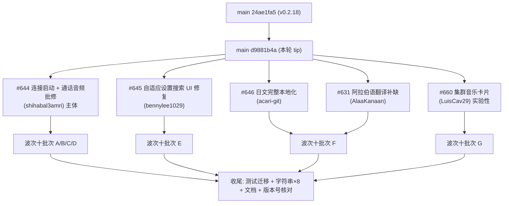

# DiPlay main 分支增量差异迁移报告（第三轮 · 0.2.18 之后未发版增量）

> **作者**: WorkBuddy
> **生成日期**: 2026-10-12
> **上一轮已登记 main 基线**: `24ae1fa52edbe27392a668d4c9e71a32d5691986`（Merge PR #628，release/0.2.18；波次九批次 A–H 已迁移完成）
> **本轮最新 main tip**: `d9881b4a`（Merge PR #660）
> **当前分支**: `port/wave9-increment`（波次九 已完成，版本号 `0.2.18-api17` / versionCode 37）
> **本轮落定版本号**: **`0.2.18-api17`** **/ versionCode 37（保持不变）** —— main 本轮**未推进版本号**（仍为 `0.2.18` / 37，无 0.2.19 痕迹），详见 **§7**
> **增量范围**: `git log 24ae1fa5..origin/main` — **22 个提交（其中非 merge 16 个）**
> **增量规模**: `git diff --shortstat 24ae1fa5..origin/main` = **70 个文件，+2710 / −118**

***

## 0. 增量取数命令（每轮开始前重跑）

```sh
git fetch origin
git rev-parse origin/main                                  # 新基线，替换下一轮的锚点 → d9881b4a
git log 24ae1fa5..origin/main --oneline                    # 本轮增量（22 提交）
git diff --stat 24ae1fa5..origin/main                      # 70 文件 +2710/-118
```

> 本轮增量**无全新波次**：`24ae1fa5` 之后的 5 个 PR 全部可归入既有波次（一～七）作为**叠加增量**。
> 本轮的显著特征是 **「零新增依赖、零构建改动」**——只有一处资源层结构性变化（新增 `values/colors.xml`），其余全是代码/资源/测试的叠加修改。

***

## 1. 增量概览



### 1.1 增量功能总表（按批次归类）

| 批次 | 功能项                                | 对应 PR / 提交          | 主要文件                                                                                                                                                                                                 | API 17 关注                                                                              | 分支现状                                                |
| -- | ---------------------------------- | ------------------- | ---------------------------------------------------------------------------------------------------------------------------------------------------------------------------------------------------- | -------------------------------------------------------------------------------------- | --------------------------------------------------- |
| A1 | NCM bulk-out 未就绪用 20 ms 超时丢弃帧      | #644 `7d974f42` 等   | `NcmUsbBridge.kt`                                                                                                                                                                                    | 无                                                                                      | 缺失，可干净套用                                            |
| A2 | USB 配置选择状态机（CarPlay mode 优先）       | #644                | **新** `WiredConfigurationAction.kt`、`CarPlayController.kt`、`IphoneCarPlayConfiguration.kt`                                                                                                           | 无                                                                                      | 缺失 ⚠️ 分支用 `UsbConfigurationView` 需改签名               |
| A3 | USB 权限自动确认识别 `android.app.Dialog`  | #644                | `UsbAutoConfirmService.kt`                                                                                                                                                                           | 无                                                                                      | 缺失，可干净套用                                            |
| A4 | 方向盘键服务崩溃标记重置等待 1 秒                 | #644                | `WheelKeyService.kt`                                                                                                                                                                                 | 无                                                                                      | 缺失，可干净套用                                            |
| A5 | 车机 5 GHz companion 热点（`_5G`/`-5G`） | #644                | `ManualHotspotManager.kt`                                                                                                                                                                            | 无                                                                                      | 缺失，可干净套用（companion 可见性需放大）                          |
| B1 | RTP 时钟速率（16 kHz 通话位置修正）            | #644                | `AudioStream.kt`、`CarPlayMediaEngine.kt`                                                                                                                                                             | 无                                                                                      | 缺失 ✅ `MicrophoneConfig.opusClockRate` 分支已有          |
| B2 | 麦克风首读失败自动重启录音（≤3 次）                | #644                | `MicrophoneUplink.kt`                                                                                                                                                                                | `AudioRecord.ERROR_DEAD_OBJECT`(API 24)                                                | 缺失 ⚠️ 常量需守卫                                         |
| B3 | 麦克风峰值电平诊断（`peakDbfs`）              | #644                | `MicrophoneCaptureStats.kt`                                                                                                                                                                          | 无                                                                                      | 缺失，可干净套用                                            |
| B4 | 音频解码输入等待上限 100 ms                  | #644                | `AndroidMediaSink.kt`                                                                                                                                                                                | 无                                                                                      | 缺失 ✅ `DecoderInputPump` 已有 `timeoutNs`              |
| B5 | 通话播放诊断通道名 `PHONE` → `CALL`         | #644                | `AndroidMediaSink.kt`                                                                                                                                                                                | 无                                                                                      | 缺失，可干净套用                                            |
| C1 | 窗口/对话框背景改资源引用（Android 9 及以下）       | #644                | **新** `values/colors.xml`、`values/themes.xml`、**`values-v21/themes.xml`**                                                                                                                            | 正向收益（专治 API 17/28）                                                                     | 缺失 ⚠️ 分支是 Holo/Material 双层主题，需两处都改                  |
| C2 | 集群导航卡片 5 秒后消失（#511）                | #644                | `BydHudRouteState.kt`、`BydNavigationOutputs.kt`                                                                                                                                                      | 无                                                                                      | 缺失，可干净套用                                            |
| D1 | iAP2 rx 周期消息节流（0x5001/0x5201）      | #644                | **新** `Iap2RxLog.kt`、`Iap2Wired/WirelessControlClient.kt`                                                                                                                                            | 无                                                                                      | 缺失，可干净套用                                            |
| D2 | usbmux rx logcat 限 50 帧            | #644                | `Iap2UsbMuxHost.kt`                                                                                                                                                                                  | 无                                                                                      | 缺失，可干净套用                                            |
| E1 | 设置搜索 UI 重构（按钮展开/收起两态）              | #645                | `DiPlayActivity.kt`（+234/−44）                                                                                                                                                                        | ⚠️ **API 23 三连**：`LayerDrawable` 层布局、`PopupWindow.setIsLaidOutInScreen`、`StaticLayout` | 分支是「常驻搜索框」旧实现，需**替换**而非叠加                           |
| F1 | 阿拉伯语翻译补缺                           | #631                | `values-ar/strings.xml`、**新** `values-ar/strings_contrib_audio.xml`、**新** `values-ar/picture.xml`                                                                                                    | 无                                                                                      | 缺失                                                  |
| F2 | 日文完整本地化                            | #646                | **新** `values-ja/*`、`shared/values-ja/strings.xml`、`AppLocale.kt`、`locales_config.xml`                                                                                                               | 无（但 key 集合断言严格）                                                                        | 缺失 ⚠️ 分支 values/ 有 988 条 key，其中 **24 条 main ja 没有** |
| F3 | 发布站日文页                             | #646                | `site/ja/index.html`、`site/content.json`                                                                                                                                                             | —                                                                                      | ⏭️ 跳过（站内页不迁）                                        |
| G1 | 集群音乐卡片视图/状态/设置                     | #660                | **新** `ClusterMusicSettings.kt`、`ClusterMusicState.kt`、`ClusterMusicView.kt`                                                                                                                         | ⚠️ `StaticLayout.Builder.obtain`(API 23)                                               | 缺失，需 View 化适配                                       |
| G2 | 媒体元数据发布接线                          | #660                | `CarPlayMediaKeys.kt`（3 处 publish）                                                                                                                                                                   | 无                                                                                      | 缺失，可干净套用                                            |
| G3 | 设置卡片入口（toggle + 模式 + 3 滑块）         | #660                | `DiPlayActivity.kt`                                                                                                                                                                                  | 无                                                                                      | 缺失 ✅ `overlaySliderRow` 分支已有                        |
| G4 | 集群视图挂载                             | #660                | `AdbClusterActivity.kt`、`ClusterMapPresentation.kt`                                                                                                                                                  | 无                                                                                      | 缺失，addView 顺序明确                                     |
| G5 | 集群音乐字符串 ×8 语言（9 条）+ 设计文档           | #660                | `values*/strings.xml`、`docs/CLUSTER_MUSIC_CARD.md`                                                                                                                                                   | 无                                                                                      | 缺失                                                  |
| H1 | 新增单测 ×7                            | #644/#645/#646/#660 | `ClusterMusicTest`、`JapaneseTranslationsTest`、`AudioStreamCodecTest`、`ManualHotspotCompanionTest`、`WiredConfigurationActionTest`、`Iap2RxLogTest`、`NcmUsbBridgeWriteTimeoutTest`                      | 见 §3                                                                                   | 缺失                                                  |
| H2 | 修改单测 ×8                            | #644/#645/#646      | `AdaptiveSettingsUiTest`(+113)、`AppDialogsTest`、`AppLocaleTest`、`UsbAutoConfirmServiceTest`、`WheelKeyPermissionSetupTest`、`BydHudRouteStateTest`、`MicrophoneCaptureStatsTest`、`VideoDecodeQueueTest` | 见 §3                                                                                   | 缺失                                                  |
| H3 | 文档/元数据同步                           | 各 PR                | `AGENTS.md`（日文 experimental 后缀）、`README.md`、`docs/INSTALL.md`、`CHANGELOG.md`                                                                                                                         | —                                                                                      | 需同步                                                 |

***

## 2. 重点功能分析

### 2.1 #644 — 本轮主体（批次 A/B/C/D 全部来自它）

`#644`（`817ff3fa` + `ddfb3fd2` + `7d974f42` + `a9734a10` 等）是本轮唯一的大改动，一条 PR 覆盖了**连接启动、通话音频、显示、诊断**四条线。逐项拆解：

| 位置                                                                           | 改动                                                                                                                                                                                          | 对 API 17 的意义                                                                                                                                                                          |
| ---------------------------------------------------------------------------- | ------------------------------------------------------------------------------------------------------------------------------------------------------------------------------------------- | ------------------------------------------------------------------------------------------------------------------------------------------------------------------------------------- |
| `NcmUsbBridge.kt:78-105`                                                     | 写入超时由 `timeoutMillis` 改为 `if (bulkOutAccepted) timeoutMillis else minOf(timeoutMillis, 20)`；首次成功写后上报 `NCM bulk-out ready after N dropped frames`                                            | ⭐ **高价值**：车机未 StartCarPlaySession 前每次 USBMUX 握手写要等满 2 s 超时（Android 8.1–14 均如此），改后步骤耗时从 \~2 s 降到 \~20 ms，**有线启动提前数秒**                                                                  |
| **新** `WiredConfigurationAction.kt`（37 行）                                    | 枚举 `USE` / `USE_WITHOUT_APPLE_ETHERNET` / `REQUEST_TRANSITION` / `REJECT`，`choose(found, carPlayMode, transitionsTried, maximumTransitions)` + `fallbackAfterRejection(found, carPlayMode)` | ⭐ 修复 iOS 17/26 上「有 USBMUX+NCM 但无 Apple Ethernet」的配置被直接采用导致 AirPlay 永不打开（Proton S70 / iPhone 12 Pro Max）                                                                               |
| `CarPlayController.kt:1919-1945`                                             | 用 `WiredConfigurationAction.choose(...)` 替换内联 when；`beginReenumeration(device, fallbackAfterRejection)`；被拒时回落到无 Apple Ethernet 的配置并写诊断                                                      | 分支该处（`:1919-1936`）与 main 24ae1fa5 逐行同构，可**整体替换**                                                                                                                                      |
| `IphoneCarPlayConfiguration.kt`                                              | 新增 `fun isCarPlayMode(configuration)` = `usbMuxInterface != null && hasCdcNcm && hasAppleEthernet`                                                                                          | ⚠️ **签名适配**：main 用原生 `UsbConfiguration`，分支用 `com.shilapi.xcertplay.compat.UsbConfigurationView`；因 `hasCdcNcm`/`hasAppleEthernet` 在同 object 内为 `private`，**直接放在同 object 内调用即可，无需改可见性** |
| `UsbAutoConfirmService.kt:19-30, 43-56, 97-127`                              | 新增 `ALERT_ACTIVITY_CLASS = "android.app.Dialog"` 计入系统 USB 窗口；`isTargetPrompt` 增加 `USB_DEVICE_WORDS = Regex("USB\|iPhone\|iPad")` 二次确认；新增 `ignoredWindowId` 抑制重复日志                           | ⭐ **高价值**：`UsbPermissionActivity`/`UsbConfirmActivity` 继承 `AlertActivity`，无障碍上报的类名是 `android.app.Dialog` 而非活动名 —— 这是**波次八已移植的自动确认功能一直不生效的真正原因**（#409）。改后 Android 7.1–14 一致生效          |
| `WheelKeyService.kt:405, 423-437`                                            | `CRASH_RESET_PAUSE_SECONDS = 1`；先写「不含本服务」的列表并 `&& sleep 1`，再写含本服务的列表                                                                                                                        | 修复 Android 判定服务 crashed 后不重绑、键位卡在「Allowed, starting…」（#606）                                                                                                                           |
| `ManualHotspotManager.kt:72-135, 382-396`                                    | 新增 `isFiveGhzCompanion(apSsid, expectedSsid)`（后缀 `_5G` / `-5G`，忽略大小写）；companion 时 `apConfiguration` 置 null（只沿用 security）、频率/信道不作为证据、band 标签固定「5 GHz」                                        | 支持车机同时广播 `HOTSPOT` + `HOTSPOT_5G` 的场景（#617）。⚠️ companion 由 `private companion object` 改 **`internal companion object`**（测试要访问），`TAG` 保持 private                                       |
| `AudioStream.kt:17-25, 223-229`                                              | `AudioFormat` 新增 `val rtpClockRate: Int = sampleRate`；Opus 分支传 `MicrophoneConfig.opusClockRate(bits)`                                                                                       | ⭐ 修正 16 kHz/24 kHz 通话流的 RTP 时间戳基准                                                                                                                                                     |
| `CarPlayMediaEngine.kt:76, 451-476`                                          | `FeedbackPositionMonitor(format.rtpClockRate)`；`sampleRate`/`sampleTime` 改用 `rtpClockRate`                                                                                                  | 修复通话中 `/feedback` 位置按 48 kHz 计数导致**领先实际音频 14.5 s**（20 s 通话），司机听不清对面（#473）——波次九已引入 `FeedbackPositionMonitor`，**本轮是它的计算公式修正**                                                           |
| `MicrophoneUplink.kt:278-300, 349-360, 485-490`                              | `MAX_READ_RESTARTS = 3`、`READ_RESTART_PAUSE_MILLIS = 50`；首读负值时重开 `AudioRecord`（`stop()` + sleep + `startRecording()` + 校验 `recordingState`）后 `continue`                                     | 修复车机切通话模式后首读 `ERROR_INVALID_OPERATION` 导致整个通话静音（Seal 05 DM-i / MT6765，3 次 USB 通话坏 2 次，**#647**）。⚠️ 排除条件含 `AudioRecord.ERROR_DEAD_OBJECT`                                              |
| `MicrophoneCaptureStats.kt:32, 55-64, 82, 96, 113-116`                       | 新增 `peakSample`、`fun level(pcm)`（16-bit LE 峰值扫描）、`fun restarted(attempt)`、`internal fun peakDbfs(peak)`；stats 行追加 `peakDbfs=…\|silent`                                                      | 区分「麦克风静音」与「iPhone 丢弃上行」（#647）                                                                                                                                                         |
| `AndroidMediaSink.kt:2159-2172, 2383-2390, 2496-2499`                        | 音频调用点 `DecoderInputPump.acquire(..., timeoutNs = AUDIO_INPUT_WAIT_NS)`，`AUDIO_INPUT_WAIT_NS = 100_000_000L`（100 ms）；诊断行 `channel=` 把 `AudioChannel.PHONE` 映射为 `CALL`                        | ⭐ 双向修正：波次九沿用了视频的 500 ms 等待，背景播放时解码器变慢→队列涨到 190 包→每几秒欠载（#649）；100 ms 仍覆盖 #381 的丢包修复。`PHONE` 前缀与报告过滤规则冲突导致**通话播放行被整行丢弃**（#647）                                                          |
| `BydHudRouteState.kt:37-40, 56-58, 100-110, 135-150, 248-251`                | 新增 `noRouteHideNs = NO_ROUTE_HIDE_NS`(5 s)、`noRouteSinceNs`、`holdingAcrossDrop`；`activeManeuver()` 增加 noRoute 超时判定；新增 `fun holdAcrossDrop()`；`clear()` 复位新字段                                | 修复取消导航后转弯卡停留最长两分钟（#511）；无线掉线场景由 `holdAcrossDrop()` 保卡至新指引                                                                                                                             |
| `BydNavigationOutputs.kt:150-160`                                            | `endNow(preserveTurnOverlay=true)` 时调用 `overlayRoute.holdAcrossDrop()`                                                                                                                      | 分支 `overlayRoute` 构造（`staleRouteNs=120s` / `emptyListHideNs=8s` / `keepAcrossNoRoute=true`）与 main **完全一致**，可直接套用                                                                      |
| **新** `Iap2RxLog.kt`（27 行）                                                   | 周期消息 `PERIODIC = {0x5001, 0x5201}` 前 5 次每次都记，之后每 100 次记一条 `count=N`；其他消息不节流                                                                                                                 | 这两类消息占 25,000 行报告的**一半以上**，导致 GitHub 尺寸截断丢失关键行（#473/#536/#606）                                                                                                                        |
| `Iap2WiredControlClient.kt:59, 114` / `Iap2WirelessControlClient.kt:70, 222` | `else ->` 分支改用 `rxLog.line(messageId)?.let(onProgress)`                                                                                                                                     | 同上；耗时/耗流量可观                                                                                                                                                                           |
| `Iap2UsbMuxHost.kt:24, 161-170, 268-270`                                     | `receivedFrames` 计数，`if (++receivedFrames <= LOGGED_RX_FRAMES) Log.i(...)`，`LOGGED_RX_FRAMES = 50`                                                                                          | 一帧一行会在有线会话 1 分钟内刷满 logcat（#634）                                                                                                                                                       |

### 2.2 #645 — 设置搜索 UI 重构（批次 E，本轮唯一「整段替换」项）⚠️ 风险最高

main 把设置页头部从「标题 + 常驻搜索框 + 外观按钮」改成「标题 + 搜索按钮（点击展开/收起）+ 外观按钮」两态，并新增自绘编辑框与弹层定位重构。

| 位置                                                                                                                   | main 改动                                                                                                                                                                              | 分支适配要求                                                                                                                                                                                                |
| -------------------------------------------------------------------------------------------------------------------- | ------------------------------------------------------------------------------------------------------------------------------------------------------------------------------------ | ----------------------------------------------------------------------------------------------------------------------------------------------------------------------------------------------------- |
| `DiPlayActivity.kt:1165-1185`（分支现状）                                                                                  | main 改为：先占位操作按钮，标题仅在展开时占位；`SETTINGS_HEADER_COMPACT_GAP_DP=8`/`SETTINGS_HEADER_GAP_DP=12`                                                                                             | 分支当前是「标题 -2 + 搜索框 weight(1) + 外观按钮」，与 main 基线的差异**恰恰就是 #645 要改掉的部分**，直接按 main 实现替换                                                                                                                    |
| 新增 `settingsSearchExpanded` 状态 + `SETTINGS_SEARCH_BUTTON_TAG`                                                        | 返回键行为改为「先收起搜索」；`render()` 后 `requestFocus()` 到搜索按钮                                                                                                                                   | `AdaptiveSettingsUiTest` 新增 4 个用例覆盖，见 H2                                                                                                                                                              |
| 新增 `SettingsSearchEditText`（继承 `EditText`）                                                                           | 自定义 hint 基线对齐（`hintedBaseline` + `alignedTextCentreY` + `usesChineseGlyphAlignment`）；文本/选区/光标一起平移                                                                                    | ⚠️ 分支已有中文基线对齐辅助函数，main 抽取为 `alignedTextCentreY(view, text, bounds, drawingBaseline)` —— 需把分支已有的同名逻辑**统一收敛到这一份**，否则中日文/阿拉伯文基线会漂移                                                                       |
| 搜索框背景改为 `LayerDrawable(buttonShape + icon + buttonFocusRing)` + `setLayerGravity/setLayerSize/setLayerInsetRelative` | 图标与焦点环放入背景层，避免随文本横向滚动                                                                                                                                                                | ⚠️ **API 23 三连之一**：`LayerDrawable.setLayerGravity/setLayerSize/setLayerInsetRelative` 在 API 17–22 不存在 → **必须复用分支已有的** **`GravityLayerDrawable`**（`CarPlayHostActivity.kt:6007`）或 `UiCompat` 方案，禁止直接照抄 |
| `PopupWindow(width, 0, false)` + `setIsLaidOutInScreen(true)` + `positionSettingsSearchResults(box, popup)`          | 结果弹层按 `getWindowVisibleDisplayFrame` 定位，`maxHeight` 取窗口可见区与 380/200 dp 的较小值，右/下边界钳制                                                                                                  | ⚠️ **API 23 之二**：`PopupWindow.setIsLaidOutInScreen` 需 `SDK_INT >= 23` 守卫（守卫后行为退化为 `showAtLocation`，定位逻辑仍可用）                                                                                           |
| 布局监听器生命周期修复                                                                                                          | `OnGlobalLayoutListener` 改为在 `onViewAttachedToWindow` 注册 / `onViewDetachedFromWindow` 注销，`AdaptiveSettingsUiTest.rebuiltSearchFieldsDoNotLeaveLayoutListenersOnTheWindow` 断言监听器数量不增长 | ⚠️ 分支当前用 `doOnLayout{}`（一次性），**不存在泄漏**，但换实现后必须保留该测试                                                                                                                                                   |
| 索引策略                                                                                                                 | 展开搜索**之前**构建索引；清空 query **不**置空索引（关闭搜索才失效）                                                                                                                                           | 修复「首键替换 IME 输入连接」                                                                                                                                                                                     |

> **迁移建议**：`git diff 24ae1fa5..origin/main -- common/src/main/java/com/shilapi/xcertplay/DiPlayActivity.kt` 可直接作为 patch 起点（main 基线与本分支该文件同源），逐 hunk 应用后**只对 3 个 API 23 调用做守卫改写**。

### 2.3 #646 — 日文完整本地化（批次 F2）⚠️ 有严格断言

| 项                                                 | main 值                                                                                           | 分支适配要求                                    |
| ------------------------------------------------- | ------------------------------------------------------------------------------------------------ | ----------------------------------------- |
| `common/src/main/res/values-ja/strings.xml`       | **907** 条（与 main `values/strings.xml` 一一对应）                                                      | 全新目录                                      |
| `common/src/main/res/values-ja/extra_strings.xml` | **94** 条（覆盖 main 其余分散 xml 的 key）                                                                 | 全新目录                                      |
| `shared/src/main/res/values-ja/strings.xml`       | 2 条（`carapp_hw_status_title` / `carapp_hw_not_configured`）                                       | 全新目录                                      |
| `AppLocale.kt`                                    | `const val JAPANESE = "ja"`；加入 `ALL`；`displayName` → `日本語`；`locale()` → `Locale.JAPANESE`        | 分支 `AppLocale.kt:21-24, 136-157` 同构，可干净套用 |
| `common/src/main/res/xml/locales_config.xml`      | 追加 `<locale android:name="ja" />`                                                                | 分支该文件存在，追加一行                              |
| `JapaneseTranslationsTest.kt`（40 行）               | 断言 **`values`** **与** **`values-ja`** **的** **`<string>`** **key 集合完全相等**，且占位符 `%1$s`/`%d` 等一一对应 | ⚠️ **本批次最大的坑**，见下方分析                      |
| `AGENTS.md`                                       | 实验性后缀清单追加 `（実験的機能）`                                                                              | 同步                                        |
| `README.md` / `docs/INSTALL.md`                   | 应用 8 语言 / 网站仍 7 语言                                                                               | 同步                                        |

**⚠️ 关键约束（必须照做）**

| 事实                                    | 数值                                                       |
| ------------------------------------- | -------------------------------------------------------- |
| 分支 `values/` 现有 `<string>` key 总数     | **988**                                                  |
| main `values-ja/` 提供的 key 总数          | **1001**                                                 |
| 两者交集                                  | **964**                                                  |
| **分支独有（main ja 完全没有 → 必须新写日文）**       | **24**                                                   |
| **main ja 独有（分支没有 → 不得引入）**           | **37**                                                   |
| 本轮新增（集群音乐）                            | **9**                                                    |
| **本轮后** **`values-ja/`** **目标 key 数** | **1001**（964 + 24 + 9 = 997，另 4 条为 ja/test 侧差异，实施时以断言为准） |

必须新写日文的 24 条（分支专有功能）：

| 分组       | key                                                                                                                                                                                                                                                                                             |
| -------- | ----------------------------------------------------------------------------------------------------------------------------------------------------------------------------------------------------------------------------------------------------------------------------------------------- |
| 主板自检     | `main_board_i2c_title`、`main_board_i2c_hint`、`main_ch341_note`、`main_run_self_check`                                                                                                                                                                                                            |
| 外接 Wi-Fi | `settings_external_wifi_band_unknown`、`..._connect`、`..._connected`、`..._connecting`、`..._device_label`、`..._disconnect`、`..._disconnected`、`..._error`、`..._found_device`、`..._input_ip`、`..._ip_hint`、`..._ip_unknown`、`..._not_available`、`..._scan`、`..._scanning`、`..._ssid_unknown`（16 条） |
| 实时日志     | `settings_usb_realtime_log`、`settings_usb_realtime_log_description`                                                                                                                                                                                                                             |
| 跳过蓝牙     | `settings_wireless_skip_bluetooth_config`、`settings_wireless_skip_bluetooth_config_description`                                                                                                                                                                                                 |

不得引入的 37 条（对应已跳过/未迁移的功能）：`phone_audio_route*`(4, #595 跳过)、`cluster_small_window_*`(18, #493 未迁移)、`card_preview_*`(4)、`turn_card_theme_*`(2)、以及 9 条集群音乐（**这 9 条本轮要引，其余 28 条不引**）。

### 2.4 #631 — 阿拉伯语翻译补缺（批次 F1）

| 位置                                          | 改动                                                         |
| ------------------------------------------- | ---------------------------------------------------------- |
| `values-ar/strings.xml`                     | 补缺若干 DiPlay 控件文案                                           |
| **新** `values-ar/strings_contrib_audio.xml` | 8 条音频焦点/路由文案（分支 `values/strings_contrib_audio.xml` 已有对应英文） |
| **新** `values-ar/picture.xml`               | 9 条画面调节文案（分支 `values/picture.xml` 已有对应英文）                  |
| `values-ar/cluster_card_preview.xml`        | main 同时存在 —— 分支**无此文件**，不在本批次引入                            |

> 分支 `values-ar/` 当前缺 `strings_contrib_audio.xml` 与 `picture.xml`（`values/` 有），说明波次七/九的阿拉伯语同步**漏了这两个文件**。本批次顺带补齐，`SettingsTranslationsTest` 会验证。

### 2.5 #660 — 集群音乐卡片（批次 G）⚠️ 实验性 / 默认关

| 位置                                                           | 改动                                                                                                                                                                                                     | 分支适配要求                                                                                                                                                                                                                                                               |
| ------------------------------------------------------------ | ------------------------------------------------------------------------------------------------------------------------------------------------------------------------------------------------------ | -------------------------------------------------------------------------------------------------------------------------------------------------------------------------------------------------------------------------------------------------------------------- |
| **新** `ClusterMusicSettings.kt`（28 行）                        | `xcertplay_airplay` prefs，键前缀 `cluster_music_`：`enabled`(false)、`permanent`(false)、`x`(50)、`y`(75)、`size`(100)；`save()` 带 `require(key in setOf("x","y","size"))`；`observe()` 返回反注册 lambda             | 分支已有同款 prefs 名，可直接复制                                                                                                                                                                                                                                                 |
| **新** `ClusterMusicState.kt`（36 行）                           | 主线程单例快照；`publish(info, artwork)` 用 `trackChanged()` 判定（title/artist/album/sourceApp/durationMillis）；`revision` 只在变化时 +1                                                                                | 依赖 `com.shilapi.xcertplay.media.CarPlayNowPlaying` —— 分支该类型**已存在**（`CarPlayPlaybackStatus.kt:8`）✅                                                                                                                                                                    |
| **新** `ClusterMusicView.kt`（147 行）                           | 画方形封面 + 8 s 临时标题带（`LinearGradient`）；`TEMPORARY_MILLIS = 8_000`；`tileSide(w,h,sizePercent)` = 高度 30% × size%，钳到 `[min(80,w,h), min(w,h)]`                                                               | ⚠️ **API 17 必须改**：`StaticLayout.Builder.obtain(...)`（**API 23**）→ 换用废弃的 `StaticLayout(CharSequence, TextPaint, int, Alignment, float, float, boolean)` 构造器（API 1）或加版本分支。其余（`Path.addRoundRect`、`Canvas.clipPath`、`LinearGradient`、`Paint.setShader`、`RectF`）均为 API 1 |
| `CarPlayMediaKeys.kt:145, 178, 389`                          | 3 处 `ClusterMusicState.publish(...)`：元数据变化时、封面解码完成时、`clearAll()` 时（`publish(CarPlayNowPlaying(), null)`）                                                                                               | 分支对应位置 `:139/:175/:389-391`，可干净插入 ✅                                                                                                                                                                                                                                  |
| `DiPlayActivity.kt`                                          | `clusterMusicControls(card)`：toggle → 模式 `choice`（Temporary · 8 seconds / Permanent，`reconnects = false`）→ 3 个 `overlaySliderRow`（x/y 5–95 步 5，size 50–150 步 5，`onSave` 落 `ClusterMusicSettings.save`） | ✅ 分支 `overlaySliderRow`（`:3469`）与 `OverlaySliderRow.onSave` 需确认存在；参数形状与 `ClusterSpeedometerSettings` 卡片（`:734-739` 字符串）一致                                                                                                                                            |
| `AdbClusterActivity.kt:73` / `ClusterMapPresentation.kt:140` | `root.addView(ClusterMusicView(...))`，**位置在** **`ClusterTurnCardView`** **之后、`ClusterSpeedometerView`** **之前**                                                                                         | 分支两处 `addView` 序列同构，插入点明确 ✅                                                                                                                                                                                                                                          |
| `docs/CLUSTER_MUSIC_CARD.md`（74 行）                           | 设计文档 + 停车验收清单                                                                                                                                                                                          | 复制并本地化                                                                                                                                                                                                                                                               |
| 字符串 9 条 ×8 语言                                                | `settings_cluster_music`、`_description`、`_mode`、`_temporary`、`_permanent`、`_horizontal`、`_vertical`、`_size`、`_unknown`                                                                                 | 英文以 `(experimental)` 后缀、日文以 `（実験的機能）` 后缀（AGENTS.md 规定）                                                                                                                                                                                                               |

> **保留意见**：贡献者在 `docs/CLUSTER_MUSIC_CARD.md` 中自述「首个矩形卡片在其 Song Pro 上可见，但**无线 CarPlay 仍停在连接/等待阶段**，原因未定；方形卡片仍需实车复测」。因此本批次必须**保持默认关闭**，不得进入任何默认开启路径，也不宣称端到端可用。

### 2.6 其余要点

| 项                                                                 | 说明                                                                                                                                                                                                           |
| ----------------------------------------------------------------- | ------------------------------------------------------------------------------------------------------------------------------------------------------------------------------------------------------------ |
| `values/colors.xml`（新，12 行）                                       | 4 个颜色：`window_background_dark/light`、`dialog_background_dark/light`                                                                                                                                          |
| `values/themes.xml` + `values-v21/themes.xml`                     | 4 处 `windowBackground` 由字面量改 `@color/...` —— 注释明确：**Android 9 及以下用** **`getResourceId()`** **读** **`windowBackground`，字面量会让窗口没有背景，对话框直接画在后面的页面上**（#640/#617）。这是 **API 17 正向收益**，与波次六的 Holo/Material 双层主题结构兼容 |
| `AppDialogsTest.windowBackgroundsAreResourcesThatAndroid9CanLoad` | 新增断言：4 个主题的 `windowBackground` `getResourceId != 0`（模拟 `PhoneWindow.generateLayout()` 的取值方式）→ **分支当前会 FAIL，修好 C1 后转 PASS**，是本批次最可靠的验收信号                                                                      |
| `site/ja/index.html` + `site/content.json`                        | 发布站日文页 → ⏭️ **跳过**（与波次九跳过 `site/**` 保持一致）                                                                                                                                                                    |

***

## 3. API 17 适配要点汇总

> 标记：**🔴 必须改写**（不守护会 `NoSuchMethodError`）/ 🟡 需评估 / 🟢 无影响

| #  | 来源                                      | API 敏感调用                                                                                                             | 最低 API       | 分支处置                                                                                                                                                          |
| -- | --------------------------------------- | -------------------------------------------------------------------------------------------------------------------- | ------------ | ------------------------------------------------------------------------------------------------------------------------------------------------------------- |
| 1  | E1 `DiPlayActivity.settingsSearchField` | `LayerDrawable.setLayerGravity` / `setLayerSize` / `setLayerInsetRelative`                                           | **23**       | 🔴 **改用分支** **`GravityLayerDrawable`**（`CarPlayHostActivity.kt:6007`，已处理 API 17–22 层摆放）；或写入 `UiCompat`                                                        |
| 2  | E1 `DiPlayActivity` 弹层                  | `PopupWindow.setIsLaidOutInScreen(boolean)`                                                                          | **23**       | 🔴 `if (SDK_INT >= 23)` 守卫；守卫后仍走 `showAtLocation(...)`，定位逻辑不变                                                                                                 |
| 3  | G1 `ClusterMusicView.onDraw`            | `StaticLayout.Builder.obtain(...)`                                                                                   | **23**       | 🔴 换 `StaticLayout(CharSequence, TextPaint, int, Layout.Alignment, float, float, boolean)`（API 1）；`.setUseLineSpacingFromFallbacks` 分支已有 `SDK_INT >= 28` 守卫范例 |
| 4  | B2 `MicrophoneUplink`                   | `AudioRecord.ERROR_DEAD_OBJECT`                                                                                      | **24**       | 🔴 常量在 API 17 类加载/解析时可能缺失 → 用字面量 `-6` 常量替代，或 `if (SDK_INT >= 24) ... else count != -6`                                                                        |
| 5  | C1 主题                                   | `Theme.obtainStyledAttributes(...).getResourceId(android.R.attr.windowBackground)`                                   | 1（行为差异在 ≤28） | 🟢 正向收益；但**分支 values/ 与 values-v21/** 两处共 8 项都要改，只改一处会让 API 17 真机仍无背景                                                                                         |
| 6  | E1 编辑框                                  | `View.doOnLayout`（androidx core-ktx）                                                                                 | 库提供          | 🟢 分支 `common/build.gradle.kts` 已含 `androidx-core-ktx`（`DiPlayActivity.kt:41` 已 import）                                                                       |
| 7  | E1 基线                                   | `View.getWindowVisibleDisplayFrame(Rect)` / `View.getLocationOnScreen`                                               | 1            | 🟢                                                                                                                                                            |
| 8  | A2                                      | `UsbConfiguration` → 分支 `UsbConfigurationView`                                                                       | 分支抽象         | 🟡 `IphoneCarPlayConfiguration.isCarPlayMode` 需改参数类型；`UsbDescriptorCompat.configurations(device)` 已在 API 17–20 提供回退                                           |
| 9  | A3                                      | 无障碍 `className == "android.app.Dialog"`                                                                              | 无            | 🟢 Android 7 起即如此，**是修复而非兼容问题**                                                                                                                               |
| 10 | G1/G3                                   | `SharedPreferences.OnSharedPreferenceChangeListener`、`Handler(Looper.getMainLooper())`、`SystemClock.elapsedRealtime` | 1            | 🟢                                                                                                                                                            |
| 11 | G1                                      | `Path.addRoundRect` / `Canvas.clipPath` / `LinearGradient` / `Paint.setShader` / `RectF` / `TextUtils.ellipsize`     | 1            | 🟢                                                                                                                                                            |
| 12 | C2                                      | `BydHudRouteState` 纯逻辑                                                                                               | 无            | 🟢                                                                                                                                                            |
| 13 | B4                                      | `DecoderInputPump.acquire(timeoutNs=...)`                                                                            | 分支已有         | 🟢 分支 `VideoDecodeQueue.kt:92` 的 `acquire` **已带** **`timeoutNs`** **形参**（默认 500 ms）→ 音频调用点只需传 100 ms，视频调用点不动                                                  |
| 14 | F2                                      | `Locale.JAPANESE`、`locale_config`                                                                                    | 1 / 声明式      | 🟢 分支 `AppLocale` 已有 `languageTag` 与 API 33 per-app language 同步逻辑                                                                                             |

**「分支已有、勿重复造」清单**

| 分支已有资产                                                                                       | 位置                                                                     | 本轮用途                                                                                           |
| -------------------------------------------------------------------------------------------- | ---------------------------------------------------------------------- | ---------------------------------------------------------------------------------------------- |
| `GravityLayerDrawable`                                                                       | `CarPlayHostActivity.kt:6007`                                          | E1 的 `LayerDrawable` 层布局替代                                                                     |
| `UiCompat`（ripple / setForeground / setPopupElevation / showAsDropDown / setClipToOutline …） | `common/.../UiCompat.kt`                                               | 通用守卫入口，新增项优先加在这里                                                                               |
| `DecoderInputPump.acquire(timeoutNs)`                                                        | `shared/.../media/VideoDecodeQueue.kt:92`                              | B4 直接传参                                                                                        |
| `MicrophoneConfig.opusClockRate(bits)`                                                       | `shared/.../airplay/MicrophonePacketizer.kt:45`                        | B1 直接复用                                                                                        |
| `CarPlayNowPlaying`                                                                          | `shared/.../media/CarPlayPlaybackStatus.kt:8`                          | G2/G3 的数据类型                                                                                    |
| `overlaySliderRow` / `OverlaySliderRow.onSave`                                               | `DiPlayActivity.kt:3469`                                               | G3 位置/尺寸滑块                                                                                     |
| `ClusterSpeedometerView` + 设置卡片                                                              | `common/.../ClusterSpeedometerView.kt`、`settings_cluster_speedometer*` | G1/G3 的样式与接线范式（调色板、圆角比例、值域钳制）                                                                  |
| `com.shilapi.xcertplay.host.R`                                                               | `DiPlayActivity.kt:78`                                                 | G1 的 `R.string.settings_cluster_music_unknown`（main 的 `ClusterMusicView` 已 import 此包，**分支一致**） |

***

## 4. 不移植 / 需守卫项

| 项                                              | 处置       | 核心理由                                                        |
| ---------------------------------------------- | -------- | ----------------------------------------------------------- |
| `site/ja/index.html`、`site/content.json`（#646） | ⏭️ 跳过    | 与波次九跳过 `site/**` 一致；分支不分发发布站                                |
| `phone_audio_route*` 日文（来自 main ja）            | ⏭️ 不引入   | 对应 #595 Telecom 电话音频（API 26+），波次九已整体跳过                      |
| `cluster_small_window_*` 日文（18 条）              | ⏭️ 不引入   | #493 小窗模式域未迁移（波次六已标注「留待整体迁移」）                               |
| `card_preview_*` / `turn_card_theme_*` 日文（6 条） | ⏭️ 不引入   | 分支 `values/` 无对应 key（已用其他 key 名承载或未迁移），引入会造成中文/日文 key 集合不一致 |
| `values-ar/cluster_card_preview.xml`           | ⏭️ 不引入   | 分支无 `values/cluster_card_preview.xml`                       |
| `staticLayoutBuilder` 之外的 Cluster 音乐高级项        | —        | 本轮 #660 无其他项                                                |
| 集群音乐卡片**默认开启**                                 | ⛔ 禁止     | 贡献者自述无线 CarPlay 仍未打通；保持 `enabled=false` 默认                  |
| `MIN_READ_RESTARTS` 之外的麦克风重启上限放宽               | ⛔ 保持 3 次 | 与 main 一致，避免无限重启拖死通话                                        |

***

## 5. 建议迁移计划（波次十 · 批次 A–H）

### 5.1 批次划分与验证

| 批次    | 内容                                                                               | 依赖                               | 验证命令（分支版 CI）                                                                                                                                                                                                                                                |
| ----- | -------------------------------------------------------------------------------- | -------------------------------- | ----------------------------------------------------------------------------------------------------------------------------------------------------------------------------------------------------------------------------------------------------------- |
| **A** | A1 NCM 20 ms 超时 → A2 配置状态机 → A3 USB 自动确认 → A4 WheelKey 崩溃重置 → A5 5 GHz companion | 无                                | `:shared:testDebugUnitTest --tests '*NcmUsbBridgeWriteTimeoutTest' --tests '*WiredConfigurationActionTest' --tests '*ManualHotspotCompanionTest'` + `:common:testDebugUnitTest --tests '*UsbAutoConfirmServiceTest' --tests '*WheelKeyPermissionSetupTest'` |
| **B** | B1 rtpClockRate → B4 音频 100 ms → B3 峰值电平 → B2 麦克风重启 → B5 CALL 通道名                | A                                | `:shared:testDebugUnitTest --tests '*AudioStreamCodecTest' --tests '*MicrophoneCaptureStatsTest' --tests '*VideoDecodeQueueTest'`                                                                                                                           |
| **C** | C1 colors.xml + 双层 themes → C2 导航卡片 5 s 隐藏                                       | 无                                | `:common:testDebugUnitTest --tests '*AppDialogsTest'` + `:shared:testDebugUnitTest --tests '*BydHudRouteStateTest'`                                                                                                                                         |
| **D** | D1 Iap2RxLog → D2 usbmux 50 帧                                                    | 无                                | `:shared:testDebugUnitTest --tests '*Iap2RxLogTest'`                                                                                                                                                                                                        |
| **E** | E1 设置搜索重构（含 3 处 API 23 守卫改写）                                                     | 无                                | `:common:testDebugUnitTest --tests '*AdaptiveSettingsUiTest' --tests '*SettingsTranslationsTest'`；⚠️ 需补 3 个 API 17 的 Robolectric `@Config(sdk=[17])` 冒烟                                                                                                     |
| **F** | F1 阿拉伯语补缺 → F2 日文全量 → F3 跳过                                                      | 无                                | `:common:testDebugUnitTest --tests '*JapaneseTranslationsTest' --tests '*AppLocaleTest' --tests '*SettingsTranslationsTest'`                                                                                                                                |
| **G** | G1 三文件（含 `StaticLayout` 改写）→ G2 三处 publish → G3 设置卡片 → G4 集群挂载 → G5 字符串/文档       | E（`headerIconSize` 等辅助复用）、F（字符串） | `:common:testDebugUnitTest --tests '*ClusterMusicTest'`；`:common:assembleDebug` 确认 R 引用完整                                                                                                                                                                   |
| **H** | H1/H2 全部测试迁移 → H3 文档同步                                                           | A–G                              | 全量 CI（见 §5.4）                                                                                                                                                                                                                                               |

**推荐提交纪律**（沿用既有风格）：每批次一个提交，消息形如 `波次十批次A：NCM 短超时、USB 配置状态机、USB 自动确认类名、方向盘键崩溃重置、5 GHz companion`。

### 5.2 字符串义务

| 类别           | 条目                                                                                                                             | 语言数                                        | 备注                                                                              |
| ------------ | ------------------------------------------------------------------------------------------------------------------------------ | ------------------------------------------ | ------------------------------------------------------------------------------- |
| 集群音乐卡片       | 9 条                                                                                                                            | **8**（en/ar/ru/uk/es/zh-rCN/zh-rTW/**ja**） | 英文以  ` (experimental)` 后缀；**日文用** **`（実験的機能）`**（AGENTS.md 规定）；`values-ja` 是本轮新建 |
| 阿拉伯语补缺       | `values-ar/strings_contrib_audio.xml`(8) + `values-ar/picture.xml`(9)                                                          | 1（ar）                                      | 英文对应项分支已存在                                                                      |
| 日文全量         | **988（分支现有 key）+ 9（集群音乐）= 997 条**                                                                                              | 1（ja）                                      | 其中 **24 条 main ja 没有，需新写**；**不得引入** 37 条 main ja 独有 key（除集群音乐 9 条）              |
| 分支独有 24 条的日文 | `main_board_*`(4)、`settings_external_wifi_*`(16)、`settings_usb_realtime_log*`(2)、`settings_wireless_skip_bluetooth_config*`(2) | 1（ja）                                      | 见 §2.3 表                                                                        |

**校验**：`JapaneseTranslationsTest` 断言 `values` 与 `values-ja` 的 key 集合**完全相等**且占位符一一对应 —— 这是本批次唯一不可协商的门禁。实施时先用

```sh
# 分支 values/ 的 string key（去重排序）
grep -hoE '<string name="[^"]+"' common/src/main/res/values/*.xml | sed 's/<string name="//;s/"$//' | sort -u > /tmp/branch.txt
# values-ja/ 的 string key
grep -hoE '<string name="[^"]+"' common/src/main/res/values-ja/*.xml | sed 's/<string name="//;s/"$//' | sort -u > /tmp/ja.txt
diff /tmp/branch.txt /tmp/ja.txt && echo "OK"
```

### 5.3 新增依赖与构建改动

**无**。本轮全部改动落在既有依赖与既有构建配置内（`zxing` / `aidl` 均为波次九已引入）。C1 的 `values/colors.xml` 是纯资源新增，不影响 `build.gradle.kts`。

### 5.4 完成后文档更新义务（迁移指南 §0.5 / §0.6）

1. **§0.4** 新增「波次十（增量轮）」批次 A–H 共 8 行，状态/日期/分支提交哈希；
2. **§0.1** 「main 基线」行推进到 `d9881b4a`（备注：上一基线 `24ae1fa5`）；
3. **§0.3** 追加「main 更优则替换」条目：
   - 🔁 `DiPlayActivity` 常驻搜索框 → **main #645 两态搜索（按钮展开）**；
   - 🔁 `AndroidMediaSink` 音频 `DecoderInputPump` 等待 500 ms（波次九沿用视频值）→ **main #644 100 ms**；
   - 🔁 `IphoneCarPlayConfiguration.find` 单一选取逻辑 → **main #644** **`WiredConfigurationAction`** **状态机**；
4. **§0.6 版本号同步**：核对 main `mobile/build.gradle.kts` —— 本轮 main **未推进**（仍 `0.2.18` / 37），故分支 **`versionCode 37`** **/** **`versionName "0.2.18-api17"`** **保持不变**，仅在 `CHANGELOG.md` 的 `0.2.18-api17` 段落追加本轮增量说明（见 §7.4 模板）；
5. 文档头部「最后更新」日期同步。

**全量 CI 门禁**（`.github/workflows/android.yml`）：

```sh
./gradlew :shared:testDebugUnitTest :common:testDebugUnitTest :home:testDebugUnitTest \
  :mobile:lintDebug :home:lintDebug :maphost:lintDebug \
  :mobile:assembleDebug :home:assembleDebug :maphost:assembleDebug
```

**增量验证（用户既有流程）**：独立 `.swift`/`.kt` 探针 → `swiftc -parse`/`kotlinc` 语法门禁 → `xcodebuild`/`gradlew` 增量编译；期望**零警告**，touch 文件后再编译避免假阴性。

***

## 6. 风险清单

| #   | 风险                                                                                     | 等级   | 影响                                                      | 缓解                                                                                        |
| --- | -------------------------------------------------------------------------------------- | ---- | ------------------------------------------------------- | ----------------------------------------------------------------------------------------- |
| R1  | 日文本地化必须覆盖分支 988+9 条 key，其中 24 条**没有现成日文**                                              | 🔴 高 | 漏一条 → `JapaneseTranslationsTest` 红；工作量集中                | 先用 §5.2 的 `diff` 脚本锁死 key 集合；24 条分支独有按分支中文/英文自行翻译                                         |
| R2  | 误把 main ja 独有 37 条中的 28 条（非集群音乐）引入 → key 数反而超出                                         | 🟡 中 | 断言反向失败                                                  | 白名单化：只引 `settings_cluster_music*` 9 条，其余 28 条不落地                                          |
| R3  | E1 设置搜索重构体量大（+234/−44），且要改 3 处 API 23 调用                                               | 🔴 高 | 编译过但在 API 17 真机 `NoSuchMethodError`；或弹层定位错位             | 逐 hunk 应用 + 3 处守卫改写 + `@Config(sdk=[17])` 冒烟 + `AdaptiveSettingsUiTest` 4 个新用例            |
| R4  | C1 只改 `values/themes.xml` 忘改 `values-v21/themes.xml`（或反之）                              | 🟡 中 | API 17 真机对话框仍无背景；`AppDialogsTest` 可能在 v21 上下文下「假通过」     | 两处共 8 项同改；`AppDialogsTest` 的 4 主题断言在 sdk 28 与 sdk 17 双跑                                   |
| R5  | B4 音频等待 500→100 ms 与波次九 #618f 的「AAC 排空」逻辑交互                                            | 🟡 中 | 背景播放欠载复发（#381 回归）或解码器继续落后                               | 保留 `AudioStreamCodecTest` + `VideoDecodeQueueTest` 新用例；出现回归立刻回退到 200 ms 折中值               |
| R6  | B2 `AudioRecord.ERROR_DEAD_OBJECT` 在 API 17 上符号缺失                                      | 🔴 高 | 通话一进就崩（比静音更严重）                                          | 用字面量常量；真机走一遍通话                                                                            |
| R7  | A2 分支 `UsbConfigurationView` / `UsbDescriptorCompat` 与 main 原生 `UsbConfiguration` 语义差异 | 🟡 中 | 配置选择状态机行为偏差，或 API 17–20 走描述符回退时 `isCarPlayMode` 恒 false | 实施时对 API 17–20 路径单独打日志核对；`UsbDescriptorCompat.configurations(device)` 的 `label` 语义已在波次九验证 |
| R8  | G1 `ClusterMusicView` 与既有 `ClusterSpeedometerView` / `ClusterTurnCardView` 层叠冲突        | 🟡 中 | 遮住车速或转弯卡                                                | 严格按 main 的 addView 顺序（turnCard → **music** → speedometer）；停车验收                            |
| R9  | `ManualHotspotManager` companion 由 private 改 internal 引发可见性/命名冲突                       | 🟢 低 | 编译告警                                                    | `TAG` 保持 private，仅 `isFiveGhzCompanion` 开放                                                |
| R10 | H2 中 `AdaptiveSettingsUiTest`(+113) 会**替换**分支现有断言（原「搜索框常驻且不获焦」）                        | 🟡 中 | 若只改实现不改测试 → 编译失败                                        | 测试与实现同批提交                                                                                 |
| R11 | 集群音乐卡片被误纳入默认开启路径                                                                       | 🟡 中 | 用户看到「连不上」的观感                                            | 默认 `enabled=false`；`docs/CLUSTER_MUSIC_CARD.md` 保留贡献者的未解决说明                               |
| R12 | 版本号被误推进（误以为 main 已发 0.2.19）                                                            | 🟢 低 | 诊断报告 `appVersion` 与上游脱节                                 | 以 `git show origin/main:mobile/build.gradle.kts` 为准；本轮维持 37 / `0.2.18-api17`              |

***

## 7. main 版本号与 CHANGELOG 同步（本轮落定值）

> 规范见迁移指南 **§0.6**。本轮的特殊之处：**main 未推进版本号**。

### 7.1 同步对象（唯一信息源）

```sh
git show origin/main:mobile/build.gradle.kts | grep -E 'versionCode|versionName'
# 本轮输出：versionCode = 37 / versionName = "0.2.18"   ← 与 24ae1fa5 相同，未推进
git show origin/main:CHANGELOG.md | head -3
# 本轮输出：首段仍是 "# DiPlay 0.2.18 — 2026-10-11"（未追加 0.2.19 段）
```

### 7.2 本轮落定值

```kotlin
// mobile/build.gradle.kts —— 与上一轮完全一致，不做改动
versionCode = 37
versionName = "0.2.18-api17"
```

| 项                      | main `d9881b4a`                | 分支本轮落定                               | 动作                                                                 |
| ---------------------- | ------------------------------ | ------------------------------------ | ------------------------------------------------------------------ |
| `mobile` `versionCode` | `37`                           | `37`                                 | **不动**                                                             |
| `mobile` `versionName` | `0.2.18`                       | `0.2.18-api17`                       | **不动**（`-api17` 后缀永不省略）                                            |
| debug 变体               | `0.2.18-hud-test`              | `0.2.18-api17-hud-test`              | 不动（`applicationIdSuffix=.hudtest` + `versionNameSuffix=-hud-test`） |
| `CHANGELOG.md` 首段      | `# DiPlay 0.2.18 — 2026-10-11` | `# DiPlay 0.2.18-api17 — 2026-10-12` | **扩写**（追加本轮增量 bullet，见 §7.4）                                       |

### 7.3 不同步的模块（**误改会破坏独立版本线**）

| 模块                            | 版本                 | 说明    |
| ----------------------------- | ------------------ | ----- |
| `automotive/`                 | `1201` / `"1.2.1"` | 独立版本线 |
| `samples/home`（`:home`）       | `1` / `"0.1"`      | 独立版本线 |
| `samples/maphost`（`:maphost`） | `1` / `"1.0"`      | 独立版本线 |
| `shared` / `common`           | 无版本号               | 库模块   |

**不新增** `docs/RELEASE-NOTES-<ver>.md`（分支 docs 只到 `RELEASE-NOTES-0.2.14.md`）。

### 7.4 CHANGELOG 写法（本轮扩写模板）

在现有 `# DiPlay 0.2.18-api17 — 2026-10-12` 段落的 bullet 列表末尾追加：

```markdown
- Wave 10 ports the post-0.2.18 increment (22 commits, `main` @ `d9881b4a`): wired CarPlay starts
  seconds sooner (a NAKed NCM pipe is dropped after 20 ms, #644), a USB configuration without Apple
  Ethernet asks for CarPlay mode first (#644), the auto-confirm accessibility service now sees the
  system USB dialog under `android.app.Dialog` (#644), the wheel-key service waits out Android's
  crashed-service mark (#644), and 5 GHz companion car hotspots are accepted (#644).
- Calls count their RTP position at the stream's own rate (16 kHz, not 48 kHz, #644), the head-unit
  microphone restarts its first failed read (#644), the audio decoder waits at most 100 ms (#644),
  and call playback stats reach the report again (#644).
- Dialogs have a background on Android 9 and older, the cluster turn card goes 5 s after guidance
  ends, and long reports keep the lines that matter (iAP2 rx thinning, usbmux frame cap) (#644).
- Settings search opens from a button, keeps one editor and its keyboard, and no longer leaks layout
  listeners (#645). The app adds Japanese; the release site stays at seven languages (#646, #631).
- Experimental, off-by-default: a cluster music card on the dashboard map (#660 — temporary or
  permanent square cover; the contributor's vehicle test is unresolved).
- Skipped on this port: the release site's Japanese page; the 28 Japanese strings for features this
  branch has not ported (car phone audio #595, the small-window cluster domain #493).
```

### 7.5 执行与校验清单

| # | 步骤                                                                              | 校验                                                            |
| - | ------------------------------------------------------------------------------- | ------------------------------------------------------------- |
| 1 | `git show origin/main:mobile/build.gradle.kts \| grep -E 'version(Code\|Name)'` | 输出 `0.2.18` / `37` → 确认不推进                                    |
| 2 | 不修改 `mobile/build.gradle.kts`                                                   | `git diff -- mobile/build.gradle.kts` 为空                      |
| 3 | 扩写 `CHANGELOG.md` 首段（§7.4 模板）                                                   | 段落仍以 `# DiPlay 0.2.18-api17` 起头，首句含 `` `main` @ `d9881b4a` `` |
| 4 | 推进指南 §0.1「main 基线」→ `d9881b4a`；§0.4 新增波次十各行                                     | 指南 diff 含 `d9881b4a`                                          |
| 5 | 装配后 `aapt dump badging <apk> \| grep versionName`                               | `0.2.18-api17`                                                |
| 6 | 确认未触碰 `automotive` / `samples/**` 版本号                                           | `git diff --name-only \| grep -E 'automotive\|samples'` 为空    |

### 7.6 与 CI / 测试的关系

本轮**无任何测试断言本地版本号**（核对 `24ae1fa5..origin/main` 全部测试文件，未见 `versionName`/`versionCode` 断言）。因此 §7 的改动纯文档/构建元数据，不会引起测试波动。

***

## 8. 与上一轮（波次九）的衔接说明

1. **基线连续性**：波次九已把 `24ae1fa5`（v0.2.18）全量落地（提交 `42b5f653`→`bbcd16fc`→`80d28cb6`），本轮从 `24ae1fa5` 起算，**没有重叠、没有回退**。
2. **波次九遗留项在本轮被顺带修复**（属 §0.3「main 更优则替换」）：
   - 波次八移植的 **USB 自动确认**因类名（`android.app.Dialog`）问题一直不生效 → 本轮 A3 修正（**这是自动化安装流程的真正堵点**）；
   - 波次九引入的 `FeedbackPositionMonitor` 计数基准错误（通话位置领先 14.5 s）→ 本轮 B1 修正；
   - 波次九沿用视频的 500 ms 解码等待 → 本轮 B4 收到音频专用 100 ms；
   - 波次九的 `UsbConfigurationSelection`（并入 `UsbDescriptorCompat`）→ 本轮 A2 在其之上加 `WiredConfigurationAction` 状态机，**不冲突、是叠加**。
3. **分支已有资产的复用面**在本轮达到最高（§3 末表 8 项），说明「分支 = main + API 17 垫片」的分层已经稳定。
4. **文件命名**：本轮报告为 `DiPlay-main分支增量差异迁移报告-0.2.18-next.md`（main 未发版，故用 `-next`；待 main 打 0.2.19 后下一轮按既有命名 `<version>` 归档）。
5. **下一轮预判**：main 当前 `docs/RELEASE-NOTES-NEXT.md` 已聚合 #644/#660（本轮），一旦 main 合并 `release/0.2.19`，需按 §0.6 做一次版本号推进（预期 `versionCode 38` / `0.2.19-api17`）。

***

## 附：本轮增量提交清单（`24ae1fa5..origin/main`，22 提交 / 16 非 merge）

| 提交                                                     | 日期         | 说明                      | 归属批次        |
| ------------------------------------------------------ | ---------- | ----------------------- | ----------- |
| `d9881b4a`                                             | —          | Merge PR #660 集群音乐卡片    | G           |
| `81b938ad`                                             | 2026-10-12 | 音乐卡片用应用内日文术语            | G / F2      |
| `0d610422`                                             | 2026-10-11 | 集群音乐设置日文翻译              | G / F2      |
| `7d974f42`                                             | 2026-10-12 | 音频解码输入等待上限 100 ms       | B4          |
| `b90e7031`                                             | 2026-10-11 | 封面改方形 + 临时标题带           | G           |
| `6a12786d`                                             | 2026-10-11 | 可选的临时/永久音乐卡片            | G1/G2/G3/G4 |
| `a9734a10`                                             | 2026-10-12 | 设置搜索框布局监听器泄漏修复          | E1          |
| `a2d9dc7b`                                             | 2026-10-12 | 日文下载站页面                 | ⏭️ F3 跳过    |
| `ddfb3fd2`                                             | 2026-10-12 | 通话麦克风失败读恢复；麦克风电平与通话播放上报 | B2/B3/B5    |
| `23a893cb`                                             | 2026-10-12 | 日文文案保留连接/恢复细节           | F2          |
| `8a31fddc`                                             | 2026-10-12 | 完善日文资源并审计已翻译 UI         | F2          |
| `312bf695`                                             | 2026-10-12 | 记录日文应用语言可用性             | F2 / H3     |
| `9e1d122d`                                             | 2026-10-12 | 新增完整日文应用本地化             | F2          |
| `be1e42f8`                                             | 2026-10-12 | 自适应设置搜索 UI 修复           | E1          |
| `3c8b7c51`                                             | 2026-10-12 | 在下一版发布说明记录 #644         | H3          |
| `817ff3fa`                                             | 2026-10-12 | 通话音频计时、有线启动延迟及新报告修复     | A/B/C/D     |
| `2c455744`                                             | 2026-10-11 | 补齐 DiPlay 控件缺失的阿拉伯语翻译   | F1          |
| `d3c6b282` `e3d392db` `4e9d9888` `6aced77d` `c6561c8f` | —          | 上述各 PR 的 merge 提交       | —           |

