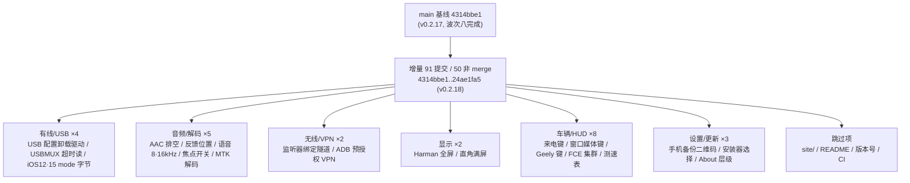

# DiPlay main 分支增量差异迁移报告（第二轮 · v0.2.18）

> **作者**: WorkBuddy
> **生成日期**: 2026-10-11
> **上一轮已登记 main 基线**: `4314bbe133599b21f40d23d3bf3de3f0d45353b4`（Merge PR #584，release/0.2.17）
> **本轮最新 main tip**: `24ae1fa5`（Merge PR #628，release/0.2.18）
> **当前分支**: `port/wave8-increment`（波次八 已完成，版本号 `0.2.17-api17` / versionCode 36）
> **本轮落定版本号**: `0.2.18-api17` / versionCode **37**（同步 main v0.2.18，详见 **§7**；规范见迁移指南 §0.6）
> **增量范围**: `git log 4314bbe1..origin/main` — **91 个提交（其中非 merge 50 个）**，对应 main 的 **v0.2.18 public preview** 发布批次
> **增量规模**: `git diff --shortstat 4314bbe1..origin/main` = **130 个文件，+6400 / −445**

---

## 0. 增量取数命令（每轮开始前重跑）

```sh
git fetch origin
git rev-parse origin/main                                  # 新基线，替换下一轮的锚点
git log 4314bbe1..origin/main --oneline                    # 本轮增量（91 提交）
git diff --stat 4314bbe1..origin/main                      # 130 文件 +6400/-445
```

> 本轮增量**无全新波次**：v0.2.18 的 22 个 PR 全部可归入既有波次（一～七）作为**叠加增量**，但引入了 **1 个新依赖（zxing）**、**1 个新构建特性（aidl）**、以及 **1 组在 API 17 上不可用的全新子系统（Telecom 电话音频）**。

---

## 1. 增量概览



### 1.1 增量功能总表（按波次归类）

> **✅ 波次九已完成（2026-10-12，分支 `port/wave9-increment`）**：下表"分支现状"列为**迁移前**评估。迁移结果：批次 A `42b5f653`、B `42f03d8a`、C `f967f18b`、D `069ce4ff`、E `dedd59a9`、F `8f4091b3`（44 文件）、G `bbcd16fc`（26 文件）逐项落地（#1–#26、#28–#32 中非跳过项全部完成，#30/#32 随既有结构与版本同步处理）；#27（#595 Telecom）按 §4 整体跳过守卫。逐项落地细节见迁移指南 §0.4 波次九各行。

| # | 功能 | main 提交/PR | 规模 | 归属波次 | 分支现状 | 移植方式 | API 17 风险 |
|---|------|--------------|------|---------|---------|---------|------------|
| 1 | USB 配置切换时卸载车机驱动（#518） | `e0cdc74b` #618 | +130 行，3 文件（新 `UsbConfigurationSelection`） | 二 | 分支已有 `compat/UsbDescriptorCompat.selectConfiguration`（:83） | **hunk 合并**：把 main 的强制 claim 卸载逻辑并入分支 compat 助手 | 低 |
| 2 | USBMUX 超时读回读字节，不再断会话（#610/#301） | `1c93dc9b` #625 | ±40 行 | 二 | 分支为旧版 `drainCancelledRead`（`IphoneUsbHost.kt:471/513`） | **替换**：`drainTimedOutRead(request, buffer)` | 低 |
| 3 | iOS 12/15 USB mode 短包字节（#509/#455） | `e0cdc74b` #618 | +8 行 | 二 | 有 `usbModeDiagnostic`（:346）旧版 | 叠加（纯逻辑） | 低 |
| 4 | 蓝牙 RFCOMM flush 被拒保持链路（#582） | `7ce3c7d8` #618 | +27 行 | 二/三 | 缺 `flushAllowed`/`bytesReceived`/`refusedIoctl` | 叠加 | 低（仅字符串匹配 errno） |
| 5 | 蓝牙链路"非真实"检测（#354） | `c5d2d8ad` #590 | +38 行（新 `BluetoothLinkCheck`）+ 控制器接线 | 三 | 全缺 | 新增纯逻辑 + `CarPlayController` 叠加 | 低 |
| 6 | 多 iPhone 经 A2DP sink/免提 client 查找（#585） | `667dffa8` #585 | +小 | 三 | 缺 | 叠加 | 低 |
| 7 | AAC 包丢弃前排空已解码音频（#381，10ms→0.5s） | `daffd2de` #618 | +60 行 | 一 | 有旧 `AndroidMediaSink` | **叠加/替换**（decoderDroppedTotal 文案同步） | 低 |
| 8 | 回放位置 vs 收到音频诊断（#620） | `aa08a6c5` #625 | +52 行（新 `FeedbackPositionMonitor`） | 一 | 全缺 | 新增 + `AndroidMediaSink` 接线 | 低 |
| 9 | **导航语音不再提供 8/16 kHz**（实验，#148/#341） | `81f2b894` #622 | +14 行 | 一 | `AirPlayInfoPlist.audioFormats` 旧版 | hunk 叠加 + 新设置 + 文案 | 低 |
| 10 | **关闭媒体键音频焦点**（实验，#615） | `3bd73082` #615 | +55 行 | 一/五 | `CarPlayMediaKeys` 已有焦点逻辑 | **重构分支 `start()`** | 低 |
| 11 | **MTK 解码器低延迟**（实验，#608） | `c07e7366`/`663ca9f6` #608 | +205 行（新 `MtkDecoderTuning`） | 四 | 全缺 | 新增 + `AndroidMediaSink` 解码尝试列表扩展 | **中**：`MediaCodecList.getCodecInfos()` 为 API 21+ |
| 12 | 有线 AirPlay 监听器绑定到 VPN 隧道（#557，Android 7.1） | `8126cb4c` #614 | +50 行 | 三 | 缺 `scopedToTunnel` | 叠加（**对 API 17 价值最高**） | 低 |
| 13 | 无 VPN 授权弹窗时经已批准 ADB 放行（#604） | `732e1918` #618 | +18 行（新 `VpnPreConsent`） | 三 | 有 `adb/LocalAdb`+`AdbKeys` | 直接新增 | 低 |
| 14 | **Harman 全屏**（实验，#603）+ 32 位 x86 ABI | `2db8a1d9` #613 | +24 行（新 `HarmanFullscreenCompat`） | 四/六 | **分支 abiFilters 已含 x86**（`shared/build.gradle:19`） | 新增（仅需 UI 侧）+ 设置 | **中**：`SYSTEM_UI_FLAG_IMMERSIVE` 为 API 19+ |
| 15 | **直角满屏 / 关闭安全区**（#578/#586） | `12e019fa` #596 | ±50 行 | 四 | `AirPlayInfoPlist.areaDict` 旧版 | hunk 叠加（cornerMasks + disableSafeArea） | 低 |
| 16 | 物理长度 25 mm 步进（#489/#591） | `c7a83ef6` #622 | ±12 行 | 六 | 缺 | 叠加（`CarPlayPicturePanel`） | 低 |
| 17 | 车机按键图标压缩到 192 px（#567） | `1c2bfd1f` #622 | +34 行（新 `AirPlayIconSizing`） | 一/四 | 全缺 | 新增 + `CarPlayPicturePanel` 接线 | 低 |
| 18 | DiPlayButton 按钮样式 + 焦点环（#594） | `bd521b50` #594 | +85 行（新 `DiPlayButton`） | 六 | 全缺 | 新增，**但必须改用分支 `UiCompat`** | **中**：`RippleDrawable` API 21+、`foreground` API 23+ |
| 19 | CarPlay 来电时方向盘键接听/挂断（#272） | `63e154a5` #622 | +8 行 | 五 | 有 `CarPlayCallKeyPolicy`（:33） | 叠加（`RINGING` 分支） | 低 |
| 20 | CarPlay 窗口内方向盘上/下一曲（#519/#602/#611） | `f65ca5c2`/`72f88054` #600 | +26 行 | 五/六 | `CarPlayMediaButton` 无 `forCarPlayWindow` | 新增函数 + `CarPlayHostActivity.dispatchKeyEvent` 接线 | 低 |
| 21 | **Geely/Lynk `geely_fx11` 方向盘键**（#149，含长按 Siri） | `4a896ea4` `1c2bfd1f` #626 | +190 行 + 2 aidl | 五 | 全缺 | 新增 3 文件 + **aidl 构建特性** | **中**：需 `buildFeatures { aidl true }`；服务仅在 Android 11 车机存在 |
| 22 | wheel-key 服务恢复重试 + 前后台复查（#606/#619） | `bfebe8a5`/`ae9a6c8a` #622/#625 | +66 行 | 五/六 | `WheelKeyService.restoreIfNeeded` 旧版（单次） | **替换为 `restoreWithRetries`** + 诊断 `report()` | 低 |
| 23 | **FCE 车机集群导航指引**（实验，#599） | `6feda68d`/`cc010bc5`/`3f98b2af` `2849c5d7` #599 | +394 行（3 新文件） | 五 | 全缺 | 新增 + `BydOutputSettings` + 设置 | 低（`ServiceManager` 反射在 API 17 可用） |
| 24 | **集群测速表**（实验，#423） | `42878066`/`aafb1ef7` #607 | +318 行（3 新文件） | 五/六 | 有 `BydWheelSpeed`/`BydVehicleFieldStore` | 新增 + `AirPlayPersistence` 7 键 + 设置 | 低 |
| 25 | 无 SOME/IP 网关时跳过 HUD 重试（#587） | `d983d084` #587 | +14 行 | 五 | 有 `BydHudBridge` | 叠加 | 低 |
| 26 | 热点名非英文警告（#303） | `bfb35f90`/`aa7cd204` #622 | +7 行 + 文案 | 六/七 | 有 `ManualHotspotValidation` | 叠加 + 1 条文案 ×7 | 低 |
| 27 | **车机电话音频**（实验，CarPlay 通话 + 其他 App VoIP，#18） | `3a1ac81a`/`8a1f35de`/`65dcf839`/`751e5068` #595 | +500 行（3 新文件） | 五 | 全缺 | ⏭️ **守卫/跳过**（见 §4） | **高**：Telecom 自管理通话 API 26+ |
| 28 | **手机浏览器备份/恢复设置**（#598）+ 二维码 | `2651bf8d`/`5820f626`/`068fbffc`/`a28ffdd6` #598 | +530 行（3 新文件 + html 资源） | 六/七 | 全缺 | 新增 + **zxing 依赖** + DiPlayActivity 备份页 | **中**：新依赖 zxing 3.5.3 |
| 29 | 更新安装器选择（#593） | `aa7cd204`/`5e4943a5` #593 | +55 行，3 文件 | 六 | **有** `update/` 包 5 文件 | hunk 叠加 + manifest `<queries>` | 低 |
| 30 | About 归入设置层级（#597） | `acc2baab` #597 | ±20 行 | 六 | 分支波次六已做 10 分类 | 叠加 + `AdaptiveSettingsUiTest` | 低 |
| 31 | 连接阶段文案全语言显示（#624） | `48b19676` #624 | +45 行 | 六/七 | `CarPlayHostActivity` 旧版 | 叠加（`englishResources`） | 低 |
| 32 | v0.2.18 发版（版本号 + site/ + README + docs） | `e8d23603` 等 | `mobile` 版本号 + site/ | 版本同步 | 分支版本 `0.2.17-api17` / versionCode 36 | ⏭️ 跳过 site/；**版本号按 §7 同步为 `0.2.18-api17` / 37** | — |

**图例**：移植方式 `替换` 表示"main 更优则替换"规则（见迁移指南 §0.3）；`⏭️` 表示建议跳过或守卫。

---

## 2. 重点功能分析

### 2.1 有线 CarPlay 稳定性四连修（#618/#625/#614）— 本轮对 API 17 价值最高

四条修复全部命中**老系统/老车机**的固有问题，对 `android-4.2.2`（API 17）分支的实际收益高于 main：

| 修复 | main 实现 | 分支适配要点 |
|------|-----------|--------------|
| **USB 配置切换卸载车机驱动**（#518） | 新增 `UsbConfigurationSelection.select(target, interfaceIds, setConfiguration, activeConfiguration, detach)`：先 `setConfiguration`，失败后 `claimInterface(iface, force=true)` → `releaseInterface` 逼出内核驱动，再重试一次；返回 `Outcome(target, selected, before, after, detached)` 供诊断 | 分支**已有** `compat/UsbDescriptorCompat.selectConfiguration(connection, device, configuration): Boolean`（`UsbDescriptorCompat.kt:83`）。**禁止整文件替换**：把 main 的 `select(...)` 纯逻辑搬进 `compat/`，令分支原函数委托它；分支规避 `getConfigurationCount()` 的枚举方式必须保留（分支提交 `3c28ca2b` 专为真机不兼容做的修复）。诊断串 `USB configuration select target=… ok=… before=… detached=… after=…` 照抄 |
| **USBMUX 超时读回读**（#610/#301） | `drainTimedOutRead(request, buffer)`：`cancel()` 失败不再直接断会话；`requests.await()` 有结果即回读 `buffer` 字节返回 | 分支现为 `drainCancelledRead(request)`（`IphoneUsbHost.kt:471` 调用、`:513` 定义），**整段替换**。`ByteBuffer.position()/flip()/get()` 全是 API 1，无适配。务必同步 `UsbmuxTimedOutReadTest`（新增 69 行） |
| **iOS 12/15 短 mode 字节**（#509/#455） | `usbModeDiagnostic` 对 `read in 1 until mode.size` 输出 `"$bytes (short:$read)"` | 分支已有同名函数（`:346`），**纯逻辑叠加**，改 3 行 |
| **有线监听器绑定 VPN 隧道**（#557） | `CarPlayVpnService.scopedToTunnel(address, listener)`：link-local IPv6 无 scopeId 时按 `NetworkInterface` 找 `tun*` 所属接口，`Inet6Address.getByAddress(null, addr, index)` 重建；`selectTunnelInterface` 静态可测 | **API 17 也会踩同一坑**（Android 7.x 原生 `PlainSocketImpl.socketBind` 不推导 scope，4.2.2 更不会）。新增 `scopedToTunnel`/`tunnelCandidates`/`selectTunnelInterface` 全部用 API 1/9 能力，**可直接移植**。诊断串 `wired AirPlay listener scope iface=tun0 index=…` |

### 2.2 蓝牙链路"非真实"检测（#590）

- **main 实现**：新增纯逻辑 `BluetoothLinkCheck`（`looksUnreal(connectMillis, bytesReceived)` = `<50ms 且 0 字节`；`controlProvesUnreal(...)` 用"连接一个不存在的服务"做对照实验；`SILENCE_MILLIS=12_000`；`UNREAL_MARK` 文案常量），`CarPlayController` 增加 `InstantBluetoothLink` + `watchForUnrealBluetooth` + `unrealBluetoothFailure`，`WirelessStartupPolicy` 新增 `BLUETOOTH_UNUSABLE` 与 `retryable` 属性。
- **分支基础**：`WirelessStartupPolicy`/`WirelessStartupException` 已有（波次三移植），`BluetoothRfcommDuplexStream` 已有；缺 `BluetoothLinkCheck`、`bytesReceived` 属性、`flushAllowed`。
- **移植**：`BluetoothLinkCheck.kt` 整文件新增；`BluetoothRfcommDuplexStream` 叠加 `flushAllowed`/`flushOutput`/`bytesReceived`/`refusedIoctl`（**注意**：`refusedIoctl` 只做 `message` 正则匹配，不 `import android.system.ErrnoException`，故 API 17 可用）；`WirelessStartupPolicy` 枚举追加一项；`CarPlayController` 按 hunk 叠加，勿整文件替换（分支波次三已改过该文件）。
- **测试**：`BluetoothLinkCheckTest`（35 行）、`BluetoothRfcommDuplexStreamTest`（+55 行）、`WirelessStartupRecoveryTest`（+10 行）。
- **注意**：诊断/失败文案经 `WirelessStartupFailure` 到 UI，`bluetooth_connections_not_real` 需进 ×7 语言。

### 2.3 MTK 解码器低延迟（#608，本轮唯一的新解码路径）⚠️ 需 API 21 守卫

- **main 实现**：`MtkDecoderTuning.kt`（90 行）：`isDecoderName`/`supportsLegacyAcodecKeys`/`isCodec2LowLatencyDecoder`/`selectedDecoderName`/`codec2LowLatencyDecoderName`/`legacyAcodecDecoderName`，键名 `vdec-lowlatency` / `vdec-no-record`（MTK 拼写，实为 no-reorder），并用 `ConcurrentHashMap` 缓存 `candidates(mime)`。`AndroidMediaSink` 的 `videoDecoderAttempts` 扩展出 `MtkDecoderMode` 维度与逐步回退（`dropMtkTuning`/`dropMtkCodec2LowLatency`）。
- **API 17 阻塞点**：`MediaCodecList(REGULAR_CODECS).codecInfos` 为 **API 21+**；`MediaCodecInfo.isAlias` 为 API 29（main 已用 `SDK_INT >= Q` 守卫）；`getCapabilitiesForType().isFeatureSupported` 为 API 29（main 已 `runCatching` 包裹）。
- **适配方案**：`listCandidates(mime)` 增加分支侧回退——`SDK_INT >= 21` 走 `codecInfos`；`< 21` 用 `MediaCodecList.getCodecCount()` + `getCodecInfoAt(i)`（API 16 起可用），并跳过 `isAlias`/`isFeatureSupported`（低版本一律 `lowLatency = false`）。**只有 `OMX.MTK.` 前缀路径在 API 17 上有意义**，`c2.mtk.` 分支自然为空，逻辑自洽。
- **验证**：`MtkDecoderTuningTest`（115 行）为纯 JUnit（用 `MtkDecoderCandidate` 列表构造），**可直接移植**；`AndroidMediaSink` 侧重跑解码尝试序列相关断言。

### 2.4 设置备份 / 恢复（#598，本轮最大新功能）⚠️ 新增 zxing 依赖

- **main 实现**：`backup/SettingsBackupServer.kt`（180 行，自实现 `ServerSocket` 单请求 HTTP 传输 + token + idle 超时）、`backup/SettingsBackupCodec.kt`（177 行，白名单式导入导出，`org.json`）、`backup/SettingsQrCode.kt`（43 行，`QRCodeWriter` 渲染带圆角卡片）、`assets/settings-backup.html`（130 行，手机浏览器页面）、`DiPlayActivity` 新增 `page="backup"` 分支 + About 卡入口。
- **依赖**：`gradle/libs.versions.toml` 新增 `zxing = "3.5.3"` + `zxing-core`；`common/build.gradle.kts` 新增 `implementation(libs.zxing.core)`。**分支 `libs.versions.toml` 目前无 zxing**，需自行追加；分支 `common` 已开 `isCoreLibraryDesugaringEnabled = true` + Java 8（`common/build.gradle.kts:22-26`），zxing 3.5.x 的 Java 8 字节码可被 D8 处理。
- **API 17 适配**：
  - `ServerSocket`/`Socket`/`Inet4Address`/`NetworkInterface` 全为 API 1～9，**无阻碍**；
  - `Bitmap.createBitmap(int[], w, h, ARGB_8888)` 为 API 1，**无阻碍**；
  - `SettingsBackupCodec` 用 `org.json`（Android 内建）+ `SharedPreferences.Editor`，**无阻碍**；
  - `SettingsBackupServer.addressCandidates(preferredPrefix)` 依赖 `WifiManager`/`NetworkInterface`，分支 `NetworkCompat` 已处理老版本差异，移植时确认走分支 compat。
- **安全语义必须保留**：只导出白名单键（配对密钥 `pairing.*`、lockdown、认证目标、车机热点名/密码**永不导出**），导入端做数值/版本校验（`068fbffc`）。分支若已改过 `xcertplay_airplay` 的键集合，白名单需按分支实际键名核对补齐（如分支独有的 `bt_suspend_*`、`hide_byd_call_popup` 等）。
- **UI**：备份页遵守 AGENTS.md——不进 Overview，入口在 `SettingsCategory.ABOUT` 卡内；离开页面即 `stopBackupServer()`，10 分钟 idle 自动停。

### 2.5 Geely/Lynk 方向盘键（#626）⚠️ 新构建特性 aidl

- **main 实现**：`GeelyWheelKeys.kt`（150 行，`bindService` → `com.geely.inputservice.InputService`，`IInputManager.registerListener` 收原始键码）、`GeelyWheelKeyCodes.kt`（28 行，键码映射）、`network/GeelyHeadUnit.kt`（35 行，机型探测）、`shared/src/main/aidl/com/geely/lib/oneosapi/input/{IInputManager,IInputListener}.aidl`，并在 `shared/build.gradle` 增加 `buildFeatures { aidl true }`，`CarPlayMediaKeys.start/stop` 增加 `GeelyWheelKeys.start(context)` / `stop()`。
- **API 17 适配**：
  - `bindService`/`ServiceConnection`/`IBinder` 全为 API 1，**编译无障碍**；
  - 但目标服务只在 Geely/Lynk `geely_fx11`（Android 11）存在 → `GeelyHeadUnit.detected` 为 false 时静默不动作，**API 17 设备上恒为不动作**，属安全空转；
  - 需要给分支 `shared/build.gradle` 加 `aidl true`（分支当前 `buildFeatures` 里没有该行，见 `shared/build.gradle`）。
- **文档**：`docs/COMPATIBILITY.md` +13 行（HiCar 占用长按说明）按需同步。

### 2.6 FCE 集群导航指引（#599）与集群测速表（#607）

- **FCE（#599）**：`hud/FceClusterBridge.kt`（92 行）、`hud/FceClusterOutput.kt`（231 行）、`hud/FceCarPropertyWriter.kt`（71 行，`Class.forName("android.os.ServiceManager")` 反射 + `fce_misc_service_hal_property`）。反射写法与分支 `BydAdbShell`/`BydStarterBridge` 同源，**API 17 可用**；`BydOutputSettings` 增加 `fceClusterAvailable()`/`fceCluster()`；设置归 **NAVIGATION → BYD_NAVIGATION 卡**（分支该卡已存在，`DiPlayActivity.kt:115/2464`）；`cc010bc5` 把该能力改为 opt-in。
- **测速表（#607）**：`ClusterSpeedometerView.kt`（190 行，自绘 View）、`airplay/ClusterSpeedometerOverlay.kt`（64 行，位置/尺寸/透明度 snap 逻辑）、`hud/BydClusterSpeedReader.kt`（36 行，250 ms 轮询 `BydAdbShell` + `BydWheelSpeed`，2 s 超时判定失效）。三者均复用分支已有 ADB/车速设施，**无版本 API 阻碍**；`AirPlayPersistence` 需追加 7 个 `cluster_speedometer_*` 键 + `observeClusterSpeedometer`；设置归 **ADVANCED**（与"CarPlay map on dashboard"同卡，AGENTS.md 要求标 `(experimental)`）。

### 2.7 DiPlayButton（#594）⚠️ 必须走 UiCompat

- **main 实现**：`DiPlayButton`（85 行）直接 `background = RippleDrawable(...)`（**API 21+**）+ `foreground = StateListDrawable(...)`（**API 23+**）。
- **分支现状**：已有 `common/src/main/java/com/shilapi/xcertplay/UiCompat.kt`——`UiCompat.ripple(...)`（:36-39，低于 21 回退为 content shape）与 `UiCompat.setForeground(view, drawable)`（:49-51，低于 23 no-op）。
- **适配**：移植时**不得照抄**两处直调，改调 `UiCompat.ripple(...)` + `UiCompat.setForeground(...)`；调用点 `CarPlayHostActivity`（waiting screen 三个按钮）与 `DiPlayActivity` 等待屏同步。`stateListAnimator = null` 为 API 21+，同样需守卫。

### 2.8 其余要点

- **USB 充电电流/`UpdateApkExport`（#593）**：`copy()` 返回值由 `String?` 变为 `Saved(path, uri)`，`UpdateAvailability` 增 `lastInstall`，`UpdateChecksums` 增 `sha256Hex(InputStream)` 重载。**分支 `update/` 包 5 文件已存在**，按 hunk 叠加；manifest `common` 增 `<queries><intent VIEW content apk>`（低版本忽略，无害）。
- **焦点开关（#615）**：`CarPlayMediaKeys.start()` 重构——`disable_media_key_audio_focus` 为真时**不申请焦点**但仍保留 MediaSession。分支该文件已移植过（波次五/八），**hunk 叠加**，`focusOwner`/`focusRequest`/`focusHeld` 置空的分支必须一起改，否则焦点回调残留。
- **wheel-key 服务恢复（#622/#625）**：`WheelKeyService.restoreWithRetries(needsRestore, restore, sleep, attempts=6, onAttempt)` + `recordRestore` + 诊断 `report()`；并把 `restoreIfNeeded` 从 `CarPlayHostActivity.onCreate` 移到 `onResume`（`DiPlayActivity` 也调用）。分支已有 `LocalAdb.Access.{READY,NOT_APPROVED,UNSUPPORTED}` 枚举，注意与分支 `CarPlayCallKeys` 的接线顺序。`WheelKeyRestoreRetryTest`（40 行）纯 JUnit 可移。
- **窗口媒体键（#600）**：`CarPlayMediaButton.forCarPlayWindow(keyCode, sessionActive, inCall)` 只认 `KEYCODE_MEDIA_NEXT/PREVIOUS`；`CarPlayHostActivity.dispatchKeyEvent` 在 `WheelZoomKeys` 判定之后、Siri 判定之前插入，按下即发、吞掉抬起（避免 BYD 播放器收到不成对的键）。分支 `dispatchKeyEvent` 顺序已含 `assignedAction`/Siri 分支（main diff 上下文可见），按位插入即可。
- **来电键（#622）**：`CarPlayCallKeyPolicy.onKey` 增 `ringing && KEYCODE_MEDIA_NEXT → ANSWER`、`ringing && KEYCODE_MEDIA_PREVIOUS → END` 两条；分支该函数在 `hud/CarPlayCallKeyPolicy.kt:33`，纯逻辑叠加。
- **AAC 排空（#618）**：`AndroidMediaSink` 音乐解码等待由 10 ms 提升到 0.5 s（与视频一致），丢弃计数改 `decoderDroppedTotal`。分支该文件波次一/八已改过，**hunk 叠加**，勿整文件替换。
- **语音 8/16 kHz（#622）**：`AirPlayInfoPlist.audioFormats(..., speechWithout8And16Khz)` 用 `pcm and 0x3c.inv()` 抹掉 8/16 kHz；`AirPlayConfig` 增字段；设置标 `(experimental)` 且 `reconnectIfRunning()`。
- **Harman 全屏（#613）**：`HarmanFullscreenCompat` 用 `View.SYSTEM_UI_FLAG_IMMERSIVE`（**API 19+**）+ OEM 位 `0x8`。API 17 上需降级为 `FULLSCREEN or HIDE_NAVIGATION or 0x8`（去掉 IMMERSIVE）；`apply/clear` 两处都要守卫。x86 native 库分支**已具备**（`shared/build.gradle:19` 已含 `'x86'`），**无需再动 ABI**。
- **直角满屏（#596）**：`AirPlayInfoPlist.areaDict` 增 `disableSafeArea`（主屏 `mainDisplayDisableSafeArea` 为真则不写 `safeArea`）与 `cornerMasks`；纯逻辑，主屏判定用 `uuid == MAIN_UUID`。
- **连接阶段文案（#624）**：`CarPlayHostActivity` 增 `englishResources`（`createConfigurationContext` + `Locale.ENGLISH`，API 17 可用）供 `friendlyStage` 匹配英文关键字；`CarPlayStageTextTest`（74 行）为纯逻辑/资源测试。
- **热点名警告（#622）**：`ManualHotspotValidation` 增非英文检测，`settings_hotspot_name_non_english` ×7。

---

## 3. API 17 适配要点汇总

| 类别 | main 用法 | 最低 API | 分支处置 |
|------|-----------|---------|---------|
| `MediaCodecList.getCodecInfos()` | MTK 候选枚举 | 21 | `<21` 回退 `getCodecCount()`/`getCodecInfoAt()`；`isAlias`(29)/`isFeatureSupported`(29) 低版本一律 false |
| `View.SYSTEM_UI_FLAG_IMMERSIVE` | Harman 全屏 | 19 | `<19` 去掉 IMMERSIVE，仅 `FULLSCREEN or HIDE_NAVIGATION` |
| `RippleDrawable` / `View.setForeground` | DiPlayButton | 21 / 23 | 改走分支 `UiCompat.ripple` / `UiCompat.setForeground` |
| `stateListAnimator` | DiPlayButton | 21 | 加 `SDK_INT >= 21` 守卫 |
| Telecom 自管理通话 `PhoneAccount.CAPABILITY_SELF_MANAGED` | #595 | 26 | **不可用** → 整块跳过/守卫（§4） |
| `AudioManager.AudioPlaybackCallback` / `getSystemService(Class)` | #595 | 26 / 23 | 随 #595 一并跳过 |
| `AudioRecordingConfiguration.clientAudioSource` | #595 | 29 | 随 #595 一并跳过 |
| `MediaStore.Downloads` | 更新/诊断导出 | 29 | 分支已有 API 17 写入路径，保留 |
| `UsbDevice.getConfigurationCount()` | #618 配置卸载 | 12（真机不兼容） | 分支提交 `3c28ca2b` 已规避，**保留分支枚举方式** |
| `buildFeatures { aidl true }` | Geely | 构建期 | 分支 `shared/build.gradle` 需补该行 |
| zxing `com.google.zxing:core:3.5.3` | 设置备份二维码 | Java 8 字节码 | 走分支已开启的 core library desugaring；见 §5 风险 |
| `org.json` / `ServerSocket` / `Bitmap.createBitmap(int[])` | 设置备份 | 1 | 无阻碍 |
| `android.os.ServiceManager` 反射 | FCE 集群 | — | 反射方案在 API 17 可用 |
| `errno` 文本正则匹配 | 蓝牙 flush | — | 仅匹配 message，不依赖 `android.system.ErrnoException` |

---

## 4. 不移植 / 需守卫项

| 类别 | 内容 | 处置 |
|------|------|------|
| **全新子系统** | **#595 车机电话音频**（`telecom/PhoneAudioRoute`、`TelecomPhoneAudioBackend`、`VoipCallWatcher`）| **⏭️ 跳过 UI 与后端**。理由：自管理通话需 API 26、`VoipCallWatcher` 需 API 23/26/29；API 17 上**三项前置条件全部不满足**，功能恒不可用。`BydOutputSettings.phoneAudioRoute*/phoneAudioRouteApps` 应返回 false（或整体不引入），`WheelKeyService.wanted()` 不追加 `phoneAudioRouteApps` 项，`shared/AndroidManifest.xml` 不声明 `MANAGE_OWN_CALLS` 与 `PhoneAudioConnectionService`。**可选**：仅移植纯逻辑 `PhoneAudioRouteController` + `PhoneAudioRouteControllerTest`（190 行）留作将来跨平台复用，但不接 UI |
| 构建链 | `gradle/libs.versions.toml` 的 main 版本（AGP 9.x/Kotlin 2.2.x/media3 1.11.1/work 2.12.0）、`gradle-wrapper.properties` | **绝不覆盖**；仅按需追加 `zxing = "3.5.3"` 与 `zxing-core` |
| 构建链 | `buildFeatures { aidl true }` | **按需追加**（Geely 功能需要）；若判定 Geely 功能对本分支无收益，可整块跳过 |
| 发版 | `site/**`、`site/content.json`、`scripts/build_site.py`、`README*.md`、`docs/RELEASE-NOTES-0.2.18.md` | 跳过 site/ 与 README；**版本号必须同步**，见 §7（`mobile` → `versionCode 37` / `versionName "0.2.18-api17"`）；分支 `docs/` **不新增** `RELEASE-NOTES-0.2.18.md`（详见 §7.4） |
| 文档 | `docs/RELEASE-NOTES-0.2.18.md`、`docs/RELEASE-NOTES-NEXT.md`、`docs/INSTALL.md`、`docs/VALIDATION.md`、`docs/COMPATIBILITY.md`、`docs/BYD_NAVIGATION.md`、`CHANGELOG.md` | 按需同步（不影响构建）；`docs/BYD_NAVIGATION.md` 的 FCE/电话音频章节只在对应功能落地后同步 |
| CI | `.github/workflows/**` | 不覆盖 |

---

## 5. 建议迁移计划（增量轮次：第 9 轮）

```mermaid
flowchart LR
    R0["准备<br/>fetch + 建分支<br/>port/wave9-increment<br/>登记基线 24ae1fa5"] --> R1["批次A 纯逻辑小项<br/>iOS12/15 mode · 蓝牙flush<br/>图标192px · 25mm · About层级 · 热点文案"]
    R1 --> R2["批次B USB/传输<br/>#618 配置卸载驱动 + #625 超时读<br/>#590 链路检测 + #585 profile"]
    R2 --> R3["批次C 音频/解码<br/>AAC 排空 · 反馈位置<br/>语音8/16kHz · 焦点开关 · MTK(API21守卫)"]
    R3 --> R4["批次D 无线/VPN<br/>#614 监听器绑定隧道<br/>#618c ADB 预授权 VPN"]
    R4 --> R5["批次E 显示<br/>Harman全屏(API19守卫) · 直角满屏"]
    R5 --> R6["批次F 车辆/HUD<br/>来电键 · 窗口媒体键 · 服务恢复重试<br/>Geely(aidl) · FCE · 测速表 · SOME/IP"]
    R6 --> R7["批次G 新功能块<br/>DiPlayButton(UiCompat) · 设置备份(zxing)<br/>安装器选择"]
    R7 --> R8["批次H 守卫项<br/>#595 Telecom 整体跳过<br/>manifest 不声明"]
    R8 --> R9["收尾: 字符串×7 全量核对<br/>SettingsTranslationsTest + CI 全量<br/>**版本号同步 §7**<br/>更新迁移指南 §0.1/§0.4/§0.6"]
```



### 5.1 批次划分与验证

| 批次 | 内容 | 关键验证命令 |
|------|------|-------------|
| **A（先行，风险最低）** | #618b `usbModeDiagnostic` 短包、#618d 蓝牙 flush 保留、#622c 图标 192px、#622b 25mm 步进、#597 About 层级、#622f 热点名警告 | `:common:testDebugUnitTest --tests "*AirPlayIconSizing*" --tests "*AdaptiveSettingsUi*"` `:shared:testDebugUnitTest --tests "*BluetoothRfcommDuplexStream*"` |
| **B（USB/传输）** | #618a `UsbConfigurationSelection` 并入 `UsbDescriptorCompat`、#625a `drainTimedOutRead`、#590 `BluetoothLinkCheck`、#585 profile 查找 | `NcmUsbBridgeFramingTest`（9 条）+ `UsbmuxTimedOutReadTest` + `BluetoothLinkCheckTest` + `WirelessStartupRecoveryTest` + `UsbDescriptorCompatTest`（分支已有） |
| **C（音频/解码）** | #618f AAC 排空、#625b `FeedbackPositionMonitor`、#622a 语音 8/16kHz、#615 焦点开关、#608 MTK（**含 API 21 回退**） | `MtkDecoderTuningTest` + `FeedbackPositionMonitorTest` + `AudioFocusSettingsTest` + `CarPlayMediaFocusDisabledTest`（105 行）+ `AirPlayInfoPlistTest` |
| **D（无线/VPN）** | #614 监听器 `scopedToTunnel`、#618c `VpnPreConsent` | `CarPlayVpnListenerScopeTest`（60 行）+ `WirelessStartupRecoveryTest` |
| **E（显示）** | #613 Harman 全屏（**API 19 守卫**）、#596 直角满屏 | `CarPlayHostDisplaySizeTest`（+27 行）+ `SystemBarSettingsTest`（+21 行）+ `CarPlaySizeTest` |
| **F（车辆/HUD）** | #622d 来电键、#600 窗口媒体键、#622e 服务恢复重试、#626 Geely（aidl）、#599 FCE、#607 测速表、#587 SOME/IP | `WheelMediaKeyWindowTest`（109 行）+ `WheelKeyRestoreRetryTest` + `GeelyWheelKeyCodesTest` + `FceClusterBridgeTest`/`FceClusterOutputTest`/`FceManeuverCodesTest` + `ClusterSpeedometerSettingsTest` + `BydClusterSpeedReaderTest` + `BydHudBridgeTest` |
| **G（新功能块）** | #594 `DiPlayButton`（**改用 UiCompat**）、#598 设置备份（**加 zxing**）、#593 安装器选择 | `SettingsBackupCodecTest` + `SettingsBackupServerTest` + `SettingsQrCodeTest` + `UpdateApkExportTest` + `UpdateAvailabilityTest` + `UpdateInstallCompatibilityTest` |
| **H（守卫）** | #595 Telecom 整体跳过；`shared/AndroidManifest.xml` 不声明 `MANAGE_OWN_CALLS`/`PhoneAudioConnectionService`；`common` manifest 只取 `<queries>` 的 VIEW 项 | 编译 + `:shared:assembleDebug` 确认无 Telecom 类引用残留 |

### 5.2 字符串义务（AI17 侧新增 34 条 × 7 语言）

main 在 `values/strings.xml` 新增 **34 行**，`values-{ar,es,ru,uk,zh-rCN,zh-rTW}` 各 34 行，**已齐**——可直接按语言对应复制。新增字符串分组：

| 分组 | 条数 | 归属 |
|------|------|------|
| 直角满屏（`rect_fill_disable_safe_area*`） | 3 | 六/七 |
| 来电键说明（`carplay_call_controls_experimental_description` 改写） | 1 | 七 |
| 电话音频（`phone_audio_route*`） | 4 | **跳过（随 #595）**，可不引入 |
| MTK（`settings_mtk_decoder_tuning*`） | 2 | 六/七 |
| 设置备份（`backup_*`） | 7 | 六/七 |
| 媒体键焦点（`settings_disable_media_key_audio_focus*`） | 2 | 六/七 |
| 集群测速表（`settings_cluster_speedometer*`） | 5 | 六/七 |
| Harman 全屏（`settings_harman_fullscreen_experimental*`） | 2 | 六/七 |
| 热点名警告（`settings_hotspot_name_non_english`） | 1 | 七 |
| 语音低采样率（`settings_speech_without_low_rates*`） | 2 | 七 |
| 蓝牙链路不可用（`bluetooth_connections_not_real`） | 1 | 七 |
| FCE 集群（`settings_fce_cluster_guidance*`） | 2 | 六/七 |

> 若跳过 #595，实际需引入 **30 条 ×7**。实验性条目（MTK / 媒体键焦点 / Harman / 测速表 / FCE）在各语言使用**既有后缀形式**：`(تجريبي)` / `(experimental)` / `(экспериментально)` / `(експериментально)` / `（实验性）` / `（實驗性）`。

### 5.3 新增依赖与构建改动（本轮唯一）

```diff
# gradle/libs.versions.toml（分支按需追加，其余版本不动）
+zxing = "3.5.3"
+zxing-core = { group = "com.google.zxing", name = "core", version.ref = "zxing" }

# common/build.gradle.kts
+    implementation(libs.zxing.core)

# shared/build.gradle（Geely aidl，可选）
+    buildFeatures { aidl true }
```

### 5.4 完成后文档更新义务（迁移指南 §0.5 / §0.6）

1. §0.4 进度表新增"波次九（增量轮）"各行（批次 A–H）；
2. §0.1 基线快照把"main 基线"推进到 `24ae1fa5`；
3. **版本号同步（每轮必做）**：`mobile` → `versionCode 37` / `versionName "0.2.18-api17"`，并追加 `CHANGELOG.md` 首段；详见 **§7** 与指南 **§0.6**；
4. 本报告对应项标记完成日期与分支提交哈希；
5. §0.3"main 更优则替换"清单登记 `drainCancelledRead → drainTimedOutRead`、`restoreIfNeeded 单次 → restoreWithRetries`、`UsbDescriptorCompat.selectConfiguration → 并入 UsbConfigurationSelection`；
6. 文档头部"最后更新"日期同步。

---

## 6. 风险清单

| 风险 | 等级 | 说明 | 缓解 |
|------|------|------|------|
| **zxing 3.5.3 在本构建链的可用性** | **中** | 分支 AGP 7.4.2 + Java 8 源码 + desugaring；zxing 3.5.x 要求 Java 8 字节码，个别类用 `java.nio.charset.StandardCharsets`(API 19) | 已开 core library desugaring；若 D8 报错，降级 `zxing 3.4.1`（Java 6 目标）或只保留 `core` 模块（不引 `javase`） |
| **MTK 解码 `getCodecInfos()` API 21 阻塞** | **中** | 直接编译会在 API 17 lint 报警，运行期 `NoSuchMethodError` | `listCandidates` 加 `SDK_INT >= 21` 分支回退 `getCodecCount()/getCodecInfoAt()`；低版本 `lowLatency=false` |
| **`DiPlayButton` 直调 RippleDrawable/foreground** | **中** | 照抄必在 API 17 崩（`NoClassDefFoundError`/`NoSuchMethodError`） | 改走 `UiCompat.ripple`/`UiCompat.setForeground`；`stateListAnimator` 加守卫 |
| **Harman 全屏 `IMMERSIVE` 位** | 中 | API 19+ 常量；4.2.2 上 `SYSTEM_UI_FLAG_IMMERSIVE` 未定义 | `<19` 只保留 `FULLSCREEN or HIDE_NAVIGATION or 0x8` |
| **#595 Telecom 强制移植会在 API 17 崩** | 高（若强移） | `android.telecom.*` 类在 API 17 不存在，`MANAGE_OWN_CALLS` 无法声明 | **整体跳过**（§4）；manifest、`WheelKeyService.wanted()`、设置项、文案一律不引入 |
| **`IphoneUsbHost` 与分支既有 compat 重叠** | 中 | 分支已有 `UsbDescriptorCompat.selectConfiguration`（:83）与规避 `getConfigurationCount()` 的枚举；main 用 `device.configurationCount` | 只搬 main 的 `UsbConfigurationSelection` 纯逻辑，令分支 compat 委托；**禁止整文件替换**；重跑 `UsbDescriptorCompatTest` |
| **`CarPlayMediaKeys.start()` 焦点重构与分支分叉** | 中 | 波次五/八已改过该文件（`AudioFocusRequestCompat` 注入） | hunk 级叠加；`focusOwner/focusRequest/focusHeld` 三处置空要一起改；重跑 `CarPlayMediaFocusForwardingTest`/`CarPlayMediaFocusDisabledTest` |
| **`WheelKeyService` 恢复时机变更** | 中 | `onCreate` → `onResume`；`DiPlayActivity` 也调用；与 `CarPlayCallKeys.install` 顺序相关 | 两处调用点同步；`restoreWithRetries` 的 `NOT_APPROVED/UNSUPPORTED` 提前返回分支必须保留（分支 `LocalAdb.Access` 语义） |
| **`AndroidMediaSink` 多处叠加** | 中 | 本轮同时改 AAC 排空(#618f)、MTK(#608)、反馈位置(#625b)、电话回消（#595 跳过） | 分三次 hunk 叠加，每次跑 `VideoDecodeQueueTest`/音频相关断言；勿整文件替换 |
| **设置备份白名单与分支键集不一致** | 低 | 分支独有键（`bt_suspend_*`、`hide_byd_call_popup`、`usb_charging_current` 等）可能未在 main 的 `AIRPLAY_KEYS` 中 | 移植时按分支实际 `AirPlayPersistence` 键名补齐白名单，并保留"绝不导出 pairing/lockdown/hotspot"原则 |
| **Geely aidl 构建特性** | 低 | 分支 `shared/build.gradle` 未开 `aidl true` | 追加一行；若判定无收益可整块跳过（API 17 机恒不触发） |
| **诊断报告新增行** | 低 | 多处新增（`USB configuration select`、`wired AirPlay listener scope`、`Bluetooth link check`、`Wheel key service:`、`lastInstall=`） | 属诊断子系统（`LogManager`），随功能落地同步接线 |

---

## 7. main 版本号与 CHANGELOG 同步（本轮落定值）

> 规范全文见迁移指南 **§0.6**。本节给出本轮（第 9 轮 / main v0.2.18）的具体落定值与执行清单。

### 7.1 同步对象（唯一信息源）

main 侧的版本号载体只有一处，**每轮开工先读它**：

```sh
git show origin/main:mobile/build.gradle.kts | grep -E "versionCode|versionName"
# 本轮输出：versionCode = 37 / versionName = "0.2.18"
```

分支对应改动**只落在 `mobile/build.gradle.kts` 的 `defaultConfig` 两行**，其余模块一律不动。

### 7.2 本轮落定值

| 载体 | main `24ae1fa5`（v0.2.18） | 分支本轮落定 | 备注 |
|------|---------------------------|-------------|------|
| `mobile` `versionCode` | `37` | **`37`** | 与 main **取同值**，不独立递增 |
| `mobile` `versionName` | `0.2.18` | **`0.2.18-api17`** | `-api17` 后缀是分支标识，永不省略 |
| debug `versionName` | `0.2.18-hud-test` | **`0.2.18-api17-hud-test`** | `buildTypes.debug` 已含 `versionNameSuffix = "-hud-test"`，**保持不动** |
| debug `applicationId` | `com.shihab.diplay.hudtest` | 同 | `applicationIdSuffix = ".hudtest"`，**保持不动**（使 debug 与 release 可并存安装） |
| `CHANGELOG.md` 首段标题 | `# DiPlay 0.2.18 — 2026-10-11` | **`# DiPlay 0.2.18-api17 — <本轮日期>`** | |
| 上一轮（v0.2.17） | `36` / `0.2.17` | `36` / `0.2.17-api17`（已完成） | 递增关系可核对 |

改动示意（分支现状 → 本轮）：

```diff
# mobile/build.gradle.kts
     defaultConfig {
         applicationId = "com.shihab.diplay"
         minSdk = 17
         targetSdk = 17
-        versionCode = 36
-        versionName = "0.2.17-api17"
+        versionCode = 37
+        versionName = "0.2.18-api17"
```

### 7.3 不同步的模块（**误改会破坏独立版本线**）

| 模块 | 两分支现值 | 本轮处置 |
|------|-----------|---------|
| `automotive/build.gradle.kts`（`:automotive`） | `versionCode 1201` / `versionName "1.2.1"` | **不动**，跟随 main 原值，**不追加 `-api17`** |
| `samples/home/build.gradle.kts`（`:home`） | `versionCode 1` / `versionName "0.1"` | **不动** |
| `samples/maphost/build.gradle.kts`（`:maphost`） | `versionCode 1` / `versionName "1.0"` | **不动** |
| `shared/`、`common/`、`legacy-mdns/` | 库模块，无版本号 | — |

### 7.4 CHANGELOG 与 RELEASE-NOTES 处置

1. **追加分支 CHANGELOG 首段**（模板见指南 §0.6.4）：
   ```
   # DiPlay 0.2.18-api17 — <本轮日期>

   Android 4.2.2 (API 17) port of DiPlay 0.2.18 (`main` @ `24ae1fa5`). <波次九进度一句话>
   - <逐条列本轮增量的 main PR 号（#625/#614/#618/#624/#590/#622/#600/#626/#598/#593/#595/#613/#596/#608/#607/#599/#615/#587/#585/#594/#597）+ 功能一句话>
   - Skipped or degraded on API 17: <跳过项清单>; minSdk stays 17 and the `-api17` suffix marks the port.
   ```
2. **保留 main 的历史英文段落**（`# DiPlay 0.2.17`、`# DiPlay 0.2.14`…）原样不动，**只追加、不改写**；
3. **跳过项必须显式列出**——本轮至少应含：**#595 车机电话音频**（Telecom 自管理通话需 API 26+，API 17 不可用，见 §4）、`site/` 与 README 未同步、（若执行）#626 Geely 因无 `geely_fx11` 车机而不生效；
4. **分支 `docs/` 不新增** `RELEASE-NOTES-0.2.18.md`：分支只保留到 `RELEASE-NOTES-0.2.14.md`；main 的新 release notes **不复制**，功能清单落在分支 `CHANGELOG.md` + 迁移指南 §0.4 + 本报告。

### 7.5 执行与校验清单

| # | 步骤 | 通过标准 |
|---|------|---------|
| 1 | 读 main 版本号 `git show origin/main:mobile/build.gradle.kts` | 得到 `versionCode` / `versionName` |
| 2 | 改 `mobile/build.gradle.kts` `defaultConfig` 两行 | `37` / `"0.2.18-api17"` |
| 3 | 确认 `buildTypes.debug` 未被动过 | 仍为 `applicationIdSuffix = ".hudtest"` + `versionNameSuffix = "-hud-test"` |
| 4 | 确认 `automotive` / `:home` / `:maphost` 未被动过 | 与 main 逐字一致 |
| 5 | 追加 `CHANGELOG.md` 首段 | 标题含 `0.2.18-api17`；段尾含跳过项；历史段落未改写 |
| 6 | 构建校验 | `./gradlew :mobile:assembleRelease` 后 `aapt dump badging ... | grep versionName` → 以 `-api17` 结尾；`versionCode` = 37 |

### 7.6 与 CI / 测试的关系

- 分支 `mobile` 的 `versionName` 被"关于"页与诊断报告（`appVersion`）读取；迁移文档与 `CHANGELOG` 段落的版本号必须与之保持一致，否则真机反馈无法与迁移进度对齐。
- 本轮**不涉及任何测试断言版本号的用例**（`UpdateHomeAvailabilityTest` / `UpdateInstallCompatibilityTest` 断言的是更新清单内容而非本地版本），故版本号改动不影响测试基线。

---

## 8. 与上一轮（波次八）的衔接说明

- 上一轮的**跳过项**在本轮**未被 main 追补**，无需回头处理：`RemoteMfi` 测试超时调整、`site/**`、CI。
- 上一轮引入但被降级的 **WorkManager 2.8.1** 在本轮无人触碰（main 仍为 `work 2.12.0`），**保持分支现状不动**。
- 上一轮的 **`DiagnosticExportStore` / `MediaStore.Downloads` 语义保留**策略在本轮 #593 的 `UpdateApkExport.Saved(uri)` 上继续适用：只取"可选择安装器 + 用公开 Downloads 副本"的**行为语义**，底层写入路径保留分支实现。
- 分支 `shared/build.gradle:19` 已含 `'x86'`，故 main #613 的 "32-bit x86 ABI" 部分**无需再动**；仅需移植 Harman 全屏 UI 开关。
