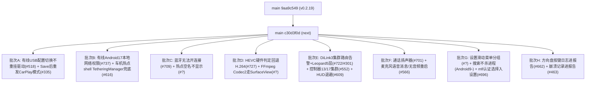

# DiPlay main 分支增量差异迁移报告（第五轮 · 0.2.19 之后 · 0.2.19-next）

> **作者**: WorkBuddy
> **生成日期**: 2026-10-14
> **上一轮已登记 main 基线**: `9aa9c549`（`Prepare DiPlay 0.2.19 public preview release`，即 0.2.19 公开发布版）
> **本轮最新 main tip**: `c30d3f0d`（`Merge pull request #734`，领先 `9aa9c549` 之后的增量）
> **当前分支**: `port/wave9-increment` @ `a0c6ef7a`
> **上一轮文档**: `DiPlay-main分支增量差异迁移报告-0.2.19.md`
> **增量范围**: `git log 9aa9c549..origin/main` — **36 个提交（其中非 merge 18 个）**
> **增量规模**: `git diff --shortstat 9aa9c549..origin/main` = **~43 个源文件（+ 大量测试 + 截图 + docs/RELEASE-NOTES-NEXT.md）**
> **本轮落定目标版本号（建议）**: **`0.2.20-api17`** **/ versionCode 39**（main 尚未打 0.2.20 tag；本轮为 "next release" 增量，见 `docs/RELEASE-NOTES-NEXT.md`）

> ⚠️ **本轮与前四轮的本质差异**：前四轮迁移的是已经打 tag 的 `0.2.17 / 0.2.18 / 0.2.19` 公开发布版；本轮是 **0.2.19 之后、尚未发版** 的开发增量（main 的 `RELEASE-NOTES-NEXT.md` 称之为 "next release"）。因此本报告沿用 `-0.2.19-next.md` 命名（与 `-0.2.18-next.md` 策略一致），待 main 打 0.2.20 tag 后固化为 `-0.2.20.md`。

***

## 0. 增量取数命令（每轮开始前重跑）

```sh
git fetch origin
git rev-parse origin/main                                  # 新基线替换下一轮锚点 → c30d3f0d
git log  9aa9c549..origin/main --oneline | wc -l           # 本轮增量（36 提交 / 18 非 merge）
git diff --shortstat 9aa9c549..origin/main                 # 43 源文件级改动
git diff --diff-filter=A --name-status 9aa9c549..origin/main   # 本轮新增文件（见 §1.2）
git diff --diff-filter=D --name-status 9aa9c549..origin/main   # 本轮删除文件（空）
```

> **编译基线核对（关键）**: 本仓库 `common/build.gradle.kts` 实测 `compileSdk = 36`、`targetSdk = 17`、`minSdk = 17`。
> 因此 main 中任何 **`Build.VERSION_CODES.CINNAMON_BUN`（API 37 代号）** 在编译期 **不可解析**——本轮 `WiredPermissions.kt` 必须改写为字面量 `37`（与分支既有 `WirelessPermissions.kt` 处理 API 37 的约定一致）。其余 API 17/21/24/29/31 调用本报告已逐条核对。

***

## 1. 增量概览



### 1.1 增量功能总表（按批次归类）

| 批次 | 功能项 | 对应 main 提交 | 主要文件 | API 17 相关 |
| --- | --- | --- | --- | --- |
| **A** | USB 配置切换不重挂驱动（保留 claim，关闭重开连接） | `bcc5013a` | `IphoneUsbHost.kt`、`transport/UsbConfigurationSelection.kt` | 🟢 纯 usbfs（API 1） |
| **A** | Save&reconnect 后重发 CarPlay 模式 | `5e8a6f9a` | `orchestration/CarPlayController.kt`、`WiredConfigurationAction.kt`、`WiredSessionMemory.kt`(新) | 🟢 纯逻辑 |
| **B** | 有线启动申请 Android 17 本地网络权限 | `903f2df4` | `WiredPermissions.kt`(新)、`CarPlayHostActivity.kt` | 🟡 需把 `CINNAMON_BUN`→`37` 字面量；运行期 API 17 为 no-op |
| **B** | 车机热点经 shell TetheringManager 兜底启动 | `bcc5013a`+`791a89d4` | `network/CarHotspotStartMain.kt`(新)、`CarHotspotAdbFallback.kt`、`CarHotspotTethering.kt`、`DiPlayActivity.kt` | 🟢 反射实现，编译安全；仅 Android 7.0+ 生效，API 17 为无效兜底（可选） |
| **C** | 蓝牙无法为应用建立连接 → 可诊断失败 | `26d2154c` | `transport/BluetoothLinkCheck.kt`、`orchestration/CarPlayController.kt`、多语系 strings | 🟢 纯逻辑（分支已有 `UNREAL_MARK`） |
| **C** | 车机热点名称未保存前不显示空名 | `db23bc2d` | `DiPlayActivity.kt`、strings | 🟢 API 1 |
| **D** | 无硬件 HEVC 解码器时回退 H.264 | `f5366138` | `HevcSupport.kt`(新)、`CarPlayHostActivity.kt` | 🟢 `isHardwareAccelerated` 已对 <29 走名称判断 |
| **D** | FFmpeg-backed Codec2 解码器走 SurfaceView | `d0556a2f` | `CarPlayVideoSurface.kt`、`CarPlayHostActivity.kt` | 🟢 `MediaCodecList`（API 1）；c2.ffmpeg 解码器 API 17 不存在，自然 no-op |
| **E** | DiLink 3 集群路由冲突告警 + Leopard 5 层 | `7a966466` | `AirPlayPersistence.kt`、`DiLink51ClusterLayout.kt`、`DiPlayActivity.kt` | 🟢 DiLink 专属；API 1 |
| **E** | 控制器 13/17 固件集群表面名 | `2f84512b` | `DiLink4ClusterDisplay.kt` | 🟢 集合判定 |
| **E** | HUD 网关绑定退避 + 手机页服务器 accept 轮询 | `67612809` | `hud/BydHudBridge.kt`、`hud/BydHudProtocol.kt`、`backup/SettingsBackupServer.kt` | 🟢 `SystemClock`（API 1） |
| **F** | 通话扬声器（手机/平板作车机） | `bd2d6066` | `media/CallSpeaker.kt`(新)、`media/AndroidMediaSink.kt`、`AirPlayPersistence.kt`、`DiPlayActivity.kt` | 🟢 `setCommunicationDevice`(API 31) else `isSpeakerphoneOn`(API 1 弃用) |
| **F** | 麦克风语音消息（无下行音频即开麦）+ 无音频重启 | `9647d689` | `airplay/MicrophoneStart.kt`(新)、`airplay/CarPlayMediaEngine.kt`、`media/MicrophoneUplink.kt`、`media/MicrophoneCaptureStats.kt` | 🟢 API 1 |
| **G** | 设置滑动菜单按驾驶目标分组 + 内容滚动恢复 | `a8be7283`+`db59fb07` | `CarPlayHostActivity.kt`(buildSettingsMenu) | 🟡 **高集成风险**：需与分支既有「玻璃壳」菜单合并 |
| **G** | 设置搜索在 Android 9 及以下不再杀进程 | `55877dba` | `DiPlayActivity.kt` | 🟢 `setLayoutInScreenEnabled` 反射兜底（恰为 API 17 需要的路径） |
| **G** | mfi 认证选择（Local/USB-CH341）移入设置 Connection | `bcc5013a` | `DiPlayActivity.kt`、`AirPlayPersistence.kt` | 🟢 API 1 |
| **H** | 方向盘按键服务所见按键写入报告 | `d713087d` | `WheelKeyLog.kt`(新)、`WheelKeyService.kt`、`NavigationWheelKeyPolicy.kt`、`DiPlayActivity.kt` | 🟢 API 1 |
| **H** | 记录上次崩溃进诊断报告 | `5b6dead5` | `CrashRecord.kt`(新)、`AndroidManifest.xml`、`DiPlayActivity.kt` | 🟢 `ContentProvider`（API 1） |

### 1.2 本轮新增文件（`git diff --diff-filter=A`，主代码 8 个）

| 文件 | 说明 | 处理 | API 17 |
| --- | --- | --- | --- |
| `shared/.../orchestration/WiredSessionMemory.kt` | 记录上次有线会话的 USB 设备节点，用于重发 CarPlay 模式 | 批次 A 移植 | 🟢 |
| `common/.../WiredPermissions.kt` | 有线启动所需运行时权限（仅 API≥37 含 `ACCESS_LOCAL_NETWORK`） | 批次 B 移植（改 `CINNAMON_BUN`→`37`） | 🟡 编译守卫 |
| `shared/.../network/CarHotspotStartMain.kt` | shell(`app_process`) 热点启动助手，反射 `TetheringManager`/`IConnectivityManager` | 批次 B 移植（可选，API 17 无效果） | 🟢 编译安全 |
| `common/.../HevcSupport.kt` | HEVC 解码器枚举 + 可用性判定（硬件 or 软件选择） | 批次 D 移植 | 🟢 |
| `common/.../CarPlayVideoSurface.kt` 内 `textureUnsafeDecoder` | 识别 `c2.ffmpeg.*` 解码器名 | 批次 D 移植（随 `CarPlayVideoSurface.kt` 修改） | 🟢 |
| `shared/.../media/CallSpeaker.kt` | 通话扬声器切换（API 31 setCommunicationDevice / 旧版 isSpeakerphoneOn） | 批次 F 移植 | 🟢 |
| `shared/.../airplay/MicrophoneStart.kt` | 下行音频到达前静默开麦 / 定时启动 | 批次 F 移植 | 🟢 |
| `common/.../WheelKeyLog.kt` | 方向盘按键服务事件环形缓冲，进报告 | 批次 H 移植 | 🟢 |
| `common/.../CrashRecord.kt` | 未捕获异常处理器 + 报告段落 + `ContentProvider` 安装器 | 批次 H 移植 | 🟢 |

> 测试文件（14 个新 `*Test.kt`）与 docs/RELEASE-NOTES-NEXT.md、截图等一并同步，本表从略。

### 1.3 当前分支本地状态（与本轮无关，需独立提交）

`git status` 显示 `port/wave9-increment` 有**未提交改动**，经核对属用户自有实验性特性 **「无线无蓝牙引导（wireless_no_bluetooth_bootstrap）」**（`AirPlayPersistence.kt`、`CarPlayController.kt` +141、`DiPlayActivity.kt` +20、`CarPlayRuntimeConfig.kt`、`ExperimentalTogglesSettingsTest.kt` 及多语系 `settings_wireless_no_bluetooth_bootstrap*`）。**与本轮 18 个 main 提交无任何重合**，迁移时应先将其独立提交/暂存，避免与本轮改动混淆。

***

## 2. 重点功能逐项分析

### 批次 A — 有线 USB 配置切换不重挂驱动 + Save&reconnect 后重发 CarPlay 模式（#518 / #335）

**背景**：`#518` 在 8227L 等机型上，`releaseInterface()` 会让内核通过 `USBDEVFS_CONNECT` 把 snd-usb-audio 驱动重新挂回 iPhone 音频接口，导致 setConfiguration 失败。`#335` 在「Save 并重新连接」后，iPhone 仍停留在旧会话的 CarPlay 模式，iAP2/StartSession 通过但 AirPlay 30–150s 内不开连接。

**① `UsbConfigurationSelection.select` 新增 `reopen` lambda（纯逻辑）**

```kotlin
// UsbConfigurationSelection.kt
fun select(target, interfaceIds, setConfiguration, activeConfiguration, detach, reopen: () -> Unit): Outcome? {
    if (setConfiguration()) return null
    val before = activeConfiguration()
    if (before == target) return Outcome(target, selected = false, before, before, emptyList())
    val detached = interfaceIds.distinct().sorted().filter(detach)
    if (detached.isNotEmpty()) reopen()          // 关闭并重新 openDevice，usbfs 释放 claim 且不重挂驱动
    val selected = setConfiguration()
    return Outcome(target, selected, before, activeConfiguration(), detached)
}
```

**② `IphoneUsbHost.selectConfiguration` 改为保留 claim、关闭重开连接（`shared/.../transport/IphoneUsbHost.kt`）**

```kotlin
// detach 改为只 claim 不 release（旧实现是 claim 后立即 releaseInterface，触发驱动回挂）
detach = { id -> current.claimInterface(interfaces.getValue(id), true) }
// 新增 reopen：关闭当前连接并在新连接上继续
reopen = {
    current.close()
    current = usbManager.openDevice(device)
        ?: throw IphoneUsbException.DeviceUnavailable("UsbManager could not reopen the iPhone")
}
// selectConfiguration 现在返回新的 connection 给调用方
```

> **API 17**：`UsbDeviceConnection.close()`、`openDevice`、`claimInterface`、`setConfiguration` 均为 API 1。🟢 安全直移；`UsbConfigurationSelection` 是既有纯逻辑对象，仅增一个 `reopen` 参数。

**③ 重发 CarPlay 模式（`WiredSessionMemory.kt` 新 + `WiredConfigurationAction.kt` + `CarPlayController.kt`）**

```kotlin
// WiredSessionMemory.kt（新，~23 行）
internal object WiredSessionMemory {
    @Volatile private var startedOn: String? = null
    fun started(deviceName: String) { startedOn = deviceName }
    fun startedOn(deviceName: String): Boolean = startedOn == deviceName
    internal fun clear() { startedOn = null }
}
```

`WiredConfigurationAction.choose` 新增首条规则：
```kotlin
found && carPlayMode && sessionAlreadyStarted && transitionsTried == 0 -> REQUEST_TRANSITION
```
`CarPlayController` 在 `openDataPaths` 时记下 `wiredDeviceName`，并在 `onProgress` 命中 `"iap2 tx=0x4301"`（StartSession）时 `WiredSessionMemory.started(deviceName)`；下次枚举同节点且仍在 CarPlay 模式则强制 `REQUEST_TRANSITION`。

> **API 17**：🟢 纯逻辑（字符串匹配 + 内存标记），无 API 依赖。

### 批次 B — 有线 Android 17 本地网络权限 + 车机热点 shell TetheringManager 兜底（#737 / #616）

**① `WiredPermissions.kt`（新，⚠️ 编译守卫）**

```kotlin
// main 原文（编译期会因 CINNAMON_BUN 在 compileSdk=36 缺失而失败）：
internal object WiredPermissions {
    fun required(sdkInt: Int): List<String> =
        if (sdkInt >= Build.VERSION_CODES.CINNAMON_BUN)   // ← API 37 代号，compileSdk 36 无此常量
            listOf(Manifest.permission.ACCESS_LOCAL_NETWORK) else emptyList()
}
```

**分支移植写法（必须改）**：
```kotlin
internal object WiredPermissions {
    private const val API_37 = 37   // compileSdk=36 无 CINNAMON_BUN 代号，用字面量
    // 复用分支既有字符串常量，规避平台 Manifest 缺常量：
    private const val PERMISSION_ACCESS_LOCAL_NETWORK = "android.permission.ACCESS_LOCAL_NETWORK" // 见 WirelessPermissions.kt:23
    fun required(sdkInt: Int): List<String> =
        if (sdkInt >= API_37) listOf(PERMISSION_ACCESS_LOCAL_NETWORK) else emptyList()
}
```
> **API 17 行为**：`required(17)` 恒返回 `emptyList()`，`requestWiredPermissions()` 直接返回 `false` 走原 VPN  consent 路径 → **no-op**。仅 Android 17(Raspberry Pi 5 等) ROM 才会申请 `ACCESS_LOCAL_NETWORK`。🟡 只需替换代号，逻辑安全。

**② `CarHotspotStartMain.kt`（新，反射实现，编译安全但仅 Android 7.0+ 生效）**

该文件是 `app_process` 助手，全部通过 `Class.forName("android.net.TetheringManager")` / `IConnectivityManager` 反射，**无任何 Android 框架类型的编译期引用**（仅 import `ContextWrapper`/`ResultReceiver`/`Bundle`/`IBinder` 等 API 1 类），故 **compileSdk=36 可编译**。

- `startWithTetheringManager()`：`Build.SDK_INT >= R(30)` 时走 `TetheringManager.startTethering`（API 30+）。
- `startWithConnectivity()`：`else` 走 `IConnectivityManager.startTethering`（API 24–29）。
- **API 17（4.2.2）既无 `TetheringManager` 也无 `startTethering` 的可用签名**，助手会打印 `unsupported` 后退出。

> **移植判定**：🟢 **可编译、可纳入**，但**对 API 17 无实际收益**（固件无热点命令时，助手返回 unsupported，与原 fallback 失败行为一致）。建议作为**可选增强**随批次 B 一起移植，不阻流程；若该助手在 API 17 上徒增复杂度，可整体跳过（不影响既有固件命令路径）。注意 `CarHotspotAdbFallback.start` 新增 `helper: String? = null` 形参、`CarHotspotTethering.shellTetheringHelper` 仅在 `command == null` 时调用助手——分支既有 `CarHotspotAdbFallback.start` 需同步增加该形参与 `CarHotspotStartMain.parse/accepted` 调用。

> **⚠️ 移植实测修正（首次 `:shared:compileDebugKotlin` 报错）**：
> `e: CarHotspotStartMain.kt:39:42 Unresolved reference: describe`
> 上面「无任何 Android 框架类型的编译期引用」只覆盖了**平台类**，漏了**同模块类**——`CarHotspotStartMain.main()` 第 39 行 `"error ${CarHotspotTethering.describe(error)}"` 依赖 `CarHotspotTethering.describe`，而**分支 HEAD 版本的 `CarHotspotTethering.kt` 从未包含该函数**（它在 `9aa9c549` 基线里就有，属波次十一漏迁项，与本轮增量无关，故增量 diff 中它以「上下文行」出现、不会被识别为新增）。
> **修复**：向分支 `CarHotspotTethering.kt` 补齐 main 的 4 处实现，保留 2 处 API 17 适配：
> | # | 位置 | 改动 | 类型 |
> |---|---|---|---|
> | 1 | `startReflection` | 包一层 `try/catch`，`log("car hotspot: Android start request failed ${describe(error)}")` 后重抛 | 补迁 |
> | 2 | `startAdb` ADB 分支 | 改回 main 的 `val access = …` 形态并 `log("car hotspot: ADB access=$access")` | 补迁 |
> | 3 | `enable()` 收尾 | `.also { … log("car hotspot: Android state=… writeSettings=…"); log("car hotspot auto-enable: …") }` | 补迁 |
> | 4 | 新增 | `internal fun describe(error: Throwable): String`（解包 `InvocationTargetException.targetException`，取 `simpleName + : message.take(100)`） | 补迁（**编译必需**） |
> | — | 第 43 行 | `getSystemService(Context.CONNECTIVITY_SERVICE) as? ConnectivityManager`（**不改**：`getSystemService(Class)` 是 API 23+） | API 17 适配 |
> | — | 第 174/182 行 | `isReflectionFailure()` 取代 `error is ReflectiveOperationException`（**不改**：该类 API 19+） | API 17 适配 |
> 修复后本文件与 main 仅余上述 2 处 API 17 适配 + 1 处无害的成员排列差异（`stateWithAdbObservation` 位置）。**教训**：新文件若引用**同模块既有类**的成员，必须逐一对该成员做存在性核对（本轮已用脚本对 8 个新文件 + 33 个改动文件的 1060 行新增代码做限定成员引用穷举，零残留）。

### 批次 C — 蓝牙无法为应用建立连接（#709）/ 热点空名不显示

**① `BluetoothLinkCheck` 扩展（`shared/.../transport/BluetoothLinkCheck.kt`）**

```kotlin
const val NO_SOCKETS_MARK = "cannot open connections for apps"
fun socketServiceMissing(failure: Throwable): Boolean =
    generateSequence(failure) { it.cause }.take(4).any {
        (it is NullPointerException && "IBluetoothSocketManager" in message) ||
        (it is IOException && "get socket manager failed" in message)
    }
fun connectFailure(failure, address): IOException = when {
    socketServiceMissing(failure) -> WirelessStartupException(
        WirelessStartupFailure.BLUETOOTH_UNUSABLE, "Android Bluetooth on this head unit $NO_SOCKETS_MARK: ...")
    failure is IOException -> failure
    else -> IOException("Could not connect RFCOMM to $address", failure)
}
```
`CarPlayController` 的 RFCOMM 连接失败处理改为调用 `BluetoothLinkCheck.connectFailure`；`setConnectionStage` 增加 `NO_SOCKETS_MARK → R.string.bluetooth_cannot_open_connections` 映射。分支已有 `BLUETOOTH_UNUSABLE`、`UNREAL_MARK`、`WirelessStartupException`，🟢 直移。

**② `DiPlayActivity` 热点空名（`db23bc2d`）**

新增 `carHotspotDetailsMissing()`（`= pendingCarHotspotSetup || hotspotError(...) != null`）替换原先 `pendingCarHotspotSetup || hotspotError(...) != null` 的散用；`carHotspotOff()` 且名称为空时显示 `R.string.hotspot_details_off`（分支已存在）而非把空名拼进句子。🟢 直移。

### 批次 D — 视频解码器选择（HEVC 硬件判定 + FFmpeg Codec2 走 SurfaceView）（#727 / #?）

**① `HevcSupport.kt`（新）**

```kotlin
internal object HevcSupport {
    data class Decoder(val name: String, val hardware: Boolean)
    fun usable(requested: Boolean, softwareChosen: Boolean, decoders: List<Decoder>): Boolean =
        requested && (decoders.any { it.hardware } || softwareChosen && decoders.isNotEmpty())
    fun decoders(): List<Decoder> = runCatching {
        MediaCodecList(REGULAR_CODECS).codecInfos.filter { !it.isEncoder &&
            it.supportedTypes.any { t -> t.equals(MIMETYPE_VIDEO_HEVC, true) } }
        .map { Decoder(it.name, if (SDK_INT >= 29) it.isHardwareAccelerated
            else !it.name.startsWith("OMX.google.") && !it.name.startsWith("c2.android.")) }
    }.getOrDefault(emptyList())
}
```
> **API 17**：`MediaCodecInfo.isHardwareAccelerated` 是 API 29 才有的属性，但代码已用 `SDK_INT >= 29` 守卫，低版本走 `OMX.google.`/`c2.android.` 名称判断。🟢 安全。分支 `CarPlayHostActivity` 已有 `hevcEnabled`/`hevcSoftwareDecoderEnabled` 字段，新增 `sessionHevc` 惰性属性与 `hevcDecoders by lazy { HevcSupport.decoders() }`，并把所有 `if (hevcEnabled)` 判别替换为 `if (sessionHevc)`（transport 选择、canvas support、rotation、诊断日志）。

**② `CarPlayVideoSurface.textureUnsafeDecoder`（新纯函数）**

```kotlin
internal fun textureUnsafeDecoder(decoders: List<VideoDecoderInfo>, mimes: List<String>): String? =
    mimes.asSequence()
        .mapNotNull { mime -> decoders.firstOrNull { d -> d.types.any { it.equals(mime, true) } } }
        .firstOrNull { it.name.startsWith("c2.ffmpeg.", true) }?.name
private const val FFMPEG_CODEC2_PREFIX = "c2.ffmpeg."
```
`CarPlayHostActivity` 在视频表面探测时调用 `textureUnsafeVideoDecoder()`，命中则 `carPlayVideoSurfaceMode(..., textureUnsafeDecoder = true)` → 选 `SURFACE`（SurfaceView），并记入诊断日志。

> **API 17**：⚠️ **首版分析有误，已在下文「真机崩溃」段修正** —— `MediaCodecList` 的无参构造确为 API 1，但 **`MediaCodecList(int)` 构造与 `codecInfos` 属性都是 API 21+**；且 `c2.ffmpeg.*` 解码器在 Android 4.2.2 上不存在。原判「🟢 安全 no-op」只考虑了解码器**不存在**的后果，漏掉**构造本身就会抛 `NoSuchMethodError`**。

> **⚠️ 移植实测修正（①真机运行时崩溃，2026-10-12 · `com.shihab.diplay.hudtest`）**：
>
> **现象**：`NoSuchMethodError: android.media.MediaCodecList.<init>` → `CarPlayHostActivity.textureUnsafeVideoDecoder(CarPlayHostActivity.kt:5864)` ← `observeVideoWindow$probe$1.onPreDraw(:5842)`，**进程 FATAL**（视频窗首次 attach 时，属主链路）。
>
> **根因（三重叠加）**：
> | # | 事实 | 后果 |
> |---|---|---|
> | 1 | `MediaCodecList(REGULAR_CODECS)` 与 `codecInfos` 均为 **API 21+**，GM C140A（API 17）上没有 | dalvik 把该指令替换成抛 `NoSuchMethodError` 的桩，**执行即崩** |
> | 2 | 崩溃点包在 `catch (error: RuntimeException)` 里 | `NoSuchMethodError` 属 **`Error`**，不是 `RuntimeException`/`Exception` → **catch 拦不住** |
> | 3 | `textureUnsafeVideoDecoder` / `HevcSupport.decoders()` 均为本轮**新增**（逐字节抄自 main） | 增量审查只核了「平台类**编译期**引用」，漏了「**API 21+ 成员调用**」这一类 |
>
> **修复**：新增 `common/src/main/java/com/shilapi/xcertplay/CodecCompat.kt`（`internal object`），把枚举收敛到单个函数内 —— 两个分支必须共处一个函数体，调用方只拿到 `List<MediaCodecInfo>`，永不触碰 API 21 成员：
> ```kotlin
> fun all(): List<MediaCodecInfo> =
>     if (Build.VERSION.SDK_INT >= Build.VERSION_CODES.LOLLIPOP) {
>         MediaCodecList(MediaCodecList.REGULAR_CODECS).codecInfos.toList()
>     } else {
>         (0 until MediaCodecList.getCodecCount()).map { MediaCodecList.getCodecInfoAt(it) }  // API 16+
>     }
> ```
> 与 `shared` 的 `MtkDecoderTuning.listCandidates` 同一策略（该处本就如此处理，故从未出事）。
>
> | 文件 | 位置（改动后行号） | 改动 |
> |---|---|---|
> | `CarPlayHostActivity.kt` | `textureUnsafeVideoDecoder()` :5863 | `MediaCodecList(...).codecInfos` → `CodecCompat.all()`；`catch (RuntimeException)` → `catch (Throwable)` |
> | `CarPlayHostActivity.kt` | `decoderCanvasSupport()` :4451 | 同上换 `CodecCompat.all()`；`catch (Exception)` → `catch (Throwable)`（既有潜在崩溃，仅放大画布时触发） |
> | `HevcSupport.kt` | `decoders()` :18 | 换 `CodecCompat.all()`。原 `runCatching` 兜住了崩溃，但 API 17 上恒返回 `emptyList()` → **HEVC 开关静默失效** |
>
> **教训（本轮第二次同类）**：①「无 Android **平台类**编译期引用」≠「无 **API 21+ 成员调用**」——新文件抄 main 时，凡是 `android.*`/`androidx.*` 的**非平凡成员**都要逐条查 API level；②探测/诊断类方法的 `catch` 必须覆盖 `Throwable`，否则一个 LinkageError 就能带走 host 进程。
>
> **同一错误类的连带修复**：真机日志同时列出了 dalvik 对 `CarPlayHostActivity` 等多个类**全部**未解析方法（`VFY: unable to resolve …`）。逐条比对后，绝大多数分支**早已守卫**（`setElevation`/`clipToOutline` :2503、`PixelCopy` :5927、`LayerDrawable.setLayerGravity` :1919/:2184、`startForegroundService` :5232、`isInMultiWindowMode` :5317、`VpnService.Builder.setBlocking` :108、`ProgressBar.setIndeterminateTintList` :154 等，均为显式 `SDK_INT` 守卫）；另发现 **4 处同源未守卫**，一并修掉：
> | 文件 | 位置 | 症状 | 修复 |
> |---|---|---|---|
> | `ClusterMapPresentation.kt` | :161 `onCreate` 无条件执行 | `FrameLayout.LayoutParams(FrameLayout.LayoutParams)` 同型拷贝构造比 API 17 新 → 起集群即崩 | `UiCompat.copyFrameLayoutParams()`（新增，逐字段复制） |
> | `CarPlayHostActivity.kt` | :5965 `showLastPicture` | 同上（API 17 上因 `lastPicture` 恒为 null 而不可达，属预防性） | 同上 |
> | `CarPlayHostActivity.kt` | :586 / :2158 侧栏药丸淡入淡出 | `Drawable.getAlpha` 是 **API 19+**，且发生在属性初始化/回调里、无 catch | 新增 `private fun drawableAlpha()`：≥19 直读，<19 取自绘 `GravityLayerDrawable.currentAlpha`（新增只读字段） |
> | `AndroidMediaSink.kt` :738/:754、`WifiP2pGroupManager.kt` :341/:880 | 线程收尾 | `HandlerThread.quitSafely` 是 **API 18+**（dalvik 已证实本机缺失） | `if (SDK_INT >= JELLY_BEAN_MR2) quitSafely() else quit()`（`CarPlayHostActivity` :1612 同款一并加守卫） |
> | `CarPlayHostActivity.kt` | :5799 `exitApplication()` | **`Activity.finishAndRemoveTask` 是 API 21+** 且为**裸调**——「设置 → 退出应用」即触发 `NoSuchMethodError`（dalvik 已列出 `unable to resolve … CarPlayHostActivity;.finishAndRemoveTask`） | `if (SDK_INT >= LOLLIPOP) finishAndRemoveTask() else finish()`（随后 `shutdown` 终止进程，效果等价） |
> | `DiPlayActivity.kt` | :1977 `showSettingsSearchResults()` | `View.isAttachedToWindow` 是 **API 19+**；本轮 `CarPlayHostActivity`/`CarPlayVideoActivity` 的 `texture.isAttachedToWindow` 已改用 `UiCompat`，**此处为漏改** | `UiCompat.isAttachedToWindow(box)` |
> | `ClusterSpeedometerView.kt` | :65 `applySettings()` 的 `main.post` 闭包 | 同上 API 19+ 裸调（**存量代码**，非本轮增量） | `UiCompat.isAttachedToWindow(this)` |
>
> **不改**：日志中 `androidx.appcompat.widget.SwitchCompat` 的 `CompoundButton.drawableHotspotChanged` / `WindowInsets` / `LocaleList` 等未解析项均由 AndroidX 内部处理，非本项目可达路径；`ThemeUtils` 报的「SwitchCompat is an AppCompat widget …」为**主题层级问题**（设置页未处于 `Theme.AppCompat` 之下），不影响功能，但与波次十二设置的开关样式相关，列为下一轮待查。

### 批次 E — 仪表 / HUD 集群（#722 / #301 / #552 / #609）

**① DiLink 3 集群路由冲突告警（`7a966466` + `AirPlayPersistence`/`DiLink51ClusterLayout`/`DiPlayActivity`）**
- `AirPlayPersistence.loadDiLink4ClusterRouteEnabled = loadAdbClusterEnabled || loadLegacyClusterEnabled`（新）。
- `DiLink51ClusterLayout` 新增 `LEOPARD5_FINGERPRINT` 并入 `FINGERPRINTS` 集合（`supported()` 现接受两个指纹）。
- `DiPlayActivity` 集群设置卡：当 `DiLinkGeneration.current == DILINK_3`（分支已有 `DILINK_3`）且 `loadDiLink4ClusterRouteEnabled` 为真时，仅显示冲突告警 + 一键关闭两个路由的按钮（`clusterRouteConflict`，分支已有 `setup_cluster_route_conflict`）；否则维持既有 ADB/Platform21 两个开关。`settingsCategoryHeader` 文案 "advanced" 特判用 `settings_swipe_advanced`。🟢 DiLink 专属，API 1。

**② 控制器 13/17 集群表面名（`2f84512b`）**
`DiLink4ClusterDisplay.FULL_PANEL_NAMES = setOf("fission_bg_xdjaVirtualSurface", "fission_magicsentry", "sission_magicsentry")`；`matches`/`accepts` 改为集合判定。🟢 直移。

**③ HUD 网关绑定退避 + 手机页 accept 轮询（`67612809`）**
- `BydHudProtocol.bindRetryMillis(failures)`：从 300ms 起按 `REPEAT_MILLIS shl (failures-1)` 翻倍至 `MAX_BIND_RETRY_MILLIS=60_000`；`BydHudBridge` 记 `refusedBinds`/`nextBindAtMillis`，仅首次记录日志。
- `SettingsBackupServer`：`soTimeout = minOf(idleTimeoutMillis, ACCEPT_POLL_MILLIS=250)`，新增 `lastConnection` 与轮询逻辑（关闭不再阻塞在 accept 上，修复 macOS JVM 单测挂起）。🟢 纯 Java/`SystemClock`，API 1。

### 批次 F — 音频 / 通话 / 麦克风（#701 / #566）

**① `CallSpeaker.kt`（新）**

```kotlin
internal class CallSpeaker private constructor(private val undo: () -> Unit) {
    fun restore() = runCatching(undo)
    companion object {
        fun on(manager: AudioManager, sdk: Int = Build.VERSION.SDK_INT): CallSpeaker? = runCatching {
            if (sdk >= Build.VERSION_CODES.S) {        // API 31
                val sp = manager.availableCommunicationDevices
                    .firstOrNull { it.type == AudioDeviceInfo.TYPE_BUILTIN_SPEAKER } ?: return null
                if (!manager.setCommunicationDevice(sp)) return null
                CallSpeaker { manager.clearCommunicationDevice() }
            } else {
                @Suppress("DEPRECATION")
                val before = manager.isSpeakerphoneOn
                @Suppress("DEPRECATION")
                manager.isSpeakerphoneOn = true
                @Suppress("DEPRECATION")
                CallSpeaker { manager.isSpeakerphoneOn = before }
            }
        }.getOrNull()
    }
}
```
`AndroidMediaSink` 进入 communication 模式时读取 `callSpeakerphone()` lambda，为真则 `CallSpeaker.on(manager)` 并在退出时 `restore()`；诊断日志追加 `loudspeaker=...`。`AirPlayPersistence` 增 `KEY_CALL_SPEAKERPHONE` + `load/saveCallSpeakerphone`；`DiPlayActivity` 在 Audio 卡增 `toggle(settings_call_speakerphone, ...)`。

> **API 17**：`setCommunicationDevice`/`availableCommunicationDevices` 为 API 31，运行时 `sdk=17` 走 `else` 分支的 `isSpeakerphoneOn`（API 1，虽弃用但 4.2.2 可用）。🟢 安全。
>
> **⚠️ 测试工具链差异（分支 Robolectric 4.10 vs main 4.17）**：`CallSpeakerphoneTest` 调用了
> `shadowOf(manager).setAvailableCommunicationDevices(...)`，该 shadow 成员 **Robolectric 4.16 才加入**
> （4.10 的 `ShadowAudioManager` 连 `availableCommunicationDevices` 字段都没有）；分支的
> `shared/build.gradle` 固定在 **4.10**（构建链不与 main 同步，见 §3），故该测试**首跑即 `Unresolved reference` 编译失败**。
> **处理**：在测试文件内补一层子 shadow —— `class CommunicationDevicesShadowAudioManager : ShadowAudioManager()`，
> 标注 `@Implements(AudioManager::class)` 并补 `getAvailableCommunicationDevices()`，用
> `@Config(shadows = [...])` 注册；**不升 Robolectric 版本**（4.10 → 4.17 会波及 shared/common 全部既有 Robolectric 测试）。
>
> **⚠️ 同时暴露的既有问题（非本轮引入）**：`shared` **未配置** `unitTests.isIncludeAndroidResources = true`
> （`common/build.gradle.kts:31` 有、`shared/build.gradle` 没有），而 Robolectric 4.10 在"legacy resources 模式"下
> **会跳过所有 `@Config(sdk ≥ 29)` 的测试**（跳过原因：`Robolectric doesn't support legacy resources mode after P`）。
> 实测 `:shared:testDebugUnitTest` **1250 个用例里 260 个被跳过**，其中 32 个测试类**整类跳过**。main 用 4.17 不再有此限制，故 main 侧无感。

**② 麦克风语音消息 + 无音频重启（`9647d689`）**
- `MicrophoneStart.kt`（新）：等待首包下行；`startsWithoutDownlink(audioType)` 对非 `telephony` 类型在 SETUP 后 `SILENT_START_MILLIS=500ms` 静默开麦（`MicrophoneStart.kt:48`）。
- `CarPlayMediaEngine`：新增 `microphoneScheduler`（单线程 `ScheduledThreadPoolExecutor`），`onDownlink` 触发或定时 `scheduleSilentStart`。
- `MicrophoneUplink`：`count==0` 分支增加「无音频重启」：`noAudioRestarts < MAX_NO_AUDIO_RESTARTS(3)` 且距上次音频 ≥ `NO_AUDIO_RESTART_MILLIS(1000)` 时 `restartRecording`，否则 `Thread.sleep(EMPTY_READ_PAUSE_MILLIS=5)` 避免空转；`MicrophoneCaptureStats.restarted(attempt, reason, routeType)` 签名扩展。🟢 全部 API 1。

### 批次 G — 设置 UI（滑动菜单分组 / 搜索不杀进程 / mfi 认证入设置）

**① 滑动菜单按驾驶目标分组（`a8be7283` + `db59fb07`，⚠️ 高集成风险）**

main 把 `buildSettingsMenu()` 从「单 LinearLayout + 多个 `settingsCategoryHeader`」重构为「分类字典 `pages`（connection/display/navigation/vehicle/diagnostics/advanced/more）+ 左侧 rail（宽屏）或顶部 chips（窄屏 `HorizontalScrollView`）+ `body` 容器」。新增常量 `SWIPE_CATEGORY_ACTION_HEIGHT_DP=48`、`SWIPE_CATEGORY_RAIL_WIDTH_DP=208`、`SWIPE_CATEGORY_RAIL_MIN_WIDTH_DP=640`；新增 `settingsMenuCategoryKey`/`settingsMenuContentScroll` 字段；重建菜单时通过 `addOnLayoutChangeListener` 恢复滚动位置 `scrollY`。

> **⚠️ 与分支既有菜单的合并风险**：分支在 0.2.19 波次 F 已对 `buildSettingsMenu()` 做过「玻璃壳」重构（`clipToOutline`/`elevation` 守卫、`TONAL_DANGER` 退出按钮、`SWIPE_PANEL_*` 常量、`settingsMenuWidth`、`UiCompat.setClipToOutline`）。main 本轮的 `buildSettingsMenu` 是**在 main 自己的玻璃壳之上**再分组，二者差异巨大。**禁止整段覆盖**，应：
> 1. 保留分支的玻璃壳外壳（`overlay`/`panel`/`header`/`footer`/`SWIPE_PANEL_*`/`UiCompat` 守卫）。
> 2. 仅把分支外壳内的「内容区」改为 main 的 `pages`+`rail/chips` 结构，分类键复用 `SettingsCategory`/`SettingsSection` 体系（AGENTS.md 定义）。
> 3. 各 `filteredSection`/`reconnectingToggle`/`toggle` 调用点不变，只改它们挂到哪个 `page`。
> 4. 必须同步更新 `common/src/test/.../CarPlayHostSettingsTest.kt`、`AdaptiveSettingsUiTest.kt`、`SettingsLayoutPolicyTest.kt`（存在 `buildSettingsMenu` 相关断言），并在窄窗 + 大字号下提供截图（AGENTS.md 要求）。
> 5. 新增 `settings_more` / `settings_swipe_advanced` 串（见 §6）。

**② 设置搜索在 Android 9 及以下不杀进程（`55877dba`）**

```kotlin
// DiPlayActivity 设置搜索结果 PopupWindow
if (Build.VERSION.SDK_INT >= 29) setIsLaidOutInScreen(true)
else runCatching {
    PopupWindow::class.java.getMethod("setLayoutInScreenEnabled", Boolean::class.javaPrimitiveType)
        .invoke(this, true)
}
```
> **API 17**：走 `else` 反射 `setLayoutInScreenEnabled`（**恰为 Android 10 之前的正确方法名**，API 29 才改为 `setIsLaidOutInScreen`）。这正解决 API 17 上 `setIsLaidOutInScreen` 不存在而崩的问题。🟢 安全，且对分支是**修复性移植**。

**③ mfi 认证选择移入 Settings → Connection（`bcc5013a`）**

`DiPlayActivity` 的 Connection 卡片在 `storedMfiTarget in [LOCAL, USB_CH341]` 时新增 `choice(mfi_certificate_signing_target, [local_offline, usb_ch341], ...)` 并 `DiPlayBootstrap.ensure(this, target)`；`CarPlayHostActivity.maybeStartCarPlay` 每次启动前重读 `loadMfiTarget` 并 `DiPlayBootstrap.ensure`。`AirPlayPersistence` 既有 `load/saveMfiTarget` 已存在。新增串 `settings_mfi_target_description`。🟢 直移。

### 批次 H — 诊断增强（#662 / #463）

**① `WheelKeyLog.kt`（新）+ `WheelKeyService.kt` 改造（`d713087d`）**

`WheelKeyLog` 用 `ArrayDeque<Entry>`（Kotlin 标准库，非框架）环形缓冲最近 40 条按键事件，`DiagnosticRedactor.redact` 脱敏后输出；`WheelKeyService` 把原 `Log.i(TAG, ...)` 改为 `note(...)`（同时写 logcat + `WheelKeyLog.note`），`onKeyEvent` 在 `ACTION_DOWN && repeatCount==0` 时 `recordPress`；新增 `NavigationGate` 内部类统一返回「可改音量的流 / 不可改原因」。分支已有 `DiagnosticRedactor.kt`（实测存在），🟢 直移。

**② `CrashRecord.kt`（新）+ `AndroidManifest.xml` provider（`5b6dead5`）**

```kotlin
// CrashRecord.kt（新，~74 行）
internal object CrashRecord {
    fun install(context) { /* 设置默认未捕获异常处理器，写 logs/last-crash.txt，再调用 previous */ }
    fun format(threadName, error, atMillis): String { /* 截断 cause 链 + 栈帧，MAX_CAUSES=4/MAX_FRAMES=12/MAX_MESSAGE=120 */ }
    fun report(context): String { /* 读文件并经 DiagnosticRedactor.redact */ }
}
class CrashRecordInstaller : ContentProvider() {  // 进程最早启动点安装
    override fun onCreate() = context?.let(CrashRecord::install).let { true }
}
```
`AndroidManifest.xml` 在 `<application>` 内**首位**新增：

```xml
<provider
    android:name="com.shilapi.xcertplay.CrashRecordInstaller"
    android:authorities="${applicationId}.crash-record"
    android:exported="false" />
```

`DiPlayActivity` 诊断报告追加 `--- Last crash recorded by DiPlay ---` 段。

> **⚠️ 必须写全限定类名，禁止 `.CrashRecordInstaller` 相对名**（首版报告此处笔误为相对名，导致移植后运行时崩溃，已修正）：
> `common` 模块的 `namespace` 是 **`com.shilapi.xcertplay.host`**（`common/build.gradle.kts:7`），而该类实际声明在 **`com.shilapi.xcertplay`**（`CrashRecord.kt:1`）。清单里的相对名按**模块 namespace** 解析，`.` 开头会得到 `com.shilapi.xcertplay.host.CrashRecordInstaller` → **`ClassNotFoundException`，进程启动即 `FATAL EXCEPTION`**（`ActivityThread.installProvider`）。
> 记法：**common 模块清单中的一切 `android:name` 都必须用全限定名**（既有 `com.shilapi.xcertplay.DiagnosticReportProvider` / `com.shilapi.xcertplay.update.UpdateApkProvider` 皆如此）。
> `authorities` 也须与既有 provider 同风格用 `${applicationId}.xxx`（分支首版误用硬编码 `com.shilapi.xcertplay.crashrecord`，已改回）。

> **API 17**：`ContentProvider`（API 1）、`Thread.setDefaultUncaughtExceptionHandler`（API 1）、`IdentityHashMap`（API 1）。🟢 安全直移。

***

## 3. API 17 适配要点总表

| # | 位置 | 调用 | 最低 API | 级别 | 处理 |
| --- | --- | --- | --- | --- | --- |
| 1 | `WiredPermissions.kt` | `Build.VERSION_CODES.CINNAMON_BUN` | **37（compileSdk 36 无此代号）** | 🟡 编译失败 | 改为字面量 `37`（参考 `WirelessPermissions.kt` 约定），并复用 `"android.permission.ACCESS_LOCAL_NETWORK"` 字符串常量 |
| 2 | `WiredPermissions.required` | 运行期 `required(17)` | — | 🟢 no-op | 返回空列表，不走权限申请 |
| 3 | `IphoneUsbHost.selectConfiguration` / `UsbConfigurationSelection` | `close()`/`openDevice`/`claimInterface` | **1** | 🟢 | 直移（修复 #518） |
| 4 | `WiredSessionMemory` / `WiredConfigurationAction` / `CarPlayController` | 字符串匹配 + 内存标记 | 1 | 🟢 | 直移（修复 #335） |
| 5 | `BluetoothLinkCheck.socketServiceMissing/connectFailure` | `generateSequence`/`NullPointerException` | 1 | 🟢 | 直移（分支已有 `UNREAL_MARK`/`BLUETOOTH_UNUSABLE`） |
| 6 | `HevcSupport.decoders` | `MediaCodecInfo.isHardwareAccelerated` | **29** | 🟢 已守卫 | `<29` 走名称判断（`OMX.google.`/`c2.android.`）；直移 |
| 7 | `CarPlayVideoSurface.textureUnsafeDecoder` | `MediaCodecList` | 1 | 🟢 | `c2.ffmpeg.*` 在 API 17 不存在 → no-op |
| 8 | `DiLink4ClusterDisplay` / `DiLink51ClusterLayout` / `DiPlayActivity` | 集合/指纹匹配 | 1 | 🟢 | DiLink 专属，直移 |
| 9 | `BydHudBridge` / `BydHudProtocol` / `SettingsBackupServer` | `SystemClock` / `ServerSocket.soTimeout` | 1 | 🟢 | 直移 |
| 10 | `CallSpeaker.on` | `setCommunicationDevice` / `availableCommunicationDevices` | **31** | 🟢 已分支 | `sdk<31` 走 `isSpeakerphoneOn`（API 1 弃用）；直移 |
| 11 | `MicrophoneStart` / `CarPlayMediaEngine` / `MicrophoneUplink` | `ScheduledThreadPoolExecutor` / `ArrayDeque` | 1 | 🟢 | 直移 |
| 12 | `CarPlayHostActivity.buildSettingsMenu`（分组） | `HorizontalScrollView` / `ColorUtils.blendARGB` | 1 / androidx | 🟡 高集成 | 与分支玻璃壳菜单**合并**，不可整段覆盖；同步更新 3 个测试 + 截图 |
| 13 | `DiPlayActivity` 设置搜索 | `setLayoutInScreenEnabled`(反射) / `setIsLaidOutInScreen` | **29** | 🟢 已分支 | `<29` 反射旧方法名（恰为 API 17 所需）；修复性移植 |
| 14 | `WheelKeyLog` / `WheelKeyService` | `ArrayDeque` / `KeyEvent`常量 | 1 | 🟢 | 分支已有 `DiagnosticRedactor`，直移 |
| 15 | `CrashRecord` + `ContentProvider` | `ContentProvider` / 未捕获异常处理器 | 1 | 🟢 | 直移 + Manifest 注册 provider |
| 16 | `CarHotspotStartMain`（反射 `TetheringManager`） | `Class.forName` 反射 | 反射，编译安全 | 🟢 编译 / 🟡 运行 | 仅 Android 7.0+ 生效，API 17 为无效兜底；**可选** |
| 17 | 各蓝牙/诊断新增 strings | 资源 | 1 | 🟢 | 需补全部语系（见 §6） |

***

## 4. 需跳过 / 需守卫清单（执行摘要）

- 🟡 **必须改写落地方式**：`WiredPermissions.kt` 的 `CINNAMON_BUN` → 字面量 `37` 并复用字符串常量（否则 compileSdk=36 编译失败）。
- 🟡 **必须合并而非覆盖**：`CarPlayHostActivity.buildSettingsMenu()` 的分组重构，需与分支既有玻璃壳外壳逐层合并，并同步 `CarPlayHostSettingsTest`/`AdaptiveSettingsUiTest`/`SettingsLayoutPolicyTest`。
- 🟢 **可直接移植（零/低风险）**：`WiredSessionMemory`、`UsbConfigurationSelection`/`IphoneUsbHost` 重开连接、`BluetoothLinkCheck` 扩展、`HevcSupport`、`textureUnsafeDecoder`、`DiLink4ClusterDisplay`/`DiLink51ClusterLayout`/`AirPlayPersistence` 集群逻辑、`BydHudBridge`/`BydHudProtocol`/`SettingsBackupServer`、`CallSpeaker`、`MicrophoneStart` 系列、`WheelKeyLog`、`CrashRecord`、mfi 认证入设置、`setLayoutInScreenEnabled` 反射修复。
- ⚪ **可选（API 17 无实际收益）**：`CarHotspotStartMain`（shell TetheringManager 助手）——编译安全，但 API 17 上既不调用成功也不回归，可随批次 B 一并纳入或跳过。
- 🟢 **无需新增依赖 / 无删除 / 无构建脚本改动**：`gradle/libs.versions.toml` 与 `mobile/build.gradle.kts` 仅需提升版本号（见 §7）。

***

## 5. 迁移计划（建议分支 `port/wave12-increment`，从 `port/wave9-increment` 切出）

| 批次 | 内容 | 依赖前置 | 提交信息模板 | 风险 |
| --- | --- | --- | --- | --- |
| **A** | USB 配置切换不重挂驱动 + Save 后重发 CarPlay 模式 | 无 | `波次十二批次A：有线USB配置切换保留claim关闭重开(#518) + 重发CarPlay模式(#335)` | 🟢 |
| **B** | 有线 ACCESS_LOCAL_NETWORK 权限（守卫改 37）+ 车机热点 shell TetheringManager 兜底 | 分支 `WirelessPermissions.PERMISSION_ACCESS_LOCAL_NETWORK` | `波次十二批次B：有线Android17本地网络权限(#737) + 热点shell TetheringManager兜底(#616)` | 🟡→🟢 |
| **C** | 蓝牙无法开连接可诊断 + 热点空名不显示 | 分支 `BLUETOOTH_UNUSABLE`/`UNREAL_MARK` 已就位 | `波次十二批次C：蓝牙无法为应用建连可诊断(#709) + 热点空名不显示` | 🟢 |
| **D** | HEVC 硬件判定回退 + FFmpeg Codec2 走 SurfaceView | 分支 `hevcEnabled` 体系已存在 | `波次十二批次D：无硬件HEVC回退H.264(#727) + FFmpeg Codec2走SurfaceView` | 🟢 |
| **E** | DiLink3 集群路由告警 + Leopard5 层 + 控制器13/17 集群 + HUD 退避 | `DiLinkGeneration.DILINK_3` 已存在 | `波次十二批次E：DiLink3集群路由告警(#722/#301) + 控制器13/17集群(#552) + HUD退避(#609)` | 🟢 |
| **F** | 通话扬声器 + 麦克风语音消息/无音频重启 | `DiagnosticRedactor` 已存在 | `波次十二批次F：通话扬声器(#701) + 麦克风语音消息/无音频重启(#566)` | 🟢 |
| **G** | 设置滑动菜单分组（合并玻璃壳）+ 搜索不杀进程 + mfi 认证入设置 | 分支玻璃壳外壳 + `DiPlayButton.style(kind,palette,overlay)` 已支持 | `波次十二批次G：设置滑动菜单按目标分组 + 搜索不杀进程(Android9-) + mfi认证入设置(#696)` | 🟡 |
| **H** | 方向盘按键日志进报告 + 崩溃记录进报告 | `DiagnosticRedactor` 已存在 | `波次十二批次H：方向盘按键日志(#662) + 崩溃记录(#463)进诊断报告` | 🟢 |

**顺序建议**：A → C → D → E → F → H → B（B 含可选 `CarHotspotStartMain`，可置后）→ G（UI 合并风险最高，放最后且单独验证）。每批次落地后补对应语系串（§6），避免 `SettingsTranslationsTest` / `TraditionalChineseTranslationsTest` 红灯。

**每批次验收门（沿用既有三重门禁）**：
1. 增量编译：`./gradlew :common:compileDebugKotlin :shared:compileDebugKotlin`；
2. 单测：`./gradlew :shared:testDebugUnitTest :common:testDebugUnitTest`；
3. 全量 CI（AGENTS.md）：`./gradlew :shared:testDebugUnitTest :common:testDebugUnitTest :home:testDebugUnitTest :mobile:lintDebug :home:lintDebug :maphost:lintDebug :mobile:assembleDebug :home:assembleDebug :maphost:assembleDebug`。
> 期望**零警告**；改文件后先 `touch` 再编译避免假阴性。G 批次改动后必须补 `docs/screenshots/` 窄窗+大字号截图（含 RTL）。

***

## 6. 字符串与本地化义务

| 组 | 新增 key | 目标语言 | 数量级 |
| --- | --- | --- | --- |
| 蓝牙诊断 | `bluetooth_cannot_open_connections` | 全语系（values / -ar/-es/-ja/-ru/-uk/-zh-rCN/-zh-rTW） | 8（main 已补，分支需同步） |
| 音频 | `settings_call_speakerphone`、`settings_call_speakerphone_description` | 全语系 | 16 |
| 连接设置 | `settings_mfi_target_description` | 全语系 | 8 |
| 设置布局 | `settings_more`、`settings_swipe_advanced` | 全语系（values*/strings_settings_layout.xml） | 16 |
| 集群 | 复用既有 `setup_cluster_route_conflict` / `setup_cluster_route_turn_off` / `hotspot_details_off`（分支已存在） | — | 0 新增 |

> `SettingsTranslationsTest` 会在 `settings_*` 串缺任一语系时失败；`settings_more`/`settings_swipe_advanced` 属 `strings_settings_layout.xml`，需同步到各 `values-xx/strings_settings_layout.xml`（main 已补，分支需逐语系补齐）。G 批次菜单分组依赖这两个串，**必须在本轮落地前补齐**，否则 `AdaptiveSettingsUiTest` 关联断言红灯。

***

## 7. 版本号同步（建议）

| 项 | 分支现值 | main(next) | 目标（本轮落定） |
| --- | --- | --- | --- |
| `mobile/build.gradle.kts` `versionName` | `0.2.19-api17` | 未发版（next） | **`0.2.20-api17`** |
| `mobile/build.gradle.kts` `versionCode` | `38` | 39（推测） | **`39`** |
| `gradle/libs.versions.toml` | — | 未改动 | **不动**（零依赖变化） |
| `CHANGELOG.md` | 0.2.19 段 | 新增 next 段 | 追加 `0.2.20-api17` 段 |
| `docs/RELEASE-NOTES-NEXT.md` | — | 已存在 | 分支同步归档为 `0.2.20` |

> 版本号待 main 正式打 0.2.20 tag 后固化；若 main 最终以其它版本号发版，以 main tag 为准。

***

## 8. 风险清单

| 级别 | 风险 | 触发点 | 缓解 |
| --- | --- | --- | --- |
| 🟡 高 | `WiredPermissions` 编译失败 | `CINNAMON_BUN` 在 compileSdk=36 不存在 | 改为字面量 `37` + 字符串常量 `PERMISSION_ACCESS_LOCAL_NETWORK` |
| 🟡 高 | 设置滑动菜单分组破坏既有玻璃壳 | 整段覆盖 `buildSettingsMenu` | 仅替换内容区为 `pages`+`rail/chips`，保留外壳与 `UiCompat` 守卫；同步 3 个测试 + 截图 |
| 🟢 中 | `setLayoutInScreenEnabled` 反射在部分 ROM 抛异常 | 设置搜索（Android 9-） | main 已用 `runCatching` 包裹，直移即可 |
| 🟢 中 | `CarHotspotStartMain` 在 API 17 无效但增加复杂度 | 热点 shell 兜底 | 标记为可选；若排期紧可跳过（不影响固件命令路径） |
| 🟢 低 | 新增 strings 漏翻致测试红灯 | 批次 C/F/G | 与主批次同批补串；跑 `SettingsTranslationsTest`/`TraditionalChineseTranslationsTest` |
| 🟢 低 | `CrashRecord` provider 与既有 provider 冲突 | Manifest 注册 | 确认 `authorities` 唯一（`${applicationId}.crash-record`） |
| 🟢 低 | `WheelKeyLog` 环形缓冲在主线程外写入 | 按键事件高频 | main 已用 `@Synchronized` + `copy()`，直移 |

***

## 9. 与上一轮文档的衔接 & 归档

1. **归档**：本文件按既有命名归档为 `DiPlay-main分支增量差异迁移报告-0.2.19-next.md`（上一轮为 `-0.2.19.md`）。下一轮锚点更新为 **`c30d3f0d`**。
2. **主迁移指南**：`DiPlay-Android4.2.2-深度代码迁移指南.md` 的「波次」登记处新增 **波次十二 批次 A–H** 行（状态/日期/分支提交哈希）。
3. **待 main 打 0.2.20 后**：按既有命名生成 `-0.2.20.md`，取数命令见 §0；本报告 NET 结论：可移植 16 项、可选 1 项（CarHotspotStartMain）、需编译守卫 1 项（WiredPermissions 代号→字面量）、需高集成合并 1 项（设置滑动菜单分组）；**新增依赖 0、删除文件 0、构建脚本（除版本号）改动 0**；**必须新增编译守卫 1 处**（CINNAMON_BUN→37）、**高集成合并 1 处**（buildSettingsMenu）。
4. **本地 WIP 提示**：`port/wave9-increment` 未提交的「无线无蓝牙引导」实验特性与本轮无关，迁移前请先独立提交，避免 diff 交叉。

***
*生成依据：`git diff 9aa9c549..origin/main` 全量源码 diff（43 源文件）+ 各提交 message/body + `docs/RELEASE-NOTES-NEXT.md` + 分支现状核对（`compileSdk=36`、`DiagnosticRedactor`/`BluetoothLinkCheck`/`DiPlayButton`/各既有符号已就位）。所有 `file:line` 以 main 提交为参照；移植落地后以分支实际行号为准。*
