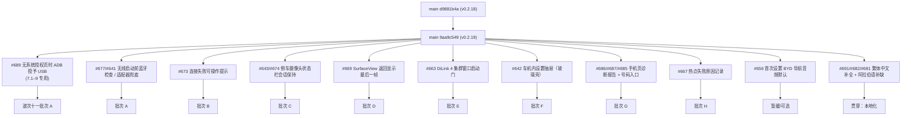

# DiPlay main 分支增量差异迁移报告（第四轮 · 0.2.19 公开发布版）

> **作者**: WorkBuddy
> **生成日期**: 2026-10-13
> **上一轮已登记 main 基线**: `d9881b4a`（Merge PR #660，`release/0.2.18`；波次十批次 A–H 已迁移完成）
> **本轮最新 main tip**: `9aa9c549ee2726770ad55ec997beeeff642990fe`（`Prepare DiPlay 0.2.19 public preview release`，PR #689 之后）
> **当前分支**: `port/wave9-increment` @ `acaf06e0`（波次十 已完成，版本号 `0.2.18-api17` / versionCode 37）
> **上一轮文档**: `DiPlay-main分支增量差异迁移报告-0.2.18-next.md`
> **增量范围**: `git log d9881b4a..origin/main` — **57 个提交（其中非 merge 38 个）**
> **增量规模**: `git diff --shortstat d9881b4a..origin/main` = **99 个文件，+3481 / −455**（**零删除、零依赖改动**）
> **本轮落定目标版本号**: **`0.2.19-api17`** **/ versionCode 38**（main 已正式发版 0.2.19 / 38，详见 **§7**）

***

## 0. 增量取数命令（每轮开始前重跑）

```sh
git fetch origin
git rev-parse origin/main                                  # 新基线替换下一轮锚点 → 9aa9c549
git log  d9881b4a..origin/main --oneline | wc -l           # 本轮增量（57 提交 / 38 非 merge）
git diff --shortstat d9881b4a..origin/main                 # 99 文件 +3481/-455
git diff --diff-filter=A --name-status d9881b4a..origin/main   # 本轮新增文件（见 §1.2）
git diff --diff-filter=D --name-status d9881b4a..origin/main   # 本轮删除文件（空）
```

> 本轮**无全新波次结构**：`d9881b4a` 之后的 20+ 个 PR 全部可归入既有波次（一～七）作为**叠加增量**，故记入 **波次十一（增量轮）批次 A–H**。
> 本轮特征：**「零新增依赖、零删除、零构建脚本改动」**——`gradle/libs.versions.toml` 未改动；仅 `mobile/build.gradle.kts` 做版本号提升（0.2.18→0.2.19 / 37→38），另有一处 Manifest 权限结构性变化（BLUETOOTH 去 `maxSdkVersion`，对 API 17 为 no-op）。
> **主线索**: ①有线 USB 在「无系统授权页」机型上的 ADB 回退（#689，**7.1–9 专用，API 17 不适用**）；②无线启动前蓝牙可用性前置检查（#677/#641）；③连接失败可操作提示（#673）；④倒车摄像头状态栏占用时的会话保持（#643/#674）；⑤SurfaceView 返回时显示最后一帧（#669，**PixelCopy API 24 守卫**）；⑥DiLink 4 集群窗口启动门（#663）；⑦车机内设置抽屉「玻璃壳」重构（#642，**clipToOutline/elevation API 21 守卫**）；⑧手机页诊断报告下载 + 号码入口（#686/#687/#685）；⑨繁体中文补全 + 阿拉伯语补缺（#691/#682/#681）。

***

## 1. 增量概览



### 1.1 增量功能总表（按批次归类）

| 批次 | 功能项 | 对应 PR / 提交 | 主要文件 | API 17 相关 |
| --- | --- | --- | --- | --- |
| **A** | 无线启动前蓝牙可用性前置检查 | #677 `5fbd7171` | `transport/BluetoothRadioCheck.kt`(新)、`orchestration/CarPlayController.kt` | 🟢 纯逻辑 |
| **A** | 适配器兜底 `getDefaultAdapter()` | #641 `54116013` | `BydBluetoothSuspend.kt`、`DiPlayBluetooth.kt`、`CarPlayHostActivity.kt` | 🟠 改在 `BluetoothCompat` 内落地 |
| **A** | MIUI 13(Android 12) 蓝牙权限保留 | #671 `5fb5d875` | `shared/src/main/AndroidManifest.xml` | ⚪ API 17 no-op |
| **B** | 连接失败可操作提示（本地化） | #673 `9b169ee3`/`65087c2a` | `ConnectionFailureGuidance.kt`(新)、`CarPlayHostActivity.kt` | 🟢 依赖已就绪 |
| **C** | 倒车摄像头隐藏状态栏时保持会话 | #643/#674 `b5f1bfe4` | `CarPlayHostActivity.kt` | 🟢 `WindowInsetsCompat` |
| **D** | SurfaceView 返回后显示最后一帧 | #669 `301c5601` | `CarPlayHostActivity.kt`、`CarPlayVideoSurface.kt` | 🔴 `PixelCopy` API 24 |
| **E** | DiLink 4 集群窗口启动门（先取焦再启动） | #663 `d1a653ea` | `ClusterLaunchGate.kt`(新)、`CarPlayHostActivity.kt`、`AdbClusterActivity.kt` | 🟡 Android 10 特定，API 17 可选 |
| **F** | 车机内设置抽屉「玻璃壳」重构 + Exit 归位 | #642 `93b7869d`/`fdadb4da` | `CarPlayHostActivity.kt`、`DiPlayButton.kt` | 🔴 `clipToOutline`/`elevation` API 21 |
| **G** | 手机页诊断报告下载 + 号码/口令入口 | #686/#687/#685 `468d18cd`/`f57c36b1`/`4081472f` | `DiPlayActivity.kt`、`backup/SettingsBackupServer.kt`、`assets/settings-code.html`(新) | 🟢 纯 Java 网络 |
| **H** | 记录车机热点无法启动的原因 | #667 `ab4dd22b` | `network/CarHotspotAdbFallback.kt` | 🟢 日志 |
| **暂缓** | 无系统授权页时 ADB 授予 USB | #689 `59c26525` | `IphoneUsbAdbGrant.kt`(新)、`UsbPermissionActivityProbe.kt`(新)、`IphoneUsbHost.kt` | ⛔ **7.1–9 专用，API 17 不适用** |
| **暂缓** | 首次设置应用 BYD 导航音频默认 | #656 `f64e0e83` | `setup/SetupGuide.kt`、`DiPlayActivity.kt`、`AirPlayPersistence.kt` | 🟡 DiLink 专用 |
| **暂缓** | 厂商中立能力/状态机 | `d0c6469e`/`8e692ea9` | `capabilities/HeadUnitCapabilities.kt`(新)、`orchestration/ConnectionStateMachine.kt`(新) | ⚪ 未接入主流程 |
| **贯穿** | 繁体中文补全 + 繁体指南文档 | #691 `a93066d1`/`fe8aa505` | `values-zh-rTW/*`、`docs/*.zh-TW.md`、`README.zh-TW.md` | 🟢 资源 |
| **贯穿** | 阿拉伯语补缺 | #682/#681/#631 | `values-ar/*.xml` | 🟢 资源 |
| **贯穿** | 日文（已在波次十批次 F 迁移） | #646 | `values-ja/strings.xml` | 🟢 新增少量 |

### 1.2 本轮新增文件（`git diff --diff-filter=A`，共 35 个）

**主代码（8）**

| 文件 | 说明 | 处理 |
| --- | --- | --- |
| `common/.../ClusterLaunchGate.kt` | DiLink 4 集群启动门（纯逻辑） | 批次 E 移植 |
| `common/.../ConnectionFailureGuidance.kt` | 连接失败→可操作提示映射（纯逻辑） | 批次 B 移植 |
| `shared/.../transport/BluetoothRadioCheck.kt` | 无线启动前蓝牙阻断器（纯逻辑） | 批次 A 移植 |
| `shared/.../transport/IphoneUsbAdbGrant.kt` | ADB 授予 USB（7.1–9 专用） | **暂缓/跳过** |
| `shared/.../transport/UsbPermissionActivityProbe.kt` | 探测系统 USB 授权页（7.1–9） | **暂缓/跳过** |
| `common/src/main/assets/settings-code.html` | 手机页号码/口令入口页面 | 批次 G 移植 |
| `samples/home|maphost/.../values[-zh-rTW]/strings.xml` | 示例 App 字符串 | ⚪ 示例工程，低优先 |
| `docs/RELEASE-NOTES-0.2.19.md` | 发行说明 | 文档同步 |

**测试（12）**：`ClusterLaunchGateTest`、`ConnectionFailureGuidanceTest`、`StatusBarHiddenByAnotherWindowTest`、`TraditionalChineseTranslationsTest`、`BluetoothRadioCheckTest`、`IphoneUsbAdbGrantTest`、`UsbPermissionActivityProbeTest`、`BluetoothManifestTest`、`AtomicFileRenameTestShadow`（Windows 宿主修复）。
**繁体文档（7）**：`README.zh-TW.md`、`docs/{BUILD,INSTALL,LOCALIZATION,PRIVACY,SETTINGS,VALIDATION}.zh-TW.md`。
**截图（6）**：`docs/screenshots/upstream-swipe-*.png`、`docs/screenshots/zh-TW/*.png`。

### 1.3 本轮修改文件（`git diff --diff-filter=M`，节选）

`CarPlayHostActivity.kt`(+310/−74)、`DiPlayActivity.kt`(+119/−87)、`CarPlayController.kt`(+75/−8)、`SettingsBackupServer.kt`(+131/−11)、`CarHotspotAdbFallback.kt`(+13/−3)、`IphoneUsbHost.kt`(+19/−3)、`AirPlayPersistence.kt`(+11)、`DiPlayButton.kt`、`DiPlayBluetooth.kt`、`BydBluetoothSuspend.kt`、`CarPlayVideoSurface.kt`、`AdbClusterActivity.kt`、`SetupGuide.kt`、`shared/src/main/AndroidManifest.xml`、`mobile/build.gradle.kts`、`common/src/main/res/values{,-ar,-es,-ja,-ru,-uk,-zh-rCN,-zh-rTW}/strings.xml`。

***

## 2. 重点功能逐项分析

### 批次 A — 蓝牙前置检查与适配器兜底（#677 / #641 / #671）

**新增** `shared/src/main/java/com/shilapi/xcertplay/transport/BluetoothRadioCheck.kt`（纯逻辑，无 API 依赖）：

```kotlin
object BluetoothRadioCheck {
    fun blocker(adapterPresent: Boolean, enabled: Boolean, pausedByDiPlay: Boolean): String? = when {
        !adapterPresent -> NO_ADAPTER
        !enabled && !pausedByDiPlay -> RADIO_OFF      // 蓝牙关且非 DiPlay 自己暂停 → 阻止
        else -> null
    }
    const val NO_ADAPTER = "Bluetooth adapter is unavailable"
    const val RADIO_OFF_MARK = "Turn on Bluetooth"    // 宿主屏按此关键词匹配本地化文案
    const val RADIO_OFF = "$RADIO_OFF_MARK in the head unit's settings, then reconnect"
}
```

**接入点** `CarPlayController.kt`：在**改动 Wi-Fi 之前**（`startWireless` 内、`startWirelessHotspot` 之前）抛出阻断异常：

```kotlin
BluetoothRadioCheck.blocker(
    adapterPresent = bluetoothAdapter != null,
    enabled = bluetoothAdapter?.isEnabled == true,
    pausedByDiPlay = BydBluetoothSuspend.isSuspendedByUs(appContext),
)?.let { throw IOException(it) }
```

同时把 `"Bluetooth adapter is unavailable"` / `"Bluetooth is not enabled"` 两处硬编码 `IOException` 文本替换为 `BluetoothRadioCheck.NO_ADAPTER` / `RADIO_OFF`。

**适配器兜底（#641）**：main 把所有 `getSystemService(BluetoothManager::class.java)?.adapter` 改成 `?: BluetoothAdapter.getDefaultAdapter()`（`CarPlayController`、`BydBluetoothSuspend.radioEnabled`、`DiPlayBluetooth.localAddress`、`DiPlayActivity` 蓝牙权限检查、`CarPlayHostActivity.logCarBluetoothAudio`）。

> **⚠️ 分支关键差异**：main 用的 `Context.getSystemService(Class)` 是 **API 23** 才能调用的方法，在 **API 17 会 `NoSuchMethodError`**。分支已用自建兼容层 `com.shilapi.xcertplay.compat.BluetoothCompat.getAdapter()`（`BluetoothCompat.kt:34`）统一处理：
> ```kotlin
> fun getAdapter(context: Context): BluetoothAdapter? {
>     // 优先 BluetoothManager（API 18+），失败或低版本一律回退 getDefaultAdapter()
>     ... (context.getSystemService(Context.BLUETOOTH_SERVICE) as? BluetoothManager)?.adapter ...
>     BluetoothAdapter.getDefaultAdapter()   // 第 46 行：API 1，安全
> }
> ```
> **因此 #641 对分支：不需要移植 main 的写法**，只需确认分支上所有取蓝牙适配器的位置都经过 `BluetoothCompat.getAdapter()`（`getDefaultAdapter()` 兜底已在其中）；若还有裸 `getSystemService(BluetoothManager::class.java)` 的调用点，应改为走 `BluetoothCompat`。

**#671 Manifest**：`shared/src/main/AndroidManifest.xml` 删除 `BLUETOOTH`/`BLUETOOTH_ADMIN` 上的 `android:maxSdkVersion="30"`（理由：MIUI 13/Android 12 的 RFCOMM 仍检查旧权限）。
> **API 17 处理**：`maxSdkVersion` 语义是「只声明到某 SDK 为止」，API 17 本就在 30 以下，**该属性对 API 17 无影响**；分支保持 `BLUETOOTH`/`BLUETOOTH_ADMIN` 无 `maxSdkVersion` 即等价于修改后的效果。**无需改动**（若分支当前带了 `maxSdkVersion` 才需删除，经核对分支 manifest 未带，故 no-op）。

### 批次 B — 连接失败可操作提示（#673）

**新增** `common/src/main/java/com/shilapi/xcertplay/ConnectionFailureGuidance.kt`：把 `CarPlayStatus.Failed` → 可操作建议字符串（`@StringRes`），覆盖有线/无线、热点模式（MANUAL / EXISTING_WIFI / WIFI_P2P / LOCAL_ONLY_HOTSPOT）、`WirelessStartupFailure` 各枚举、`wifiResetRequired`，以及对 MIUI 13 类 `SecurityException`（驱动无法自授）与可自授权限的区分。

> **✅ 前置依赖核对（分支已全部满足，可净移植）**：
> | 依赖 | 分支位置 | 状态 |
> | --- | --- | --- |
> | `WirelessStartupFailure{HOTSPOT_NOT_READY, FIRST_TCP_TIMEOUT, HOTSPOT_CONFIGURATION, BLUETOOTH_UNUSABLE}` | `network/WirelessStartupPolicy.kt:14-18` | ✅ 已有 |
> | `CarPlayStatus.Failed(message, wifiResetRequired, startupFailure)` | `orchestration/CarPlayController.kt:143-144` | ✅ 已有 |
> | `WirelessHotspotMode` | `network/` | ✅ 已有 |
> | `R.string.connection_help_*` 系列 | `values/strings.xml` | ❌ **需新增并翻译（见 §6）** |

**接入点** `CarPlayHostActivity.kt`：
- 新增 `connectionHelpView`（`TextView`），在连接面板 `instructions` 下方（`buildConnectionPanel` 内 `panel.addView(help)`）。
- 新增 `showConnectionHelp(failure: CarPlayStatus.Failed?)`：`failure==null` 显示原 `instructions`、隐藏 help；否则读取 `ConnectionFailureGuidance.message(failure, wirelessEnabled, wirelessHotspotMode)`。
- 状态回调：`if (status is CarPlayStatus.Failed) showConnectionHelp(status)`（保留可操作提示不被自动重试覆盖）；AirPlay 会话建立时 `showConnectionHelp(null)`。
- `setConnectionStage` 关键词映射新增：`englishMessage.contains(BluetoothRadioCheck.RADIO_OFF_MARK, true) -> getString(R.string.turn_on_bluetooth_in_the_head_unit_s_settings_to_connect)`。

### 批次 C — 倒车摄像头隐藏状态栏时保持会话（#643 / #674）

**修改** `CarPlayHostActivity.kt`：
- `CarPlaySessionDisplay` 新增字段 `statusBarShown: Boolean?`（会话启动时状态栏是否可见）。
- 新增纯函数（文件尾部，`internal`，便于单测 `StatusBarHiddenByAnotherWindowTest`）：
  ```kotlin
  internal fun statusBarHiddenByAnotherWindow(display: CarPlaySessionDisplay, width: Int, height: Int,
      statusBarShown: Boolean?): Boolean =
      !display.hideTopBar && display.statusBarShown == true && statusBarShown == false &&
          width == display.windowWidth && height > display.windowHeight
  ```
- `statusBarShown()` 用 `ViewCompat.getRootWindowInsets(window.decorView)?.isVisible(WindowInsetsCompat.Type.statusBars())` 取当前状态栏可见性。
- `applyDisplaySize` 在「display 尺寸变化但布局未变」分支中新增判定：若 `statusBarHiddenByAnotherWindow(...)` 为真，**保持会话画布不变**（因为窗口只是被倒车摄像头临时撑大到含状态栏的高度），仅 `updateVideoLayout`，避免在新尺寸上重建会话导致「缩小显示」。

> **API 17**：`WindowInsetsCompat` 来自 androidx core，`getRootWindowInsets` 在低版本返回 null（`statusBarShown()==null`），判定自然为 false → 行为退化为原逻辑。**🟢 安全**。

### 批次 D — SurfaceView 返回后显示最后一帧（#669）🔴

**修改** `CarPlayHostActivity.kt`（新增约 60 行）+ `CarPlayVideoSurface.kt`：

- 新增 `lastPicture: Bitmap?`、`pictureHold: ImageView?`、`pictureHoldTick`（50ms 轮询）、`pictureRetry`（1s/2s 二次请求关键帧）、`pictureCopyThread`（`HandlerThread("diplay-picture-copy")`）。
- `surfaceDestroyed` 时 `captureLastPicture()`：用 **`PixelCopy.request(surfaceView, picture, callback, handler)`** 把当前画面半尺寸拷出。
- `surfaceCreated` 时 `showLastPicture()`：把上次画面以 `ImageView` 叠在 SurfaceView 之上，直到解码器渲染出新帧或 30s 超时。
- `CarPlayVideoSurface.kt` 新增纯函数 `lastPictureDone(rendered, baseline, elapsedMillis, maxMillis)`（单测友好）。
- 生命周期：`onDestroy`/`teardown`/`shutdown` 调用 `discardLastPicture()`；`onDestroy` 收尾 `pictureCopyThread.quitSafely()`。

> **🔴 API 17 硬约束**：**`android.view.PixelCopy.request(...)` 是 API 24（N）新增**。在 API 17 直接调用会 `NoSuchMethodError` 崩溃。**必须守卫**：
> ```kotlin
> private fun captureLastPicture() {
>     if (Build.VERSION.SDK_INT < Build.VERSION_CODES.N) return   // PixelCopy 需 API 24
>     ... 原实现 ...
> }
> ```
> 同时 `showLastPicture()` 需保证在无 `lastPicture` 时（API 17 始终为 null）安全 no-op——现有 `val picture = lastPicture ?: return` 已满足。常量 `PICTURE_HOLD_MAX_MILLIS=30_000`、`PICTURE_COPY_WAIT_MILLIS=150` 照搬。

### 批次 E — DiLink 4 集群窗口启动门（#663）🟡

**新增** `common/src/main/java/com/shilapi/xcertplay/ClusterLaunchGate.kt`（纯逻辑，构造参数可注入等待时长，单测 `ClusterLaunchGateTest`）：
- `request(now, hostFocused)`：宿主已取焦 → 立即启动；否则置 `awaitingFocusSince`。
- `due(now, hostFocused, hostVisible)`：宿主取焦 / 已离开屏幕 / 等待超 `FOCUS_WAIT_MILLIS(1500)` 任一满足 → 可启动。
- `holdsCarPlayStart(now, routeSettling)`：启动等待取焦期间、或路由落定 `ROUTE_WAIT_MILLIS(3000)` 内 → 暂扣 CarPlay 启动（保证首个会话已带集群流）。

**接入** `CarPlayHostActivity.kt`：新增 `clusterLaunchGate`、`clusterLaunchTick(100ms)`、`launchClusterActivity()`、`onClusterLaunchTick()`、`carPlayStartHeldForCluster`；`ensureClusterPresentation` 改为「已确认路由或 `gate.request(...)` → 启动，否则 tick」；`onWindowFocusChanged`/`onStop` 触发 `onClusterLaunchTick()`；`maybeStartCarPlay` 在 `gate.holdsCarPlayStart(...)` 时暂扣并 tick。
**接入** `AdbClusterActivity.kt`：`ClusterActivityOutput.routeSettling()`（壳已接受但窗口未确认 display 期间为真）。

> **API 17 说明**：`ClusterLaunchGate` 依赖 `hasWindowFocus()`（API 1）与 `SystemClock`，**本身安全**；但该修复针对的是 **Android 10 上「窗口获焦后才隐藏系统栏」** 的行为（DiLink 4 车机），API 17 无此行为。分支若在 API 17 已有稳定的集群启动路径，**建议按「可选增强」处理**：可移植（低风险、逻辑无害），但非必需；若移植，需与分支现有 `ensureClusterPresentation` 结构对齐后再改，避免打乱既有启动次序。

### 批次 F — 车机内设置抽屉「玻璃壳」重构（#642）🔴

**修改** `CarPlayHostActivity.kt` 的 `buildSettingsMenu()`（大范围重写）+ `DiPlayButton.kt`：
- 新增 `swipeMenuChrome(topCornersOnly, bottomCornersOnly)`：用 `ColorUtils.blendARGB`（androidx，API 安全）混合 `MENU_BACKGROUND` / `overlayPalette.surface` / 白，生成 `GradientDrawable`（顶/底圆角 + 描边）。
- 结构改为 **header（标题 + Close 按钮，RTL/LTR 分支布局）+ 可滚动内容 + footer（仅 Save）**；`Exit application` 从「紧邻 Save 危险按钮」**移到列表末尾**（`fdadb4da`，避免误触）。
- 关闭按钮文案由 `"X"` 改为 `R.string.close`（分支**已存在**该串，核验 `values/strings.xml` 命中 1 处）。
- `Exit application` 由 `DiPlayButtonKind.DANGER` 改为 **`DiPlayButtonKind.TONAL_DANGER`**（分支 `DiPlayButton.kt` **未定义 TONAL_DANGER**，需新增该枚举项及其样式绘制）。
- 新增常量组 `SWIPE_PANEL_MARGIN_DP=16`、`SWIPE_PANEL_RADIUS_DP=28`、`SWIPE_PANEL_ELEVATION_DP=24`、`SWIPE_PANEL_HEIGHT_PERCENT=94`、`SWIPE_BORDER_WIDTH_DP=1`、`SWIPE_CHROME_PADDING_DP=16`、`SWIPE_CONTENT_TOP_PADDING_DP=16`、`SWIPE_CONTENT_BOTTOM_PADDING_DP=36`、`SWIPE_ACTION_HEIGHT_DP=52`、`SWIPE_ACTION_GAP_DP=8`、`SWIPE_SCRIM_COLOR=0xB3000000`。
- 面板尺寸：宽 `settingsMenuWidth()`（新增左右各 `SWIPE_PANEL_MARGIN_DP` 边距）、高 `heightPixels*94%`，`Gravity.CENTER`。

> **🔴 API 17 硬约束**：
> | 调用 | 最低 API | 分支对策 |
> | --- | --- | --- |
> | `panel.clipToOutline = true` | **21** | 改用 `UiCompat.setClipToOutline(panel, true)`（`UiCompat.kt:79` 已带版本判断） |
> | `panel.elevation = dp(...).toFloat()` | **21** | 新增 `if (SDK_INT>=21) panel.elevation=...` 守卫，或用 `UiCompat.setOutlineProvider(...)`（`:175`） |
> | `ColorUtils.blendARGB` / `GradientDrawable.cornerRadii` / `View.LAYOUT_DIRECTION_LTR\|RTL` / `configuration.layoutDirection` | 17 / 1 / **17** / 17 | 🟢 API 17 可用，无需守卫 |
>
> 注意 `View.LAYOUT_DIRECTION_*` 与 `Configuration.layoutDirection` 恰为 **API 17** 引入，本机可用（这是分支能直接受益于 #642 RTL 布局的原因）。

### 批次 G — 手机页诊断报告下载 + 号码/口令入口（#686 / #687 / #685）

**修改** `DiPlayActivity.kt`：
- `openBackup(from: SettingsCategory = ABOUT)` 记录来源；「诊断」页新增按钮 `settings_report_on_phone` → `openBackup(SettingsCategory.DIAGNOSTICS)`。
- 手机页标题/提示按来源切换（`settings_report_on_phone` / `settings_report_on_phone_hint` vs `backup_title` / `backup_page_hint`）。
- `SettingsBackupServer(...)` 构造新增 `report = { diagnosticReportText(applicationContext).toByteArray(UTF_8) }`、`codePage = assets.open("settings-code.html").readBytes()`、`onCodeEntryClosed`。
- QR 码地址按来源追加 `#report`；新增「手输地址 + 口令」提示（`backup_type_address`、`backup_code_entry_closed`）。
- 把诊断报告文本抽取为 `diagnosticReportText(appContext)`（**纯重构，逻辑等价**，注意在**非主线程**调用，因读日志文件）。

**修改** `backup/SettingsBackupServer.kt`（+131）：
- 连接改为**每连接一线程**（`ThreadPoolExecutor(0,16,30s,SynchronousQueue)`，`ConcurrentHashMap` 记录在手连接），请求仍串行应答（`synchronized(answering)`）——解决浏览器**预开空闲连接**阻塞应答的问题（#685）。
- 新增路由：`GET /b/<token>/report` → 返回诊断报告（`Content-Disposition` 附件）；`GET /` → `settings-code.html`；`POST /code` → 校验 6 位口令（`CODE_DIGITS=6`，`MAX_WRONG_CODES=5`，超限锁页 `onCodeEntryClosed`）。
- `SettingsBackupEndpoint` 新增 `code` 与 `typedAddress(address)="$address:$port"`；`TYPED_PORT=8888`（可输地址固定端口，占用则退任意端口）；TLS 首字节 `0x16` 直接断开让浏览器回退 HTTP。

> **API 17**：全部为 Java 5+ 标准库（`ThreadPoolExecutor`/`SynchronousQueue`/`ConcurrentHashMap`/`Collections.newSetFromMap`）与 `java.net`，**无 API 24+ 调用**，🟢 安全。`assets/settings-code.html` 需随 `common` 模块打包。
> **取舍**：本项为「诊断便利」功能，非 API 17 有线连接刚需；建议**随波次一并移植**（对分支现有 `SettingsBackupServer` 进行等价增强即可），若排期紧张可降为可选。

### 批次 H — 记录车机热点无法启动的原因（#667）

**修改** `network/CarHotspotAdbFallback.kt`：在 ADB 无法读取 AP 状态、固件未列出热点启动命令、固件拒绝命令三处分支补齐 `log(...)` 说明（`observed() ?: return false.also{ log(...) }`、`command == null` 与 `!accepted(output)` 分别记录，并截断固件回显 120 字）。**纯日志补强**，🟢 安全直移。

### 暂缓 / 可选（不建议本轮移植）

| 功能 | 原因 | 文件 |
| --- | --- | --- |
| **#689 无系统授权页时 ADB 授予 USB** | `IphoneUsbAdbGrant.supported()` = `N_MR1..P`（**API 25–28**），`UsbPermissionActivityProbe.supportsProbe()` 同为 25–28；API 17 恒返回 `UNSUPPORTED`/`UNKNOWN`。且依赖 `app_process`/`LocalAdb`/私 API 反射，收益为零。 | `IphoneUsbAdbGrant.kt`、`UsbPermissionActivityProbe.kt`、`IphoneUsbHost.requestPermission(...,allowAdbFallback)`、`CarPlayController.attemptIphoneUsbAdbGrant` |
| **#656 首次设置应用 BYD 导航音频默认** | DiLink/BYD 专用；分支 `SetupGuide.kt` 仅 52 行、**缺 `applyFirstSetupDefaults`**（main 定义于 `SetupGuide.kt:59`），需连带移植 `AirPlayPersistence.applySetupNavigationAudioChannelDefault`。分支为通用车机 fork，**除非明确需要 BYD DiLink 首设引导，否则跳过**。 | `setup/SetupGuide.kt`、`DiPlayActivity.kt`、`AirPlayPersistence.kt` |
| **厂商中立能力/状态机** | `HeadUnitCapabilities.kt`、`ConnectionStateMachine.kt` 为**新增且未接入任何主流程**（全仓仅其自身文件引用），属实验性铺垫，**暂缓**。 | `capabilities/HeadUnitCapabilities.kt`、`orchestration/ConnectionStateMachine.kt` |

***

## 3. API 17 适配要点总表

| # | 位置 | 调用 | 最低 API | 级别 | 处理 |
| --- | --- | --- | --- | --- | --- |
| 1 | `CarPlayHostActivity.captureLastPicture()` | `PixelCopy.request(...)` | **24** | 🔴 崩溃 | `if (SDK_INT < N) return`，API 17 无最后一帧 |
| 2 | `CarPlayHostActivity.buildSettingsMenu()` | `panel.clipToOutline = true` | **21** | 🔴 崩溃 | `UiCompat.setClipToOutline(panel, true)`（`UiCompat.kt:79`） |
| 3 | `CarPlayHostActivity.buildSettingsMenu()` | `panel.elevation = ...` | **21** | 🔴 崩溃 | `if (SDK_INT>=21)` 守卫或 `UiCompat.setOutlineProvider(...)`（`:175`） |
| 4 | 各处蓝牙取适配器 | `getSystemService(BluetoothManager::class.java)` | **23** | 🟠 适配 | 一律走 `BluetoothCompat.getAdapter()`（`BluetoothCompat.kt:34`，内含 `getDefaultAdapter()` 兜底） |
| 5 | `CarPlayHostActivity.statusBarShown()` | `WindowInsetsCompat.getRootWindowInsets` / `Type.statusBars()` | androidx | 🟢 安全 | 低版本返回 null → 判定退化，无需改 |
| 6 | `buildSettingsMenu` RTL | `View.LAYOUT_DIRECTION_*`、`Configuration.layoutDirection` | **17** | 🟢 安全 | API 17 恰可用 |
| 7 | `swipeMenuChrome()` | `ColorUtils.blendARGB`、`GradientDrawable.cornerRadii` | androidx / 1 | 🟢 安全 | 无需改 |
| 8 | `SettingsBackupServer` | `ThreadPoolExecutor`/`SynchronousQueue`/`ConcurrentHashMap` | java 5+ | 🟢 安全 | 无需改 |
| 9 | `BluetoothRadioCheck` / `ClusterLaunchGate` / `ConnectionFailureGuidance` / `lastPictureDone` | 纯逻辑 | 1 | 🟢 安全 | 直移 |
| 10 | `IphoneUsbAdbGrant` / `UsbPermissionActivityProbe` | 私 API 反射 / `MATCH_DISABLED_COMPONENTS` | 24+ | ⛔ 不移植 | 7.1–9 专用 |

***

## 4. 需跳过 / 需守卫清单（执行摘要）

- ⛔ **整体跳过**：`IphoneUsbAdbGrant.kt`、`UsbPermissionActivityProbe.kt`、`IphoneUsbHost.PermissionRequest.AdbRequired` 分支、`CarPlayController.attemptIphoneUsbAdbGrant` 全链（#689）。
- ⛔ **整体跳过（或降级为可选）**：`HeadUnitCapabilities.kt`、`ConnectionStateMachine.kt`。
- ⏸️ **暂缓（DiLink 专用）**：`SetupGuide.applyFirstSetupDefaults` + `AirPlayPersistence.applySetupNavigationAudioChannelDefault` + 首设 `markReconnectNeeded()`（#656）。
- 🔴 **必须加守卫**：`PixelCopy`（批次 D）、`clipToOutline`/`elevation`（批次 F）。
- 🟠 **必须改写落地方式**：蓝牙适配器兜底改在 `BluetoothCompat` 内（批次 A）。
- 🟢 **可直接移植（零/低风险）**：`BluetoothRadioCheck`、`ConnectionFailureGuidance`（依赖已就绪）、`statusBarHiddenByAnotherWindow`、`lastPictureDone`、`CarHotspotAdbFallback` 日志、`SettingsBackupServer` 增强、繁体/阿拉伯语资源。

***

## 5. 迁移计划（波次十一 批次 A–H）

**建议分支**：`port/wave11-increment`（从 `port/wave9-increment` 切出）

| 批次 | 内容 | 依赖前置 | 提交信息模板 | 风险 |
| --- | --- | --- | --- | --- |
| **A** | 蓝牙前置检查 + 适配器兜底 | `BluetoothCompat` 已就绪 | `波次十一批次A：无线启动前蓝牙检查、适配器兜底归位 BluetoothCompat` | 🟢 |
| **B** | 连接失败可操作提示 | 新增 `connection_help_*` 串 | `波次十一批次B：连接失败可操作提示（ConnectionFailureGuidance + connectionHelpView）` | 🟢 |
| **C** | 倒车摄像头状态栏会话保持 | 无 | `波次十一批次C：倒车摄像头隐藏状态栏时保持 CarPlay 会话` | 🟢 |
| **D** | 最后一帧显示（含 API 24 守卫） | 批次 C 之后 | `波次十一批次D：SurfaceView 返回显示最后一帧（PixelCopy API 24 守卫）` | 🔴→🟢 |
| **E** | DiLink 4 集群启动门 | 对齐现有集群路径 | `波次十一批次E：DiLink 4 集群窗口启动门（ClusterLaunchGate）` | 🟡 可选 |
| **F** | 设置抽屉玻璃壳 | `DiPlayButtonKind.TONAL_DANGER` | `波次十一批次F：车机内设置抽屉玻璃壳重构（含 API 21 守卫、Exit 归位）` | 🔴→🟢 |
| **G** | 手机页诊断报告 | `settings-code.html` 打包 | `波次十一批次G：手机页诊断报告下载与号码口令入口` | 🟢 可选 |
| **H** | 热点失败原因日志 | 无 | `波次十一批次H：记录车机热点无法启动的原因` | 🟢 |
| **I** | 本地化补缺 | 各批次串同批落地 | `波次十一批次I：繁体中文补全 + 阿拉伯语补缺 + 日文补缺` | 🟢 |

**顺序建议**：A → B → C → D → H → F → I（先纯逻辑/低风险，再带守卫的 UI）；E、G 视排期置后或跳过；每批次落地后追加**本地化同批补串**，避免 `SettingsTranslationsTest` 红灯。

**每批次验收门（沿用既有三重门禁）**：
1. `swiftc -parse` 语法门禁（对独立 .kt 逻辑探针）→ 实为 Kotlin，改用 `./gradlew :common:compileDebugKotlin :shared:compileDebugKotlin` 增量编译；
2. 单测：`./gradlew :shared:testDebugUnitTest :common:testDebugUnitTest`（含新增 `ClusterLaunchGateTest`/`ConnectionFailureGuidanceTest`/`StatusBarHiddenByAnotherWindowTest`/`TraditionalChineseTranslationsTest`）；
3. 全量 CI：`./gradlew :shared:testDebugUnitTest :common:testDebugUnitTest :home:testDebugUnitTest :mobile:lintDebug :home:lintDebug :maphost:lintDebug :mobile:assembleDebug :home:assembleDebug :maphost:assembleDebug`（AGENTS.md）。
> 期望**零警告**；改文件后先 `touch` 再编译避免假阴性。

***

## 6. 字符串与本地化义务

| 组 | 新增 key（示例） | 目标语言 | 数量级 |
| --- | --- | --- | --- |
| 连接提示 | `connection_help_reset_wifi`、`connection_help_bluetooth_unusable`、`connection_help_hotspot`、`connection_help_existing_wifi`、`connection_help_wifi_direct`、`connection_help_iphone_wifi`、`connection_help_permissions`、`connection_help_bluetooth`、`connection_help_usb`、`connection_help_general`、`turn_on_bluetooth_in_the_head_unit_s_settings_to_connect` | 全语系（`values`、`-ar/-es/-ja/-ru/-uk/-zh-rCN/-zh-rTW`） | ~11 |
| 手机页/诊断 | `settings_report_on_phone`、`settings_report_on_phone_hint`、`backup_type_address`、`backup_code_entry_closed`、`backup_other_addresses` | 全语系 | ~5 |
| 设置抽屉 | `close`（分支已有）、`exit_application`（已有） | 复用 | 0 |

**本地化增量（`git diff` 实测 key 数）**：

| 语言目录 | 分支现值 | main 值 | 需补 | 备注 |
| --- | --- | --- | --- | --- |
| `values-zh-rTW`（全 xml 合并） | 995 | 1012 | **+17** | 含新增 `strings_contrib_audio.xml`（9）+ 14 处台湾用词修订；另 6 篇 `*.zh-TW.md` 指南 + `README.zh-TW.md` |
| `values-ar`（全 xml 合并） | 985 | 1000 | **+15** | CHANGELOG 计「67 条」为跨 `strings.xml`/`strings_contrib_audio.xml`/`picture.xml` 累计 |
| `values-ja` | — | — | 少量 | 日文完整化已在波次十批次 F 迁移，本轮仅零星补缺 |

> `SettingsTranslationsTest` 会在 `settings_*` 串缺任一语系时失败；`TraditionalChineseTranslationsTest` 为本轮新增门禁（校验繁体完整）。

***

## 7. 版本号同步

| 项 | 分支现值 | main(0.2.19) | 目标（本轮落定） |
| --- | --- | --- | --- |
| `mobile/build.gradle.kts` `versionName` | `0.2.18-api17` | `0.2.19` | **`0.2.19-api17`** |
| `mobile/build.gradle.kts` `versionCode` | `37` | `38` | **`38`** |
| `versionNameSuffix` | `-hud-test` | `-hud-test` | 保留 |
| `gradle/libs.versions.toml` | — | 未改动 | **不动**（零依赖变化） |
| `CHANGELOG.md` | 0.2.18 段 | 新增 0.2.19 段 | 追加 0.2.19-api17 段 |
| `docs/RELEASE-NOTES-NEXT.md` | — | 已更名为 `RELEASE-NOTES-0.2.19.md` | 分支同步归档为 0.2.19 |

***

## 8. 风险清单

| 级别 | 风险 | 触发点 | 缓解 |
| --- | --- | --- | --- |
| 🔴 高 | `PixelCopy` 在 API 17 崩溃 | 批次 D 未加守卫 | 强制 `SDK_INT>=24` 守卫；单测覆盖 `lastPictureDone` 纯逻辑 |
| 🔴 高 | `clipToOutline`/`elevation` 在 API 17 崩溃 | 批次 F 直移 main 代码 | 改走 `UiCompat`；lint/真机验证设置抽屉开合 |
| 🟠 中 | 蓝牙适配器兜底误用 API 23 写法 | 批次 A 照抄 main | 一律 `BluetoothCompat.getAdapter()` |
| 🟠 中 | 设置抽屉重写打乱既有手势/无障碍 | 批次 F 大范围替换 `buildSettingsMenu` | 保留 `SETTINGS_SWIPE_*` 手势常量；真机回归抽屉开/关/滚动/RTL |
| 🟡 低 | 集群启动门在 API 17 引入启动延迟 | 批次 E | 默认不移植或加「仅 DiLink 4 / Android 10+」开关 |
| 🟡 低 | `SettingsBackupServer` 端口/线程变化影响既有备份 | 批次 G | 保留 `IDLE_TIMEOUT_MILLIS`；验证 QR 备份路径与报告下载并行 |
| 🟢 低 | 繁体中/阿拉伯语漏串致测试红灯 | 批次 I | 与主批次同批补串；跑 `TraditionalChineseTranslationsTest`/`SettingsTranslationsTest` |

***

## 9. 与上一轮文档的衔接 & 归档

1. **归档**：本文件按既有命名归档为 `DiPlay-main分支增量差异迁移报告-0.2.19.md`（上一轮为 `-0.2.18-next.md`）。下一轮锚点更新为 **`9aa9c549`**（v0.2.19）。
2. **主迁移指南**：`DiPlay-Android4.2.2-深度代码迁移指南.md` 的「波次」登记处新增 **波次十一 批次 A–H** 行（状态/日期/分支提交哈希），并核对 §「API 兼容性」是否需补 `PixelCopy`/`clipToOutline`/`elevation` 三条（建议补）。
3. **待 main 打 0.2.20 后**：按既有命名生成 `-0.2.20.md`，取数命令见 §0。
4. **本轮 NET 结论**：**可移植 12 项、暂缓 3 项、必须跳过 2 项**；**新增依赖 0、删除文件 0、构建脚本（除版本号）改动 0**；**必须新增 API 守卫 3 处**（PixelCopy / clipToOutline / elevation）、**必须改写落地方式 1 处**（蓝牙适配器兜底）。
