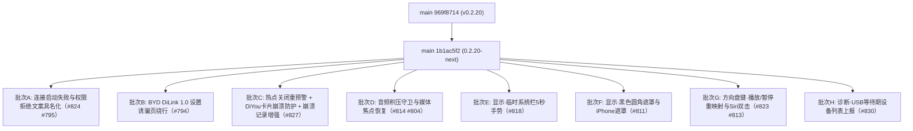

# DiPlay main 分支增量差异迁移报告（第七轮 · 0.2.20-next 未发布增量）

> **作者**: TRAE AI  
> **生成日期**: 2026-10-16  
> **上一轮已登记 main 基线**: `969f8714`（`Merge pull request #799`，即 **0.2.20 公开发布版**，见 `DiPlay-main分支增量差异迁移报告-0.2.20.md`）  
> **本轮最新 main tip**: `1b1ac5f2`（`Merge pull request #834`，docs/release-notes-20261015b）  
> **当前分支**: `port/wave13-increment` @ `d55e9b5f`（波次十三批次 A–Z 已全部落地，版本 `0.2.20-api17` / versionCode 39）  
> **上一轮文档**: `DiPlay-main分支增量差异迁移报告-0.2.20.md`  
> **增量范围**: `git log 969f8714..origin/main` — **37 个提交（其中非 merge 20 个）**  
> **增量规模**: `git diff --shortstat 969f8714..origin/main` = **61 文件改动（+3479/-63 行）**  
> **本轮落定目标版本号**: **维持 `0.2.20-api17` / versionCode 39**（main 实测仍为 `versionCode=39`、`versionName="0.2.20"`，**未发新号**；本轮为 0.2.20 之后的开发中增量，故命名 `-0.2.20-next.md`，与 `-0.2.18-next.md` / `-0.2.19-next.md` 策略一致）

> ✅ **本轮关键变化**：main 在 0.2.20 发版后合入 **11 个功能 PR（#794/#795/#804/#811/#813/#814/#818/#823/#824/#827/#830）**，集中在四个主题：**连接失败文案具名化**、**显示（临时系统栏 + 黑色圆角遮罩/iPhone 遮罩）**、**音频积压与焦点恢复**、**方向盘键扩展（播放/暂停 + Siri 双击）**。全部改动基于分支已就位的 0.2.20 基线符号（`WirelessPermissions`、`WheelKeyService`、`CarPlayMediaButton`、`CarPlayBackgroundSession`、`Ch341UsbHost.describe`、`AudioFormat.rtpClockRate` 等均已核对存在），**无 API 37 代号符号、无新增第三方依赖**，整体移植风险低于上一轮。

***

## 0. 增量取数命令（每轮开始前重跑）

```sh
git fetch origin
git rev-parse origin/main                                   # 新基线替换下一轮锚点 → 1b1ac5f2
git log  969f8714..origin/main --oneline | wc -l            # 本轮增量（37 提交 / 20 非 merge）
git diff --shortstat 969f8714..origin/main                  # 61 文件级改动（+3479/-63）
git diff --diff-filter=A --name-status 969f8714..origin/main   # 本轮新增文件（见 §1.2）
git diff --diff-filter=D --name-status 969f8714..origin/main   # 本轮删除文件（空）
git show origin/main:docs/RELEASE-NOTES-NEXT.md             # 本轮功能权威说明（含 PR 链接）
```

> **编译基线核对（关键）**: 本仓库 `common/build.gradle.kts` 实测 `compileSdk = 36`、`targetSdk = 17`、`minSdk = 17`。  
> 本轮 main 代码中出现的 `Manifest.permission.BLUETOOTH_CONNECT`（API 31 常量）、`KeyEvent.KEYCODE_SYSTEM_NAVIGATION_*`（API 26 常量）均为**编译期内联 int/String 常量**，在 API 17 设备上不会触发 `NoSuchFieldError`；`Build.VERSION_CODES.N_MR1` 同理。**本轮没有任何需要改写为字面量的 API 37 符号。**  
> `WindowInsetsControllerCompat`（androidx.core）在 pre-R 设备走 `View.setSystemUiVisibility` 旧路径（API 11+），API 17 可用。

***

## 1. 增量概览



### 1.1 增量功能总表（按批次归类）

| 批次 | 功能项 | 对应 main PR / 提交 | 主要文件 | API 17 相关 |
| --- | --- | --- | --- | --- |
| **A** | 无线启动失败具名文案（热点未就绪/首TCP超时/重试停止） | #824 `285bc169` `0f00e8a4` | `CarPlayHostActivity.kt` | 🟢 纯文案与状态判定 |
| **A** | 无线权限拒绝具名文案（定位/附近设备/应用权限） | #795 `30af4fed` `b9679df4` `ec99c2d2` | `WirelessPermissions.kt`、`CarPlayHostActivity.kt` | 🟢 权限常量为编译期内联 |
| **B** | DiLink 1.0（Android 7.1）蓝牙/热点按钮直达 BYD 自有页面，绕开"多媒体系统不支持"诱骗页 | #794 `d628798f` `9690ba65` `f46dcec8` | `DiPlayActivity.kt`、`scripts/byd_firmware_actions.py` | 🟢 `SDK_INT <= N_MR1` 守卫；API 17 落入范围但无 BYD 包时行为不变 |
| **C** | 热点"关闭"重预警：驱动选择失效后恢复 off 警告 | #827 `776cbdb5` `b296bb0d` | `CarHotspotSettings.kt`、`CarPlayController.kt` | 🟢 纯逻辑 |
| **C** | DiYou 桌面卡片打开 CarPlay 屏不再闪退（新任务重试 + 二次失败仅记日志） | #827 | `OwnScreenStart.kt`(新)、`DiPlayActivity.kt`、`CarPlayHostActivity.kt` | 🟢 `FLAG_ACTIVITY_NEW_TASK` API 1 |
| **C** | 崩溃记录保留前 12 帧后最多 6 个 DiPlay 自有帧 | #827 | `CrashRecord.kt` | 🟢 纯字符串处理 |
| **D** | 压缩媒体积压守卫：持续 >1.5s 积压才丢弃陈旧包（#806/#719） | #814 `e4569878` `15ee0cab` | `MediaPacketLagGuard.kt`(新)、`AndroidMediaSink.kt`、`MediaClockTrim.kt` | 🟢 纯逻辑，RTP 时间戳判定 |
| **D** | 短暂音频焦点丢失后、iPhone 恢复播放时重新申请焦点 | #804 `80750eb9` `21d6832b` | `CarPlayMediaKeys.kt` | 🟢 `AUDIOFOCUS_LOSS_TRANSIENT` API 8 |
| **E** | 临时系统栏（5 秒）：设置手势指向上滑唤出状态栏/导航栏 | #818 `852aaf7a` `a64b363f` | `CarPlayHostActivity.kt`、`AirPlayPersistence.kt`、`SettingsBackupCodec.kt` | 🟡 `WindowInsetsControllerCompat` pre-R 走旧 flags，部分固件可能忽略；需真机验证 |
| **F** | 黑色圆角遮罩（0/12/24/36/48 dp）+ iPhone 原生遮罩（实验性） | #811 `abdd123a` `e0ce9be6` `ca5206fe` | `CarPlayBlackCornerOverlay.kt`(新)、`IphoneCornerMask.kt`(新)、`CarPlayHostActivity.kt`、`AirPlaySession.kt`、`AirPlayConfig.kt`、`CarPlayController.kt` | 🟢 Canvas/Bitmap 均为老 API；协议改动纯 Java/Kotlin |
| **G** | 方向盘播放/暂停键重映射（保护导航/系统/媒体键不被占用） | #823 `4c9be87f` `56959210` | `CarPlayRemoteKeys.kt`、`WheelKeyService.kt`、`DiPlayActivity.kt`、`CarPlayHostActivity.kt` | 🟢 `KEYCODE_SYSTEM_NAVIGATION_*` 为编译期常量 |
| **G** | 方向盘 Siri 键双击触发（间隔 600ms、触发延迟 300ms 可调；两次按下仍交给车机） | #813 `733acb09` `deaf7284` `5480b366` | `WheelKeyService.kt`、`DiPlayActivity.kt`、`CarPlayHostActivity.kt` | 🟢 纯时序逻辑；`scanCode`/`deviceId` API 9/16 |
| **H** | 等待有线 iPhone 时上报 Android 列出的 USB 设备（vid:pid node） | #830 `07a737f4` `2c808c07` | `CarPlayController.kt`、`IphoneUsbHost.kt` | 🟢 `UsbManager.deviceList` API 12 |
| — | `:common` 测试堆 1g→2g（Robolectric OOM 修复） | `907ebe88` | `common/build.gradle.kts` | ✅ **分支已就位**（`maxHeapSize = "2g"`，波次十批次 H），跳过 |
| — | CI 重触发（无代码） | `aa8a7ecd` | — | 跳过 |
| — | 发布说明文档（#833/#834 等） | `70b70d34` `4a564dff` `df8fc54b` `b485ff6c` `1b1ac5f2` | `docs/RELEASE-NOTES-NEXT.md` | 文档同步即可 |

### 1.2 本轮新增文件（`git diff --diff-filter=A`，主代码 4 个）

| 文件 | 说明 | 处理 | API 17 |
| --- | --- | --- | --- |
| `common/.../CarPlayBlackCornerOverlay.kt` | 本地黑色圆角遮罩 View（半径/EVEN_ODD Path 环带 + iPhone 遮罩位图四镜像绘制） | 批次 F 移植 | 🟢 `Bitmap/Canvas/Path` 全为 API 1 |
| `common/.../IphoneCornerMask.kt` | iOS `topLeftCornerMask` 灰度 PNG 解码（校验/翻转/转 ARGB 黑像素） | 批次 F 移植 | 🟢 `BitmapFactory` API 1 |
| `common/.../OwnScreenStart.kt` | 自有页面启动防护：拒绝后新任务重试一次，二次失败仅记日志 | 批次 C 移植 | 🟢 `Intent` flags API 1 |
| `shared/.../media/MediaPacketLagGuard.kt` | RTP 时间戳积压守卫（1.5s 阈值 + 1.5s 宽限 + 回收到 0.5s 目标） | 批次 D 移植 | 🟢 纯 JDK 逻辑 |

> 测试新增 10 个（`BydSettingsDecoyTest`、`BluetoothManagerDialog`(Robolectric shadow)、`CarPlayBlackCornerOverlayTest`、`CarPlayBlackCornerSettingsScreenshotsTest`、`OwnScreenStartTest`、`WheelMediaSettingsScreenshotsTest`、`WirelessPermissionRefusalTest`、`IphoneCornerMaskProtocolTest`、`IphoneCornerMaskSessionTest`、`MediaPacketLagGuardTest`、`CarHotspotOffReportTest`）与 `docs/BYD_SETTINGS_ENTRY_POINTS.md`、`scripts/byd_firmware_actions.py` 一并同步。

### 1.3 当前分支本地状态（与本轮无关，需独立提交）

`git status` 显示 `port/wave13-increment` 工作区有**未提交改动**：`AirPlayPersistence.kt`(+36)、`CarPlayHostActivity.kt`(+4)、`CarPlayController.kt`(+14) 与未跟踪文件 `docs/design-c140a-single-usb-permission.md`。经核对属用户自有实验特性 **「有线主机身份稳定键 / 单次 USB 授权」**（`host_identity_host_id`、`host_identity_system_buid` 持久化 + `saveLockdownRecord` 改用 `commit()` 同步落盘）。另有已提交 `d55e9b5f`（NCM 诊断日志改走 `onDiagnostic`，属用户自有 USB 诊断增强）。**与本轮 37 个 main 提交无功能重合**（`#830` 改的是 iPhone 设备发现轮询，与 NCM 打开路径不同文件段），迁移开工前先将上述改动独立提交，避免混淆。

***

## 2. 重点功能逐项分析

### 批次 A — 连接启动失败与权限拒绝文案具名化（#824 + #795）

**① 启动失败具名文案（#824，`0f00e8a4`，修复 #809）**

**背景**：无线启动自动重试停止后，画面此前一直显示"正在准备 CarPlay…"，仿佛仍在连接。本改动把失败阶段具名：热点配置失败显示"热点网络未就绪"+ 重试停止行；可重试失败显示原因 + 重试停止行；并在 `friendlyStage` 中放行这些具名文案不被通用行覆盖。

```kotlin
// CarPlayHostActivity.kt（onHotspotStatus）
if (!startupRetryStopped || status !is CarPlayStatus.Failed) setConnectionStage(description, englishDescription)

// 重试停止分支
if (startupFailure == WirelessStartupFailure.HOTSPOT_CONFIGURATION) {
    setConnectionStage("${getString(R.string.hotspot_network_not_ready)}\n" +
        getString(R.string.wireless_startup_retries_exhausted))
} else if (!startupFailure.retryable) { ... }

// friendlyStage 放行
message == getString(R.string.hotspot_network_not_ready) || message == getString(R.string.first_tcp_timeout) ||
    message.endsWith(getString(R.string.wireless_startup_retries_exhausted)) -> message
```

**移植要点**：分支已有 `startupRetryStopped`（L149）与 `WirelessStartupFailure.HOTSPOT_CONFIGURATION`（CarPlayController L2553-2573）；`hotspot_network_not_ready`、`first_tcp_timeout`、`wireless_startup_retries_exhausted` 三个字符串**分支全部已存在**，无新增字符串。同步 `WirelessStartupRecoveryTest`。🟢 低风险。

**② 权限拒绝具名文案（#795，`b9679df4`+`ec99c2d2`，修复 #290）**

**背景**：无线权限被拒（驱动拒绝或 Android 静默拒绝）后画面停留在"正在准备 CarPlay…"。现在 `WirelessPermissions.refusalMessage(missing)` 按缺失项具名：缺定位 → "为 DiPlay 允许精确位置"；缺 `BLUETOOTH_CONNECT`/`NEARBY_WIFI_DEVICES` → "允许附近设备"；其余（如 Android 17 本地网络访问）→ "返回 DiPlay 检查应用权限"。`onResume` 与权限回调处调用 `showMissingWirelessPermission()` 复检。

```kotlin
// WirelessPermissions.kt 新增
@StringRes
fun refusalMessage(missing: Collection<String>): Int = when {
    Manifest.permission.ACCESS_FINE_LOCATION in missing || ... -> R.string.allow_precise_location_...
    Manifest.permission.BLUETOOTH_CONNECT in missing || Manifest.permission.NEARBY_WIFI_DEVICES in missing ->
        R.string.allow_nearby_devices_...
    else -> R.string.could_not_start_carplay_return_to_diplay_and_check_app_per
}
```

**移植要点**：分支已有 `WirelessPermissions.kt`（0.2.20 基线），追加 `refusalMessage` 即可；三个 R.string 引用在分支均已存在。`ec99c2d2` 将"附近设备"措辞限定为权限确实缺失时。日志行补充 `missing=` 列表。同步 `WirelessPermissionRefusalTest`、`WirelessPermissionsTest`。🟢 低风险。

### 批次 B — BYD DiLink 1.0 设置诱骗页绕行（#794，`9690ba65`+`f46dcec8`）

**背景**：DiLink 1.0（Android 7.1）的设置应用对 **60 个标准 `android.settings.*` Intent** 统一应答"多媒体系统不支持此操作"（诱骗 Activity）。`startActivity` 成功但无界面，按钮全部失效。修复：先 `resolveActivity` 判定是否命中诱骗包（`BYD_SETTINGS_PACKAGE` 且类名含 `unsupport`），命中则用**显式 ComponentName** 打开 BYD 自有蓝牙管理器 / 热点页；都找不到时 toast 提示"请从车机设置应用打开此设置"。

```kotlin
private val targetedByBydSettingsWork get() = Build.VERSION.SDK_INT <= Build.VERSION_CODES.N_MR1
private fun answeredByBydDecoy(action: String): Boolean { ... }
private fun openBluetoothSettings() { ... }   // 蓝牙按钮与对话框"打开蓝牙"两处调用点替换
private fun openCarWifiSettings() { ... }     // 诱骗命中时回退 HOTSPOT_SETTINGS 判定，f46dcec8 补测试
```

**移植要点**：改动集中在 `DiPlayActivity.kt` 的 `openBluetoothSettings`/`openCarWifiSettings` 与对话框调用点（分支对应段落与 main 基线一致，可整段替换）。`f46dcec8` 的热点回退不踩诱骗页逻辑必须一并移植（含测试）。Robolectric shadow `common/src/test/java/com/byd/btsetting/BluetoothManagerDialog.kt` 与 `BydSettingsDecoyTest` 同步。`scripts/byd_firmware_actions.py` 为取证脚本，随 `docs/BYD_SETTINGS_ENTRY_POINTS.md` 一并归档。  
**API 17 注意**：`targetedByBydSettingsWork` 判定为 `SDK_INT <= 25`，**API 17 也落入该范围**——但非 BYD 车机上诱骗包不存在，`answeredByBydDecoy` 返回 false，行为与今日完全一致，无需额外守卫。🟢

### 批次 C — 热点重预警 + DiYou 卡片防护 + 崩溃记录（#827，`b296bb0d`）

**① 热点"关闭"重预警（修复 #809 回归）**

0.2.20 起"驱动选择信任热点"逻辑会让 Android 报 off 时也继续连接；BYD Han EV 2020 热点开关常亮但只有打开热点页才真正启动，导致每次盲重试一分钟。新增 `CarHotspotSettings.hotspotNeverCameUp(context, state)`：一次尝试越过 off 报告仍未建立热点、且 Android 仍报 off → 撤销驱动选择，下次尝试恢复"热点已关闭"警告。`CarPlayController` 在热点建立失败（`HOTSPOT_NOT_READY`）路径调用，并新增 `pastOffReport` 标记。🟢 纯逻辑。

**② DiYou 桌面卡片闪退防护（修复 #463）**

DiLink 5.0 的 DiYou 卡片内 `startActivity` 抛 `IllegalArgumentException("There is no running activity in rootTask")` 直接杀死 DiPlay。新增 `OwnScreenStart.start(activity, intent, log)`：捕获后以 `FLAG_ACTIVITY_NEW_TASK` 从 application context 重试一次；再失败仅记日志、不关闭。替换 5 处调用点：`DiPlayActivity.openProjection`、图片调节按钮、`CarPlayHostActivity` 引导回主页、中心地图卡片、`showDiPlayHome`。  
**移植要点**：分支这 5 处 `startActivity` 位置与 main 基线一致（行号略有偏移），逐点替换为 `OwnScreenStart.start(...)`；`appendLog` 作为 log 参数传入。同步 `OwnScreenStartTest`。🟢

**③ CrashRecord 自有帧保留**

前 12 帧被 Android 框架帧占满时，追加保留其后最多 6 个 `com.shilapi.`/`com.shihab.` 自有帧（`ownFrame` 过滤），输出 `... DiPlay frames further down:`。🟢 纯字符串逻辑，同步 `CrashRecordTest`。

### 批次 D — 音频积压守卫与焦点恢复（#814 + #804）

**① 压缩媒体积压守卫（#814，`15ee0cab`，修复 #806/#719）**

**背景**：0.2.20 的时钟漂移补偿（#788）只统计 Android 侧已缓冲音频；车机缓冲低于起播水位时，音乐被拖到 1.5% 限速下限，其余未解码包持续堆积（DiLink 3.0 实测 192 包 ≈ 4s），切歌/暂停延迟数秒可闻。修复两层：

- `MediaClockTrim.sample(queuedFrames, nowNs, compressedFrames)`：把**待解码的压缩帧折算成 PCM 帧**并入水位误差；积压超过目标水位时**不学习**（`compressedBacklog` 冻结积分项），避免把解码背压误教成车机时钟偏差。
- `MediaPacketLagGuard`（新文件）：用 RTP 时间戳度量队列头部延迟；>1.5s 且再持续 1.5s 才进入回收态，丢弃陈旧包直至 ≤0.5s；RTP 时间戳换曲重置（>16s 跨度视为无效）不误判；短 Wi-Fi 补传突发不受影响。
- `AndroidMediaSink.AudioRenderer`：仅 `audioType == "media"` 启用守卫；入队时更新 `newestRtpSample` 并调用 `recover`，丢弃计数并入 `packetsDropped`，恢复事件按 `MAX_REBUFFER_REPORTS` 限次上报。

**移植要点**：分支 `AudioPacket(val rtp, val sample)`（L1774）与 `AudioFormat.rtpClockRate`（AudioStream.kt L24）均已存在，直接套用。`MediaClockTrim.kt` 分支已有（波次十三批次 A 移植），按 diff 扩展 `sample` 签名（默认参数保持旧调用兼容）。同步 `MediaClockTrimTest`、`MediaPacketLagGuardTest`。🟢 纯逻辑，无平台 API。

**② 短暂焦点丢失后随 iPhone 播放恢复（#804，`21d6832b`）**

部分车机在通话等短暂打断后**从不回发 `AUDIOFOCUS_GAIN`**，DiPlay 音乐永久静音。`CarPlayMediaKeys` 新增 `transientFocusInterrupted` 状态：`LOSS_TRANSIENT` 置位、`GAIN`/`LOSS`/`start`/`release` 清位；只有 **iPhone 侧播放开始**（`onIphonePlaying`）才允许重新申请焦点，且仅在 Android 授予后才解除静音；通话进行中不抢占。🟢 `AUDIOFOCUS_*` 常量 API 8。同步 `CarPlayMediaFocusForwardingTest`。

### 批次 E — 显示·临时系统栏 5 秒（#818，`a64b363f`，#754）

**背景**：隐藏状态栏/导航栏后，司机想点车机空调等控件只能进设置菜单恢复。新增快捷菜单开关（**Display → Fullscreen** 区，默认关）：以设置手势指法数**上滑** → 系统栏显示 5 秒后自动收回；下滑仍打开 DiPlay 设置。不改变 CarPlay 尺寸、不重连。

```kotlin
// 手势判定改造：原"下滑≥阈值 → 开设置"改为方向分流
if (deltaY > 0) { gestureSequenceActive = false; openSettingsMenu() }
else { showTemporarySystemBars() }   // 上滑：吞掉后续手指抬起，避免幻影点击

private fun showTemporarySystemBars(): Boolean {
    if (!temporarySystemBarsEnabled || gestureFingerCount == 0 || menuOpen ||
        harmanFullscreenEnabled || isMultiWindowActive() || (!hideTopBar && !hideBottomBar)) return false
    mainHandler.removeCallbacks(hideTemporarySystemBars)
    temporarySystemBarsVisible = true; applyFullscreenMode()
    mainHandler.postDelayed(hideTemporarySystemBars, 5_000L); return true
}
// applyFullscreenMode 中 peek 标志：temporarySystemBarsVisible && !multiWindow && !harmanFullscreen
```

**移植要点**：持久化键 `temporary_system_bars`（`loadTemporarySystemBars`/`saveTemporarySystemBars`）、`SettingsBackupCodec` 键列表、`settingsHash` 字段、`onPause`/`onMultiWindowModeChanged`/`onDestroy`/`openSettingsMenu` 的 `cancelTemporarySystemBars()` 清理点、快捷菜单 `settingsSwitchRow` 各按 diff 落位。分支 `SETTINGS_SWIPE_DISTANCE_DP`/`RATIO`（L6350-6351）与手势段结构一致。  
**API 17 注意**：`WindowInsetsControllerCompat.show/hide` 在 pre-R 走 `setSystemUiVisibility`（API 11+），API 17 语义成立；但 release notes 明确"部分固件可能忽略请求"，**需真机验证**（尤其 4.2.2 车机）。同步 `CarPlayHostDisplaySizeTest`、`CarPlayHostSettingsTest`、`SettingsBackupCodecTest`。🟡

### 批次 F — 显示·黑色圆角遮罩与 iPhone 遮罩（#811，`e0ce9be6`+`ca5206fe`，#635/#586）

**背景**：圆角车机上 CarPlay 画面四角透出壁纸色。两层方案：

1. **本地遮罩**（`CarPlayBlackCornerOverlay`，View 覆盖在视频之上、触摸与菜单之下）：EVEN_ODD Path 画"矩形减圆角矩形"环带，半径 0/12/24/36/48 dp 可选，即时预览。
2. **iPhone 原生遮罩（实验性，`-1` 档）**：向 iPhone 声明 `cornerMasks` feature（仅当 iPhone 先提议时），接收其 `topLeftCornerMask` 灰度 PNG（SETUP 流内或运行期 `SET_PARAMETER`），`IphoneCornerMask.decode` 校验（≤512KiB、正方形、≤512px、纯灰度、四角翻转归一）后转 ARGB 黑像素，四镜像绘制；未收到有效遮罩回退 24 dp。遮罩解码在专用线程，UI 代次号防过期；Activity 重建时经 `controller.activeIphoneCornerMask()` 回放。

```kotlin
// AirPlaySession.handle 新增分支（分支当前无 SET_PARAMETER 处理，属纯新增）
"SET_PARAMETER" -> {
    if (config.main.useIphoneCornerMask && request.body.size <= MAX_PNG_BYTES + 64 * 1024) {
        val value = runCatching { BplistCodec.decode(request.body) }.getOrNull()
        findIphoneCornerMask(value)?.let(::notifyCornerMask)
    }
    return RtspMessage.Response(status = 200)
}
// setupEnabledFeatures：config.main.useIphoneCornerMask && proposed 含 "cornerMasks" 才应答
```

**移植要点**：`AirPlayDisplayConfig.useIphoneCornerMask` 新字段（默认 false，不影响既有协商）；`CarPlayController` 的 `currentCornerMask`/`activeIphoneCornerMask` 会话级缓存；`CarPlayHostActivity` 遮罩安装/清理/`setContentBounds`（letterbox 内容区）与快捷菜单 **Safe area** 区 `buildStepSliderSection`（档位含 `IPHONE_MASK=-1`）；iPhone 遮罩模式下强制 `mainDisplayDisableSafeArea=true`、`safeAreaDrawOutside=false`。持久化键 `black_corner_radius_dp`（`takeIf { it in RADII_DP } ?: 0` 防脏值）、`SettingsBackupCodec` 键同步。  
**风险**：分支 `AirPlaySession.handle()` 现无 `SET_PARAMETER` 分支（未知方法走默认应答），移植后**所有** `SET_PARAMETER` 一律 200——与 main 行为一致，但需回归确认 iPhone 音量等其他参数无副作用。同步 `IphoneCornerMaskProtocolTest`、`IphoneCornerMaskSessionTest`、`CarPlayBlackCornerOverlayTest`、`CarPlayBlackCornerSettingsScreenshotsTest`。🟢（图形 API 全为老版本）

### 批次 G — 方向盘键扩展（#823 + #813）

**① 播放/暂停重映射（#823，`56959210`，#815）**

**Settings → Vehicle → Wheel keys** 新增开关（默认关）+ 学习式按键指派（`Role.MEDIA_PLAY_PAUSE`）。核心保护：`CarPlayRemoteKeys.isProtectedNavigationKey` 列出方向键/系统键/音量键/媒体键/BYD 专用键/TV 遥控键等**禁止指派**（学习时 toast `wheel_media_navigation_reserved` 并消费事件，旧存档中的受保护码被静默忽略）。通话中或无 CarPlay 会话时按键保持车机原行为；无辅助服务时走 CarPlay 窗口 `learnInWindow` 路径。服务路径 `mediaPress(role, calling)` 经 `CarPlayBackgroundSession.snapshot()?.controller?.sendMediaButton(PLAY_PAUSE)` 发送。🟢

**② Siri 双击触发（#813，`deaf7284`+`5480b366`，#813）**

**Settings → Vehicle → Wheel keys**（需已指派 Siri 键）新增开关（默认关）+ 两个可调项：双击间隔（300–1000ms，默认 600）与触发延迟（0–1500ms，默认 300，让车机自带助手先关闭）。语义：**两次按下都放行给车机**（`return false`），DiPlay 仅观察配对；`WheelSiriKey.onDoublePress` 区分 FIRST/REPEAT/CONFIRMED（<180ms 视为长按流重复，永不构成双击）；第二下**抬起**后延迟 `triggerDelay` 发 `requestSiri()`；会话切换/通话中/服务解绑均 `clearDoubleSiri()` 复位；`5480b366` 修复双击关闭时 BYD 语音键被 `opensSiriWhileCarPlay` 提前劫持（新增 `isSiriKey && siriDoublePress` 排除条件，并把 `val key = WheelKey.of(event)` 上移）。双路径实现：辅助服务 `PendingServiceSiriDoublePress` 与 CarPlay 窗口 `PendingAssignedSiriDoublePress`（窗口路径用 `observedDoubleSiri(event)` 指纹去重，避免服务与窗口双发）。`diagnosticSummary` 追加双击三项参数。同步 `WheelSiriKeyTest`、`WheelSiriWindowTest`、`WheelKeyServiceTest`。🟢

**设置 IA 核对（AGENTS.md）**：两项均落在既有 **Vehicle** 类别的 wheel keys 卡片内（`filteredSection` 扩展，不新增 `SettingsSection`）；`choice(..., reconnects = false)` 不触发重连，符合"仅下次按键生效"语义；黑色圆角遮罩的 iPhone 档文案 main 已按各语言实验性后缀惯例（`（实验性）`/`(experimental)` 等）落地，移植时**逐语言原样同步**，不得改写为 `· experimental`。

### 批次 H — 诊断·USB 等待期设备列表（#830，`2c808c07`，#763）

有线 iPhone 不在列表时，仅报 `iPhone USB device not present` 无法区分"端口 Android 完全不可见（如仅充电口）"与"线材/手机问题"。`IphoneUsbHost.listedDevices()` 复用 `Ch341UsbHost::describe` 输出 `vid:pid node` 排序列表；`CarPlayController.reportIphoneMissing()` 在 `checkIphoneAvailability` 轮询中**仅在列表变化时**记一条 `wired iPhone not listed by Android; USB devices=[…]`；发现设备后清空基线。分支 `Ch341UsbHost.describe`（L169）已存在。同步 `CarPlayControllerUsbServiceTest`。🟢  
**注意**：与分支自有提交 `d55e9b5f`（NCM open 诊断）相邻但不同函数段，合并时无冲突面。

***

## 3. API 17 适配要点总表

| 项 | 涉及 API | API 17 结论 |
| --- | --- | --- |
| #824/#795 具名文案 | `Manifest.permission.BLUETOOTH_CONNECT`/`NEARBY_WIFI_DEVICES`（API 31 常量） | 🟢 编译期内联 String，运行时仅作集合比较，不触达系统服务 |
| #794 诱骗页绕行 | `packageManager.resolveActivity`（API 1）、`ComponentName` 显式启动、`Toast` | 🟢 全 API 1；`SDK_INT <= 25` 判定含 API 17，无 BYD 包时行为不变 |
| #827 OwnScreenStart | `FLAG_ACTIVITY_NEW_TASK`（API 1）、`applicationContext.startActivity` | 🟢 无 |
| #827 CrashRecord | `Throwable.stackTrace`、`String` 处理 | 🟢 无 |
| #814/#804 音频 | `LinkedBlockingQueue`、`AudioManager.AUDIOFOCUS_*`（API 8） | 🟢 无新平台调用；`setPlaybackRate` 沿用既有 API 23 守卫 |
| #818 临时系统栏 | `WindowInsetsControllerCompat.show/hide`（pre-R 走 `setSystemUiVisibility`，API 11） | 🟡 编译与运行安全；**部分 4.2.2 固件可能忽略**，需真机截图验证 |
| #811 遮罩 | `Bitmap`/`Canvas`/`Path.EVEN_ODD`/`BitmapFactory`（全 API 1） | 🟢 无 |
| #823 受保护键 | `KEYCODE_SYSTEM_NAVIGATION_*`（API 26 常量）、`KEYCODE_NUMPAD_ENTER`（API 9） | 🟢 编译期内联 int |
| #813 双击 | `KeyEvent.scanCode`（API 9）、`deviceId`（API 16）、`Handler.postDelayed` | 🟢 无 |
| #830 USB 列表 | `UsbManager.deviceList`（API 12） | 🟢 无 |

> **UiCompat 检查（项目铁律）**：本轮 main 改动**不含**任何 API 21+/23+ UI 直调（无 `imageTintList`/`setButtonTintList`/`PopupWindow` 4 参/`letterSpacing` 等）。移植落地后仍按惯例对 `DiPlayActivity`/`CarPlayHostActivity` grep 一遍常见违规名再提交。

***

## 4. 需跳过 / 需守卫清单（执行摘要）

| 项 | 处置 |
| --- | --- |
| `907ebe88`（common 测试堆 2g） | **跳过** — 分支 `common/build.gradle.kts` L33 已是 `maxHeapSize = "2g"` |
| `aa8a7ecd`（CI 重触发） | **跳过** — 无代码 |
| #818 临时系统栏 | 保留 main 原实现（compat 路径已覆盖 API 17），**不加** SDK 守卫；真机验证项记入验收清单 |
| #794 `targetedByBydSettingsWork` | 保留 `SDK_INT <= N_MR1` 原判定，**不得**收窄为 `== 25`（main 语义即"7.1 及以下"） |
| #811 `SET_PARAMETER` 全量 200 应答 | 按 main 原样移植；回归测试覆盖 iPhone 音量参数场景 |
| 分支未提交的主机身份实验（§1.3） | **先独立提交**，不参与本轮批次 |

***

## 5. 迁移计划（建议分支 `port/wave14-increment`，从 `port/wave13-increment` 切出）


| 顺序 | 批次 | 内容 | 验收 |
| --- | --- | --- | --- |
| 0 | 前置 | 独立提交主机身份/USB 诊断工作区改动 | `git status` 干净 |
| 1 | A | #824 + #795 文案具名化 | `WirelessStartupRecoveryTest`、`WirelessPermissionRefusalTest`、`WirelessPermissionsTest` |
| 2 | C | #827 热点重预警 + `OwnScreenStart` + `CrashRecord` | `OwnScreenStartTest`、`CrashRecordTest`、`CarHotspotOffReportTest` |
| 3 | B | #794 BYD 诱骗页绕行 | `BydSettingsDecoyTest`（含 shadow `BluetoothManagerDialog`） |
| 4 | D | #814 + #804 音频 | `MediaPacketLagGuardTest`、`MediaClockTrimTest`、`CarPlayMediaFocusForwardingTest` |
| 5 | H | #830 USB 设备列表 | `CarPlayControllerUsbServiceTest` |
| 6 | E | #818 临时系统栏 | `CarPlayHostDisplaySizeTest`、`CarPlayHostSettingsTest`、`SettingsBackupCodecTest` |
| 7 | F | #811 圆角遮罩（主代码 2 新文件 + 协议） | `IphoneCornerMask*Test`、`CarPlayBlackCornerOverlayTest`、`CarPlayHostVideoSurfaceTest`、截图测试 |
| 8 | G | #823 + #813 方向盘键 | `WheelKeyServiceTest`、`WheelSiriKeyTest`、`WheelSiriWindowTest`、`WheelMediaKeyWindowTest`、`CarPlayRemoteKeysTest` |
| 9 | Z | CHANGELOG、`docs/RELEASE-NOTES-NEXT.md` 同步、本报告归档 | — |

每批完成后跑 AGENTS.md 门禁命令：

```sh
./gradlew :shared:testDebugUnitTest :common:testDebugUnitTest :home:testDebugUnitTest \
  :mobile:lintDebug :home:lintDebug :maphost:lintDebug \
  :mobile:assembleDebug :home:assembleDebug :maphost:assembleDebug
```

> 既有失败定界沿用项目惯例：疑似存量红测先 `git checkout` 到 `d55e9b5f` 跑同一测试对比，再判定是否本轮引入。

***

## 6. 字符串与本地化义务

本轮 main **新增 15 个字符串 key**（`values/strings.xml`），需同步到全部 7 个语言目录（`values-ar`/`es`/`ja`/`ru`/`uk`/`zh-rCN`/`zh-rTW`，main 实测各目录均已齐 15 条，直接取 main 译文）：

| key | 来源 PR |
| --- | --- |
| `temporary_system_bars`、`temporary_system_bars_description` | #818 |
| `black_corner_overlay`、`black_corner_overlay_description`、`black_corner_overlay_off`、`black_corner_overlay_value`、`iphone_corner_mask_mode` | #811 |
| `wheel_media_play_pause`、`wheel_media_play_pause_description`、`wheel_key_role_media_play_pause`、`wheel_media_navigation_reserved` | #823 |
| `wheel_siri_double_press`、`wheel_siri_double_press_description`、`wheel_siri_double_press_interval`、`wheel_siri_trigger_delay` | #813 |

复用的既有 key（分支已全部存在，**无需新增**）：`hotspot_network_not_ready`、`first_tcp_timeout`、`wireless_startup_retries_exhausted`、`allow_precise_location_for_diplay_in_the_head_unit_s_app_p`、`allow_nearby_devices_for_diplay_in_the_head_unit_s_app_per`、`could_not_start_carplay_return_to_diplay_and_check_app_per`、`open_this_setting_from_your_car_s_settings_app`、`fps_counter_millis`（双击参数复用毫秒格式）。

> **完整性判定口径**（项目教训）：以语言目录**全部 XML** 与 `SettingsTranslationsTest` 同口径核对，不得只比 `strings.xml`。实验性文案后缀逐语言保持各自形式（`（实验性）`/`(experimental)`/`(تجريبي)`/`（實驗性）` 等），main 译文已合规，原样移植即可。

***

## 7. 版本号同步（与 main 保持一致）

| 项 | main 实测 | 分支处置 |
| --- | --- | --- |
| `versionCode` | 39（未升） | **维持 39** |
| `versionName` | `0.2.20` | **维持 `0.2.20-api17`** |

本轮为 0.2.20 发版后的未发布增量（`RELEASE-NOTES-NEXT.md` 在持续累积）。待 main 正式发 0.2.21（或下一发版号）时，分支随下一轮报告一并升号。

***

## 8. 风险清单

| 风险 | 等级 | 缓解 |
| --- | --- | --- |
| #811 `SET_PARAMETER` 新增分支改变未知方法应答路径 | 中 | 回归 iPhone 音量/其他 SET_PARAMETER；`IphoneCornerMaskSessionTest` 覆盖开关关闭时不解析 |
| #818 临时系统栏在 4.2.2 车机固件上被忽略 | 中 | 真机验收项；描述文案已含"部分固件可能忽略"；默认关闭 |
| #813/#823 方向盘键双路径（服务 + 窗口）状态机复杂，分支 `CarPlayHostActivity` 行号偏移大 | 中 | 按函数锚点移植而非行号；`WheelSiriWindowTest`/`WheelMediaKeyWindowTest` 去重逻辑必须全绿 |
| #827 五处 `startActivity` 调用点替换遗漏 | 低 | 全局 grep `startActivity(Intent(this` 核对 |
| #794 `openCarWifiSettings` 分支与 main 基线段落若有本地化改动需人工合并 | 低 | 移植前 diff 该函数 |
| 工作区自有主机身份实验与批次 A–H 文件重叠（`AirPlayPersistence.kt`、`CarPlayHostActivity.kt`、`CarPlayController.kt`） | 高 | **先独立提交**（§1.3），否则批次 E/F/H 的 diff 应用会互相污染 |
| common Robolectric 全量 OOM | 已消除 | 分支已 2g |

***

## 9. 与上一轮文档的衔接 & 归档

- 上一轮 `DiPlay-main分支增量差异迁移报告-0.2.20.md` 的基线 `969f8714` 即本轮起点；波次十三批次 A–Z 已全部落地（`e1e73985` 文档同步、`d55e9b5f` 用户自有 USB 诊断）。
- 本轮完成后，**下一轮锚点更新为 `1b1ac5f2`**（或届时 `origin/main` tip）；若 main 已发 0.2.21，报告转 `-0.2.21.md`，否则继续 `-0.2.20-next.md` 命名。
- 本轮 `docs/RELEASE-NOTES-NEXT.md` 全文（连接恢复、显示、音频、方向盘键、诊断五节，含 PR 链接）为功能语义权威来源，批次 Z 时同步进分支 `CHANGELOG`。

***

## 10. 附录：main 增量提交列表（`969f8714..origin/main`，37 个）

```text
1b1ac5f2 Merge pull request #834 from shihabal3amri/docs/release-notes-20261015b
df8fc54b Release notes for #830
733acb09 Merge pull request #813 from ycl2018/feat/wheel-siri-double-press
d31f528b Merge main into feat/wheel-siri-double-press
b485ff6c Merge pull request #833 from shihabal3amri/docs/release-notes-20261015
07a737f4 Merge pull request #830 from Boring206/iphone-usb-wait-listing
4a564dff Release notes for #827
776cbdb5 Merge pull request #827 from shihabal3amri/fix/reports-20261015
70b70d34 Release notes for #794, #795, #804, #811, #814, #818, #823 and #824
abdd123a Merge pull request #811 from acari-git/feat/local-black-corner-overlay-635
7d7b73df Merge main into feat/local-black-corner-overlay-635
4c9be87f Merge pull request #823 from acari-git/feat/815-wheel-media-play-pause
23457526 Merge main into feat/815-wheel-media-play-pause
852aaf7a Merge pull request #818 from acari-git/feat/transient-system-bars-754
258a3db3 Merge main into feat/transient-system-bars-754
80750eb9 Merge pull request #804 from acari-git/fix/media-focus-resume-after-transient-loss
d628798f Merge pull request #794 from sdmj76/fix/dilink10-settings-decoy
30af4fed Merge pull request #795 from Boring206/wireless-permission-refused-text
285bc169 Merge pull request #824 from Boring206/startup-failure-stage-text
e4569878 Merge pull request #814 from acari-git/fix/806-media-stale-backlog
5480b366 修复双击关闭时的比亚迪语音键处理
2c808c07 Report what Android lists while waiting for the iPhone over USB
b296bb0d Warn again about a car hotspot that stays off, and survive the DiYou card
56959210 Add opt-in steering-wheel play pause mapping without hijacking TV remotes
0f00e8a4 Name the wireless startup failure on the CarPlay screen
aa8a7ecd Re-trigger CI: the failure was SettingsBackupServerTest's port race
907ebe88 Raise :common's test heap, which the UI suite had already filled
f46dcec8 Keep the hotspot fallback off the decoy, and cover it with a test
ec99c2d2 Name Nearby devices only when its permissions are missing
a64b363f Offer opt-in five-second system bars via upward CarPlay gesture
15ee0cab Bound sustained stale music backlog without impairing short Wi-Fi bursts
deaf7284 新增方向盘按键双击触发 Siri
ca5206fe Decode and render exact iPhone corner masks when opted in
e0ce9be6 Add adjustable local black corner overlay for CarPlay video
21d6832b Retry transient media focus loss only when iPhone playback resumes
b9679df4 Name the refused wireless permission on the CarPlay screen
9690ba65 Open BYD's own screens where the settings app answers with a decoy
```

***

*生成依据：`git diff 969f8714..origin/main` 全量源码 diff（61 文件）+ 各 PR merge 提交 `^1..` 逐项 diff + `docs/RELEASE-NOTES-NEXT.md` + 分支现状核对（`WirelessPermissions`/`WheelKeyService`/`CarPlayMediaButton.KEYCODE_BYD_*`/`CarPlayBackgroundSession`/`Ch341UsbHost.describe`/`AudioFormat.rtpClockRate`/`startupRetryStopped`/`settingsSwitchRow`/`buildStepSliderSection`/测试堆 2g/15 个新字符串与 8 个复用字符串均已逐一验证存在性）。所有 `file:line` 以 main 提交为参照；移植落地后以分支实际行号为准。*
