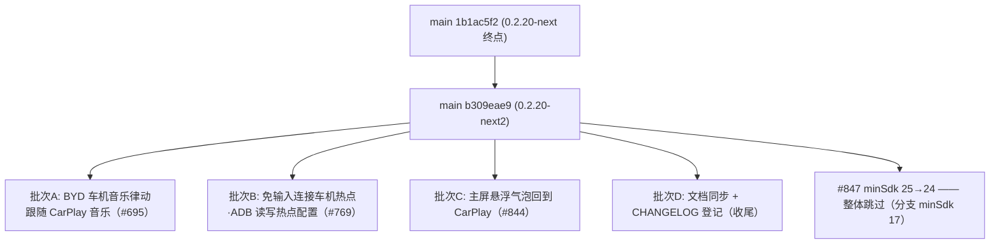
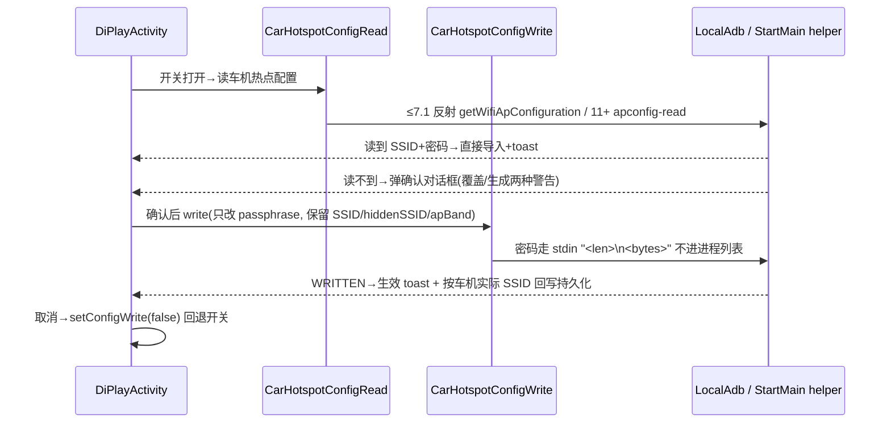

# DiPlay main 分支增量差异迁移报告（第八轮 · 0.2.20-next2 未发布增量）

> **作者**: TRAE AI
> **生成日期**: 2026-10-17
> **上一轮已登记 main 基线**: `1b1ac5f2`（`Merge pull request #834`，docs/release-notes-20261015b，即上一轮 `DiPlay-main分支增量差异迁移报告-0.2.20-next.md` 的迁移终点）
> **本轮最新 main tip**: `b309eae9`（`Merge pull request #695`，BYD 车机音乐律动）
> **当前分支**: `port/wave14-increment` @ `24654912`（波次十四批次 A–Z 已全部落地，工作区干净，版本 `0.2.20-api17` / versionCode 39）
> **上一轮文档**: `DiPlay-main分支增量差异迁移报告-0.2.20-next.md`
> **增量范围**: `git log 1b1ac5f2..origin/main` — **24 个提交（其中非 merge 20 个）**
> **增量规模**: `git diff --shortstat 1b1ac5f2..origin/main` = **43 文件改动（+2581/-25 行）**
> **本轮落定目标版本号**: **维持 `0.2.20-api17` / versionCode 39**（main 实测仍为 `versionCode=39`、`versionName="0.2.20"`，**未发新号**；本轮为 0.2.20 之后的第二段开发中增量，故命名 `-0.2.20-next2.md`，与 `-0.2.18-next.md` / `-0.2.19-next.md` / `-0.2.20-next.md` 策略一致）

> ✅ **本轮关键变化**：main 在 `1b1ac5f2` 后合入 **4 个功能 PR（#695 / #769 / #844 / #847）**，集中在三个可迁移主题：**BYD 车机音乐律动跟随 CarPlay 音乐**、**免输入连接车机热点（ADB 读写热点配置）**、**主屏回到 CarPlay 悬浮气泡**；第 4 个 PR（#847，minSdk 25→24）**对本分支整体不适用，需跳过**。全部改动基于分支已就位的 0.2.20 基线符号（`AmbientMusicController`、`LocalAdb`、`AdbKeys`、`CarHotspotSettings/StartMain/Tethering`、`AirPlayPersistence`、`CarPlayGlance` 等均已核对存在），**无新增第三方依赖**，但本轮含**反射隐藏 API 与 ADB 写配置**等高风险操作，整体移植风险**高于上一轮**。

***

## 0. 增量取数命令（每轮开始前重跑）

```sh
git fetch origin
git rev-parse origin/main                                       # 新基线替换下一轮锚点 → b309eae9
git log  1b1ac5f2..origin/main --oneline | wc -l                # 本轮增量（24 提交 / 20 非 merge）
git diff --shortstat 1b1ac5f2..origin/main                      # 43 文件级改动（+2581/-25）
git diff --diff-filter=A --name-status 1b1ac5f2..origin/main    # 本轮新增文件（主代码 6 + 测试 6，见 §1.2）
git diff --diff-filter=D --name-status 1b1ac5f2..origin/main    # 本轮删除文件（空）
git show origin/main:docs/RELEASE-NOTES-NEXT.md                 # 注意：本轮 4 个 PR 均未写入 RELEASE-NOTES-NEXT，功能权威说明见各 PR 提交信息与 §4 文档
```

> **编译基线核对（关键）**: 本分支 `mobile/build.gradle.kts` 实测 `minSdk = 17`、`targetSdk = 17`、`versionCode = 39`、`versionName = "0.2.20-api17"`。
> 本轮 main 代码中的 API 敏感点集中在 **#844 气泡**（`Settings.canDrawOverlays` API 23、`getSystemService(Class)` API 23、`TYPE_APPLICATION_OVERLAY` API 26）与 **#769 热点读写**（`getSystemService(WifiManager::class.java)` API 23、`supported(sdk)` 版本判定、反射 `WifiManager.getWifiApConfiguration`），**必须逐项加守卫或改写**（见 §3）。`CompletableFuture`（API 24）分支已开 `coreLibraryDesugaring 2.0.4` 且 `AmbientMusicController` 已在用，**无新增风险**。

***

## 1. 增量概览



### 1.1 增量功能总表（按批次归类）

| 批次 | 功能项 | 对应 main PR / 提交 | 主要文件 | API 17 相关 |
| --- | --- | --- | --- | --- |
| **A** | 氛围灯新增"车机音乐律动"开关：CarPlay 音乐播放时开启 BYD 隐藏 `IAudioService.startAudioOutput`，让**车机自己的**音乐律动灯光跟随 CarPlay 音乐；DiPlay 灯光让位 | #695 `78b4b71b` | `BydCarMusicRhythm.kt`(新)、`AmbientMusicActivityPolicy.kt`、`AmbientMusicController.kt`、`AmbientMusicSettings.kt`、`DiPlayActivity.kt` | 🟡 反射 BYD 隐藏 API；hidden-API 强制按 targetSdk 判定，分支 targetSdk 17 豁免；`CompletableFuture` 已脱糖 |
| **A** | 律动 helper 启动失败后 2/4/6s 递增重试（最多 3 次，音乐持续期间） | #695 `55c4649d` | `BydCarMusicRhythm.kt` | 🟢 `ScheduledExecutor` API 1 |
| **A** | "DiPlay 自己进程反射直调优先，失败才走 ADB helper（`app_process` 跑 `BydCarMusicRhythmTool`）"；按启动方式原样停止 | #695 `b243d780` | `BydCarMusicRhythm.kt`、`DiPlayActivity.kt`、`docs/BYD_AMBIENT_LIGHTING.md` | 🟡 helper `app_process` 段仅 Android 12 车机生效，旧机 `supported=false` 自动降级 |
| **B** | 免输入连接车机热点：ADB shell helper **读**车机热点配置（SSID/密码/安全类型），读到即导入 + toast | #769 `7b2484c2` `08386dbc` | `CarHotspotConfigRead.kt`(新)、`CarHotspotConfigWrite.kt`(新)、`CarHotspotStartMain.kt`、`LocalAdb.kt`、`DiPlayActivity.kt` | 🔴 `getSystemService(WifiManager::class.java)` API 23 → 改字符串形式；`supported(sdk)==N_MR1‖>=R` → 分支放宽为 `<=N_MR1`（4.2 走反射 `getWifiApConfiguration`，hidden API 在 4.2 无限制） |
| **B** | 确认对话框：覆盖已存详情/生成新详情两种警告文案；取消即回退开关；写回**只改 passphrase**，保留车机 SSID/hiddenSSID/apBand | #769 `fd72889a` `6e17806c` `1304fab8` `672dc7c0` | `CarHotspotConfigWrite.kt`、`DiPlayActivity.kt` | 🟢 密码走 stdin 不进进程列表；Android 11+ helper 反射 `IWifiManager.getSoftApConfiguration` 仅在车机侧进程执行 |
| **B** | 无详情时生成 `DiPlay-XXXX` + 16 位随机密码；安全类型未知拒绝写、WPA3 提示不支持、OPEN 文案统一 | #769 `32233f18` `4189948a` `f97b5866` | `ManualHotspotProvisioning.kt`(新)、`CarHotspotConfigWrite.kt`、`CarHotspotStartMain.kt` | 🟢 `SecureRandom`/`BitSet` API 1；`KeyMgmt.WPA2_PSK` API 12 |
| **B** | 写入生效 toast（"下次启动热点生效"）+ 按车机实际 SSID 回写持久化 | #769 `e9e514f0` | `DiPlayActivity.kt`、`AirPlayPersistence.kt` | 🟢 纯逻辑 |
| **C** | 主屏悬浮气泡：WindowManager overlay 独立窗口，回到 CarPlay；拖动记忆位置、长按 900ms 锁定、大小 8/10/12/16% 可调、默认关 | #844 `14b779bb` | `LauncherBubble.kt`(新)、`LauncherBubbleLayout.kt`(新)、`AirPlayPersistence.kt`、`DiPlayActivity.kt`、`CarPlayHostActivity.kt` | 🔴 `Settings.canDrawOverlays` API 23 → 抄 `CenterMapOverlay.kt:46-48` 守卫；`getSystemService(Class)` API 23 ×3 处 → 改 `Context.WINDOW_SERVICE`；`TYPE_APPLICATION_OVERLAY` API 26 → main 已有 `TYPE_PHONE` 回退，保留即可 |
| — | minSdk 25→24（"Install on Android 7.0"）+ `targetedByBydSettingsWork` 由 `<= N_MR1` 收紧为 `== N_MR1` | #847 `71391aeb` | `common/mobile/shared build.gradle(.kts)`、`Application.mk`、`DiPlayActivity.kt` | ⛔ **整体跳过**：分支 minSdk 17 本就覆盖 4.2；`== N_MR1` 收紧对分支**语义相反**（会禁用 4.2–7.0 的 BYD 诱骗页绕行），分支第 3424 行保持 `<= N_MR1` 不动 |
| — | 文档：`BYD_AMBIENT_LIGHTING.md`、`LAUNCHER_INTEGRATION.md`、`COMPATIBILITY.md`、`CONNECTION_RELIABILITY.md` | #695/#844/#847 | `docs/` | 批次 D 同步 |

### 1.2 本轮新增文件（`git diff --diff-filter=A`，主代码 6 个）

| 文件 | 说明 | 处理 | API 17 |
| --- | --- | --- | --- |
| `shared/.../hud/BydCarMusicRhythm.kt` | BYD 音乐律动直调 + ADB helper 双通道，2/4/6s 重试，按启动方式停止 | 批次 A 移植 | 🟡 反射隐藏 API；targetSdk 17 豁免 hidden-API 强制 |
| `shared/.../network/CarHotspotConfigRead.kt` | 读车机热点配置：≤7.1 反射 `getWifiApConfiguration`；11+ ADB helper | 批次 B 移植 | 🔴 一处 `getSystemService(WifiManager::class.java)` 须改写 |
| `shared/.../network/CarHotspotConfigWrite.kt` | 只改写 passphrase 写回；WPA2/OPEN 限定；密码走 stdin | 批次 B 移植 | 🔴 一处 `getSystemService(WifiManager::class.java)` 须改写 |
| `shared/.../orchestration/ManualHotspotProvisioning.kt` | 无详情时生成 `DiPlay-XXXX` SSID + 16 位密码 | 批次 B 移植 | 🟢 纯 JDK |
| `common/.../LauncherBubble.kt` | overlay 气泡窗口：自绘图标+扫光+挂锁徽标、拖动/长按锁定、600ms 延迟显隐 | 批次 C 移植 | 🔴 见 §1.1 批次 C 三处守卫 |
| `common/.../LauncherBubbleLayout.kt` | 气泡尺寸/命中区纯计算 | 批次 C 移植 | 🟢 纯计算 |

> 测试新增 6 个（`BydCarMusicRhythmTest`、`CarHotspotConfigReadTest`、`CarHotspotConfigWriteTest`、`ManualHotspotProvisioningTest`、`LauncherBubbleLayoutTest`、`LauncherBubblePersistenceTest`）与改动测试 7 个（`AmbientMusicSettingsUiTest`、`AmbientMusicActivityPolicyTest`、`AmbientMusicSettingsTest`、`AmbientMusicTickingTest`、`CarHotspotTetheringTest`、`BydSettingsDecoyTest`）一并同步。删除文件：无。

### 1.3 当前分支本地状态

`port/wave14-increment` @ `24654912`，工作区**干净**（上一轮的 C140A 稳定主机身份改动已随 `0648b4e4/acf2ae29` 提交落地）。波次十四批次 A–Z 全部完成，CHANGELOG 与 RELEASE-NOTES-NEXT 已同步至 `1b1ac5f2`。**本轮无前置遗留改动，可直接从 `port/wave14-increment` 切出 `port/wave15-increment` 开工。**

***

## 2. 重点功能逐项分析

### 批次 A — BYD 车机音乐律动跟随 CarPlay 音乐（#695，`78b4b71b`+`55c4649d`+`b243d780`）

**背景**：BYD 车机自带氛围灯"音乐律动"只跟随车机自己的媒体。本功能让 CarPlay 音乐也能驱动车机**原生**律动灯光：DiPlay 感知 CarPlay 播放状态后，反射调用 BYD 隐藏 `IAudioService.startAudioOutput("com.byd.mediacenter", token)`，system_server 的 visualizer 随之取音频输出并发色到灯 ECU；开启时 DiPlay 自有氛围灯 `restoreOriginal` 让位。

**三层机制**：
1. **感知**：`AmbientMusicController.tick()`（20Hz）新增分支 `carRhythmPlaying(rendererActive, trackPlaying, phonePlaying)`（`AmbientMusicActivityPolicy.kt` 顶层函数）→ 调 `BydCarMusicRhythm.setPlaying()`。
2. **直调优先**（`b243d780`）：`BydCarMusicRhythmDirect` 在 DiPlay 自己进程反射调用（12L 唐实测 ART 记 "blocked,reflection,denied" 日志但仍放行）；失败才降级 `BydCarMusicRhythmHelper`——经既有网络 ADB shell 用 `app_process` 拉起 `BydCarMusicRhythmTool`（`--probe`/`--stdin` 行协议）。`startedBy` 记录生效方式，停止时按原方式停。
3. **重试**（`55c4649d`）：启动失败后 `ScheduledExecutor` 按 2/4/6s 递增重试，最多 3 次，仅在音乐持续播放期间。

**设置接入**：`AmbientMusicSettings` 新增 `carRhythm: Boolean = false` 持久化；`DiPlayActivity` 氛围灯卡片（分支第 2534 行 `filteredSection(AMBIENT_LIGHTING)`）内新增 `carRhythmControl(card)` 开关行（仅 BYD 支持时显示，不支持显示 `_unavailable` 文案）。**注意**：main 的 `DiPlayActivity` 混有 #769/#844 改动段，移植时只摘 #695 的 3 处小改动（`carRhythmSupportCheck` 字段、卡片内调用、新函数）。

**移植要点**：分支 AmbientMusic 三类、`hud/` 58 个 BYD 类、`LocalAdb/AdbKeys`、氛围灯卡片均就位（波次十三批次 B 遗产），分支无任何 `carRhythm` 痕迹，可干净接入。🟡 中风险：隐藏 API 反射在 targetSdk 17 下不受 Android 9+ hidden-API 强制限制；helper 段仅 Android 12 车机生效；**需真车验证律动灯光实际生效**。同步 `BydCarMusicRhythmTest` + 4 个 AmbientMusic 测试 + `docs/BYD_AMBIENT_LIGHTING.md`。

### 批次 B — 免输入连接车机热点（#769，11 个功能提交 + 2 对 revert 链）

**端到端流程**（类归属）：



**revert 净效果（关键）**：`2195d445`（Android 8-10 root adb 写入）与 `9273c5ec`（WRITE_SETTINGS appop）已被 `981f3029`/`36031978` 完全还原——**最终态无 root 路径**，`supported()` 排除 8.0–10；`LocalAdb` 净改动仅 shell 三参 stdin 重载。移植时直接取 `origin/main` 最终态文件，**勿按提交链逐个 cherry-pick**，否则会把 revert 的 root 路径带进来。

**API 17 三处必改**：
1. `CarHotspotConfigRead.readWithApp` / `CarHotspotConfigWrite.writeWithApp` 各一处 `getSystemService(WifiManager::class.java)`（API 23）→ 改 `getSystemService(Context.WIFI_SERVICE) as WifiManager`。
2. `CarHotspotConfigRead.supported(sdk) == N_MR1 || >= R` → 分支放宽为 `<= N_MR1 || >= R`：API 17 走反射 `WifiManager.getWifiApConfiguration/setWifiApConfiguration`（hidden API 自 API 14 存在，4.2 无 hidden-api 限制，可用；`apBand` 经反射访问不受 27 移除公开字段影响）。
3. 协议行 `DIPLAY_HOTSPOT_(APCONFIG_)READ_V1|ok|<base64>` 与 helper 端 `SoftApConfiguration.Builder` 仅车机侧 11+ 进程执行，app 侧无风险；`Base64`/`SecureRandom`/`KeyMgmt.WPA2_PSK` 均 ≤12。

**UI 适配缺口**：main 热点配置写入行挂在 `parent.addView` 结构（约 3507 行，searchIndex 同步）；分支热点卡是 `section(parent, settings_car_hotspot_control)`（第 3186 行）+ `adbToggle` 范式，**插入点需手工适配**，并遵守 AGENTS.md：该控制属 Connection 类别（车热点自动化），描述须写明"下次启动热点生效"，保存后 `markReconnectNeeded()` 不适用（不改运行中会话）。前置符号 `ManualHotspotSecurity(含 WPA3_TRANSITION)/Band/Validation`、`CarHotspotAdbFallback.bounded`、`CarHotspotSetup.grant/shouldStartOnLaunch`、`AirPlayPersistence.load/saveManualHotspot*`、`createSwitchRow`、`searchIndexSink` 分支全部在；`LocalAdb` 与 PR base **零差异可直接套 diff**。🔴 高风险项：写车机热点配置不可逆，确认对话框与"只改 passphrase"约束必须原样保留；4.2 反射路径 main 从未实测，**必须真机验证并标注实验性**。

### 批次 C — 主屏悬浮气泡回到 CarPlay（#844，`14b779bb`）

**机制**：WindowManager **独立 overlay 窗口**（非布局内 View）：`windows.addView(BubbleView, params)` 自绘 app 图标+扫光+挂锁徽标；长按提示是第二个 `FLAG_NOT_TOUCHABLE` 窗口。参数 `FLAG_NOT_FOCUSABLE|FLAG_LAYOUT_NO_LIMITS` + `Gravity.TOP|START`。显隐挂接：DiPlayActivity `onStart`/CarPlayHostActivity → `attach + onAppScreenShown`（隐藏）；`onStop` → `scheduleShow`（600ms 后、进程 importance ≤ FOREGROUND 才显示）。点击：`CarPlayGlance.snapshot().connected` 为真开 `CarPlayHostActivity`，否则 `DiPlayActivity`（NEW_TASK）。持久化：`AirPlayPersistence.load/saveLauncherBubble`（默认关）+ `…Size`（8/10/12/16%）；位置/锁定另存 prefs `diplay_launcher_bubble`。

**API 17 三处必改**（其余 `getMyMemoryState`(16)、`ValueAnimator`(11)、`actionMasked`(8)、`Gravity.START`(17)、Paint/Canvas(1) 均安全，UiCompat 无需新增 helper）：
1. `Settings.canDrawOverlays`（API 23）：`permitted()` 直调在 17 崩 → 抄分支 `CenterMapOverlay.kt:46-48` 范式 `SDK_INT >= 23 ? canDrawOverlays : true`（JB 装机即授予 SYSTEM_ALERT_WINDOW）。
2. `Context.getSystemService(Class)`（API 23）×3 处 → `getSystemService(Context.WINDOW_SERVICE) as? WindowManager`（`CenterMapOverlay.kt:77` 同款）。
3. `TYPE_APPLICATION_OVERLAY`（API 26）：编译期内联常量不崩，main 已带 `TYPE_PHONE` 回退守卫，**原样保留**。

**设置接入**：main 将 `SettingsSection.LAUNCHER_BUBBLE` 映射到 **ADVANCED** 类别（main `DiPlayActivity` L158）；分支按 AGENTS.md 归类表同样落 Advanced（实验性悬浮窗行为）。分支缺口：整文件 2 个 + `SettingsSection.LAUNCHER_BUBBLE` 枚举/映射/卡片 + `AirPlayPersistence` 2 KEY 4 方法（锚点 `KEY_LAUNCHER_MAP_SHARING`:114、`loadClusterSpeedometerEnabled`:932 在）+ DiPlayActivity onStart/onStop 挂接 + CarPlayHostActivity 两处挂接（锚点 :1100/:1709 在）。`toggle/choice/label/filteredSection/openOverlayPermission`(:508)、`percent_value`(:548)、`ic_carplay`、`CarPlayGlance`（shared，common 已依赖）全部就位。同步 2 个新测试 + `docs/LAUNCHER_INTEGRATION.md`。🟡 中风险：JB 上 TYPE_PHONE 层级悬浮窗行为需真机验证（拖动、锁定、遮挡系统栏）。

### 批次 D — 文档同步与发布登记（收尾）

CHANGELOG 波次十五条目 + `docs/BYD_AMBIENT_LIGHTING.md`、`docs/LAUNCHER_INTEGRATION.md`、`docs/COMPATIBILITY.md`、`docs/CONNECTION_RELIABILITY.md` 同步 main 权威全文。**注意**：本轮 4 个 PR 均未写入 `docs/RELEASE-NOTES-NEXT.md`（与上一轮不同），批次 Z 时该文件维持 `1b1ac5f2` 版即可，勿从 main 拉不存在的条目。

***

## 3. API 17 适配要点总表

| API / 调用 | 引入版本 | 出现位置 | 处置 |
| --- | --- | --- | --- |
| `Settings.canDrawOverlays` | 23 | `LauncherBubble.permitted()` | 🔴 `SDK_INT>=23` 守卫，else `true`（抄 CenterMapOverlay） |
| `Context.getSystemService(Class)` | 23 | `LauncherBubble` ×3、`CarHotspotConfigRead/Write` 各 1 | 🔴 全部改字符串 service 形式 |
| `TYPE_APPLICATION_OVERLAY` | 26 | `LauncherBubble` params | 🟢 编译期内联 + main 已带 TYPE_PHONE 回退，保留 |
| `supported(sdk)==N_MR1‖>=R` | — | `CarHotspotConfigRead` | 🔴 分支放宽 `<=N_MR1`，4.2 走反射路径（新行为，需真机验证） |
| 反射 `getWifiApConfiguration/setWifiApConfiguration` | hidden, API 14 起 | `CarHotspotConfigRead/Write` | 🟢 4.2 无 hidden-api 限制 |
| `SoftApConfiguration`/`Builder`、`IWifiManager` | 11+/hidden | 仅 ADB helper 车机侧进程 | 🟢 app 进程不触碰 |
| 反射 BYD `IAudioService.startAudioOutput` | hidden | `BydCarMusicRhythmDirect` | 🟡 targetSdk 17 豁免 hidden-API 强制；需真车验证 |
| `app_process` helper | — | `BydCarMusicRhythmHelper` | 🟢 仅 Android 12 车机分支生效，旧机 supported=false 降级 |
| `CompletableFuture` | 24 | `BydCarMusicRhythm` | 🟢 分支 coreLibraryDesugaring 2.0.4 已覆盖，AmbientMusicController 已在用 |
| `KeyMgmt.WPA2_PSK`/`BitSet`/`SecureRandom`/`Base64` | ≤12 | 热点读写 | 🟢 安全 |
| `ScheduledExecutor`/`ValueAnimator`/`Gravity.START` | ≤17 | 重试/动画 | 🟢 安全 |
| `targetedByBydSettingsWork == N_MR1` 收紧 | — | #847 `71391aeb` | ⛔ **不迁移**（分支 minSdk 17，收紧会禁用 4.2–7.0 绕行，语义相反） |

***

## 4. 需跳过 / 需守卫清单（执行摘要）

1. **跳过**：#847 全部（4 个构建文件 minSdk 25→24、`Application.mk`、DiPlayActivity `== N_MR1` 收紧、`BydSettingsDecoyTest` 新增的 API<24 用例——分支 minSdk 17 本无此断言意义）。
2. **守卫改写**：§3 表中 🔴 五项（canDrawOverlays、getSystemService(Class) ×5、supported 放宽、热点写 4.2 反射路径标注实验性）。
3. **勿逐提交 cherry-pick**：#769 含 revert 链，一律取 `origin/main` 最终态文件整迁。
4. **UI 手工适配**：#769 热点配置行（分支 `section(parent, settings_car_hotspot_control)` 结构）；#695 只摘氛围灯卡 3 处小改动；#844 气泡卡走 `filteredSection + ADVANCED 映射`。

***

## 5. 迁移计划（建议分支 `port/wave15-increment`，从 `port/wave14-increment` 切出）

| 批次 | 内容 | 建议提交 |
| --- | --- | --- |
| A | 车机音乐律动：`BydCarMusicRhythm.kt` + AmbientMusic 三类 + DiPlayActivity 3 处 + 3 字符串 + 测试 + 文档 | `波次十五批次A：BYD 车机音乐律动跟随 CarPlay 音乐（#695）` |
| B | 热点免输入：`LocalAdb` shell stdin 重载 → `ManualHotspotProvisioning` → `CarHotspotConfigRead/Write`（含 2 处 getSystemService 改写 + supported 放宽）→ `StartMain/Settings/Tethering` diff → DiPlayActivity 对话框/toast + 14 字符串 + 测试 | `波次十五批次B：免输入连接车机热点（#769）` |
| C | 主屏气泡：`LauncherBubble/Layout`（含 4 处 API 守卫）+ `AirPlayPersistence` 4 方法 + 双 Activity 挂接 + 气泡卡（ADVANCED）+ 7 字符串 + 2 测试 + 文档 | `波次十五批次C：主屏回到 CarPlay 悬浮气泡（#844）` |
| D | CHANGELOG 波次十五条目 + 4 篇 docs 同步（RELEASE-NOTES-NEXT 不动）+ `SettingsTranslationsTest`/`SettingsLayoutPolicyTest`/`AdaptiveSettingsUiTest` 全绿 + CI 命令 | `波次十五批次Z：文档同步与发布登记` |

每批次完成后跑对应模块单测；批次 B/C 完成后按 AGENTS.md 补大字号 compact/full 截图（气泡卡涉 ADVANCED 页；热点卡涉 Connection 页 + 阿拉伯语 RTL 截图——气泡锁定/解锁文案为行内对齐敏感项）。

***

## 6. 字符串与本地化义务

本轮新增 **24 个** `settings_*` key（全部 8 locale 同步，`SettingsTranslationsTest` 门禁）：

- **#695（3）**：`settings_ambient_car_rhythm`、`_description`、`_unavailable`
- **#769（14）**：`settings_car_hotspot_config_{title, description, unsupported, written, imported, dialog_title, dialog_message, dialog_generate_message, dialog_save_message, dialog_confirm, effect, failed, wpa3, open}`
- **#844（7）**：`settings_launcher_bubble`、`_description`、`_size`、`_locked`、`_unlocked`、`_hold_to_lock`、`_hold_to_unlock`

> 取数：`git diff 1b1ac5f2..origin/main -- common/src/main/res/values/strings.xml`。按既往教训，齐全性判定须覆盖各 locale 目录下**全部** XML（不止 strings.xml），缺失时以分支 `values/` 英文为占位符基准补齐，防止 Duplicate resources。

***

## 7. 版本号同步（与 main 保持一致）

main 实测 `versionCode = 39`、`versionName = "0.2.20"`（#847 只动 minSdk 未发新号）→ 分支维持 `0.2.20-api17` / versionCode 39，待发布时再升 `0.2.21-api17` / 40。分支 `minSdk/targetSdk = 17` 不受 #847 影响，**不改任何构建脚本**。

***

## 8. 风险清单

| 风险 | 等级 | 缓解 |
| --- | --- | --- |
| 热点配置写回不可逆（写坏车机热点将无法连接） | 🔴 高 | 原样保留 main 的确认对话框、"只改 passphrase"、安全类型未知拒写；4.2 反射路径为**分支独有扩展**（main 未实测），首验必在测试车机上进行，并考虑标题加 `（实验性）` |
| `supported()` 放宽到 `<=N_MR1` 引入未验证路径 | 🔴 高 | 真机 4.2/4.4 验证反射 `getWifiApConfiguration` 可用性；不可用则回退仅 `>=R` |
| JB 悬浮窗（TYPE_PHONE）层级/拖动/遮挡系统栏行为差异 | 🟡 中 | 批次 C 真机截图 + 交互验证；异常时气泡开关保持默认关 |
| BYD 隐藏 `IAudioService` 反射在不同 DiLink 版本行为不一 | 🟡 中 | 沿用 main 的直调→helper→重试→降级链；`_unavailable` 文案兜底；真车验证 |
| #769 revert 链误带 root adb 路径 | 🟡 中 | 一律取 `origin/main` 最终态整文件，不逐提交 pick |
| DiPlayActivity 三段改动互相混排（#695/#769/#844 同文件） | 🟡 中 | 按批次分次提交，每次只摘对应 PR 段；提交间跑 `SettingsLayoutPolicyTest` 防归类破坏 |

***

## 9. 与上一轮文档的衔接 & 归档

- 上一轮 `DiPlay-main分支增量差异迁移报告-0.2.20-next.md`（第七轮，`969f8714..1b1ac5f2`）已由 `port/wave14-increment` 批次 A–Z 全部落地（含 CHANGELOG/RELEASE-NOTES-NEXT 登记 `95e0aa4f`），本轮基线锚点即其登记终点 `1b1ac5f2`。
- 本轮（第八轮）终点 `b309eae9` 替换为下一轮锚点；迁移落地后归档本文档并生成 `-0.2.21.md`（若 main 发新号）或 `-0.2.20-next3.md`。

***

## 10. 附录：main 增量提交列表（`1b1ac5f2..origin/main`，24 个，倒序）

```
b309eae9 Merge pull request #695 from romanchukg-cloud/feat/byd-car-music-rhythm
7b7aa167 Merge pull request #844 from macheteHot/feat/home-screen-bubble
94f6a072 Merge pull request #769 from band-wa/feat/car-hotspot-config-write
ac2f4b21 Merge pull request #847 from Boring206/android-7-0-install
672dc7c0 Mention only the password in the save dialog
71391aeb Install on Android 7.0 (API 24)
14b779bb feat(launcher): a home-screen bubble that comes back to CarPlay
1304fab8 Describe saving details in the save dialog
32233f18 Create the car hotspot details when the car has none
f97b5866 Say that importing is unsupported, not writing
4189948a Reject open writes when the car's security type is unknown
6e17806c Render when the save-time overwrite dialog is cancelled
fd72889a Confirm the car hotspot write and keep the car's SSID and password
8afba49d fix(wireless): rewrite only the car hotspot passphrase
08386dbc feat(wireless): read the car hotspot configuration before overwriting it
981f3029 Revert "Write the car hotspot config from a root adb on Android 8-10"
36031978 Revert "Allow the WRITE_SETTINGS appop before writing the hotspot config"
9273c5ec Allow the WRITE_SETTINGS appop before writing the hotspot config
2195d445 Write the car hotspot config from a root adb on Android 8-10
e9e514f0 Toast when the hotspot write takes effect
7b2484c2 Connect the car hotspot without typing anything
b243d780 Car music rhythm: DiPlay makes the call itself, the ADB helper only where that fails
55c4649d Car music rhythm: start the helper again after a failure while the music plays
78b4b71b Ambient lighting: the car's own music rhythm follows CarPlay music
```

> 其中 `2195d445`/`9273c5ec` 已被 `981f3029`/`36031978` 还原，净增量不含 root adb 与 appop 路径。
