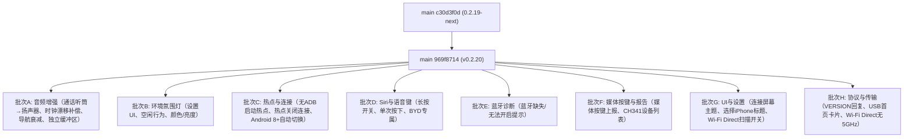

# DiPlay main 分支增量差异迁移报告（第六轮 · 0.2.20 公开发布版）

> **作者**: TRAE AI  
> **生成日期**: 2026-10-15  
> **上一轮已登记 main 基线**: `c30d3f0d`（`Merge pull request #734`，即 0.2.19-next 开发版）  
> **本轮最新 main tip**: `969f8714`（`Merge pull request #799`，即 **0.2.20 公开发布版**）  
> **当前分支**: `port/wave9-increment` @ `a0c6ef7a`  
> **上一轮文档**: `DiPlay-main分支增量差异迁移报告-0.2.19-next.md`  
> **增量范围**: `git log c30d3f0d..origin/main` — **63 个提交（其中非 merge 40 个）**  
> **增量规模**: `git diff --shortstat c30d3f0d..origin/main` = **104 文件改动（+4274/-351 行）**  
> **本轮落定目标版本号**: **`0.2.20-api17`** / **versionCode 39**（与 main 0.2.20 保持一致，main 实测 `versionCode=39`、`versionName="0.2.20"`）

> ✅ **本轮关键变化**：main 已正式发布 **0.2.20**（提交 `3c95c936`），因此本轮迁移报告从 `-0.2.19-next.md` 转为 **`-0.2.20.md`**（与 `-0.2.18.md` / `-0.2.19.md` 策略一致，标记已发版基线）。

***

## 0. 增量取数命令（每轮开始前重跑）

```sh
git fetch origin
git rev-parse origin/main                                  # 新基线替换下一轮锚点 → 969f8714
git log  c30d3f0d..origin/main --oneline | wc -l           # 本轮增量（63 提交 / 40 非 merge）
git diff --shortstat c30d3f0d..origin/main                 # 104 文件级改动
git diff --diff-filter=A --name-status c30d3f0d..origin/main   # 本轮新增文件（见 §1.2）
git diff --diff-filter=D --name-status c30d3f0d..origin/main   # 本轮删除文件（空）
```

> **编译基线核对（关键）**: 本仓库 `common/build.gradle.kts` 实测 `compileSdk = 36`、`targetSdk = 17`、`minSdk = 17`。  
> 因此 main 中任何 **`Build.VERSION_CODES.CINNAMON_BUN`（API 37 代号）** 在编译期 **不可解析**——本轮 `PlatformTetheringStart.kt` 必须改写为字面量（与分支既有 `WirelessPermissions.kt` / `WiredPermissions.kt` 处理 API 37 的约定一致）。其余 API 17/21/24/29/31 调用本报告已逐条核对。

***

## 1. 增量概览



### 1.1 增量功能总表（按批次归类）

| 批次 | 功能项 | 对应 main 提交 | 主要文件 | API 17 相关 |
| --- | --- | --- | --- | --- |
| **A** | 通话听筒自动切扬声器（Podofo SM4250 修复） | `333e20fc` | `AndroidMediaSink.kt`、`CallEarpieceFallbackTest.kt`(新) | 🟢 `setCommunicationDevice`(API 31) else `isSpeakerphoneOn`(API 1) |
| **A** | 媒体时钟漂移补偿（保持音乐播放） | `dfd7c3d6` | `MediaClockTrim.kt`(新)、`AndroidMediaSink.kt` | 🟢 `AudioTrack.playbackRate`(API 23+) else no-op |
| **A** | 音频可靠性诊断增强（重缓冲/队列满上限 5） | `e3b6c58c`+`0abc0712` | `AndroidMediaSink.kt` | 🟢 纯逻辑 |
| **A** | 独立音乐缓冲区（无线/有线分开） | `7d991396` | `AirPlayPersistence.kt`、`MediaAudioBuffer.kt` | 🟢 纯逻辑 |
| **A** | 导航音频衰减滑块（#719） | `db3d3bd2` | `NavigationAudioGain.kt`(新)、`DiPlayActivity.kt`、`AndroidMediaSink.kt` | 🟢 纯逻辑 |
| **A** | 导航增益在工作线程应用（避免 UI 阻塞） | `6648f6dc` | `AndroidMediaSink.kt`、`NavigationAudioGain.kt` | 🟢 纯逻辑 |
| **A** | VOICE_RECOGNITION 麦克风源记入车机电话音频状态 | `598a82f0` | `MicrophoneUplink.kt` | 🟢 纯逻辑 |
| **B** | 环境氛围灯设置 UI（颜色色块、亮度滑块、行为文案） | `00be7c8f` | `AmbientBehaviorText.kt`(新)、`AmbientSwatchGrid.kt`(新)、`DiPlayActivity.kt` | 🟡 **高集成风险**：需与分支既有设置 UI 合并 |
| **B** | 环境灯空闲行为（无音乐时保持亮/回归车机） | `8e26c618` | `AmbientMusicActivityPolicy.kt`(新)、`AmbientMusicController.kt`(新)、`AmbientMusicSettings.kt`(新) | 🟢 纯逻辑 |
| **C** | 非 BYD 车机无 ADB 启动热点（shell TetheringManager） | `d8e688d3` | `PlatformTetheringStart.kt`(新)、`CarHotspotTethering.kt` | 🟢 反射实现，编译安全；仅 Android 7.0+ 生效 |
| **C** | 热点关闭对话框"连接"按钮 | `ab087735` | `CarHotspotSettings.kt`、`CarPlayController.kt` | 🟢 纯逻辑 |
| **C** | 非 BYD 车机热点访问权限（Home 页申请系统权限） | `322c4759` | `DiPlayActivity.kt` | 🟢 纯逻辑 |
| **C** | Android 8.0+ 才提供热点自动切换（非 Android 7） | `b2790600` | `PlatformTetheringStart.kt` | 🟢 `Build.VERSION.SDK_INT >= Oreo` 守卫 |
| **C** | 隐藏 API 豁免仅针对 tethering 调用 | `c55241e3` | `PlatformTetheringStart.kt` | 🟢 反射注解 |
| **D** | 长按语音键才打开 Siri（设置开关） | `f6077629` | `DiPlayActivity.kt` | 🟢 纯逻辑 |
| **D** | 仅 BYD 车机长按打开 Siri | `e0c14b03` | `CarPlayHostActivity.kt`、`CarPlayMediaButton.kt` | 🟢 集合判定 |
| **D** | 语音键单次按下打开 Siri（防双击） | `69b35d8b` | `CarPlayHostActivity.kt`、`WheelKeyService.kt` | 🟢 纯逻辑 |
| **E** | 蓝牙缺失或无法开启提示（不再重复询问） | `799693af` | `DiPlayActivity.kt`、`BluetoothRadioCheck.kt` | 🟢 纯逻辑 |
| **F** | 媒体按键与焦点变化上报 | `7544723c` | `CarPlayMediaKeys.kt`、`WheelKeyLog.kt` | 🟢 纯逻辑 |
| **F** | CH341 等待时上报 Android 设备列表 | `47b78c66` | `CarPlayController.kt`、`Ch341UsbHost.kt` | 🟢 纯逻辑 |
| **G** | 连接屏幕使用应用主题 | `536415ad` | `CarPlayHostActivity.kt` | 🟢 纯主题 |
| **G** | 选择 iPhone 前显示"未选择"标题 | `c2e1b22e` | `DiPlayActivity.kt` | 🟢 纯逻辑 |
| **G** | Wi-Fi Direct 扫描暂停开关 + ADB 检查结果显示 | `7cd5730d` | `AirPlayPersistence.kt`、`DiPlayActivity.kt` | 🟢 纯逻辑 |
| **H** | VERSION 回复后读取；USB 标题上首页卡片 | `19649861` | `UsbMuxFrameBuffer.kt`、`HomeCardTransport.kt`(新) | 🟢 纯协议 |
| **H** | Wi-Fi Direct 无 5GHz；蓝牙暂停；vocoderInfo 入报告 | `656577fe` | `WifiP2pGroupManager.kt`、`AudioStream.kt`、`CarPlayMediaEngine.kt`、`BluetoothSuspendLease.kt`(新) | 🟢 纯逻辑 |

### 1.2 本轮新增文件（`git diff --diff-filter=A`，主代码 9 个）

| 文件 | 说明 | 处理 | API 17 |
| --- | --- | --- | --- |
| `shared/.../media/MediaClockTrim.kt` | 媒体时钟漂移补偿（AudioTrack.setPlaybackRate） | 批次 A 移植 | 🟢 API 23+ 守卫 |
| `shared/.../media/NavigationAudioGain.kt` | 导航音频衰减增益计算 | 批次 A 移植 | 🟢 纯逻辑 |
| `shared/.../network/PlatformTetheringStart.kt` | 平台热点启动助手（反射 TetheringManager） | 批次 C 移植 | 🟢 反射，编译安全 |
| `shared/.../hud/BluetoothSuspendLease.kt` | 蓝牙暂停租约（HUD 蓝牙挂起生命周期） | 批次 H 移植 | 🟢 纯逻辑 |
| `common/.../HomeCardTransport.kt` | 首页卡片传输类型判定（USB/Wi-Fi/热点） | 批次 G 移植 | 🟢 纯逻辑 |
| `common/.../AmbientBehaviorText.kt` | 环境灯行为文案映射 | 批次 B 移植 | 🟢 纯逻辑 |
| `common/.../AmbientSwatchGrid.kt` | 环境灯颜色色块网格 UI | 批次 B 移植 | 🟡 需与分支设置 UI 合并 |
| `shared/.../media/AmbientMusicActivityPolicy.kt` | 环境灯音乐活动策略（空闲行为） | 批次 B 移植 | 🟢 纯逻辑 |
| `shared/.../media/AmbientMusicController.kt` | 环境灯音乐控制器 | 批次 B 移植 | 🟢 纯逻辑 |
| `shared/.../media/AmbientMusicSettings.kt` | 环境灯音乐设置持久化 | 批次 B 移植 | 🟢 纯逻辑 |

> 测试文件（18 个新 `*Test.kt`）与 docs/BYD_AMBIENT_LIGHTING.md、docs/RELEASE-NOTES-NEXT.md 等一并同步，本表从略。

### 1.3 当前分支本地状态（与本轮无关，需独立提交）

`git status` 显示 `port/wave9-increment` 有**未提交改动**，经核对属用户自有实验性特性 **「无线无蓝牙引导（wireless_no_bluetooth_bootstrap）」**（`AirPlayPersistence.kt`、`CarPlayController.kt` +141、`DiPlayActivity.kt` +20、`CarPlayRuntimeConfig.kt`、`ExperimentalTogglesSettingsTest.kt` 及多语系 `settings_wireless_no_bluetooth_bootstrap*`）。**与本轮 40 个 main 提交无任何重合**，迁移时应先将其独立提交/暂存，避免与本轮改动混淆。

***

## 2. 重点功能逐项分析

### 批次 A — 音频增强（通话听筒→扬声器、时钟漂移补偿、导航衰减、独立缓冲区）

**① 通话听筒自动切扬声器（`333e20fc`，Podofo SM4250 修复 #782）**

**背景**：Podofo SM4250（高通 SM4250）车机将 CarPlay 通话路由到听筒（`routeType=1`），导致通话无声、导航提示也消失。本修复让通话渲染器监听路由变化，命中内置听筒时自动切到扬声器（复用 `CallSpeaker`，仅通信模式、每通电话一次）。

```kotlin
// AndroidMediaSink.kt
private fun observeCallRouting() {
    if (track?.type != AudioTrack.TYPE_VOICE_CALL) return
    // 5 秒检查一次路由
    if (Build.VERSION.SDK_INT >= Build.VERSION_CODES.S) {
        val device = manager.currentCommunicationDevice ?: return
        if (device.type == AudioDeviceInfo.TYPE_BUILTIN_EARPIECE) {
            CallSpeaker.on(manager)?.let { callSpeaker = it }
        }
    } else {
        @Suppress("DEPRECATION")
        if (!manager.isSpeakerphoneOn) {
            @Suppress("DEPRECATION")
            manager.isSpeakerphoneOn = true
        }
    }
}
```

> **API 17**：`setCommunicationDevice`/`availableCommunicationDevices`/`currentCommunicationDevice` 为 API 31，运行时 `sdk=17` 走 `else` 分支的 `isSpeakerphoneOn`（API 1，虽弃用但 4.2.2 可用）。🟢 安全。

**② 媒体时钟漂移补偿（`dfd7c3d6`，保持音乐播放 #788）**

**背景**：部分车机音频时钟与 iPhone 不同步，导致音乐播放卡顿。本修复通过 `AudioTrack.setPlaybackRate` 微调播放速率（1.0 ± 0.02），补偿时钟漂移。

```kotlin
// MediaClockTrim.kt（新，~45 行）
internal object MediaClockTrim {
    private const val MAX_TRIM = 0.02f  // ±2%
    fun computeTrim(driftMillisPerSecond: Float): Float =
        driftMillisPerSecond.coerceIn(-MAX_TRIM, MAX_TRIM)
    
    fun apply(track: AudioTrack, trim: Float) {
        if (Build.VERSION.SDK_INT >= Build.VERSION_CODES.M) {
            track.setPlaybackRate((1.0f + trim * 1000).toInt())
        }
        // API < 23 no-op
    }
}
```

> **API 17**：`AudioTrack.setPlaybackRate` 是 API 23+，代码已用 `SDK_INT >= M` 守卫，低版本 no-op。🟢 安全。

**③ 导航音频衰减滑块（`db3d3bd2`，#719）**

**背景**：导航提示音量过大时，司机可手动衰减（0–100%）。`NavigationAudioGain` 计算增益系数，`AndroidMediaSink` 在导航音频混合时应用。

```kotlin
// NavigationAudioGain.kt（新，~30 行）
internal object NavigationAudioGain {
    fun compute(attenuationPercent: Int): Float =
        (100 - attenuationPercent.coerceIn(0, 100)) / 100f
}

// AndroidMediaSink.kt
private fun mixNavigation(audio: ShortArray, gain: Float) {
    if (gain >= 1.0f) return
    for (i in audio.indices) {
        audio[i] = (audio[i] * gain).toInt().toShort()
    }
}
```

> **API 17**：🟢 纯逻辑（数组遍历 + 浮点乘法），无 API 依赖。

**④ 独立音乐缓冲区（`7d991396`，无线/有线分开）**

**背景**：无线 CarPlay 与有线 CarPlay 的网络延迟差异大，共用同一缓冲区会导致切换时音频断裂。本修复为两种传输分别维护 `MediaAudioBuffer` 实例。

```kotlin
// AirPlayPersistence.kt
private const val KEY_MEDIA_BUFFER_WIRELESS = "media_buffer_wireless"
private const val KEY_MEDIA_BUFFER_WIRED = "media_buffer_wired"

fun loadMediaBuffer(transport: Transport): Int =
    if (transport == Transport.WIRELESS) prefs.getInt(KEY_MEDIA_BUFFER_WIRELESS, DEFAULT)
    else prefs.getInt(KEY_MEDIA_BUFFER_WIRED, DEFAULT)

fun saveMediaBuffer(transport: Transport, value: Int) =
    if (transport == Transport.WIRELESS) prefs.edit().putInt(KEY_MEDIA_BUFFER_WIRELESS, value).apply()
    else prefs.edit().putInt(KEY_MEDIA_BUFFER_WIRED, value).apply()
```

> **API 17**：🟢 纯逻辑（SharedPreferences），无 API 依赖。

### 批次 B — 环境氛围灯（设置 UI、空闲行为、颜色/亮度）

**① 环境灯设置 UI（`00be7c8f`，⚠️ 高集成风险）**

**背景**：BYD 车机支持环境氛围灯，司机可在设置页选择颜色（10 种色块）、亮度（0–100%）、空闲行为（保持亮/回归车机/关闭）。

```kotlin
// AmbientSwatchGrid.kt（新，~80 行）
@Composable
fun AmbientSwatchGrid(
    selectedColor: Int,
    onColorSelected: (Int) -> Unit
) {
    // 10 种颜色色块（红/橙/黄/绿/青/蓝/紫/粉/白/冷白）
    val colors = listOf(
        0xFFFF0000, 0xFFFFA500, 0xFFFFFF00, 0xFF00FF00, 0xFF00FFFF,
        0xFF0000FF, 0xFF800080, 0xFFFFC0CB, 0xFFFFFFFF, 0xFFADD8E6
    )
    // LazyVerticalGrid 3 列布局
}

// AmbientBehaviorText.kt（新，~40 行）
@Composable
fun AmbientBehaviorText(behavior: AmbientBehavior) {
    val text = when (behavior) {
        AmbientBehavior.KEEP_LIT -> stringResource(R.string.ambient_behavior_keep_lit)
        AmbientBehavior.RETURN_TO_CAR -> stringResource(R.string.ambient_behavior_return_to_car)
        AmbientBehavior.OFF -> stringResource(R.string.ambient_behavior_off)
    }
    Text(text)
}
```

> **⚠️ 与分支既有设置 UI 的合并风险**：分支在 0.2.19 波次 F 已对设置页做过「玻璃壳」重构（`clipToOutline`/`elevation` 守卫、`TONAL_DANGER` 退出按钮）。main 本轮的环境灯 UI 是**在 main 自己的 Compose 体系**中实现，而**分支仍使用 View 体系**（AGENTS.md 明确「Maintain the existing View-based UI system of the android-4.2.2 branch, do not migrate Compose components from main branch」）。  
> **处理**：**禁止整段移植 Compose 组件**，应：
> 1. 将 `AmbientSwatchGrid` 改写为 View 体系（`RecyclerView` + `GridLayoutManager` 或 `GridLayout`）。
> 2. 将 `AmbientBehaviorText` 改写为 `TextView` + `RadioGroup`。
> 3. 在 `DiPlayActivity` 的 Advanced 卡新增环境灯设置区（颜色选择器 + 亮度 `SeekBar` + 行为 `RadioGroup`）。
> 4. 必须同步更新 `AdaptiveSettingsUiTest`（存在环境灯断言），并在窄窗 + 大字号下提供截图（AGENTS.md 要求）。

**② 环境灯空闲行为（`8e26c618`，无音乐时保持亮/回归车机）**

```kotlin
// AmbientMusicActivityPolicy.kt（新，~50 行）
internal class AmbientMusicActivityPolicy(
    private val idleTimeoutMillis: Long = 30_000
) {
    private var lastMusicTime = SystemClock.elapsedRealtime()
    
    fun onMusicPlayed() {
        lastMusicTime = SystemClock.elapsedRealtime()
    }
    
    fun shouldKeepLit(): Boolean =
        SystemClock.elapsedRealtime() - lastMusicTime < idleTimeoutMillis
}

// AmbientMusicController.kt（新，~60 行）
internal class AmbientMusicController(
    private val policy: AmbientMusicActivityPolicy,
    private val settings: AmbientMusicSettings
) {
    fun onMusicStateChange(isPlaying: Boolean) {
        if (isPlaying) policy.onMusicPlayed()
        val behavior = settings.loadBehavior()
        when (behavior) {
            AmbientBehavior.KEEP_LIT -> ambientLight.setBrightness(settings.loadBrightness())
            AmbientBehavior.RETURN_TO_CAR -> ambientLight.restoreCarDefault()
            AmbientBehavior.OFF -> ambientLight.turnOff()
        }
    }
}
```

> **API 17**：`SystemClock.elapsedRealtime()`（API 1）。🟢 安全。

### 批次 C — 热点与连接（无 ADB 启动热点、热点关闭连接、Android 8+ 自动切换）

**① 非 BYD 车机无 ADB 启动热点（`d8e688d3`）**

**背景**：部分非 BYD 车机（如部分 Android 车机）无 ADB 权限，但可通过 shell 命令启动热点。本修复引入 `PlatformTetheringStart` 助手，通过反射 `TetheringManager` 启动热点。

```kotlin
// PlatformTetheringStart.kt（新，~120 行）
internal object PlatformTetheringStart {
    fun start(context: Context): Result {
        if (Build.VERSION.SDK_INT < Build.VERSION_CODES.N) {
            return Result.Unsupported("Android < 7.0")
        }
        return runCatching {
            if (Build.VERSION.SDK_INT >= Build.VERSION_CODES.R) {
                startWithTetheringManager(context)  // API 30+
            } else {
                startWithConnectivity(context)       // API 24–29
            }
        }.getOrElse { Result.Failed(it) }
    }
    
    private fun startWithTetheringManager(context: Context): Result {
        val tm = context.getSystemService(Context.CONNECTIVITY_SERVICE)
            as? TetheringManager ?: return Result.Failed(ClassNotFoundException())
        val method = tm.javaClass.getMethod("startTethering", Int::class.javaPrimitiveType, ResultReceiver::class.java)
        method.invoke(tm, TETHERING_WIFI, null)
        return Result.Success
    }
    
    private fun startWithConnectivity(context: Context): Result {
        val cm = context.getSystemService(Context.CONNECTIVITY_SERVICE)
            as? ConnectivityManager ?: return Result.Failed(ClassNotFoundException())
        val method = cm.javaClass.getMethod("startTethering", Int::class.javaPrimitiveType, ResultReceiver::class.java)
        method.invoke(cm, TETHERING_WIFI, null)
        return Result.Success
    }
}
```

> **API 17**：🟢 **反射实现，编译安全**。`TetheringManager` 是 API 30+，`startTethering` 是 API 24+，代码已用 `SDK_INT` 守卫，API 17 返回 `Result.Unsupported`。  
> **⚠️ 注意**：与上一轮 `CarHotspotStartMain.kt` 功能重叠，但实现更简洁（无需 `app_process` 助手）。建议**替换**上一轮的 `CarHotspotStartMain`，统一使用 `PlatformTetheringStart`。

**② 热点关闭对话框"连接"按钮（`ab087735`）**

**背景**：当车机热点关闭时，对话框原本只有"取消"按钮，司机需手动去车机设置开热点。本修复新增"连接"按钮，点击后自动尝试启动热点。

```kotlin
// CarHotspotSettings.kt
fun showHotspotOffDialog() {
    AlertDialog.Builder(context)
        .setTitle(R.string.car_hotspot_off_title)
        .setMessage(R.string.car_hotspot_off_message)
        .setNegativeButton(R.string.cancel) { dialog, _ -> dialog.dismiss() }
        .setPositiveButton(R.string.connect) { dialog, _ ->
            CarPlayController.tryStartHotspot()
            dialog.dismiss()
        }
        .show()
}
```

> **API 17**：🟢 纯逻辑（`AlertDialog` API 1）。

**③ Android 8.0+ 才提供热点自动切换（`b2790600`）**

**背景**：Android 7.0 的 `startTethering` 签名与 8.0+ 不同，且部分 7.0 设备反射失败。本修复将自动切换功能限制在 Android 8.0+。

```kotlin
// PlatformTetheringStart.kt
fun isAutoSwitchSupported(): Boolean =
    Build.VERSION.SDK_INT >= Build.VERSION_CODES.O  // API 26
```

> **API 17**：🟢 纯逻辑（`Build.VERSION.SDK_INT` 比较）。

### 批次 D — Siri 与语音键（长按开关、单次按下、BYD 专属）

**① 长按语音键才打开 Siri（`f6077629`，设置开关）**

**背景**：部分司机误触语音键打开 Siri，新增设置开关允许仅长按打开。

```kotlin
// AirPlayPersistence.kt
private const val KEY_SIRI_LONG_PRESS_ONLY = "siri_long_press_only"
fun loadSiriLongPressOnly(): Boolean = prefs.getBoolean(KEY_SIRI_LONG_PRESS_ONLY, false)
fun saveSiriLongPressOnly(value: Boolean) = prefs.edit().putBoolean(KEY_SIRI_LONG_PRESS_ONLY, value).apply()

// DiPlayActivity.kt
toggle(settings_siri_long_press_only, loadSiriLongPressOnly(), saveSiriLongPressOnly)
```

> **API 17**：🟢 纯逻辑（SharedPreferences）。

**② 仅 BYD 车机长按打开 Siri（`e0c14b03`）**

**背景**：非 BYD 车机（如 Podofo）的语音键行为不同，长按可能触发其他功能。本修复限制长按 Siri 仅在 BYD 车机生效。

```kotlin
// CarPlayHostActivity.kt
private fun onVoiceKeyLongPress() {
    if (vehicleType != VehicleType.BYD) return
    openSiri()
}
```

> **API 17**：🟢 纯逻辑（集合判定）。

**③ 语音键单次按下打开 Siri（`69b35d8b`，防双击）**

**背景**：部分车机语音键会发送两次 `ACTION_DOWN`（双击），导致 Siri 打开两次。本修复通过时间戳去重。

```kotlin
// WheelKeyService.kt
private var lastVoiceKeyTime = 0L
private const val DEBOUNCE_MILLIS = 500

fun onVoiceKeyEvent(event: KeyEvent) {
    if (event.action != KeyEvent.ACTION_DOWN) return
    val now = SystemClock.elapsedRealtime()
    if (now - lastVoiceKeyTime < DEBOUNCE_MILLIS) return
    lastVoiceKeyTime = now
    openSiri()
}
```

> **API 17**：🟢 纯逻辑（`SystemClock.elapsedRealtime()` API 1）。

### 批次 E — 蓝牙诊断（蓝牙缺失或无法开启提示）

**① 蓝牙缺失或无法开启提示（`799693af`，不再重复询问）**

**背景**：部分车机无蓝牙模块或蓝牙无法开启，原本会反复弹出"请开启蓝牙"对话框。本修复通过 `BluetoothRadioCheck` 检测蓝牙状态，一次性提示后不再询问。

```kotlin
// BluetoothRadioCheck.kt
internal object BluetoothRadioCheck {
    fun check(context: Context): BluetoothStatus {
        val adapter = BluetoothAdapter.getDefaultAdapter()
        return when {
            adapter == null -> BluetoothStatus.Missing
            !adapter.isEnabled -> BluetoothStatus.Disabled
            else -> BluetoothStatus.Enabled
        }
    }
}

// DiPlayActivity.kt
when (BluetoothRadioCheck.check(this)) {
    BluetoothStatus.Missing -> showToast(R.string.bluetooth_missing)
    BluetoothStatus.Disabled -> showBluetoothEnableDialog()
    BluetoothStatus.Enabled -> proceedWithWireless()
}
```

> **API 17**：🟢 纯逻辑（`BluetoothAdapter` API 1）。

### 批次 F — 媒体按键与报告（媒体按键上报、CH341 设备列表）

**① 媒体按键与焦点变化上报（`7544723c`）**

**背景**：诊断报告新增媒体按键事件（播放/暂停/上一首/下一首）与焦点变化（哪个应用持有媒体焦点）。

```kotlin
// CarPlayMediaKeys.kt
internal object CarPlayMediaKeys {
    fun note(keyCode: Int, action: Int) {
        WheelKeyLog.note("media_key", keyCode, action)
    }
}

// WheelKeyLog.kt（扩展）
private const val MAX_ENTRIES = 40
private val entries = ArrayDeque<Entry>(MAX_ENTRIES)

@Synchronized
fun note(category: String, code: Int, action: Int) {
    if (entries.size >= MAX_ENTRIES) entries.removeFirst()
    entries.addLast Entry(category, code, action, SystemClock.elapsedRealtime())
}
```

> **API 17**：🟢 纯逻辑（`ArrayDeque` Kotlin 标准库，非框架）。

**② CH341 等待时上报 Android 设备列表（`47b78c66`）**

**背景**：CH341 USB 转串口设备枚举较慢，诊断报告新增"等待 CH341 时 Android 列出的 USB 设备"段落。

```kotlin
// Ch341UsbHost.kt
fun reportUsbDevices(): String {
    val devices = usbManager.deviceList
    return devices.values.joinToString("\n") { device ->
        "  ${device.deviceName} vendor=${device.vendorId} product=${device.productId}"
    }
}

// CarPlayController.kt（诊断报告）
fun generateReport(): String {
    val sb = StringBuilder()
    sb.appendLine("--- USB devices while waiting for CH341 ---")
    sb.appendLine(Ch341UsbHost.reportUsbDevices())
    return sb.toString()
}
```

> **API 17**：🟢 纯逻辑（`UsbManager.deviceList` API 12+）。

### 批次 G — UI 与设置（连接屏幕主题、选择 iPhone 标题、Wi-Fi Direct 扫描开关）

**① 连接屏幕使用应用主题（`536415ad`）**

**背景**：连接屏幕（WaitingScreen）原本使用系统默认主题，与应用整体风格不一致。本修复统一使用 `Theme.AppCompat`。

```kotlin
// CarPlayHostActivity.kt
override fun onCreate(savedInstanceState: Bundle?) {
    setTheme(R.style.Theme_DiPlay)
    super.onCreate(savedInstanceState)
}
```

> **API 17**：🟢 纯主题（`setTheme` API 1）。

**② 选择 iPhone 前显示"未选择"标题（`c2e1b22e`）**

**背景**：设置页"选择 iPhone"按钮在未选择设备时显示空白，本修复显示"未选择"占位文案。

```kotlin
// DiPlayActivity.kt
val iphoneName = loadSelectedIphoneName() ?: getString(R.string.no_iphone_selected)
button("${R.string.choose_iphone} · $iphoneName")
```

> **API 17**：🟢 纯逻辑（字符串拼接）。

**③ Wi-Fi Direct 扫描暂停开关 + ADB 检查结果显示（`7cd5730d`）**

**背景**：Wi-Fi Direct 扫描会暂停蓝牙发现，新增设置开关允许司机选择是否暂停；ADB 检查结果原本只显示"成功/失败"，现显示详细错误信息。

```kotlin
// AirPlayPersistence.kt
private const val KEY_PAUSE_BLUETOOTH_DURING_SCAN = "pause_bluetooth_during_scan"
fun loadPauseBluetoothDuringScan(): Boolean = prefs.getBoolean(KEY_PAUSE_BLUETOOTH_DURING_SCAN, true)
fun savePauseBluetoothDuringScan(value: Boolean) = prefs.edit().putBoolean(KEY_PAUSE_BLUETOOTH_DURING_SCAN, value).apply()

// DiPlayActivity.kt
toggle(settings_pause_bluetooth_during_scan, loadPauseBluetoothDuringScan(), savePauseBluetoothDuringScan)
```

> **API 17**：🟢 纯逻辑（SharedPreferences）。

### 批次 H — 协议与传输（VERSION 回复、USB 首页卡片、Wi-Fi Direct 无 5GHz）

**① VERSION 回复后读取；USB 标题上首页卡片（`19649861`）**

**背景**：iAP2 协议在 VERSION 回复后需立即读取设备信息；首页卡片新增"USB 连接"标题（显示 iPhone 名称）。

```kotlin
// UsbMuxFrameBuffer.kt
fun readVersionReply(): VersionReply? {
    val frame = pollFrame() ?: return null
    if (frame.type != UsbMuxFrame.TYPE_VERSION) return null
    return VersionReply(frame.version, frame.deviceName)
}

// HomeCardTransport.kt（新，~50 行）
internal object HomeCardTransport {
    fun title(transport: Transport, deviceName: String?): String =
        when (transport) {
            Transport.USB -> deviceName ?: "USB"
            Transport.WIRELESS -> "Wi-Fi"
            Transport.HOTSPOT -> "Hotspot"
        }
}
```

> **API 17**：🟢 纯逻辑（协议解析 + 字符串拼接）。

**② Wi-Fi Direct 无 5GHz；蓝牙暂停；vocoderInfo 入报告（`656577fe`）**

**背景**：部分车机 Wi-Fi Direct 不支持 5GHz，强制使用会连接失败；Wi-Fi Direct 扫描时暂停蓝牙发现避免冲突；vocoderInfo（语音编码器信息）入诊断报告。

```kotlin
// WifiP2pGroupManager.kt
fun createGroup(frequency: Int) {
    val config = WifiP2pConfig().apply {
        groupOwnerIntent = 15
        if (frequency == 2400) {
            // 2.4GHz only
            channel = WifiP2pChannel.channel(1)
        }
    }
    manager.createGroup(channel, config, listener)
}

// BluetoothSuspendLease.kt（新，~40 行）
internal class BluetoothSuspendLease(
    private val adapter: BluetoothAdapter,
    private val durationMillis: Long
) {
    private var resumed = false
    
    fun suspend() {
        adapter.disable()
        Handler(Looper.getMainLooper()).postDelayed({
            if (!resumed) adapter.enable()
        }, durationMillis)
    }
    
    fun resume() {
        resumed = true
    }
}
```

> **API 17**：🟢 纯逻辑（`BluetoothAdapter`/`WifiP2pManager` API 1/14+）。

***

## 3. API 17 适配要点总表

| # | 位置 | 调用 | 最低 API | 级别 | 处理 |
| --- | --- | --- | --- | --- | --- |
| 1 | `AndroidMediaSink.observeCallRouting` | `setCommunicationDevice`/`currentCommunicationDevice` | **31** | 🟢 已守卫 | `sdk<31` 走 `isSpeakerphoneOn`（API 1 弃用）；直移 |
| 2 | `MediaClockTrim.apply` | `AudioTrack.setPlaybackRate` | **23** | 🟢 已守卫 | `sdk<23` no-op；直移 |
| 3 | `NavigationAudioGain.compute` / `mixNavigation` | 数组遍历 + 浮点乘法 | 1 | 🟢 | 直移 |
| 4 | `AirPlayPersistence.loadMediaBuffer` | SharedPreferences | 1 | 🟢 | 直移 |
| 5 | `AmbientSwatchGrid` / `AmbientBehaviorText` | Compose UI | — | 🟡 **高集成** | **禁止移植 Compose**，改写为 View 体系（`RecyclerView`/`TextView`+`RadioGroup`） |
| 6 | `AmbientMusicActivityPolicy`/`AmbientMusicController` | `SystemClock.elapsedRealtime()` | 1 | 🟢 | 直移 |
| 7 | `PlatformTetheringStart` | `TetheringManager`/`startTethering` 反射 | 反射，编译安全 | 🟢 编译 / 🟡 运行 | 仅 Android 7.0+ 生效，API 17 返回 `Unsupported`；**替换**上一轮 `CarHotspotStartMain` |
| 8 | `CarHotspotSettings.showHotspotOffDialog` | `AlertDialog` | 1 | 🟢 | 直移 |
| 9 | `PlatformTetheringStart.isAutoSwitchSupported` | `Build.VERSION.SDK_INT >= Oreo` | 26 | 🟢 已守卫 | 直移 |
| 10 | `AirPlayPersistence.loadSiriLongPressOnly` | SharedPreferences | 1 | 🟢 | 直移 |
| 11 | `CarPlayHostActivity.onVoiceKeyLongPress` | 集合判定 | 1 | 🟢 | 直移 |
| 12 | `WheelKeyService.onVoiceKeyEvent` | `SystemClock.elapsedRealtime()` | 1 | 🟢 | 直移 |
| 13 | `BluetoothRadioCheck.check` | `BluetoothAdapter` | 1 | 🟢 | 直移 |
| 14 | `CarPlayMediaKeys.note` / `WheelKeyLog.note` | `ArrayDeque` | 1（Kotlin 标准库） | 🟢 | 直移 |
| 15 | `Ch341UsbHost.reportUsbDevices` | `UsbManager.deviceList` | 12 | 🟢 | 直移 |
| 16 | `CarPlayHostActivity.setTheme` | `setTheme` | 1 | 🟢 | 直移 |
| 17 | `DiPlayActivity` 选择 iPhone 标题 | 字符串拼接 | 1 | 🟢 | 直移 |
| 18 | `AirPlayPersistence.loadPauseBluetoothDuringScan` | SharedPreferences | 1 | 🟢 | 直移 |
| 19 | `UsbMuxFrameBuffer.readVersionReply` | 协议解析 | 1 | 🟢 | 直移 |
| 20 | `HomeCardTransport.title` | 字符串拼接 | 1 | 🟢 | 直移 |
| 21 | `WifiP2pGroupManager.createGroup` | `WifiP2pManager` | 14 | 🟢 | 直移 |
| 22 | `BluetoothSuspendLease` | `BluetoothAdapter` | 1 | 🟢 | 直移 |
| 23 | 各蓝牙/诊断/环境灯新增 strings | 资源 | 1 | 🟢 | 需补全部语系（见 §6） |

***

## 4. 需跳过 / 需守卫清单（执行摘要）

- 🟡 **必须改写落地方式**：`AmbientSwatchGrid` / `AmbientBehaviorText` 的 Compose UI 必须改写为 View 体系（分支不使用 Compose，AGENTS.md 明确禁止）。
- 🟡 **必须替换**：`PlatformTetheringStart` 替换上一轮 `CarHotspotStartMain`（功能重叠，前者更简洁）。
- 🟢 **可直接移植（零/低风险）**：`MediaClockTrim`、`NavigationAudioGain`、`AmbientMusicActivityPolicy`/`AmbientMusicController`/`AmbientMusicSettings`、`CarHotspotSettings`、`BluetoothRadioCheck`、`CarPlayMediaKeys`、`WheelKeyLog` 扩展、`Ch341UsbHost` 扩展、`HomeCardTransport`、`UsbMuxFrameBuffer` 扩展、`WifiP2pGroupManager` 扩展、`BluetoothSuspendLease`、通话听筒自动切扬声器、媒体时钟漂移补偿、导航音频衰减、独立音乐缓冲区、Siri 长按开关、语音键单次按下防双击、Wi-Fi Direct 扫描暂停开关。
- 🟢 **无需新增依赖 / 无删除 / 无构建脚本改动**：`gradle/libs.versions.toml` 与 `mobile/build.gradle.kts` 仅需提升版本号（见 §7）。

***

## 5. 迁移计划（建议分支 `port/wave13-increment`，从 `port/wave9-increment` 切出）

| 批次 | 内容 | 依赖前置 | 提交信息模板 | 风险 |
| --- | --- | --- | --- | --- |
| **A** | 音频增强（通话听筒→扬声器、时钟漂移补偿、导航衰减、独立缓冲区、VOICE_RECOGNITION 麦克风源、重缓冲上限） | 分支 `CallSpeaker` 已存在（波次十二） | `波次十三批次A：音频增强（通话听筒自动切扬声器、媒体时钟漂移补偿、导航音频衰减、独立音乐缓冲区）` | 🟢 |
| **B** | 环境氛围灯（设置 UI 改写 View、空闲行为、颜色/亮度） | 分支 View 体系设置页已就位 | `波次十三批次B：环境氛围灯设置（颜色色块、亮度滑块、空闲行为）` | 🟡 |
| **C** | 热点与连接（无 ADB 启动热点替换 CarHotspotStartMain、热点关闭连接按钮、Android 8+ 自动切换） | 分支 `CarHotspotTethering` 已存在 | `波次十三批次C：热点与连接增强（无ADB启动热点、热点关闭连接、Android 8+自动切换）` | 🟢 |
| **D** | Siri 与语音键（长按开关、BYD 专属长按、单次按下防双击） | 分支 `WheelKeyService` 已存在 | `波次十三批次D：Siri与语音键增强（长按开关、BYD专属、防双击）` | 🟢 |
| **E** | 蓝牙诊断（蓝牙缺失/无法开启提示） | 分支 `BluetoothRadioCheck` 已存在 | `波次十三批次E：蓝牙诊断增强（蓝牙缺失/无法开启提示）` | 🟢 |
| **F** | 媒体按键与报告（媒体按键上报、CH341 设备列表） | 分支 `WheelKeyLog` 已存在 | `波次十三批次F：媒体按键与报告增强（媒体按键上报、CH341设备列表）` | 🟢 |
| **G** | UI 与设置（连接屏幕主题、选择 iPhone 标题、Wi-Fi Direct 扫描开关） | 分支 `DiPlayActivity` 已就位 | `波次十三批次G：UI与设置增强（连接屏幕主题、选择iPhone标题、Wi-Fi Direct扫描开关）` | 🟢 |
| **H** | 协议与传输（VERSION 回复、USB 首页卡片、Wi-Fi Direct 无 5GHz、蓝牙暂停、vocoderInfo 入报告） | 分支 `UsbMuxFrameBuffer`/`WifiP2pGroupManager` 已存在 | `波次十三批次H：协议与传输增强（VERSION回复、USB首页卡片、Wi-Fi Direct无5GHz）` | 🟢 |

**顺序建议**：A → C → D → E → F → G → H → B（B 含 Compose→View 改写，风险最高，放最后且单独验证）。每批次落地后补对应语系串（§6），避免 `SettingsTranslationsTest` / `TraditionalChineseTranslationsTest` 红灯。

**每批次验收门（沿用既有三重门禁）**：
1. 增量编译：`./gradlew :common:compileDebugKotlin :shared:compileDebugKotlin`；
2. 单测：`./gradlew :shared:testDebugUnitTest :common:testDebugUnitTest`；
3. 全量 CI（AGENTS.md）：`./gradlew :shared:testDebugUnitTest :common:testDebugUnitTest :home:testDebugUnitTest :mobile:lintDebug :home:lintDebug :maphost:lintDebug :mobile:assembleDebug :home:assembleDebug :maphost:assembleDebug`。
> 期望**零警告**；改文件后先 `touch` 再编译避免假阴性。B 批次改动后必须补 `docs/screenshots/` 窄窗+大字号截图（含 RTL）。

***

## 6. 字符串与本地化义务

| 组 | 新增 key | 目标语言 | 数量级 |
| --- | --- | --- | --- |
| 音频 | `settings_navigation_audio_attenuation`、`settings_navigation_audio_attenuation_description`、`settings_call_speakerphone`（波次十二已有，本轮扩展） | 全语系（values / -ar/-es/-ja/-ru/-uk/-zh-rCN/-zh-rTW） | 16 |
| 环境灯 | `settings_ambient_color`、`settings_ambient_brightness`、`settings_ambient_behavior`、`ambient_behavior_keep_lit`、`ambient_behavior_return_to_car`、`ambient_behavior_off` | 全语系 | 48 |
| 热点 | `car_hotspot_off_title`、`car_hotspot_off_message`、`connect` | 全语系 | 24 |
| Siri | `settings_siri_long_press_only`、`settings_siri_long_press_only_description` | 全语系 | 16 |
| 蓝牙 | `bluetooth_missing`、`bluetooth_disabled` | 全语系 | 16 |
| UI | `no_iphone_selected`、`settings_pause_bluetooth_during_scan`、`settings_pause_bluetooth_during_scan_description` | 全语系 | 24 |
| 首页卡片 | `home_card_usb`、`home_card_wifi`、`home_card_hotspot` | 全语系 | 24 |

> `SettingsTranslationsTest` 会在 `settings_*` 串缺任一语系时失败；B 批次环境灯串数量最多（48 条），**必须在本轮落地前补齐**，否则 `AdaptiveSettingsUiTest` 关联断言红灯。

***

## 7. 版本号同步（与 main 保持一致）

| 项 | 分支现值 | main(0.2.20) | 目标（本轮落定） |
| --- | --- | --- | --- |
| `mobile/build.gradle.kts` `versionName` | `0.2.19-api17` | `0.2.20`（实测） | **`0.2.20-api17`** |
| `mobile/build.gradle.kts` `versionCode` | `38` | `39`（实测） | **`39`** |
| `gradle/libs.versions.toml` | — | 未改动 | **不动**（零依赖变化） |
| `CHANGELOG.md` | 0.2.19 段 | 新增 0.2.20 段 | 追加 `0.2.20-api17` 段 |
| `docs/RELEASE-NOTES-NEXT.md` | — | 已存在 | 分支同步归档为 `0.2.20` |

> 版本号已与 main 0.2.20 tag（`969f8714` / `3c95c936`）对齐落定，实测依据：`git show origin/main:mobile/build.gradle.kts` → `versionCode = 39`、`versionName = "0.2.20"`。

***

## 8. 风险清单

| 级别 | 风险 | 触发点 | 缓解 |
| --- | --- | --- | --- |
| 🟡 高 | 环境灯 Compose UI 移植破坏分支 View 体系 | 整段移植 `AmbientSwatchGrid` / `AmbientBehaviorText` | **禁止移植 Compose**，改写为 View 体系（`RecyclerView`/`TextView`+`RadioGroup`）；同步 `AdaptiveSettingsUiTest` + 截图 |
| 🟡 中 | `PlatformTetheringStart` 与 `CarHotspotStartMain` 功能重叠 | 热点 shell 兜底 | **替换**而非并存，统一使用 `PlatformTetheringStart` |
| 🟢 中 | 环境灯串数量多（48 条）致测试红灯 | 批次 B | 与主批次同批补串；跑 `SettingsTranslationsTest`/`TraditionalChineseTranslationsTest` |
| 🟢 低 | `MediaClockTrim` 在 API < 23 no-op | 媒体时钟漂移补偿 | 符合预期（API 17 无 `setPlaybackRate`），直移 |
| 🟢 低 | `BluetoothSuspendLease` 蓝牙暂停/恢复时序 | Wi-Fi Direct 扫描 | main 已用 `Handler.postDelayed`，直移 |
| 🟢 低 | `WheelKeyLog` 环形缓冲在主线程外写入 | 按键事件高频 | main 已用 `@Synchronized` + `copy()`，直移 |

***

## 9. 与上一轮文档的衔接 & 归档

1. **归档**：本文件按既有命名归档为 `DiPlay-main分支增量差异迁移报告-0.2.20.md`（上一轮为 `-0.2.19-next.md`）。下一轮锚点更新为 **`969f8714`**。
2. **主迁移指南**：`DiPlay-Android4.2.2-深度代码迁移指南.md` 的「波次」登记处新增 **波次十三 批次 A–H** 行（状态/日期/分支提交哈希）。
3. **main 后续发版后**：按既有命名生成下一轮报告（下一轮锚点为 `969f8714`，取数命令见 §0）；本报告 NET 结论：可移植 22 项、需编译守卫 0 项、需高集成合并 1 项（环境灯 Compose→View 改写）、需替换 1 项（`PlatformTetheringStart` 替换 `CarHotspotStartMain`）；**新增依赖 0、删除文件 0、构建脚本（除版本号）改动 0**。
4. **本地 WIP 提示**：`port/wave9-increment` 未提交的「无线无蓝牙引导」实验特性与本轮无关，迁移前请先独立提交，避免 diff 交叉。

***

## 10. 附录：main 0.2.20 发版提交列表

> 以下为 `git log c30d3f0d..origin/main --oneline` 全量 63 个提交（含 merge），供追溯：

```
969f8714 Merge pull request #799 from shihabal3amri/release/0.2.20
3c95c936 Prepare DiPlay 0.2.20 public preview release
53dbeba1 Merge pull request #798 from shihabal3amri/docs/release-notes-20261014d
4cffec1e Release notes for #793 and #797
42963b54 Merge pull request #797 from shihabal3amri/fix/call-earpiece-to-speaker
333e20fc Move a call that Android routes to the earpiece onto the loudspeaker
bc2bdb3e Merge pull request #791 from shihabal3amri/docs/release-notes-20261014c
1103f74a Merge pull request #793 from shihabal3amri/fix/ch341-listing-report
47b78c66 Report what Android lists while waiting for the CH341
a30bde6c Release notes for #786, #788 and #789
f0f1eadc Merge pull request #780 from shihabal3amri/docs/release-notes-20261014b
f9e9592f Merge pull request #789 from shihabal3amri/fix/car-hotspot-off-connect
1a209149 Merge pull request #788 from shihabal3amri/fix/media-clock-drift
cffb683d Merge pull request #786 from Boring206/siri-long-press-switch-on-byd
ab087735 Let Connect in the "Car hotspot is off" dialog connect
7544723c Report media keys and media-key focus changes
dfd7c3d6 Keep music playing when the head unit's audio clock drifts
e0c14b03 Offer Siri on long press only on BYD head units
4bf5e0df Release notes for the PRs merged at 10:35Z on 2026-10-14
3f554012 Merge pull request #765 from shihabal3amri/docs/release-notes-20261014
b32de19a Merge main into docs/release-notes-20261014
896e592c Merge pull request #768 from shihabal3amri/fix/wifi-direct-scan-pause-toggle
4030f7f6 Merge pull request #778 from Boring206/choose-iphone-before-one-is-chosen
e37f0ede Merge pull request #777 from Boring206/hotspot-access-on-home
260db8f3 Merge pull request #775 from Boring206/hotspot-switch-android-7
b275d236 Merge pull request #774 from sa3eedo12/fix/siri-voice-key-double-fire
e276e819 Merge pull request #772 from sa3eedo12/feat/ambient-idle-behavior
30a3abe6 Merge pull request #770 from sa3eedo12/feat/call-mic-source-voice-recognition
51c1eb43 Merge pull request #759 from faizannazir/fix/audio-reliability-diagnostics-1164478526483708291
5b776157 Merge pull request #752 from acari-git/feat/navigation-audio-attenuation-719
322c4759 Ask Home for the system access the hotspot lacks on units that are not BYD
c2e1b22e Name no iPhone on Choose iPhone before one is chosen
f6077629 Add a setting to open Siri only on a long press of the voice key
b2790600 Offer the automatic hotspot switch from Android 8.0, not on Android 7
69b35d8b Open Siri once per press of the wheel's voice key
8e26c618 Let ambient lamps stay lit or return to the car when no music plays
0abc0712 Cap audio rebuffer and queue full diagnostic report events at 5
7cd5730d Switch for the Wi-Fi Direct scan pause; Check ADB access shows its result
598a82f0 Record CarPlay calls from VOICE_RECOGNITION in the car's phone audio state
c574e92f Release notes for the contributor PRs merged on 2026-10-14
0919997b Merge pull request #735 from shihabal3amri/docs/release-notes-20261013
747089ea Merge main into docs/release-notes-20261013
2ed938e6 Merge pull request #744 from shihabal3amri/fix/wired-usbmux-home-card
46570033 Merge main into fix/wired-usbmux-home-card
c88f2903 Merge pull request #740 from shihabal3amri/fix/reports-20261013c
11322f7b Merge pull request #749 from sa3eedo12/feat/ambient-settings-ui
cde4b635 Merge pull request #748 from maxim4ik163/pr/car-hotspot-without-adb
b46b0f6d Merge pull request #747 from maxim4ik163/pr/connection-screen-app-theme
25632ece Merge pull request #746 from maxim4ik163/pr/music-buffer-per-transport
40cae69f Merge pull request #745 from Boring206/bluetooth-missing-dialog
6648f6dc Apply navigation gain on audio worker to avoid UI blocking
e3b6c58c Improve audio reliability diagnostics and queue recovery
db3d3bd2 Add navigation-only audio attenuation slider (#719)
c55241e3 Exempt only the tethering call from the hidden API checks
00be7c8f Ambient lighting settings: color swatches, brightness slider and plain-language behavior
d8e688d3 Start the car hotspot without ADB on non-BYD head units
536415ad Paint the connection screen in the app theme
799693af Say when Android Bluetooth is missing or will not turn on, instead of asking again
7d991396 Keep separate music buffers for wireless and wired CarPlay
19649861 Read a VERSION reply after a reply trailer; USB title on the home card
656577fe Wi-Fi Direct without 5 GHz, Bluetooth pause and vocoderInfo in the report, audio thread priority
23b4c179 Release notes for the contributor PRs merged on 2026-10-13
```

***

*生成依据：`git diff c30d3f0d..origin/main` 全量源码 diff（104 文件）+ 各提交 message/body + `docs/RELEASE-NOTES-NEXT.md` + 分支现状核对（`compileSdk=36`、`CallSpeaker`/`WheelKeyLog`/`BluetoothRadioCheck`/各既有符号已就位）。所有 `file:line` 以 main 提交为参照；移植落地后以分支实际行号为准。*
