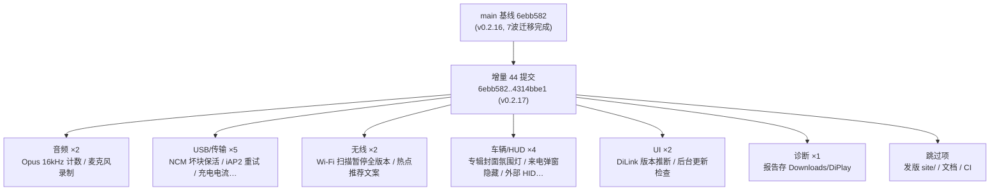
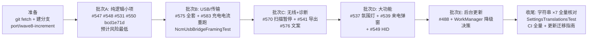

# DiPlay main 分支增量差异迁移报告

> **作者**: TRAE AI
> **生成日期**: 2026-10-11
> **已登记 main 基线**: `6ebb58218f90b0c0853b78013cb8431765ca77bb`（0.4 进度表，2026-10-11 迁移完成点）
> **最新 main tip**: `4314bbe133599b21f40d23d3bf3de3f0d45353b4`（Merge PR #584，release/0.2.17）
> **当前分支**: `android-4.2.2`（工作分支 `port/wave7-i18n`，七波迁移已全部完成）
> **增量范围**: `git log 6ebb582..4314bbe1` — **44 个提交（0.2.17 批次），其中功能提交 13 块**

---

## 1. 增量概览

本轮增量对应 main 的 **v0.2.17 public preview** 发布批次，较上一基线新增约 **3800 行功能代码**，覆盖音频、USB、无线、车辆/HUD、UI、诊断六大领域，无全新波次——全部可作为既有波次的**叠加增量**处理。

### 1.1 增量功能总表（按波次归类）

| # | 功能 | main 提交 | PR | 规模 | 归属波次 | 分支现状 | 移植方式 |
|---|------|-----------|-----|------|---------|---------|---------|
| 1 | Opus 16kHz 麦克风包按 16kHz 计数 + 记录 iPhone 时钟 | `6dbde48f` | #547 | +75 行，5 文件 | 一（音频） | 缺 `RtpClockProbe.kt` | 纯逻辑直接复制 |
| 2 | CarPlay 麦克风录制供应用语音备忘 | `c2afb171` | #548 | +69 行，2 文件 | 一（音频） | 缺 | 纯逻辑叠加 `CarPlayMediaEngine` |
| 3 | NCM 损坏块保持有线会话存活 | `5a5b5328` | #575 | +161/-37 行 | 二（USB） | `NcmUsbBridge` 已有帧修复基线 | 叠加坏块跳过逻辑 |
| 4 | iAP2 识别对老 iOS 拒绝消息重试 | `6ad23022` | #575 | +188/-25 行 | 二（USB） | 已有拒绝列表诊断（无重试） | 叠加重试状态机 + `Iap2IdentificationRetryTest` |
| 5 | 有线 CarPlay 模式被拒解释 + 设置失败记录 | `8a8a6ffa` | #575 | +101 行 | 二/三 | 缺 | 叠加 `CarPlayVpnService`/`IphoneUsbHost`/`CarPlayController` 三处 |
| 6 | USB 自动确认 Android 10+ 修复 + BYD 无障碍设置 | `b99042da` | #575 | +51/-18 行 | 二（USB） | 缺 `UsbAutoConfirmService*` | 叠加 |
| 7 | **司机下调 iPhone USB 充电电流**（新功能） | `da7cb124` | #583 | +175 行，17 文件 | 二（USB） | 缺 `UsbChargingCurrent.kt` | 新功能：iAP2 消息 + 设置滑块 + 持久化 ×7 语言 |
| 8 | Wi-Fi Direct 期间暂停车机 Wi-Fi 扫描（全 Android 版本） | `382ff3bf` | #570 | +535/-132 行 | 三（无线） | 已有 `WifiScanPause`/`Session` 旧版 | 叠加 `WifiScanPauseMain`（新文件）+ 重构 diff |
| 9 | 设置里推荐内置车机热点（文案） | `386234e4` | #576 | +41/-18 行 | 六（UI）/七 | 缺 | 文案 ×7 语言 + 描述更新 |
| 10 | **专辑封面颜色跟随氛围灯**（新功能） | `5591d10e` | #537 | +1056 行，30 文件 | 五（车辆） | 已有 Ambient* 基础版 | 叠加 `AmbientAlbumPalette` + `InitialAlbumRecovery` + `CarPlayMediaKeys` 扩展 |
| 11 | 氛围灯读取固件热修复注释后的回复 | `33b9c798` | #550 | +18 行 | 五（车辆） | 缺 | 小修叠加 `BydAmbientLightClient/Worker` |
| 12 | **CarPlay 前台隐藏 BYD 来电弹窗**（新功能） | `53400e9e` | #539 | +1051 行，19 文件 | 五（车辆） | 全缺 | 新功能：无障碍服务 + shell 工具 + 持久化 |
| 13 | 触屏设备允许 CarPlay 远程键 | `bcd1e71d` | — | 1 行 | 五（车辆） | 缺 | 单行叠加 `CarPlayHostActivity` |
| 14 | 外部 HID 控制器（配置开关 + Wheel keys 归位 + 仅转发设备键） | `19d950b2`+`48044407`+`7ece482c`+`ea3cc261` | #549 | +95/-40 行 | 五/六 | 全缺 | 设置 toggle + 按键策略，含 ×7 语言 |
| 15 | DiLink 控制器版本推断 | `94082397` | #531 | +47 行 | 六（UI） | 已有 setup 包（B4 移植） | 叠加 `DiLinkGeneration` |
| 16 | **后台更新检查**（新功能） | `b21029d9`+`1b67267e`+`ad80c931`+`a059d10b` | #488 | +660 行，22 文件 | 六（UI） | 已有 update 包 5 文件，缺 5 个新文件 | 叠加 + WorkManager 依赖评估（见 §3.1 风险） |
| 17 | 诊断报告存到可见 Downloads/DiPlay 目录 | `8a6ab5f9`+`088a0e16`+`d999b273` | #541 | +161/-11 行 | 诊断 | **已有** `DiagnosticExportStore.kt` | 逐 hunk 对比合并，保留分支 API 17 写入路径 |
| 18 | RemoteMfi 测试超时修复 | `b1aa46fe` | #575 | 4 行（测试） | 测试 | 分支已改 ServerSocket 桩 | **对照后大概率跳过** |
| 19 | v0.2.17 发版（版本号 + site/） | `391c90f8`+`4314bbe1` | #584 | site/ 为主 | 版本同步 | 分支版本 `0.2.17-api17` | 跳过 site/，版本号按分支节奏自定 |

**迁移完成登记（2026-10-11，分支 `port/wave8-increment`，已全部合入批次提交）**：

| 序号 | 分支提交 | 备注 |
|------|----------|------|
| 1/2（#547/#548）、11/13（#550/`bcd1e71d`）、15（#531） | `5b1924d7` | 批次A 纯逻辑小项 |
| 3/4/5/6（#575）、7（#583） | `31216dab` | 批次B USB/传输 |
| 8（#570）、17（#541）、9（#576） | `9c8ab729` | 批次C 无线与诊断 |
| 10（#537）、12（#539）、14（#549） | `a7bc59aa` | 批次D 交互与氛围灯 |
| 16（#488，含 3 fix） | `c8cb0e9b` | 批次E 后台更新；WorkManager 降级 2.8.1 |
| 18（RemoteMfi 测试超时） | 跳过 | 分支已是 ServerSocket 桩，按预案不移植 |
| 19（v0.2.17 发版） | 跳过 site/ | 版本号按分支节奏自定（`0.2.17-api17`） |

---

## 2. 重点功能分析

### 2.1 专辑封面颜色氛围灯（#537，本轮最大功能块之一）

- **main 实现**：`AmbientAlbumPalette.kt`（封面取色，+104 行）+ `AmbientMusicColorDetector/Controller` 扩展 + `CarPlayMediaKeys.kt`（+127 行，NowPlaying 元数据扩展）+ `InitialAlbumRecovery.kt`（+102 行，连接时恢复当前专辑）+ `CarPlayController` 接线（+52 行）。
- **分支基础**：波次五已移植 `Ambient*` 全套（音乐跟随挂音频管线），本增量是在其上的颜色跟随扩展。
- **API 17 适配要点**：
  - 取色用 `Palette`（androidx.palette）或 main 自研算法——若 main 用 androidx.palette 需确认 AGP 7.4.2 下版本可用；
  - `CarPlayMediaKeys` 为 IAP2 消息解析纯逻辑，API 17 无碍；
  - 分支 `AmbientMusicController` 与 main 结构可能已分叉（波次五移植时改过），**不能整文件替换，按 hunk 叠加**。
- **测试**：`AmbientAlbumPaletteTest`（123 行）、`InitialAlbumRecoveryTest`（169 行）均为纯 JUnit，可直接移植；`AmbientAlbumUiScreenshotsTest`（191 行）依赖 Robolectric 截图，按分支 Robolectric 4.9 评估。

### 2.2 CarPlay 前台隐藏 BYD 来电弹窗（#539，新功能，+1051 行）

- **main 实现**：`BydCallPopupGuard.kt`（Kotlin，+163 行）+ `BydCallPopupLease.java`/`BydCallPopupTool.java`（Java，无障碍服务/shell 工具）+ `AirPlayPersistence` 设置项 + manifest 声明 + `strings_call_popup.xml` ×7 语言。
- **API 17 适配要点**：
  - `AccessibilityService` 在 API 16+ 可用，基本 API 无碍；需核对 main 使用的 `AccessibilityServiceInfo` 字段是否为高版本新增（如 `FLAG_*` 常量）；
  - 该功能依赖 BYD 无障碍设置页（与 `b99042da` 的 BYD accessibility settings 有关联）；
  - manifest 无障碍服务声明需手工加入分支三个 manifest 中的 mobile/common；
  - 分支无运行时权限体系，`canRetrieveWindowContent` 检查直接走服务自带能力。
- **文档**：`docs/byd-call-popup.md` 可一并复制。

### 2.3 后台更新检查（#488，新功能，+660 行）⚠️ 唯一有依赖风险的项

- **main 实现**：`BackgroundUpdateWorker.kt`（+96 行）+ `UpdateAvailability/UpdateApkExport/InternetNetworkSelector/UpdateReleaseLookup`（4 个新文件）+ `UpdateClient` 扩展 + DiPlayActivity 周期调度 + 4 条字符串 ×7 语言。
- **依赖风险**：main 引入 `androidx.work:work-runtime:2.12.0`（`libs.versions.toml` + `common/build.gradle.kts`）。**WorkManager 2.12 要求 AGP 8+ 构建链与较新 Kotlin 元数据，分支是 AGP 7.4.2 + Kotlin 1.9.22，不能照搬**。
- **API 17 适配方案（二选一）**：
  1. 降级依赖到 `work-runtime 2.8.1`（minSdk 14，AGP 7 兼容，分支构建链可用）——保留 main 的 Worker 结构；
  2. 不引依赖，用分支自有 `AlarmManager` + `setInexactRepeating` 或 `JobScheduler`(API 21+ 守卫) 重写调度，核心策略逻辑（`BackgroundUpdatePolicy` 等 5 个新类为纯逻辑）直接复制。
- **建议**：方案 1 改动最小；`BackgroundUpdatePolicyTest` 等测试为纯 JUnit 可直接移植。
- 附带的 3 个 fix（下载最新 release、文案去版本号）随本块一并移植。

### 2.4 USB 充电电流下调（#583，新功能）

- **main 实现**：`UsbChargingCurrent.kt`（+19 行，iAP2 消息构造）+ `Iap2WiredControlClient` 扩展 + `CarPlayRuntimeConfig` 透传 + `DiPlayActivity` 设置项 + 6 条字符串 ×7 语言。
- **API 17 适配要点**：iAP2 消息为纯字节逻辑，无版本 API；设置按 AGENTS.md 归 **Connection**（连接/USB 语义）或 **Advanced**（实验性，可能影响充电/握手）——按实验性标注 `(experimental)` 处理更稳妥。

### 2.5 Wi-Fi 扫描暂停全版本（#570）

- **main 实现**：`WifiScanPauseMain.kt`（新文件，+148 行，ADB 路径扩展）+ `WifiScanPause` 重构（±85 行）+ `WifiScanPauseSession` 扩展 + `BydAdbShell` 调整 + 3 个测试更新/新增（`WifiAutojoinSwitchTest` 新增 131 行）。
- **分支基础**：已有 `WifiScanPause`/`WifiScanPauseSession`（旧版，仅部分 Android 版本）。本增量把暂停能力扩到**所有 Android 版本**（经 ADB）——对 API 17 分支**价值更大**（老系统 Wi-Fi 搜索抢占 Wi-Fi Direct 的问题更严重）。
- **移植方式**：以 main 版为准整体替换 3 个主文件 + 新增 `WifiScanPauseMain`，`BydAdbShell` hunk 叠加；注意分支 `BydAdbShell` 若有 API 17 专有补丁需保留。

### 2.6 诊断报告存 Downloads/DiPlay（#541，3 提交）

- **分支现状**：**已有 `DiagnosticExportStore.kt`**（分支此前自行实现过导出）。diff 显示 9 文件 +485/-56（含 update 包文件）。
- **关键 API 差异**：main 用 `MediaStore.Downloads`（API 29+）写可见目录；分支已有实现走的是 API 17 路径（直接文件写入 + `DownoloadManager`/`environment`）。**移植时只取 main 的"Downloads/DiPlay 子目录 + 共享失败保留文件 + 仅 Android 9 请求存储权限"三个行为语义，分支底层写入路径保留**。
- manifest 的 `WRITE_EXTERNAL_STORAGE` 声明变更需按分支"不恢复运行时权限"原则核对。

### 2.7 其余小项

- **Opus 16kHz 计数（#547）**：`RtpClockProbe.kt` 新文件 + `MicrophonePacketizer` 时间戳计算修正，纯逻辑，直接移植 + 2 个测试。
- **麦克风录制（#548）**：`CarPlayMediaEngine` 增加 PCM 环形缓冲供应用读取，纯逻辑；注意与分支已移植的 Concentus 编码路径叠加顺序。
- **iAP2 重试（#575）**：`Iap2IdentificationClient` 重试状态机；分支已有"拒绝消息列表"，main 的重试逻辑覆盖其上，需对照 `Iap2IdentificationRejectionTest`（波次二已移植）与新增 `Iap2IdentificationRetryTest` 合并断言。
- **NCM 坏块保活（#575）**：`NcmUsbBridge` +126 行——损坏传输块跳过而非断流；与波次二"可选短包填充状态机"叠加，**必须**重跑 `NcmUsbBridgeFramingTest`（main 版测试同步更新了 72 行）。
- **外部 HID（#549）**：4 提交含一次自我修正（`7ece482c` 修复 toggle 误控 CarPlay 键转发）和最终归位（`ea3cc261` 移到 Wheel keys 且仅转发设备键）——**以 `ea3cc261` 最终态为准**，不逐提交移植。
- **DiLink 版本推断（#531）**：`DiLinkGeneration` +22 行，分支 setup 包已就位，直接叠加 + `SetupGuideTest`。
- **USB 自动确认（#575）**：`UsbAutoConfirmService` 修复 Android 10+ 判断；分支 minSdk 17，主要取其 BYD 无障碍设置部分与判断逻辑收敛。

---

## 3. 不移植 / 需守卫项

| 类别 | 内容 | 处置 |
|------|------|------|
| 构建链 | `gradle/libs.versions.toml` 的 AGP 9.3/Kotlin 2.2.10/WorkManager 2.12、`gradle-wrapper.properties` | **绝不覆盖**；WorkManager 单独评估（见 §2.3） |
| 发版 | `site/**`、`scripts/build_site.py`、版本号 0.2.17 | 跳过；分支版本号按自身节奏（当前 `0.2.17-api17`） |
| 文档 | `docs/RELEASE-NOTES-NEXT.md`、`docs/TESTING.md`、`docs/SMOOTH_WIRELESS.md`、`.github/workflows/android.yml` | 按需同步，不影响构建；workflow 不覆盖 |
| 测试 | `RemoteMfiAuthenticationClientTest` 超时调整 | 分支已改 ServerSocket 桩，对照后跳过 |
| CI | `5591d10e` 中的 workflow 改动 | 跳过 |

---

## 4. 建议迁移计划（增量轮次：第 8 轮）

### 4.1 批次划分与验证

| 批次 | 内容 | 关键验证 |
|------|------|---------|
| A（先行） | #547 Opus 计数、#548 麦克风录制、#531 版本推断、#550 氛围灯热修、`bcd1e71d` 远程键 | `:shared:testDebugUnitTest --tests "*Rtp*" --tests "*Microphone*"` |
| B | #575 四项（NCM 保活/iAP2 重试/拒绝解释/USB 自动确认）+ #583 充电电流 | `NcmUsbBridgeFramingTest` + `Iap2IdentificationRetryTest` + `UsbChargingCurrentTest` |
| C | #570 扫描暂停、#541 诊断导出、#576 热点文案 | `WifiAutojoinSwitchTest` + `DiagnosticExportFallbackTest` |
| D | #537 专辑氛围灯、#539 来电弹窗、#549 外部 HID | `AmbientAlbumPaletteTest` + `BydCallPopup*Test` + `ExternalControllerKeysTest` |
| E | #488 后台更新（WorkManager 降级决策）+ 3 个 fix | `UpdateAvailabilityTest` + `BackgroundUpdatePolicyTest` |

### 4.2 字符串义务

新增字符串集中在：#583（6 条）、#488（4 条）、#539（`strings_call_popup.xml` ×7 新文件）、#549（2 条）、#576（文案改写）。全部按七语言同步；实验性项（充电电流、外部 HID 若归 Advanced）用各语言既有后缀形式。

### 4.3 完成后文档更新义务（迁移指南 §0.5）

1. 0.4 进度表新增"波次八/增量轮"各行；
2. 0.1 基线快照 main 基线推进到 `4314bbe1`；
3. 本报告对应项标记完成日期与分支提交哈希。

---

## 5. 风险清单

| 风险 | 等级 | 说明 | 缓解 |
|------|------|------|------|
| WorkManager 2.12 不兼容 AGP 7.4.2 | **高** | main 新依赖需要 AGP 8+ 构建链 | 降级 2.8.1 或 AlarmManager 重写（§2.3） |
| NCM 坏块保活与分支帧状态机冲突 | 中 | 波次二的短包填充状态机 + main 坏块跳过叠加在同一状态机 | 以 main 逻辑为准整体对照重写 `drainFrames`，重跑全部 9 条 framing 测试 |
| `AmbientMusicController` 分叉 | 中 | 波次五移植时已改过，main 又扩展 49 行 | hunk 级叠加，禁止整文件替换 |
| 无障碍服务（#539/#575）API 17 行为 | 中 | `AccessibilityService` 字段/标志差异 | 移植时逐字段核对 `Build.VERSION_CODES` 守卫 |
| `MediaStore.Downloads` API 29+ | 低 | 诊断导出语义 vs 分支写入路径 | 只取行为语义，保留分支底层实现 |
| iAP2 多项改动重叠（#575/#583 均改 `Iap2WiredControlClient`） | 低 | 三提交触碰同一文件 | 按最终态合并移植 |
