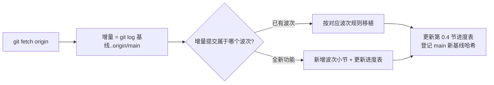
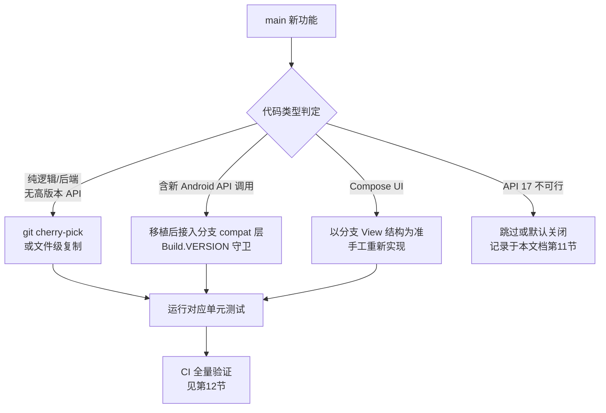

# DiPlay main 分支新功能迁移至 android-4.2.2 分支 — 详细迁移指南

> **作者**: TRAE AI
> **生成日期**: 2026-10-09 ｜ **最后更新**: 2026-10-10
> **源分支基线**: `main` @ `ef4e3fe5c39fa49a532a9570ecb930618a06e106`（2026-10-09 16:00 +0400，Merge PR #528）
> **目标分支**: `android-4.2.2` @ `6a08b07d`（2026-10-09 20:42 +0800，"迁移热点恢复"）
> **分叉点**: `7887bb7b`（v0.2.14，2026-10-07）

---

## 目录

0. [基线快照与增量迁移机制](#0-基线快照与增量迁移机制)
1. [现状分析](#1-现状分析)
2. [迁移总策略](#2-迁移总策略)
3. [冲突热点与处理原则](#3-冲突热点与处理原则)
4. [波次一：音频栈（最高优先级）](#4-波次一音频栈最高优先级)
5. [波次二：USB/传输层修复](#5-波次二usb传输层修复)
6. [波次三：无线连接恢复](#6-波次三无线连接恢复)
7. [波次四：视频链路](#7-波次四视频链路)
8. [波次五：车辆/HUD 集成](#8-波次五车辆hud-集成)
9. [波次六：UI 功能（需 View 重写）](#9-波次六ui-功能需-view-重写)
10. [波次七：本地化与文案同步](#10-波次七本地化与文案同步)
11. [明确跳过或降级守卫的变更](#11-明确跳过或降级守卫的变更)
12. [测试与验证](#12-测试与验证)
13. [回滚方案](#13-回滚方案)
14. [完整迁移检查清单](#14-完整迁移检查清单)

---

## 0. 基线快照与增量迁移机制

### 0.1 当前基线快照（重要：增量迁移的锚点）

| 锚点 | Commit（完整哈希） | 时间 | 说明 |
|------|--------------------|------|------|
| **main 基线** | `ef4e3fe5c39fa49a532a9570ecb930618a06e106` | 2026-10-09 16:00 +0400 | Merge PR #528（integrate/remaining-prs-20261009），本文档全部波次以此为终点 |
| **分叉点** | `7887bb7bf2b52258e663a2a4ea1332382ed80ad8` | 2026-10-07 15:24 +0400 | v0.2.14 发布合并点，两分支共同祖先 |
| **android-4.2.2 起点** | `6a08b07d2ee41f002d9f8b5151c94d7ed26d5fea` | 2026-10-09 20:42 +0800 | 分支已有 4 个移植提交（API 17 下移、legacy-mdns、热点恢复） |

**每次迁移开始前必须重新取一次 main tip**：

```sh
git fetch origin
git rev-parse origin/main          # 新的 main 基线，替换上表"main 基线"行
git log <旧基线>..origin/main --oneline   # 只分析这一段"增量"
```

> 约定：**上表的 main 基线哈希只增不改**。每完成一轮迁移，把基线推进到当轮实际迁移到的 main 提交，并在 0.4 进度表中登记。增量 = `git log <登记的基线>..origin/main`。

### 0.2 增量迁移流程



### 0.3 "main 更优则替换"规则

迁移过程中，若发现 **main 对分支已自行实现的功能做了更好的改进**，不要只做叠加，应**用 main 的实现替换分支的旧实现**，再补 API 17 守卫。判定与执行规则：

1. **判定"更好"的信号**：main 修复了分支实现没有的场景（如新增生命周期安全、崩溃守卫、状态机更完整）、main 的实现有对应单元测试而分支没有、或分支实现是临时方案而 main 给出了正式方案。
2. **已知需要替换的候选清单**（迁移时逐项复核）：

| 分支旧实现 | main 新实现 | 动作 |
|------------|-------------|------|
| `LegacyHotspotRecovery.kt`（分支 `6a08b07d` 自研） | `HotspotAddressRecovery.kt`（#474，含 IPv6 延迟修复、地址族交替） | **替换**：以 main 实现为准，把分支专有的 API 17 守卫（IPv4 优先）并入 main 结构，删除重复代码 |
| `CarPlayDiscovery.kt`（分支 jmdns 3.5.8 适配版） | main 仍用 jmdns 3.5.8 库；分支已 vendored `legacy-mdns` | **不替换**：保留分支 legacy-mdns，仅叠加 main 对发现逻辑的修复 |
| `IphoneUsbHost.kt` 的 requestWait 版本分支（守护线程 + queue poll） | main 的 `UsbRequestQueue.kt`（API 26+ 原生队列） | **混合**：API 26+ 路径直接采用 main 实现替换守护线程方案；API 17–25 保留守护线程路径 |
| 分支 `MainActivity.kt` View 化实现 | main 的 Compose 实现 | **不替换**：技术栈不可逆，仅移植功能逻辑 |
| 分支 `CrashFileLogger.kt`（分支自加） | main 的诊断上报增强（#499/#459） | **替换式合并**：以 main 结构为基线，保留分支的 API 17 文件路径回退 |

3. **替换后必须做**：
   - 跑被替换功能的单元测试（main 版测试优先采用 main 的测试文件）；
   - 在 0.4 进度表"备注"列写明 `替换: <分支旧文件> → <main PR>`；
   - 若替换改变了持久化键名/设置语义，提供一次性迁移代码，不得丢用户设置。

### 0.4 迁移进度追踪表（每完成一项就更新）

> 状态标记：`⬜ 未开始` / `🔶 进行中` / `✅ 已完成(日期)` / `⏭️ 跳过` / `🔁 已替换分支旧实现`

| 波次 | 功能项 | 对应 main PR/提交 | 状态 | 完成日期 | 备注 |
|------|--------|-------------------|------|----------|------|
| 一 | Concentus 软件 Opus 编码器 | `6a1e7b89`/`ea898e34` | ✅ 已完成 | 2026-10-10 | 分支提交 `bd722344`；另修复 3 个阻塞 `:shared` 测试编译的既有坏测试（setPassphrase 反射化、RemoteMfi 改 ServerSocket 桩） |
| 一 | Opus 能力广告 | #483 `6d15669f` | ✅ 已完成 | 2026-10-10 | 分支提交 `bd722344`；AirPlayConfig.microphoneOpus + InfoPlist audioFormats 守卫 |
| 一 | 音频诊断上报 | #499 `a6c8c4da` | ⬜ | | CrashFileLogger 替换式合并（见 0.3） |
| 一 | 麦克风回退集成 | #468 `e2403839` | 🔶 进行中 | | 回退逻辑已随 `bd722344` 移植（MicrophoneUplink + AndroidMediaSink 调用点）；诊断集成部分待 #499 |
| 一 | 回消参考对齐 | #421 `5fecbc08` | ✅ 已完成 | 2026-10-10 | 分支提交 `bd722344`；EchoReferenceTest 9/9 通过 |
| 一 | 缓冲音频节流 | #484 `a4b8900d` | ⬜ | | |
| 一 | prebuffer underrun 恢复 | #401 `f5452c5a`/`2f12d483` | ⬜ | | |
| 二 | NCM 接收帧修复 | #478 `515bc9ec` | ✅ 已完成 | 2026-10-10 | drainFrames 可选短包填充状态机；NcmUsbBridgeFramingTest 9/9 通过 |
| 二 | USB 读阶梯重试 | #495 `422a7d8e` | ✅ 已完成 | 2026-10-10 | UsbReadQueuePolicy 重写为 main 最终版（queueCeiling+阶梯+submitUnchanged）；另修复 API 17–25 `queue(ByteBuffer)` NoSuchMethodError 隐患（queueRead 扩展走废弃双参重载）；UsbReadQueuePolicyTest 18/18、CompatibilityTest 11/11 通过 |
| 二 | 16 KiB usbfs 上限（扩到 API 17–25） | `764e0ba1` | ✅ 已完成 | 2026-10-10 | forCurrentPlatform 守卫下探为 `< P`（比 main 的 26/27 更保守）；Android8UsbReadTest 12/12 通过；CarPlayController describeThrowable 与 Iap2IdentificationRejectionTest（5.3 第 3 条）一并移植 |
| 三 | 热点地址族恢复 | #474 `7b6f4585`/`39c052f5` | ⬜ | | 🔁 候选：替换 `LegacyHotspotRecovery.kt` |
| 三 | Android 17 本地网络权限守卫 | #465 `203a38aa` | ⬜ | | API 17 下 no-op |
| 三 | VPN 授权崩溃修复 | `4aee3f80` | ⬜ | | |
| 三 | 蓝牙延迟暂停（生命周期安全） | #307 `289fcc77`/`8681254b` | ⬜ | | |
| 三 | iPhone 蓝牙唤醒启动 | #439 `fe1a59db` | ⬜ | | |
| 三 | 显示变更保持会话 | #501 `d5d9d2fd` | ⬜ | | |
| 四 | 视频积压恢复界限 | #347 `21195488` | ⬜ | | |
| 四 | 解码器一次多帧 | #456 `1df2cd2c` | ⬜ | | |
| 四 | 低延迟解码 + 输出线程 + FPS 计数 | #496 `5dabc170`/`52004bfb` | ⬜ | | 守卫高通键；FPS 覆盖层 View 化 |
| 四 | 解码器工作速率提示 | #417 `19d11af7` | ⬜ | | API 23+ 守卫 |
| 五 | BYD 氛围灯音乐跟随 | #345 `60300d89`/`34cf4e19` | ⬜ | | |
| 五 | 导航播报方向盘音量 | #344 `ba8cdca1` | ⬜ | | |
| 五 | Platform-21 仪表路由 | #348 `52bbad46` | ⬜ | | API 17 隐藏入口 |
| 五 | DiLink3 到达时间 AMap 形式 | #458 `0e54b3ea` | ⬜ | | |
| 五 | ADB 开机自启修复 | #441 `eac7a3d9` | ⬜ | | |
| 五 | 侧栏拖拽/把手/轮胎 | #480 `ef11e819`/`4dda8598` | ⬜ | | 跳过 resize 模糊 |
| 五 | Wi-Fi Direct 频段选择 | #432 `00523988` | ⬜ | | 走 Api17 legacy 路径 |
| 五 | CarPlay 音频走车机蓝牙（实验） | #432 `593ac236` | ⬜ | | 默认关 |
| 六 | Light/Dark/Auto 外观 | #422/#420/#346 | ⬜ | | View 重写 |
| 六 | DiLink 设置向导 | #416 `4dbc509f` | ⬜ | | UI View 重写 |
| 六 | GitHub 更新检查 | #413 `f4e7d06f` | ⬜ | | FileProvider 注册 |
| 六 | 设置内联搜索 | #450 `3ce0a181` | ⬜ | | View 重写 |
| 六 | 小窗转弯卡片独立摆放 | #493/#494 | ⬜ | | 1% 步进迁移旧值 |
| 六 | 暂存设置丢弃确认 | #500 `99375a7e` | ⬜ | | |
| 六 | 下滑手势 Off 选项 | #487 `d05fcb25` | ⬜ | | |
| 六 | 重连条联动 | #482/`f256cd64` | ⬜ | | |
| 六 | 设置间距/对齐精修 | #486/#491/#490 | ⬜ | | |
| 七 | 7 语言字符串同步 | 各波次随附 | ⬜ | | `SettingsTranslationsTest` |

### 0.5 每轮迁移的文档更新义务

完成任意一次迁移提交后，**必须在同一轮内更新本文档**：

1. 0.4 进度表：对应行状态改 `✅ 已完成(YYYY-MM-DD)`，填完成日期与分支提交哈希（备注列）；
2. 0.1 基线快照：把"main 基线"行推进到本轮实际迁移到的 main 提交；
3. 若执行了"main 更优则替换"：在备注列写 `🔁 替换: <旧文件> → <PR>`；
4. 若发现新的增量提交不属于任何现有波次：在对应波次追加小节或在 0.4 表新增行；
5. 文档头部"最后更新"日期同步修改。

---

## 1. 现状分析

### 1.1 分支差异量化

| 维度 | main | android-4.2.2 |
|------|------|---------------|
| 领先提交数（相对分叉点） | **190 个** | 4 个 |
| minSdk | 25 (Android 7.1) | **17 (Android 4.2.2)** |
| targetSdk | 37 | 17 |
| compileSdk | 36+（AGP 9.x） | 36（AGP 7.4.2 / Gradle 7.6.4 / Kotlin 1.9.22） |
| UI 技术栈 | **Jetpack Compose** | **View 系统 + viewBinding**（Compose 全部移除） |
| compat 层 | `AudioFocusRequestCompat` / `Base64Compat` / `PlatformCompat` | `ApiLevel` / `BluetoothCompat` / `NetworkCompat` / `OptionalCompat` / `PermissionCompat` / `StorageCompat` / `TimeCompat` / `UsbPermissionCompat` |
| mDNS | jmdns 3.5.8 库依赖 | **legacy-mdns 模块**（vendored JmDNS，API 17 兼容） |
| 变更规模 | 441 文件，+54223 / −1328 | — |

### 1.2 main 新增内容构成

main 的 190 个提交来自两批发布：

- **v0.2.15（2026-10-08）**：Android 7.1 下移、首次启动 DiLink 设置向导、Light/Dark/Auto 外观、GitHub 手动更新检查、音频 prebuffer 恢复、解码器工作速率提示、Wi-Fi Direct 频段选择、iPhone 蓝牙唤醒启动、仪表盘 1% 滑杆、小窗导航标记、ADB 开机自启修复等（PR #407/#416/#413/#420/#422/#401/#417/#432/#439/#404/#440/#438/#441/#399）。
- **下一批集成（2026-10-09，见 `docs/RELEASE-NOTES-NEXT.md`）**：Concentus 软件 Opus、USB 帧修复与读重试、热点地址族恢复、Android 17 本地网络权限、蓝牙延迟暂停、回消参考对齐、缓冲音频节流、低延迟解码与 FPS 计数、侧栏拖拽、小窗转弯卡片独立摆放、1% 标记滑杆、设置内联搜索、弃用暂存设置确认、氛围灯、方向盘音量、Platform-21 仪表路由、DiLink 3 到达时间等（PR #465/#468/#474/#478/#480/#481/#482/#483/#484/#486/#487/#490/#491/#493/#494/#495/#496/#499/#500/#501/#517/#307/#344/#345/#346/#347/#348/#421/#450/#456/#522/#526/#528）。

### 1.3 关键判断：不能直接 merge

`DiPlayActivity.kt` 在两分支结构完全不同（main 为 Compose，分支为 View），所有 Settings 类 PR 都触碰此文件。直接 `git merge main` 会产生数百处不可自动解决的冲突。**唯一可行策略是按功能逐个移植（cherry-pick 后端逻辑 + 手工重写 UI）**。

---

## 2. 迁移总策略



### 2.1 五条铁律

1. **compat 层路由**：main 新增的 `PlatformCompat.kt`、`AudioFocusRequestCompat.kt`、`Base64Compat.kt` 一并复制进分支的 `shared/.../compat/`；分支移植代码中**所有 API 18+ 调用必须经过 compat 扩展函数**，不允许裸调用。main 的守卫只写到 API 25/26 档，移植时需**下探到 API 17/18/19/21 各档**。
2. **View 为准**：UI 冲突一律以分支的 View 实现为基线，把 main 的功能"翻译"成 View 写法，绝不把 Composable 引入分支。
3. **实验性标注**：新增设置项遵循 `AGENTS.md` 的分类规则（`SettingsCategory`/`SettingsSection`），实验性功能标题后缀用各语言既有形式（如 `（实验性）`、`(experimental)`）。
4. **字符串全覆盖**：每个新增 `settings_*` 字符串必须同时写入 `values/` 和全部 6 个 `values-xx` 目录，否则 `SettingsTranslationsTest` 失败。
5. **重连语义**：迁移的设置项若需下次连接生效，必须调用 `markReconnectNeeded()`；不得静默断开正在运行的 CarPlay 会话。

### 2.2 推荐分支与提交纪律

每个波次建立独立分支，验证通过后合并回 `android-4.2.2`：

```
android-4.2.2
 ├─ port/wave1-audio-opus
 ├─ port/wave2-usb-transport
 ├─ port/wave3-wireless-recovery
 ├─ port/wave4-video
 ├─ port/wave5-vehicle-hud
 ├─ port/wave6-ui-view
 └─ port/wave7-l10n
```

---

## 3. 冲突热点与处理原则

两分支都修改过、cherry-pick 时必然冲突的文件（共 24 个核心文件）：

| 文件 | 冲突原因 | 处理原则 |
|------|----------|----------|
| `common/.../DiPlayActivity.kt` | Compose vs View，5603 行 vs 4380 行 | **禁止 cherry-pick**。分支为基线，逐个功能手工移植 |
| `common/.../MainActivity.kt` | 分支已做 View 化 + API 17 适配 | 同上，diff 后手工搬逻辑 |
| `common/.../CarPlayHostActivity.kt` | 双方都加了生命周期代码 | 手工合并，保留双方新增 |
| `common/.../ui/theme/Theme.kt` | 分支删 Compose 主题 | 跳过 main 的 Compose 主题改动，用分支 XML 主题 |
| `shared/.../transport/IphoneUsbHost.kt` | 分支已做 requestWait 版本分支 | 叠加 main 的修复（见波次二） |
| `shared/.../transport/NcmUsbBridge.kt` | 分支已收尾，main 修帧 | 叠加 main 的帧修复（见波次二） |
| `shared/.../transport/UsbReadQueuePolicy.kt` | main 加 Android 8 上限阶梯 | 叠加，守卫下探 API 17 |
| `shared/.../media/OpusEncoder.kt` | main 加能力广告 | 叠加（见波次一） |
| `shared/.../network/WifiP2pGroupManager.kt` | 分支已有 Api17 通道类 | 叠加频段选择逻辑，走 legacy 路径 |
| `shared/.../orchestration/CarPlayController.kt` | 双方都改 lease | 手工合并 |
| 3 个 `AndroidManifest.xml` | 分支删运行时权限声明 | 手工加 main 新增组件声明，**不恢复运行时权限** |
| 7 个 `strings.xml` + `themes.xml` | 双方各自新增 | 文本级合并，无结构冲突 |
| `common/build.gradle.kts`、`mobile/build.gradle.kts`、`shared/build.gradle` | 构建链版本完全不同 | **绝不从 main 覆盖**，只按需加分支兼容的依赖 |

---

## 4. 波次一：音频栈（最高优先级）

**为什么最先做**：API 17 没有 MediaCodec Opus 编码器（Android 10+ 才有），而 CarPlay 通话/Siri 麦克风上行强制 Opus。main 恰好为此引入了纯 Java 的 Concentus 软件编码器——**这是分支从"不可用"到"可用"的关键补丁**。

### 4.1 涉及提交

| 提交 | 内容 | PR |
|------|------|-----|
| `6a1e7b89` | Vendor Concentus 纯 Java Opus 编码器（126 文件） | #415 相关 |
| `ea898e34` | MediaCodec 无 Opus 编码器时麦克风走软件 Opus | #415 |
| `6d15669f` | 仅在车机可编码时向 iPhone 广告 Opus 能力 | #483 |
| `a6c8c4da` | 音频诊断上报（编码器名称入诊断报告） | #499 |
| `66179feb` | 保留软件 Opus 能力并隔离诊断失败 | 集成批 |
| `e2403839` | 麦克风回退与诊断集成 | #468/#483/#499 |
| `5fecbc08` | 通话回消参考对齐（回消器收敛修复） | #421 |
| `a4b8900d` | 缓冲音频初始填充后节流（不与实时流抢 TCP） | #484 |
| `f5452c5a` / `2f12d483` | underrun 后重建 prebuffer、修正 retained PCM 记账 | #401 |

### 4.2 涉及文件

新增（直接复制，无冲突）：

```
shared/src/main/java/org/concentus/**          (126 文件，纯 Java)
shared/src/main/java/com/shilapi/xcertplay/media/SoftwareOpusEncoder.kt
shared/src/main/java/com/shilapi/xcertplay/media/OpusEncoderSupport.kt
shared/src/main/java/com/shilapi/xcertplay/media/MicrophoneOpusEncoder.kt
shared/src/main/java/com/shilapi/xcertplay/compat/AudioFocusRequestCompat.kt
shared/src/main/java/com/shilapi/xcertplay/compat/Base64Compat.kt
```

修改（叠加式合并）：

```
shared/.../media/OpusEncoder.kt                 # 能力广告逻辑
shared/.../media/TelephonyMicrophone*.kt        # 软件编码器回退
shared/.../media/AudioTrackRenderer*.kt         # prebuffer 重建 + 节流
```

测试（一并移植）：`SoftwareOpusEncoderTest.kt`、`OpusEncoderSupportTest.kt`、`TelephonyMicrophoneTest.kt`、`EchoReferenceTest.kt`、`NavigationPlaybackTest.kt`。

### 4.3 API 17 适配要点

1. **Concentus 本身兼容 API 17**（纯 Java 6 级别语法），但需确认分支 Kotlin 1.9 / Java 8 target 编译通过；`org/concentus` 若含 `java.util.function`/stream 调用需改写。
2. `AudioFocusRequestCompat`：main 的守卫档位是 API 26+（`AudioFocusRequest` 对象式）。分支需补 **API 8–25 走旧版 `AudioManager.requestAudioFocus(OnAudioFocusChangeListener, stream, hint)`** 分支。
3. `MediaCodec` Opus **解码**在 API 17 不可用 → `OpusEncoderSupport` 的能力探测结果在 API 17 恒为"仅软件编码"，向 iPhone 只广告软件路径，避免协商失败。
4. 诊断上报中 `Build.VERSION_CODES` 常量在分支 compileSdk 36 下编译无问题，运行时按 `ApiLevel.kt` 守卫。

### 4.4 验证

```sh
./gradlew :shared:testDebugUnitTest --tests "*Opus*" --tests "*Echo*" --tests "*TelephonyMicrophone*"
```

真机验证：API 17 车机上发起 CarPlay 通话/Siri，确认诊断报告中 `encoder=concentus` 且对侧能听到声音。

---

## 5. 波次二：USB/传输层修复

**价值**：分支的有线 CarPlay 依赖 USB 子系统，main 修复了 NCM 帧错位与 Android 8 读上限——这些 bug 在 API 17 的 usbfs 上同样存在（16 KiB 上限问题在更老内核上更严重）。

### 5.1 涉及提交

| 提交 | 内容 | PR |
|------|------|-----|
| `515bc9ec` / `48ef3b46` | NCM 接收帧修复（传输块恰好结束于 USB 包边界） | #478 |
| `ab6eb73b` / `422a7d8e` | USB 读被显式拒绝时按阶梯降级重试至 2 KiB | #495 |
| `764e0ba1` | Android < 9 有线 CarPlay：读队列上限压到 16 KiB usbfs 天花板 | 集成批 |
| `e197d5c7` 附带 | USB 帧与读重试集成 | — |

### 5.2 涉及文件

```
shared/.../transport/NcmUsbBridge.kt        # 帧修复（冲突热点，手工叠加）
shared/.../transport/UsbReadQueuePolicy.kt  # 上限阶梯（叠加）
shared/.../transport/UsbRequestQueue.kt     # main 新增，直接复制
shared/.../transport/IphoneUsbHost.kt       # 读重试（叠加到分支的版本分支 requestWait 上）
shared/.../transport/Android7UsbReadTest.kt / Android8UsbReadTest.kt /
  UsbCompletionReaperTest.kt / UsbReadQueueCompatibilityTest.kt /
  UsbReadQueuePolicyTest.kt / NcmUsbBridgeFramingTest.kt   # 测试移植
```

### 5.3 API 17 适配要点

1. 分支已实现 **API 17–25 用守护线程 + 队列 poll 模拟 requestWait**。移植 main 的 `UsbRequestQueue.kt` 时，把其内部对 `UsbRequest` 异步 API（API 26+ 的 `queue()`/`receive()` 链式语义）的调用收敛到分支已有的守护线程路径，**main 的"读被拒绝→降级重试"状态机要同时接到两条路径上**。
2. `764e0ba1` 的 16 KiB 上限原本只针对 Android < 9；分支应改为 **API 17–25 全部启用 16 KiB 上限**（更老内核 usbfs 上限相同或更低）。
3. 新增的 `Iap2IdentificationRejectionTest`（不支持消息 ID 入拒绝报告）一并移植，属纯逻辑。

### 5.4 验证

```sh
./gradlew :shared:testDebugUnitTest --tests "*Usb*" --tests "*Ncm*" --tests "*Iap2*"
```

真机：API 17 车机有线连接 iPhone，确认握手不再随机断流；拔插 20 次验证读降级日志。

---

## 6. 波次三：无线连接恢复

**价值**：分支已自行迁移过热点恢复（`6a08b07d`，含 `LegacyHotspotRecovery.kt`），main 的热点地址族交替与 IPv6 延迟修复与之**功能重叠**，需对照合并而非重复引入。

### 6.1 涉及提交

| 提交 | 内容 | PR |
|------|------|-----|
| `7b6f4585` / `39c052f5` / `e197d5c7` | 首次 AirPlay TCP 超时后交替热点地址族；下次尝试短暂等待优选 IPv6 | #474 |
| `a2b3d54d` / `203a38aa` | Android 17（最新系统）本地网络权限请求 | #465 |
| `4aee3f80` | VPN 授权页缺失/被阻塞时不崩溃；保留热点安全设置 | 集成批 |
| `15c0e697` | 内置热点经蓝牙下发凭据的说明文案 | 集成批 |
| `289fcc77` + `8681254b` + `16bcbc91` + `35335b0d` + `8ef6938e` + `e9a46e12` | CarPlay 期间延迟暂停车机蓝牙（含生命周期安全、lease 关闭锁、重连条） | #307 |
| `6eecada8` | 连接设置修复集成 | #517 |
| `d5d9d2fd` | 显示变更/取消未改设置时保持会话连接 | #501 |
| `fe1a59db` | 选定 iPhone 蓝牙重连时拉起 DiPlay | #439 |

### 6.2 涉及文件

```
shared/.../network/HotspotAddressRecovery.kt      # main 新增，复制后与分支 LegacyHotspotRecovery.kt 对照去重
shared/.../network/HotspotAddressPolicyTest.kt / HotspotAddressRecoveryTest.kt
common/.../WirelessPermissions.kt                 # main 新增；API 17 下为 no-op 守卫
shared/.../hud/BluetoothSuspendLease.kt / BydBluetoothSuspend.kt   # #307
common/.../PhoneBluetoothReceiver.kt              # #439 蓝牙唤醒广播接收器
shared/.../orchestration/CarPlayController.kt     # lease 关闭锁（手工合并）
common/src/main/AndroidManifest.xml               # 注册 PhoneBluetoothReceiver（手工加）
```

### 6.3 API 17 适配要点

1. **地址族恢复**：`HotspotAddressRecovery` 若使用 `NetworkInterface`/`Inet6Address` API，这些在 API 17 可用；但 IPv6 优选逻辑在老内核上常返回临时地址，建议 API 17–20 **默认 IPv4 优先、IPv6 仅作 fallback**（分支 `NetworkCompat.kt` 已有类似处理，复用之）。
2. **Android 17 本地网络权限**（`a2b3d54d`）：这是给**最新 Android** 用的 `CONNECTIVITY/NEIGHBOR_DISCOVERY` 类权限。移植时整体包在 `Build.VERSION.SDK_INT >= 3x` 守卫内，API 17 直接跳过；manifest 新增的权限声明对 API 17 无害（系统忽略未知权限）。
3. **蓝牙暂停（#307）**：`BluetoothAdapter.disable()` 在 API 17 存在但需要系统权限/ADB，与 main 的 ADB 路线一致——保留 ADB 前置检查，**不加运行时权限请求**（分支无运行时权限体系）。`8681254b` 的"控制器已关闭/会话已结束不能把暂停遗留"生命周期修复必须完整移植，否则 API 17 车机蓝牙会永久关闭。
4. **蓝牙唤醒启动（#439）**：`ACTION_ACL_CONNECTED` 广播在 API 17 可用；manifest 静态注册即可（老系统无后台启动限制）。默认关闭。
5. **VPN 授权崩溃修复（#4aee3f80）**：检查其修复是否依赖 `VpnService` 新 API；若是，API 17 守卫为 no-op。

### 6.4 验证

```sh
./gradlew :shared:testDebugUnitTest --tests "*Hotspot*" --tests "*Bluetooth*"
./gradlew :common:testDebugUnitTest --tests "*Wireless*"
```

真机：无线连接在热点 IPv4 失效场景下自动切 IPv6 重试；蓝牙暂停后断开 CarPlay，确认车机蓝牙自动恢复。

---

## 7. 波次四：视频链路

### 7.1 涉及提交

| 提交 | 内容 | PR |
|------|------|-----|
| `21195488` / `ba0e3464` | 视频积压恢复加界限（250ms 内保留短突发；落后 1.5s 立即恢复）；写前释放已复制音频输出 | #347 |
| `1df2cd2c` / `1886346c` | 平滑视频解码器一次请求多帧（decode-order 输出） | #456 |
| `5dabc170` / `1544854c` / `52004bfb` / `5711a9b4` | 低延迟解码（高通解码器键）+ 专用输出线程 + FPS 计数器 | #496 |
| `19d11af7` | 主屏解码器工作速率提示（codec 拒绝则回退） | #417 |
| `d729cd89` | 避免 API 29/30 调用（Existing Wi-Fi 与设置滑杆） | 0.2.15 |

### 7.2 涉及文件

```
shared/.../media/VideoBacklogRecovery.kt / VideoDecodeQueueTest.kt /
  VideoFramesAtOnceTest.kt / VideoOperatingRateTest.kt / VideoOutputThreadTest.kt /
  VideoBacklogRecoveryTest.kt / LiveVideoMeter.kt / LiveVideoMeterTest.kt
common/.../FpsCounterOverlay.kt            # View 版覆盖层，可直接用（非 Compose）
```

### 7.3 API 17 适配要点

1. **分支视频基线是 media3 1.1.1 + MediaCodec 运行时守卫**。main 的"专用输出线程"与"一次多帧"是 MediaCodec 通用用法，API 17 的 `MediaCodec`（API 16+）支持基本同步模式；`getInputBuffer(index)`（API 21+）在分支必须继续走 `getInputBuffers()` 旧数组 API——移植时全局替换。
2. **低延迟解码**：高通 `MediaFormat` 键（如 `android._low-latency`）在 API 17 高通解码器上不存在 → 设置前用 `ApiLevel` + try/catch 守卫，失败静默回退（main 本身有回退逻辑，保留）。
3. **FPS 计数器**：`FpsCounterOverlay.kt` 若是 Compose Canvas，按波次六原则用 `View` + `onDraw` 重写；若已是普通 View 则直接复制。
4. **工作速率提示**：`MediaCodec.configure` 的 KEY_OPERATING_RATE 是 API 23+，守卫后 API 17 跳过。

### 7.4 验证

```sh
./gradlew :shared:testDebugUnitTest --tests "*Video*" --tests "*LiveVideo*"
```

真机：API 17 车机播放 CarPlay 视频 10 分钟，观察积压恢复日志与 FPS 覆盖层。

---

## 8. 波次五：车辆/HUD 集成

### 8.1 涉及提交与功能

| 提交 | 功能 | PR | API 17 可行性 |
|------|------|-----|---------------|
| `60300d89` + `7926d05c` + `34cf4e19` | BYD 音乐跟随氛围灯（关灯时不跑更新循环） | #345 | 可行（ADB/网络客户端，无新 API） |
| `ba8cdca1` + `9e6c12d3` | 导航播报方向盘音量路由 | #344 | 可行（纯逻辑 + 设置项） |
| `52bbad46` | Platform-21 独立仪表任务路由（2023 唐 DM-i） | #348 | **名称即依赖 API 21**；移植但整体守卫，API 17 隐藏该入口 |
| `0e54b3ea` | DiLink 3 集群到达时间按 AMap ETA_TEXT 形式 | #458 | 可行（字符串格式） |
| `dec8cb68` + `7699faf4` | 集群等待页跟随 DiPlay 主题 + 小 spinner | #481 | UI 需 View 化 |
| `eac7a3d9` + `5887304e` | 实验性 ADB 开机自启修复 | #441 | 可行（shell 命令） |
| `ef11e819` + `4dda8598` | 侧栏拖拽调宽/关闭、拉出把手、轮胎数据 | #480 | 部分：View 重写；**resize 模糊是 API 31+，跳过**；轮胎 ADB 读取可行 |
| `00523988` | Wi-Fi Direct Auto·5GHz / Auto·2.4GHz 频段选择 | #432 | 走分支 `WifiP2pLegacyChannelsApi17` 路径 |
| `593ac236` | 实验性 CarPlay 音频走车机蓝牙 | #432 | 守卫移植，默认关；音频流路由在 API 17 用旧 `setForceUse` |

### 8.2 涉及文件（新增为主，冲突低）

```
shared/.../hud/AmbientWorkerOwnerLock.kt / BydAmbientLightClient.kt /
  BydAmbientLightPolicy.kt / BydAmbientLightWorker.kt / BydBootStartRepair.kt / BydTyres.kt
shared/.../media/AmbientLampSession.kt / AmbientMusic*.kt（8 个文件）
common/.../NavigationWheelKeyPolicy.kt / NavigationWheelSettings.kt
shared/.../network/WifiP2pGroupManager.kt（叠加）
```

### 8.3 验证

```sh
./gradlew :shared:testDebugUnitTest --tests "*Ambient*" --tests "*Byd*"
./gradlew :common:testDebugUnitTest --tests "*NavigationWheel*"
```

---

## 9. 波次六：UI 功能（需 View 重写）

以下 main 功能基于 Compose，**全部以分支 View 结构为基线手工重新实现**。按用户价值排序：

| 功能 | main PR/提交 | 重写要点 |
|------|--------------|----------|
| Light/Dark/Auto 应用外观 | #422（`bd2e2daf`→`437bea3c`）、#346（`c2d0aad3`） | `AppAppearance.kt`/`DiPlayPalette.kt`/`AppDialogs.kt` 的色板逻辑可复制；主题切换用分支 XML 主题 + `values-night/`（AppCompat DayNight，API 17 支持） |
| 首次启动 DiLink 设置向导 | #416（`4dbc509f`） | `setup/DiLinkGeneration.kt` 纯逻辑直接复制；向导 UI 用 View + ViewPager 或分步 Dialog 重写 |
| GitHub 手动更新检查 | #413（`f4e7d06f`） | `update/Update*.kt` 5 文件：`HttpURLConnection` + SHA-256 `MessageDigest` 均 API 17 可用；安装权限走分支 `PermissionCompat`；`UpdateApkProvider` 的 FileProvider 需 manifest 注册 |
| 设置内联搜索框 | #450（`3ce0a181`/`cf81999f`） | 分支设置页为 View 列表，搜索框用 `EditText` + 过滤适配器重写 |
| 小窗转弯卡片独立摆放/透明度 | #493（`802f5000`/`47c2a963`）、#494（`d6bcc835`/`9bbe6f29`/`add16f98`） | 持久化与网格计算逻辑（`ClusterCardPlacementPreview.kt`、placement sketches）直接复制；滑杆 UI 用分支 `SettingsLayoutPreferences` 的 View 控件；1% 步进迁移旧值 |
| 暂存设置丢弃确认 | #500（`99375a7e`/`9a9dafa6`/`c0a87cc4`/`9e6c12d3`） | 用分支 `AppDialogs` 风格 View AlertDialog 重写；主题跟随 #481 |
| CarPlay 下滑手势 Off 选项 | #487（`d05fcb25`→`ffdb5ee6`） | 设置项 + 手势判定，纯逻辑 |
| 重连条联动（auto-yield/蓝牙暂停/小窗标记） | #482/`16bcbc91`/`f256cd64` | 分支已有 `markReconnectNeeded()` 机制，直接接线 |
| 设置间距/对齐/菜单宽度精修 | #486/`735e81cb`、#491/`376f8928`、#490/`95760bfa` | 按分支 View 布局尺寸手工对齐；`SettingsLayoutPolicyTest`/`AdaptiveSettingsUiTest` 的断言需按分支实现调整 |
| 紧凑布局与外观细节 | #420（`fefe4808`、`eca74816`→`a12192b7`） | 图标、开关尺寸、启动白屏修复等逐条对照移植 |
| 侧栏（拖拽/把手/轮胎） | #480 | 见波次五；View 重写 + 跳过模糊 |

**通用重写流程**：

1. 在 main 上 `git show <commit> -- <file>` 读原始 Compose 实现；
2. 提取其中的**状态与持久化逻辑**（ViewModel/Preference 读写、纯函数）→ 直接复用；
3. 用分支现有 View 控件（参考 `activity_main.xml`、`fragment_external_wifi.xml` 的模式）重建布局；
4. 新增字符串按波次七同步；
5. 每个功能单独提交，提交信息注明对应 main PR 号。

---

## 10. 波次七：本地化与文案同步

main 在两批发布中为 7 个语言目录新增了数百条字符串。**移植每个功能时同步字符串**，不要攒到最后。

规则（来自 `AGENTS.md`）：

1. 新字符串加到 `common/src/main/res/values/strings.xml` 及全部 `values-ar/es/ru/uk/zh-rCN/zh-rTW`；
2. Settings 文案用 `settings_` 前缀；
3. 实验性后缀使用各语言既有形式：`(تجريبي)`、`(experimental)`、`(экспериментально)`、`(експериментально)`、`（实验性）`、`（實驗性）`；
4. 乌克兰语措辞修正（`b709f3ec`/`496afce4`，#399）一并应用；
5. 中文标签对齐与共享头图标（`3d4329a3`/`bc1c6001`/`9919585e`/`9c7fda97` 等）按波次六 View 实现处理；
6. 每波结束跑 `SettingsTranslationsTest` 确认无遗漏。

---

## 11. 明确跳过或降级守卫的变更

| 变更 | 原因 | 处置 |
|------|------|------|
| `faea3d3e` 把 minSdk 降到 25 | 分支已是 17 | **跳过**，保留分支构建链（AGP 7.4.2/Gradle 7.6.4） |
| 所有 Compose 文件与 `libs.plugins.kotlin.compose` | API 17 不支持 | 跳过，见波次六重写 |
| 侧栏 resize 模糊（Android 12+） | API 31+ | 守卫跳过 |
| `MediaCodec` Opus 编码、KEY_OPERATING_RATE、低延迟键 | API 21/23/26+ | compat 守卫 + 静默回退 |
| Android 17 本地网络权限实际请求逻辑 | 仅最新系统需要 | 守卫为 no-op，manifest 声明保留 |
| main 的 `PlatformCompat` 中 API 27/28 档 | 分支需 17 档 | 移植时**补写 API 17–25 分支** |
| `site/` 网站与 `docs/` 发布说明 | 非代码 | 按需同步，不影响构建 |
| `.github/workflows` 变更 | 分支 CI 需匹配 AGP 7.4.2 | 不覆盖分支 workflow |
| `4be0fa39` 初始外观声明（#346 一部分） | 依赖 Compose 主题 | 并入波次六 View 重写 |

---

## 12. 测试与验证

### 12.1 每波必跑（分支版 CI）

分支构建链与 `AGENTS.md` 的 main CI 不同，以分支可运行为准：

```sh
./gradlew :shared:testDebugUnitTest :common:testDebugUnitTest \
  :mobile:assembleDebug
```

若 Gradle 找不到 SDK，设置 `ANDROID_HOME` 或 `local.properties`。

### 12.2 移植的单元测试清单

main 新增 49 个 shared 测试 + 41 个 common 测试。与迁移功能对应的测试**必须随功能移植**；纯 Compose UI 测试（如 `AdaptiveSettingsUiTest` 的 Compose 断言）改写为分支 View 等价断言或跳过并注明。

### 12.3 真机验收矩阵（最低集）

| 场景 | 验收点 |
|------|--------|
| API 17 有线 CarPlay 通话 | 对侧听到声音，诊断报告 `encoder=concentus` |
| API 17 有线持续 30 分钟 | 无 NCM 帧错位断流；读降级重试日志正常 |
| 无线热点 IPv4 失效 | 自动交替地址族并恢复连接 |
| 蓝牙暂停后断开 CarPlay | 车机蓝牙恢复开启 |
| 视频播放 | 积压恢复生效；低延迟选项在 API 17 隐藏或不生效且不崩溃 |
| 更新检查 | About 页检查 GitHub 发布、SHA-256 校验、安装跳转 |
| 外观切换 | Light/Dark/Auto 全界面生效，无崩溃 |

---

## 13. 回滚方案

1. **波次级回滚**：每波独立分支 + 合并提交，出问题 `git revert -m 1 <merge-commit>` 即可整波撤销；
2. **功能级回滚**：波次六 UI 重写每项单独提交，可逐条 revert；
3. **不可逆点**：`strings.xml` 与 `AndroidManifest.xml` 的合并提交后，回滚需同时清理引用该字符串的已移植代码，建议 revert 前先 `git grep` 确认引用；
4. **数据兼容**：#494 的 1% 滑杆会迁移旧持久化值——回滚该功能时保留迁移代码或恢复旧键名，避免用户设置丢失。

---

## 14. 完整迁移检查清单

### 准备
- [ ] `git fetch origin && git checkout -b port/wave1-audio-opus android-4.2.2`
- [ ] 确认分支 CI 基线绿：`./gradlew :shared:testDebugUnitTest :common:testDebugUnitTest`

### 波次一 音频
- [ ] 复制 `org/concentus/**`（126 文件）并编译通过
- [ ] 移植 `SoftwareOpusEncoder/OpusEncoderSupport/MicrophoneOpusEncoder` + 测试
- [ ] `AudioFocusRequestCompat` 补 API 8–25 分支
- [ ] Opus 能力广告（#483）+ 音频诊断（#499）+ 回消对齐（#421）+ 缓冲节流（#484）+ prebuffer 恢复（#401）
- [ ] `:shared:testDebugUnitTest --tests "*Opus*" --tests "*Echo*"` 通过

### 波次二 USB
- [ ] `NcmUsbBridge` 帧修复叠加到分支版本
- [ ] `UsbRequestQueue.kt` 接入分支守护线程路径
- [ ] 16 KiB 上限扩展到 API 17–25
- [ ] 读阶梯重试（至 2 KiB）+ 全部 USB 测试通过

### 波次三 无线
- [ ] `HotspotAddressRecovery` 与分支 `LegacyHotspotRecovery` 对照去重合并
- [ ] #307 蓝牙暂停完整生命周期（含 `8681254b`、`e9a46e12`）
- [ ] `PhoneBluetoothReceiver` manifest 注册（静态广播）
- [ ] Android 17 权限守卫为 no-op；VPN 授权崩溃修复移植
- [ ] 热点安全设置保留（WPA3 选项按 API 守卫）

### 波次四 视频
- [ ] 积压恢复（#347）+ 一次多帧（#456）+ 专用输出线程（#496）
- [ ] 低延迟/工作速率键 API 守卫 + 回退
- [ ] FPS 计数器 View 化
- [ ] `getInputBuffer(index)` 全部替换为 `getInputBuffers()`

### 波次五 车辆
- [ ] 氛围灯（#345）+ 方向盘音量（#344）+ DiLink3 ETA（#458）+ 开机修复（#441）
- [ ] Platform-21 路由（#348）守卫隐藏
- [ ] 侧栏 View 重写、模糊跳过、轮胎 ADB 读取
- [ ] Wi-Fi Direct 频段走 Api17 legacy 路径

### 波次六 UI
- [ ] 外观 Light/Dark/Auto（#422/#420/#346）
- [ ] 设置向导（#416）、更新检查（#413）
- [ ] 内联搜索（#450）、小窗卡片（#493/#494）、丢弃确认（#500）、手势 Off（#487）
- [ ] 重连条接线（#482/#501/`f256cd64`）
- [ ] 间距/对齐精修（#486/#491/#490）

### 波次七 本地化
- [ ] 全部 `settings_*` 字符串 7 语言齐全
- [ ] `SettingsTranslationsTest` 通过
- [ ] 实验性后缀各语言形式正确

### 收尾
- [ ] 分支全量构建：`./gradlew :shared:testDebugUnitTest :common:testDebugUnitTest :mobile:assembleDebug`
- [ ] 真机验收矩阵（第 12.3 节）逐项签字
- [ ] 更新分支版 `CHANGELOG` 注明各功能对应 main PR 号

---

*本指南基于 `git log android-4.2.2..main`（190 提交）、`git diff --stat 7887bb7b..main`（441 文件）、两分支构建配置对比及 `docs/RELEASE-NOTES-0.2.15.md` / `docs/RELEASE-NOTES-NEXT.md` 编写。*
