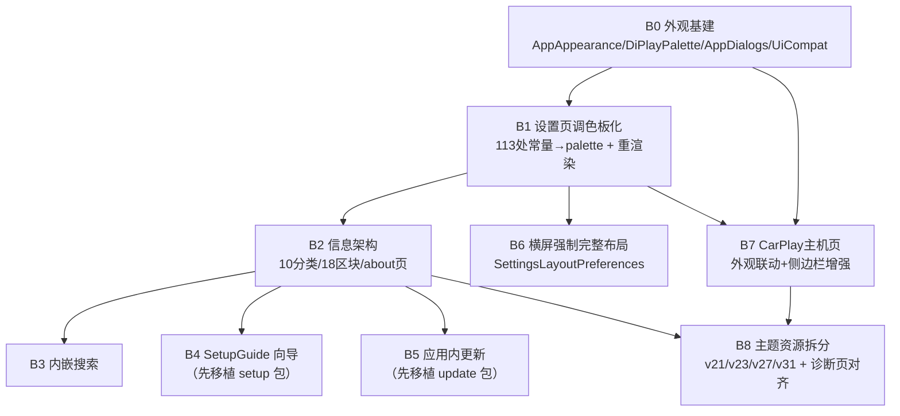

# UI 1:1 高保真还原 main 分支改造方案

> 作者：TRAE AI
> 编制日期：2026-10-10
> 适用分支：`port/wave5-vehicle`（android-4.2.2 迁移线）→ 对齐 `main`
> 前置文档：[main分支与当前分支页面布局差异分析报告.md](computer:///Users/chengshengru/Workspace/DiPlay/main分支与当前分支页面布局差异分析报告.md)

---

## 一、改造目标与保真度定义

### 1.1 目标

在 android-4.2.2 迁移线上，将设置主页、CarPlay 主机页、诊断页、主题层的 **视觉规格、信息架构、交互行为** 与 main 分支做到 1:1 一致，且在 Android 4.2.2 (API 17) 上无错误、无崩溃运行。

### 1.2 保真度三个层次

| 层次 | 定义 | 验收方式 |
| --- | --- | --- |
| 视觉保真 | 色值、字号、圆角、间距、开关尺寸、焦点环、日夜双主题全部采用 main 的 `DiPlayPalette`/`themes.xml` 规格 | 同分辨率设备截图逐像素比对 main 构建的 APK |
| 架构保真 | 分类 10 个、区块 18 个、页面路由含 `about`、compact/expanded 双形态判定逻辑一致 | `SettingsLayoutPolicyTest` 等结构测试迁移后通过 |
| 交互保真 | 内嵌搜索、引导向导、应用内更新、外观切换、横屏强制完整布局、侧边栏拖拽交互全部可用 | 手工用例清单逐项验证 |

### 1.3 唯一允许的差异

main 自身就按 API 版本降级的效果（非本次改造造成）：

| 效果 | main 的保护 | API 17 上的表现 |
| --- | --- | --- |
| 侧边栏拖拽模糊 | `startSidePanelBlur` 开头 `if (SDK_INT < S) return`（`CarPlayHostActivity.kt`） | 直接跳过，无模糊（main 在低版本同样如此） |
| 系统栏图标明暗 | `WindowInsetsControllerCompat.isAppearanceLightStatusBars` androidx 内部静默降级 | 图标明暗不生效，不崩溃 |
| API 31 启动画面色 | `tools:targetApi="31"` 资源限定 | 低版本忽略 |

**除此之外不允许任何视觉/交互偏差。** 实现载体保持 View 体系不变——main 的设置页与 CarPlay 页本身就是 View 实现，无跨框架成本。

---

## 二、可行性基线（关键结论）

1. **外观基建可近乎文件级 1:1 移植**：
   - `AppAppearance.kt`（107 行）：`resolveAppNight()` 为纯 Kotlin 决策链，仅依赖 `Calendar` 与 `configuration.uiMode`，API 17 全可用。
   - `DiPlayPalette.kt`（98 行）：纯 `android.graphics.Color` 常量。
   - `AppAppearanceRuntime`：`synchronized` + `LinkedHashMap` 单例，零 Android 高版本依赖。
   - `AppDialogs.kt`（25 行）：`AppAppearanceOwner` 接口 + 对话框取色扩展。
2. **布局策略基建已在位**：当前分支 `SettingsLayoutPolicy.kt`（`isExpanded`/`overviewHasTwoColumns`/`railWidthDp`）与 main **逐行一致**；`isExpandedSettingsLayout`、两列布局（`twoColumns`）、`SettingsSearchResult`（同构 data class）、`searchIndexSink` 搜索索引机制均已存在。
3. **缺失依赖包已量化**：`update` 包（5 文件 182 行 + 测试 304 行）、`setup` 包（2 文件 110 行 + 测试 71 行）当前分支不存在，需随 UI 批次先行移植。
4. **调色板侵入面可控**：main 中 `palette.` 动态取色仅 21 处；当前分支固定色常量（`ACCENT/MUTED/SURFACE/BG/TEXT/DANGER/WARNING`）共 **113 处**，需批量替换为 palette 取值并接入重渲染。

---

## 三、API 17 兼容风险矩阵

| # | main 使用的 API | 最低版本 | API 17 处理方案 | 风险 |
| --- | --- | --- | --- | --- |
| R1 | `RenderEffect.createBlurEffect`（侧边栏模糊） | 31 | main 已有 `SDK_INT < S` 保护，原样移植 | 无 |
| R2 | `PixelCopy.request`（SurfaceView 截帧） | 24 | 在 R1 保护块内，原样移植 | 无 |
| R3 | `isInMultiWindowMode` | 24 | main 已有 `SDK_INT >= 24` 判断，原样移植 | 无 |
| R4 | `windowLightStatusBar` / `windowLightNavigationBar`（主题属性） | 23 / 27 | main 单一 themes.xml 因 minSdk 高；本分支拆入 `values-v23` / `values-v27` 资源目录 | 低 |
| R5 | `windowSplashScreenBackground` | 31 | 拆入 `values-v31`（或 `tools:targetApi` 忽略） | 低 |
| R6 | `Switch.thumbDrawable` / `trackDrawable` + `InsetDrawable` 大开关 | 16+ | 恢复 main 的 `applyLargeSwitchStyle`，`thumbTintList`/`trackTintList` 经现有 `UiCompat.setThumbTint`/`setTrackTint` 反射封装（API 17 已验证不崩） | 中 |
| R7 | `isAppearanceLightStatusBars` | androidx 兼容层 | 静默降级，接受（见 1.3） | 无 |
| R8 | `FLAG_FULLSCREEN` / `systemUiVisibility` 全屏 | 全版本 | 复用现有 `LegacyFullscreen`：API<20 走旧旗标，≥20 走 InsetsController | 低 |
| R9 | `isDestroyed()`（回调防护） | 17 | 沿用当前分支 `isFinishing` 替代写法 | 无 |
| R10 | `View.doOnLayout` / `requestApplyInsets` | androidx | androidx.core 1.13+ 已覆盖 API 17 | 无 |
| R11 | `RadioButton`/`Switch` tint 系列 | 各版本 | 全部走 `UiCompat.setButtonTint` 等（已有，且已修复 `setButtonTintList` 崩溃先例） | 无 |
| R12 | Kotlin `entries` 枚举 API | Kotlin 1.9 | main 代码使用 `entries`；本分支已启用 `ExperimentalStdlibApi` 兼容（项目记忆约定），无需改动 | 低 |

---

## 四、分批改造方案（B0–B8）

> 每批独立可编译、可回归。批次间依赖见图五。行号均指 main 分支文件位置。

### B0 外观基建移植（全部后续批次的前置）

**目标**：三个纯 Kotlin 文件落地 + UiCompat 大开关能力恢复。

**移植单元**：

| 文件 | 内容 | 来源 |
| --- | --- | --- |
| `common/.../AppAppearance.kt`（新增 107 行） | `AppAppearance` 枚举（dark/light/auto）、`resolveAppNight()`、`shouldDeferAppearanceRender()`、`resolveAppNightNow()`、`AppAppearanceRuntime`（publishHost/clearHost/observeHost） | main 原文件 1:1 |
| `common/.../DiPlayPalette.kt`（新增 98 行） | DARK/LIGHT 双调色板，26 语义色（rail/overlay/focusRing/systemBar 等） | main 原文件 1:1 |
| `common/.../AppDialogs.kt`（新增 25 行） | `AppAppearanceOwner` 接口 + `Context.currentAppNight()` 扩展 | main 原文件 1:1 |
| `AirPlayPersistence` 扩展 | `loadAppAppearance`/`saveAppAppearance` | main 对应函数 |
| `UiCompat.kt` 扩展 | 新增 `setThumbDrawable`/`setTrackDrawable`（API 17 反射安全封装），支撑大开关 | 新写，遵循现有 UiCompat 模式 |

**API17 适配点**：仅 R6（UiCompat 封装），其余零改动。
**验收**：`:shared:compileDebugKotlin :common:compileDebugKotlin` 通过；新增 `AppAppearanceTest`、`DiPlayPaletteTest`（main 有，随文件迁移）通过。

### B1 设置页调色板化 + 外观切换闭环

**目标**：`DiPlayActivity` 从固定深色常量切换到 `DiPlayPalette` 动态取色，实现日夜实时重渲染——1:1 保真的核心批次。

**移植单元**（main `DiPlayActivity.kt`）：

| 函数 | main 行号 | 作用 |
| --- | --- | --- |
| `applyFullscreenMode()` | L538 | 系统栏隐藏/显示 + 图标明暗 + 多窗判断 |
| `startAppearanceUpdates()` | L5483 | 注册 runtime 观察者 |
| `checkForAppearanceChange()` | L5498 | 对比 night 值决定是否重渲染 |
| `refreshAppearance()` | L5535 | 重取 palette |
| `applyWindowAppearance()` | L5552 | 窗口背景/系统栏色应用 |
| `usesChineseGlyphAlignment()` | L5579 | 中文字形对齐补偿 |
| `render(appearanceOnly)` 重载 | L579-618 | 增量重渲染入口（保留 rail 滚动位置） |

**当前分支改造点**：113 处固定常量 → `palette.xxx`；`MUTED/ACCENT/SURFACE/BG` 等常量删除，统一走 `palette` 字段；`DiPlayActivity` 实现 `AppAppearanceOwner`；外观按钮（`appearanceButton` L789 + `iconButton` L5320）加入标题栏。

**API17 适配点**：R7/R8（applyFullscreenMode 内部改调 `LegacyFullscreen`，API<20 分支保留旧旗标路径，其余逻辑逐行保留）。
**验收**：手动切换 dark/light/auto 三态，全页面即时变色；`onWindowFocusChanged` 重新校验界面尺寸（`enforceInterfaceSize`）行为与 main 一致。

### B2 信息架构对齐（10 分类 / 18 区块 / about 独立页）

**移植单元**（main `DiPlayActivity.kt`）：

| 项 | main 规格 | 当前分支现状 | 改造 |
| --- | --- | --- | --- |
| `SettingsCategory` | 10 个（含 LANGUAGE、ABOUT） | 8 个 | 扩为 10 个 |
| `SettingsSection` | 18 个（含 AMBIENT_LIGHTING、NAVIGATION_WHEEL） | 17 个（多 ABOUT、缺前两者） | 对齐为 18 个 |
| `sectionsByCategory` | LANGUAGE→LANGUAGE；ABOUT→空；ADVANCED→5 项 | Overview 并载 ABOUT+LANGUAGE；ADVANCED→3 项 | 按 main 重排 |
| `openSettingsCategory()` | L1150，`ABOUT → page="about"` | 无 | 移植 |
| about 页渲染 | L648/L744 `page == "about"` | 无 page="about" | 移植 about 渲染分支 |
| `navigationWheelControls()` | L3228 | 无（学习功能散落在 VEHICLE 代码） | 移植并挂 ADVANCED |

**注意**：AGENTS.md 现行规则描述的是"About/Language 在 Overview"，本次以 main 为准改造后需**同步更新 AGENTS.md**与 `SettingsLayoutPolicyTest`，避免 CI 失败（规则第 4/8 条）。

**API17 适配点**：无（纯结构）。
**验收**：`SettingsLayoutPolicyTest` 更新后通过；页面路由 home/settings/about/connection 全通。

### B3 设置页内嵌搜索

**移植单元**（main `DiPlayActivity.kt`）：`settingsSearchField` L1314、`onSettingsSearchChanged` L1364、`settingsSearchResults` L1388、`settingsSearchRow` L1429、`setSearchKeyboard` L1460、`clearSettingsSearchState`/`closeSettingsSearch`/`showSettingsSearchResults`。

**当前分支改造点**：删除弹窗式 `showSettingsSearch()`（L1167 AlertDialog 方案），顶部搜索框内嵌页面流；`searchIndexSink` 机制保留复用（两分支同构）。

**API17 适配点**：`setSearchKeyboard` 使用 `InputMethodManager`（API 1 可用）；无风险。
**验收**：输入过滤与 main 一致；键盘弹出/收起行为一致；搜索命中后跳转正确分类。

### B4 首次使用引导向导（SetupGuide）

**前置依赖**：移植 `setup` 包——`SetupGuide.kt`（52 行）、`DiLinkGeneration.kt`（58 行）+ `SetupGuideTest`（71 行）。

**移植单元**（main `DiPlayActivity.kt`）：`openSetupGuide` L2503、`closeSetupGuide` L2510、`dilinkLabel` L2519、`setupGuide` L2526、`setupTitle` L2556、`setupCarStep` L2561、`setupConnectionStep` L2589、`setupIphoneStep` L2596、`setupFeaturesStep` L2611、`setupBadges` L2668、`setupDoneStep` L2683。

**API17 适配点**：向导步骤均为 LinearLayout 组装，无高版本 API。
**验收**：首次启动进入向导；五步骤（车机/连接/iPhone/功能/完成）与 main 视觉一致；`setupBadges` 徽标渲染一致。

### B5 应用内更新（About 页核心能力）

**前置依赖**：移植 `update` 包——`UpdateApkProvider`（6 行）、`UpdateCatalog`（41 行）、`UpdateChecksums`（35 行）、`UpdateClient`（82 行）、`UpdateVersion`（18 行）+ 测试 304 行。

**移植单元**（main `DiPlayActivity.kt`）：`updateRow` L2134、`checkForUpdates` L2154、`latestRelease` L2185、`downloadUpdate` L2195、`installUpdate` L2247、`installApk` L2257、`refreshUpdateUi` L2267。

**API17 适配点**：
- `FileProvider` 安装 APK：API 17 可用（需确认 provider 路径策略，`UpdateApkProvider` 仅 6 行，逐行核对 authority）。
- `DownloadManager`/HTTP 客户端：`UpdateClient` 使用的高版本 API 需在移植时逐个核对；HTTPS 到老设备注意 TLS 版本（API 17 默认 TLSv1.0，必要时启用 `sslSocketFactory` 兼容，参考现有 NetworkCompat 模式）。

**验收**：`UpdateCatalogTest` 等 5 个测试迁移通过；about 页可检查/下载/安装更新，UI 与 main 一致。

### B6 横屏强制完整布局（SettingsLayoutPreferences）

**移植单元**：`SettingsLayoutPreferences.kt`（原文件）；`home_layout_strings.xml` × 7 语言目录（`settings_force_full_settings` + hint）；main `DiPlayActivity.kt` 中 5 处应用点（L564 判定合并、L620 渲染条件、L1690-1692 Display 卡片开关、L5291 compact 判定）；`isNaturallyExpandedSettingsLayout`（L558，接现有 `SettingsLayoutPolicy.isExpanded`）。

**API17 适配点**：无（SharedPreferences + Configuration，API 1 可用）。
**验收**：横屏勾选后设置页强制 rail 布局；竖屏自动回退；`AppearanceLayoutCompatibilityTest` 迁移通过（Robolectric `@Config(sdk=[25,28,33])` 需补 `sdk=[17]` 或保持 CI 现有 sdk 矩阵——以当前分支测试基线为准）。

### B7 CarPlay 主机页对齐

**移植单元 A——外观联动**（main `CarPlayHostActivity.kt`）：`refreshAppAppearance`、`AppAppearanceOwner` 实现、`publishHost`/`clearHost` 生命周期挂接（持有/释放主机归属权）、`logCarBluetoothAudio`、`onAdbNaviMode`、`smallWindowActive`、`findDescendants`。

**移植单元 B——侧边栏增强**（34 函数中的 31 个，模糊 3 函数原样移植自带 API 保护）：

| 组 | 函数 |
| --- | --- |
| 把手 Tab | `buildSidePanelTab`、`placeSidePanelTab`、`sidePanelTabPill`、`showSidePanelTabHint` |
| 拖拽与触摸 | `onSidePanelTouch`、`onSidePanelTabTouch`、`holdSidePanelTabTouch`、`dropHeldSidePanelTabTouch`、`forwardSidePanelTabTouch`、`handSidePanelTabTouchToCarPlay` |
| 边缘与共享 | `sidePanelEdgeAt`、`sidePanelOpenEdge`、`sidePanelCarPlayShare`、`sidePanelScreenRect`、`sidePanelBackground` |
| 动效 | `animateSidePanelGrip`、`showSidePanelGripHint` |
| 模糊（R1/R2 保护内） | `startSidePanelBlur`、`endSidePanelBlur`、`finishSidePanelBlur` |
| 轮胎胎压 | `buildSidePanelTyres`、`startSidePanelTyres`、`releaseSidePanelTyres` 及 `sidePanelTyres`/`sidePanelTyreTexts` 字段（main L475-476） |

**移植单元 C——设置菜单**：`leaveSettingsMenu`、`menuSettingsSignature`、`settingsMenuWidth`、`settingsGestureButtonText`、`settingsGestureHintText`。

**API17 适配点**：动效用 `View.animate()`（API 1 可用）；`ObjectAnimator` 属性动画 API 11+ 可用；模糊按 R1 自动跳过。等待画面 `WaitingScreenColors` 需接入 LIGHT 调色板（当前分支该文件需与 main 对比升级）。
**验收**：侧边栏拖出/吸附/触摸转发与 main 手感一致；API 17 实机无崩溃（模糊静默跳过）。

### B8 主题资源与诊断页收尾

**移植单元**：

1. `themes.xml` 按 main 色值重构，但**必须拆资源目录**（main 的单文件结构不可用，见 R4/R5）：
   - `values/themes.xml`：`Theme.Holo.NoActionBar` 基线 + `fontFamily`/`windowBackground`/`windowActionModeOverlay`
   - `values-v21/themes.xml`：已有，补 `Theme.AdbCluster` 对齐
   - `values-v23/themes.xml`：新增 `Theme.Xcertplay.Light`（含 `windowLightStatusBar`）
   - `values-v27/themes.xml`：新增 `windowLightNavigationBar`
   - `values-v31/themes.xml`：新增 `windowSplashScreenBackground`
   - `values/` 补 `Theme.Xcertplay.Dialog.Dark/Light`（Dialog.Alert 基线在 API 11+ 可用，accent 用 `colorAccent` 需 v21，低版本用 `Holo` accent 兜底）
2. `MainActivity`（诊断页）：**保持 View+XML**（不迁回 Compose），但视觉规格对齐 palette（背景 #0C111B、accent #A6C8FF、按钮样式），文案与 main 一致。

**验收**：API 17 实机启动无白闪、弹窗深色样式正确；API 25+/31 模拟器上与 main 视觉一致。

---

## 五、批次依赖与顺序

建议执行序：**B0 → B1 → B2 → B6 → B3 → B4 → B5 → B7 → B8**（B6 提前是因为它小且独立；B7/B8 收尾处理跨 Activity 联动与资源拆分）。

---

## 六、测试与验收计划

### 6.1 自动化

| 类别 | 内容 |
| --- | --- |
| 随批次迁移的测试 | `AppAppearanceTest`、`AppAppearancePersistenceTest`、`DiPlayPaletteTest`、`AppearanceLayoutCompatibilityTest`、`SetupGuideTest`、`UpdateCatalogTest`、`UpdateChecksumsTest`、`UpdateClientTest`、`UpdateVersionTest`、`UpdateInstallCompatibilityTest` |
| 必须同步更新的现有测试 | `SettingsLayoutPolicyTest`（分类/区块重排）、`AdaptiveSettingsUiTest.settingsLiveWhereDriversLookForThem`（控件跨类移动）、`SettingsTranslationsTest`（新增 `home_layout_strings.xml` 与 `settings_*` 字符串必须全语言覆盖）、`SettingsLayoutSourceRulesTest`（如迁移） |
| 回归命令（AGENTS.md 规定） | `./gradlew :shared:testDebugUnitTest :common:testDebugUnitTest :home:testDebugUnitTest :mobile:lintDebug :home:lintDebug :maphost:lintDebug :mobile:assembleDebug :home:assembleDebug :maphost:assembleDebug` |
| Robolectric 配置 | `AppearanceLayoutCompatibilityTest` 的 `@Config(sdk=[25,28,33])` 增补 `17`（或按当前分支测试基线补），并保留 `AppAppearanceRuntime.resetForTest()` 清理 |

### 6.2 手工视觉验收（1:1 证明）

1. 用 main 构建一个参照 APK；两个 APK 装入同一台车机/同分辨率模拟器。
2. 对每个页面（home/settings×10分类/about/connection/诊断页/CarPlay 等待页）在 **dark 与 light 两种外观** 下截图比对（背景、卡片、rail、开关、弹窗、焦点环）。
3. API 17 实机专项：外观切换、搜索、向导、更新检查、侧边栏拖拽（模糊应静默跳过）、横屏强制完整布局。
4. 交互用例：搜索键盘行为、向导五步流转、更新下载安装、`onWindowFocusChanged` 界面尺寸重校验。

### 6.3 约束重申（来自项目记忆/AGENTS.md）

- 全程保持 View 体系，不引入 Compose；Kotlin 1.9 兼容（const 前向引用、智能转换、块体函数）。
- 新增字符串全部走 `values/` + 全部 `values-xx` 目录，`settings_*` 前缀，否则 `SettingsTranslationsTest` 失败。
- 涉及"重连生效"的设置描述必须带 `markReconnectNeeded()`；实验性设置标题后缀统一 ` (experimental)`。
- 每批完成后按惯例提交独立分支（如 `port/ui-b0-appearance-foundation`），记录 main 基线 commit。

---

## 七、风险与回滚

| 风险 | 等级 | 缓解 |
| --- | --- | --- |
| 113 处常量替换引入取色遗漏（视觉回归） | 高 | 替换后全局 `grep -E '\b(ACCENT|MUTED|SURFACE|BG|TEXT|DANGER|WARNING)\b'` 清零检查；截图比对兜底 |
| `Theme.Holo` 与 `DiPlayPalette` 双轨色值短暂不一致（B1 后 B8 前） | 中 | B1 起窗口/弹窗背景全部由 palette 驱动，themes.xml 仅影响低版本默认样式，窗口级覆盖可接受 |
| API 17 `colorAccent` 不可用导致 Dialog 强调色回退 | 中 | Dialog 主题低版本用 `colorActivatedHighlight`/自定义背景兜底，B8 专项验证 |
| `update` 包 TLS 1.0/1.1 老设备握手失败 | 中 | 移植时核对 UpdateClient 网络栈；必要时经 `NetworkCompat` 注入兼容 SSLSocketFactory |
| 信息架构重排与 AGENTS.md 规则冲突导致 CI 失败 | 中 | B2 同步修订 AGENTS.md 与 `SettingsLayoutPolicyTest`，一次提交内完成 |
| 侧边栏拖拽在电阻/电容老屏上的手感差异 | 低 | 交互阈值参数随 main 代码原样保留，不做"适配性"改动（保真优先） |
| 大开关反射 tint 在个别厂商 ROM 行为差异 | 低 | 复用已验证的 `UiCompat` 封装模式（wave1-4 先例） |

**回滚策略**：每批独立分支 + 独立提交；任一批次实机验证不通过可整批 revert，不影响已完成批次（批次间仅通过 B0/B1/B2 的稳定接口耦合）。

---

## 八、工作量汇总

| 批次 | 新增/修改文件数 | 代码量级 | API17 适配量 | 风险 |
| --- | --- | --- | --- | --- |
| B0 | 3 新增 + 2 修改 | ~260 行（近 1:1） | 极小 | 低 |
| B1 | 2 修改（DiPlayActivity/CarPlayHostActivity 部分联动） | ~300 行 + 113 处替换 | 中（applyFullscreenMode） | 高 |
| B2 | 1 修改 + 测试 2 + AGENTS.md | ~250 行 | 无 | 中 |
| B3 | 1 修改 | ~180 行 | 极小 | 低 |
| B4 | 2 新增（setup 包）+ 1 修改 | ~280 行 + 测试 | 无 | 低 |
| B5 | 5 新增（update 包）+ 1 修改 | ~500 行（含测试） | 中（TLS/FileProvider） | 中 |
| B6 | 1 新增 + 7 语言资源 + 1 修改 | ~120 行 | 无 | 低 |
| B7 | 2 修改 | ~800 行（近 1:1，自带降级） | 极小（R1 自保护） | 中 |
| B8 | 5 资源文件 + 1 修改 | ~150 行 | 中（资源拆分） | 中 |

总计约 **2800–3200 行**（含测试），其中近半数为 main 原文件近 1:1 移植。
