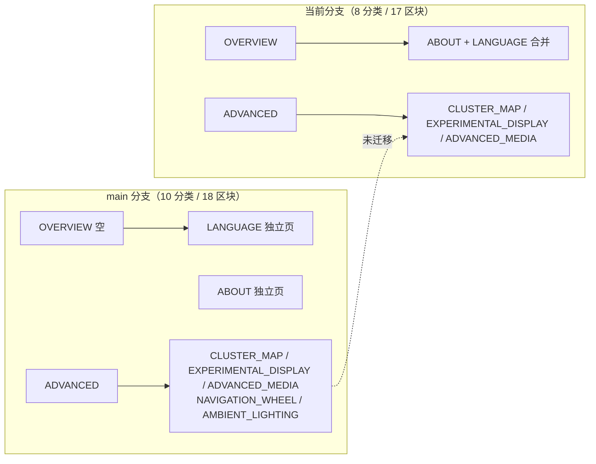
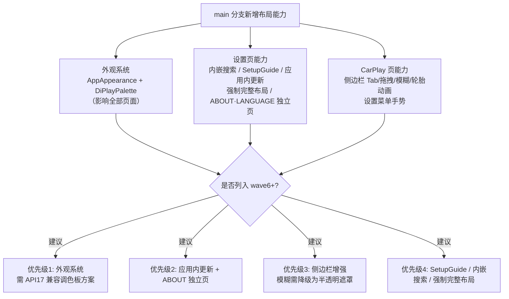

# main 分支与当前分支页面布局差异分析报告

> 作者：TRAE AI
> 分析日期：2026-10-10
> 对比对象：`main` 分支 vs 当前分支 `port/wave5-vehicle`（android-4.2.2 迁移线，基线提交 `4f1ba087`）
> 分析方式：函数级集合 diff + 信息架构枚举对比 + 主题/资源文件对比

---

## 一、结论摘要

两个分支的页面布局**骨架同源**（均为 View 体系 + DiAuto 视觉语言），但差异比预期大，主要集中在四个层面：

| 层面 | 差异程度 | 概述 |
| --- | --- | --- |
| 渲染框架 | ★☆☆☆☆ | 同为 View 体系；仅 main 的 `MainActivity` 用 Compose（当前分支已降级为 View+XML） |
| 设置信息架构 | ★★★★☆ | main 10 分类 vs 当前 8 分类；缺 LANGUAGE/ABOUT 独立页与 2 个 section |
| 视觉主题系统 | ★★★★★ | main 有完整日夜双调色板 + 外观运行时；当前分支固定深色 |
| 功能卡片/交互 | ★★★★☆ | main 多出引导向导、应用内更新、内嵌搜索、侧边栏增强等约 55 个函数 |

一个重要澄清：**main 分支的设置页与 CarPlay 页同样是 View 体系实现**（`android.widget.*` + `ComponentActivity`），Compose 仅用于 `MainActivity` 的 I2C 诊断页和 `ui/theme/` 主题目录。所谓"差异大"主要不是框架差异，而是 **main 分支在迁移基线之后又演进了约 1100 行设置页代码 + 800 行 CarPlay 主机页代码**，其中相当一部分是纯 UI 能力，尚未列入前五波迁移范围。

---

## 二、页面级差异对照表

### 2.1 核心页面体量对比

| 页面文件 | main 行数 | 当前分支行数 | 差值 | 差异性质 |
| --- | --- | --- | --- | --- |
| [DiPlayActivity.kt](file:///Users/chengshengru/Workspace/DiPlay/common/src/main/java/com/shilapi/xcertplay/DiPlayActivity.kt)（设置主页） | 5603 | 4513 | **+1090** | main 多外观系统/搜索/向导/更新 |
| [CarPlayHostActivity.kt](file:///Users/chengshengru/Workspace/DiPlay/common/src/main/java/com/shilapi/xcertplay/CarPlayHostActivity.kt)（CarPlay 主机页） | 5949 | 5158 | **+791** | main 多侧边栏增强/设置菜单手势 |
| [MainActivity.kt](file:///Users/chengshengru/Workspace/DiPlay/common/src/main/java/com/shilapi/xcertplay/MainActivity.kt)（I2C 诊断页） | 142 | 98 | +44 | **框架不同**：main Compose / 当前 View+XML |
| [CarPlayVideoActivity.kt](file:///Users/chengshengru/Workspace/DiPlay/common/src/main/java/com/shilapi/xcertplay/CarPlayVideoActivity.kt)（视频播放页） | 352 | 357 | ≈0 | 基本一致，当前分支多 API17 兼容调用 |

### 2.2 页面级实现方式对照

| 页面 | main 分支实现 | 当前分支实现 | 布局差异要点 |
| --- | --- | --- | --- |
| 设置主页 | View + `ComponentActivity`，实现 `AppAppearanceOwner` 接口 | View + `ComponentActivity`（无外观接口） | main 页面随日夜切换实时重渲染（`checkForAppearanceChange`/`refreshAppearance`）；当前分支固定深色 |
| CarPlay 主机页 | View + `TextureView` + 全屏 | View + `TextureView` + `LegacyFullscreen` 兼容层 | main 用 `WindowInsetsControllerCompat` 处理系统栏；当前分支 API<20 走 `FLAG_FULLSCREEN` 降级 |
| 诊断页 | Compose（`setContent` + Material3 `Scaffold`/`OutlinedTextField`） | View（[activity_main.xml](file:///Users/chengshengru/Workspace/DiPlay/common/src/main/res/layout/activity_main.xml) + `findViewById`） | 当前分支为 API 17 降级实现（Compose 需 API 21+） |
| 视频播放页 | PlayerView + 控制层 | PlayerView + `SeekBar` 控制层（`UiCompat` 适配） | 控制栏视觉细节因 Holo/Material 主题不同而异 |
| 外部 Wi-Fi 页 | （main 对应逻辑内嵌于连接流程） | 独立 [ExternalWifiFragment.kt](file:///Users/chengshengru/Workspace/DiPlay/common/src/main/java/com/shilapi/xcertplay/ui/ExternalWifiFragment.kt) + [fragment_external_wifi.xml](file:///Users/chengshengru/Workspace/DiPlay/common/src/main/res/layout/fragment_external_wifi.xml) | 当前分支新增的独立页面（ScrollView+ListView+ProgressBar） |

---

## 三、设置主页（DiPlayActivity）信息架构差异

### 3.1 分类（SettingsCategory）数量：main 10 个 vs 当前 8 个

```text
main:      OVERVIEW, CONNECTION, DISPLAY, AUDIO, NAVIGATION, VEHICLE,
           LANGUAGE, ABOUT, DIAGNOSTICS, ADVANCED          （LANGUAGE/ABOUT 独立分类页）
当前分支:  OVERVIEW, CONNECTION, DISPLAY, AUDIO, NAVIGATION, VEHICLE,
           DIAGNOSTICS, ADVANCED                            （ABOUT/LANGUAGE 并入 Overview）
```

### 3.2 分区（SettingsSection）映射差异



逐条对比：

| 差异点 | main 分支 | 当前分支 | 影响 |
| --- | --- | --- | --- |
| Overview 内容 | 空（仅状态+分类入口） | ABOUT、LANGUAGE 并入 Overview | 当前分支符合 AGENTS.md 规则，main 是后续演进 |
| LANGUAGE | 独立分类页 | Overview 内 section | 页面层级不同 |
| ABOUT | 独立分类页（含更新检查） | Overview 内 section，**无更新能力** | 见 3.4 |
| `NAVIGATION_WHEEL` | ADVANCED 分类下 section + `navigationWheelControls()` | **无此 section**（方向盘学习以 `WindowKeyLearning` 形式存在于 VEHICLE 相关代码中，布局归属不同） | 布局归类不一致 |
| `AMBIENT_LIGHTING` | ADVANCED 分类下 section + `ambientConfigurationLabel()`/`showAmbientConfiguration()` | **无此 section**；氛围灯 Java 文件已在工作区未跟踪（wave5 正在移植） | 迁移进行中 |

### 3.3 设置页搜索：内嵌搜索 vs 弹窗搜索

| 维度 | main | 当前分支 |
| --- | --- | --- |
| 入口形态 | 页面顶部内嵌 `settingsSearchField(compact)` 输入框 | `settings_search` 按钮 → `AlertDialog` 弹窗 |
| 结果展示 | `settingsSearchResults` 列表区常驻页面流内 | 弹窗 `ListView` 内展示 |
| 键盘控制 | `setSearchKeyboard` 显式控制 | 无 |
| 索引机制 | `searchIndexSink` + `clearSettingsSearchState` | 同样有 `searchIndexSink`（4261/4324/4376 行注入标题），机制同源 |

### 3.4 main 独有、当前分支缺失的设置页能力清单

函数级 diff（`main` 独有 55 个函数）归纳为 6 组：

1. **应用外观系统（最大缺口）**
   `appearanceButton`、`applyWindowAppearance`、`applyFullscreenMode`、`applyPendingAppearanceRender`、`checkForAppearanceChange`、`refreshAppearance`、`rememberLaunchAppearance`、`requestAppearanceRender`、`startAppearanceUpdates`、`usesChineseGlyphAlignment`
   依赖文件：`AppAppearance.kt`（DARK/LIGHT/AUTO 三态 + `resolveAppNight()` 决策链：手动 > 主机归属 > CarPlay 夜间模式 > 定时 > 系统）、`DiPlayPalette.kt`（DARK/LIGHT 双调色板，各 26 个语义色：rail 选中态、overlay 系列、focusRing、systemBar 等）、`AppAppearanceRuntime`（host 归属权防多窗口串扰）。当前分支 **0 个对应文件**。

2. **首次使用引导向导（SetupGuide）**
   `setupGuide`、`setupTitle`、`setupBadges`、`setupCarStep`、`setupConnectionStep`、`setupIphoneStep`、`setupFeaturesStep`、`setupDoneStep`、`openSetupGuide`（main 第 2503 行）、`closeSetupGuide`。当前分支引用计数为 **0**。

3. **应用内更新（About 页）**
   `checkForUpdates`（main 第 2154 行）、`refreshUpdateUi`、`downloadUpdate`、`installApk`、`installUpdate`、`latestRelease`、`userAgent`、`commit`、`badge`、`updateRow`。当前分支引用计数为 **0**（无 UpdateClient 链路）。

4. **横屏强制完整布局**
   `SettingsLayoutPreferences.kt`（`settings_force_full_layout` 偏好 + `isActive()` 横屏判断）+ 6 个语言的 `home_layout_strings.xml`（`settings_force_full_settings` 及 hint）+ `AppearanceLayoutCompatibilityTest.kt`。当前分支均无。

5. **布局微调辅助**
   `homeButton`、`iconButton`、`headerButton`、`focusLabel`、`buttonFocusRing`、`buttonShape`、`layoutCornerRadius`、`textAlignmentCentreY`、`dilinkLabel`、`navigationWheelControls`、`repairBootStart`。

6. **氛围灯配置入口**
   `ambientConfigurationLabel`、`showAmbientConfiguration`（当前分支 wave5 工作区已有 Ambient 系列 Java 文件，UI 入口待接）。

### 3.5 控件工厂（SettingsWidgets）差异

- main 的 `applyLargeSwitchStyle()` 将平台 Switch（约 36×14dp 轨道）放大为 **60×34dp 轨道 + 28dp 圆形拇指**（`InsetDrawable`+`GradientDrawable`+`thumbTintList`），保证车载远距离可读，行高 `minHeight=56dp`。
- 当前分支为 API 17 兼容删除了该实现，改用 `UiCompat.setShowText`/`UiCompat.setThumbTint` 反射式适配，**开关视觉尺寸回退到平台默认**，且 `isOverlay` 分支不再设置 56dp 行高。
- 当前分支 `SettingsTheme.kt` 被改写（-55 行重写）：保留 `CARD`/`OVERLAY` 两种风格枚举，但缺少 main 中与 `DiPlayPalette` 联动的动态日夜色值。
- 当前分支新增 `DisplayQualityPresets.kt`（+47 行，main 无此文件）。

---

## 四、CarPlay 主机页（CarPlayHostActivity）差异

main 独有 34 个函数，归纳为 3 组：

### 4.1 侧边栏（Side Panel）交互增强（最大缺口）

当前分支只有基础骨架 `buildSidePanel()`/`placeSidePanel()`（1563-1611 行）。main 在此之上增加了完整的可交互侧边栏：

| 能力 | main 函数 | 当前分支状态 |
| --- | --- | --- |
| 把手 Tab（pill 造型） | `buildSidePanelTab`、`placeSidePanelTab`、`sidePanelTabPill` | 缺失 |
| 拖拽/保持触摸 | `onSidePanelTabTouch`、`holdSidePanelTabTouch`、`dropHeldSidePanelTabTouch` | 缺失 |
| 触摸转发给 CarPlay | `forwardSidePanelTabTouch`、`handSidePanelTabTouchToCarPlay`、`onSidePanelTouch` | 缺失 |
| 边缘检测与共享 | `sidePanelEdgeAt`、`sidePanelOpenEdge`、`sidePanelCarPlayShare`、`sidePanelScreenRect` | 缺失 |
| 视觉动效 | `animateSidePanelGrip`、`showSidePanelGripHint`、`showSidePanelTabHint` | 缺失 |
| 模糊与轮胎动画 | `startSidePanelBlur`/`endSidePanelBlur`/`finishSidePanelBlur`、`startSidePanelTyres`/`buildSidePanelTyres`/`releaseSidePanelEffects` | 缺失（且 API 17 无 RenderEffect，需另行降级方案） |

### 4.2 设置菜单与手势文案

`leaveSettingsMenu`、`menuSettingsSignature`、`settingsMenuWidth`、`settingsGestureButtonText`、`settingsGestureHintText` —— main 在 CarPlay 页内呼出设置菜单时按签名增量刷新，并有手势说明文案；当前分支为静态组装（`content` 一次性加入 `ScrollView`）。

### 4.3 其他

`logCarBluetoothAudio`（蓝牙音频诊断）、`onAdbNaviMode`（ADB 导航模式切换）、`smallWindowActive`（小窗状态）、`findDescendants`（视图树查找）、`refreshAppAppearance`（外观联动，属 3.4-1 缺口）。

---

## 五、主题与系统栏差异

### 5.1 themes.xml

| 维度 | main | 当前分支 |
| --- | --- | --- |
| 基础主题 | `android:Theme.Material.NoActionBar` | `android:Theme.Holo.NoActionBar`（API 17 基线） |
| 高版本覆盖 | 无需 | 新增 [values-v21/themes.xml](file:///Users/chengshengru/Workspace/DiPlay/common/src/main/res/values-v21/themes.xml) 回补 `Theme.Material` + 状态栏/导航栏色 |
| 强调色 | `colorAccent`：暗色 #A6C8FF / 亮色 #245A9C | 基线无（v21 才恢复） |
| 亮色主题 | `Theme.Xcertplay.Light` 完整定义 | **无**（配合外观系统缺失） |
| Dialog 主题 | `Theme.Xcertplay.Dialog.Dark/Light` 两个 | **无**（弹窗为 Holo 默认样式） |
| 启动画面 | `windowSplashScreenBackground`（API 31 白闪修复） | 无 |

### 5.2 全屏与系统栏

- main：`enableEdgeToEdge`（MainActivity）+ `WindowCompat`/`WindowInsetsControllerCompat`。
- 当前分支：新增 [LegacyFullscreen.kt](file:///Users/chengshengru/Workspace/DiPlay/common/src/main/java/com/shilapi/xcertplay/LegacyFullscreen.kt) —— API<20 用 `FLAG_FULLSCREEN` + `systemUiVisibility`，API≥20 才走 `WindowInsetsControllerCompat`；`DiPlayActivity` 的 `applyFullscreenMode`（main）对应逻辑在当前分支由该兼容类承担。

---

## 六、当前分支独有的布局实现（兼容性新增）

| 项 | 作用 | main 对应物 |
| --- | --- | --- |
| [LegacyFullscreen.kt](file:///Users/chengshengru/Workspace/DiPlay/common/src/main/java/com/shilapi/xcertplay/LegacyFullscreen.kt) | API<20 全屏降级 | WindowInsetsController |
| [ExternalWifiFragment.kt](file:///Users/chengshengru/Workspace/DiPlay/common/src/main/java/com/shilapi/xcertplay/ui/ExternalWifiFragment.kt) + 布局 XML | 外部 Wi-Fi 扫描/连接独立页（设备列表、进度条、手动连接） | 逻辑内嵌于连接流程 |
| `settingsUtilitiesCard`/`settingsUtilityRow` | 设置页实用工具卡片 | main 无对应卡片 |
| `notifyPreviousCrash`/`closeChannel` | 崩溃提示与通道关闭 UI | main 无对应 |
| `DisplayQualityPresets.kt` | 画质预设封装 | main 无此文件 |
| `MainActivity` 的 View+XML 降级 | API 17 可运行 | Compose 实现 |

---

## 七、差异全景与迁移建议



### 迁移要点提示

1. **外观系统是最大结构性差异**：涉及 `AppAppearanceOwner` 接口、`AppAppearanceRuntime` 归属权、全部 chrome 颜色源。API 17 无 `uiModeManager` 完整能力，`resolveAppNight()` 的系统跟随分支需验证 API 17 行为。
2. **侧边栏模糊效果**（`startSidePanelBlur`）依赖高版本 Render 能力，API 17 需降级为半透明纯色遮罩；轮胎动画若用属性动画需验证 `ObjectAnimator` 兼容性。
3. **大开关样式**（`applyLargeSwitchStyle`）删除导致设置行视觉密度与 main 不一致，可用 `UiCompat` 系列反射封装在 API≥16 恢复大部分效果。
4. **信息架构差异需决策**：当前分支 ABOUT/LANGUAGE 并入 Overview 符合 AGENTS.md 现行规则；若迁移 main 的独立分类页，需同步更新 `SettingsLayoutPolicyTest`/`AdaptiveSettingsUiTest`。
5. **氛围灯（AMBIENT_LIGHTING）**：Java 层已在 wave5 工作区就绪（15 个未跟踪 Ambient 文件），剩设置入口卡片与 ADVANCED 分类挂载。

### 附：主要证据位置

- 分类枚举：main `DiPlayActivity.kt` L86-90 vs 当前分支 L69-72
- 区块映射：main `SettingsInformationArchitecture` vs 当前分支同名 object（L74-126）
- 函数集合 diff：设置页 55 个 main 独有函数；主机页 34 个 main 独有函数
- 主题：main `themes.xml`（5 样式）vs 当前分支（2 样式 + v21 覆盖）
